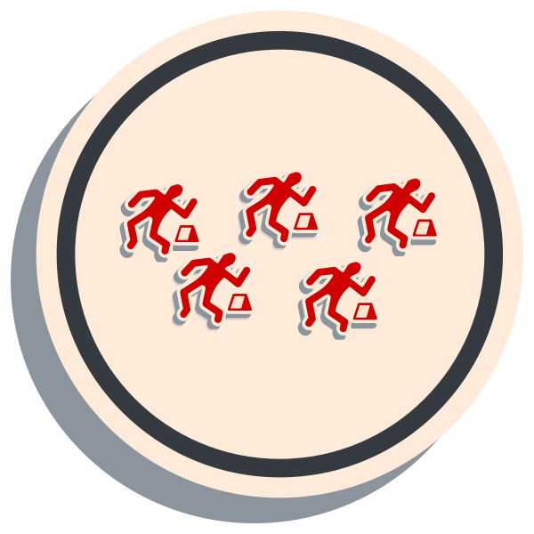
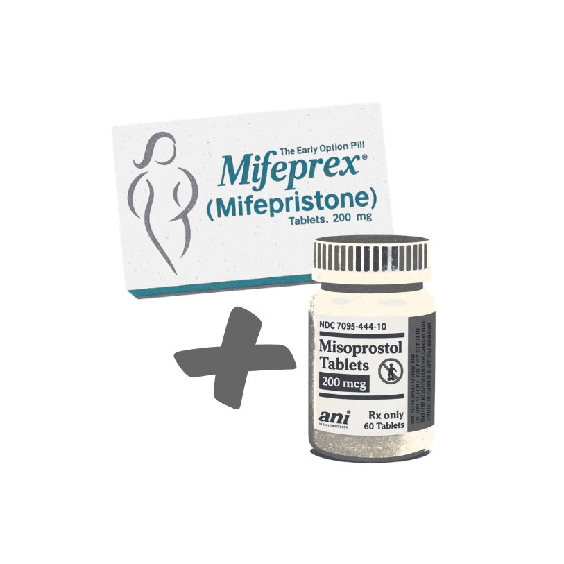
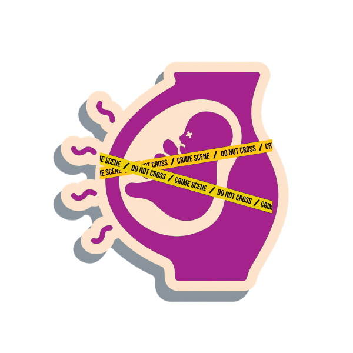

```{r}
#| label: setup
#| include: false
source("_extensions/unl-letterboxd-academic/letterbox-theme.R")
source("R/results.R")
source("R/animations.R")
source("R/tables.R")
fonts <- short_fonts()
r <- results
```

# {#m80 .main auto-animate="true" data-letterbox-fit="false" data-menu-title="Post-Dobbs Landscape"}

::::::: {.stage-frame}
:::::: {.stage}

[Background]{.kicker data-in="0.1" data-anim="nudge"}

::: {#m80-h .headline .after-kicker data-in="0.2" data-rule="0.5" data-max="1660"}
Where Abortion Is a Crime
:::

```{r}
#| output: asis
lw <- sort(list.files("anim/laws", pattern = "^frame[0-9]+[.]png$"))
cat(sprintf('<div class="tl-mapwrap"></div>', lw[1]),
    sprintf('<div class="tl-mapwrap m80-live" data-in="0.75" data-anim="fade" data-anim-holds="%s">',
            readLines("anim/laws/holds.txt", n = 1L)),
    canvas_html("m80-map", "anim/laws", lw, 1140L, 720L, 30L, play = 0.95),
    "</div>", sep = "\n")
```

:::: {#m80-box .tl-period .tl-laws data-in="0.9" data-anim="fade"}
[Post-*Dobbs*]{.tl-tag}

::: {.tl-law data-in="1.2" data-anim="rise"}
[]{.tl-swatch .sw-ban} [`r r$laws$banned`]{.tl-n} [Abortion banned]{.tl-law-t}
:::

::: {.tl-law data-in="0.15" data-step="1" data-anim="rise"}
[]{.tl-swatch .sw-inperson} [`r r$laws$restricted`]{.tl-n} [Telehealth medication abortion restriction]{.tl-law-t}
:::

::: {.tl-law data-in="0.15" data-step="2" data-anim="rise"}
[]{.tl-swatch .sw-mailing} [`r r$laws$explicit_ban`]{.tl-n} [Explicit ban on telemedicine / ban on mailing]{.tl-law-t}
:::
::::

::: {#m80-clip1 .clip data-in="0.05" data-step="3" data-anim="clip" style="left:170px;top:340px;width:520px;--tilt:-4deg;"}
{.no-lightbox fig-alt="Supplied Instagram coverage of Laken Snelling's newborn-death case and reported guilty plea. The slide caption identifies the manslaughter plea rather than repeating the post's cheerleader description."}
:::

::: {#m80-clip2 .clip data-in="0.05" data-step="3" data-anim="clip" style="left:700px;top:370px;width:600px;--tilt:2.5deg;"}
{.no-lightbox fig-alt="Supplied FOX10 headline reporting a woman charged with fetal homicide after an alleged abortion and burial. The slide caption notes that the homicide count was later dismissed."}
:::

::: {#m80-clip3 .clip data-in="0.05" data-step="3" data-anim="clip" style="left:1210px;top:450px;width:580px;--tilt:-2deg;"}
{.no-lightbox fig-alt="Supplied KETV screenshot of a Free and Just billboard stating that women are going to jail under Nebraska's abortion ban. This is public messaging rather than a case-specific legal finding"}
:::

```{=html}
<span class="fragment talk-step" data-talk-step="1"></span>
<span class="fragment talk-step" data-talk-step="2"></span>
<span class="fragment talk-step" data-talk-step="3"></span>
```

::::::
:::::::

::: {.attribution}
[@sobel_etal25]
:::

::: notes
So—when the Supreme Court eliminated the federal constitutional right to abortion in Dobbs, the ability of state governments to regulate and criminalize pregnancy outcomes expanded overnight—and today, 13 states enforce near-total abortion bans, which are shown on this map.

**[CLICK]**

And anti-abortion advocates have also continued to expand the enforcement tools available to criminalize suspected abortion-related activity—adapting to the new reality of abortion care, where most abortions are now medication abortions—by crafting new restrictions on access to telehealth services—

**[CLICK]**

—FDA-approved medications, and even interstate travel. As a result, increasing rates of American women now live in a state where officials are newly empowered to investigate, arrest, and prosecute people for pregnancy-related behaviors and outcomes that were previously at least ostensibly protected under Roe.

**[CLICK]**

And there have been a number of high-profile cases in the last few years that highlight the problem this creates: on paper, many state laws exempt the pregnant woman herself—but in practice, that exemption has not reliably protected women from investigation, arrest, or charges.

**[NEXT SLIDE: Pregnancy Criminalization]**
:::

# {#m60 .main auto-animate="true" data-letterbox-fit="false" data-menu-title="Pregnancy Criminalization"}

::::::: {.stage-frame}
:::::: {.stage}

[Background]{.kicker data-in="0.1" data-anim="nudge"}

::: {#m60-h .headline .after-kicker data-in="0.2" data-rule="0.5" data-max="1660"}
Pregnancy Criminalization
:::

```{r}
#| output: asis
tl <- timeline_anim()
cat(sprintf('<div class="tl-mapwrap" data-anim-holds="%s" data-anim-auto="1.4">', paste(round(tl$holds, 2), collapse = ",")),
    anim_canvas(tl, id = "m60-map", dir = "anim/timeline", play = 0.6, enter = 0.4),
    "</div>", sep = "\n")
```

:::: {#m60-p1 .tl-period data-in="0.75" data-anim="fade"}
[Post-*Roe*]{.tl-tag}
[1973–[2005]{.tl-now data-count="0.82" data-count-from="1973" data-count-dur="2.64" data-count-ease="linear"}]{.tl-years}

::: {.tl-l2 data-in="3.27" data-step="0" data-anim="rise"}
[`r r$timeline$roe_n`]{.tl-n} [cases]{.tl-unit}
:::
::::

:::: {#m60-p2 .tl-period data-in="4.576" data-anim="fade"}
[Post-*Roe*]{.tl-tag}
[2006–[2022]{.tl-now data-count="4.526" data-count-from="2006" data-count-dur="1.92" data-count-ease="linear"}]{.tl-years}

::: {.tl-l2 data-in="6.306" data-anim="rise"}
[`r comma0(r$timeline$pre_n)`]{.tl-n} [cases]{.tl-unit}
:::

::: {.tl-len data-in="6.306" data-anim="rise"}
over these 16.5 years
:::
::::

:::: {#m60-p3 .tl-period data-in="7.613" data-anim="fade"}
[Post-*Dobbs*]{.tl-tag}
[2022–[2025]{.tl-now data-count="7.563" data-count-from="2022" data-count-dur="1.2" data-count-ease="linear"}]{.tl-years}

::: {.tl-l2 data-in="8.673" data-anim="rise"}
[`r r$timeline$post_n`]{.tl-n} [cases]{.tl-unit}
:::

::: {.tl-len data-in="8.673" data-anim="rise"}
the first three years after *Dobbs*
:::
::::

```{=html}
<div id="m60-axis" class="tl-axis" data-in="0.6" data-anim="fade" aria-hidden="true">
<span class="tl-mile tl-m-roe"><em>Roe v. Wade</em></span>
<span class="tl-mile tl-m-dobbs"><em>Dobbs v. Jackson Women’s Health Organization</em></span>
<div class="tl-track"></div>
<div class="tl-run tl-r1" data-line="0.82" data-dur="3.3"></div>
<div class="tl-run tl-r2" data-line="4.526" data-dur="2.4"></div>
<div class="tl-run tl-r3" data-line="7.563" data-dur="1.5"></div>
<div class="tl-tick tl-t-roe"></div>
<div class="tl-tick tl-t-2006"></div>
<div class="tl-tick tl-t-dobbs"></div>
<div class="tl-tick tl-t-2025"></div>
<span class="tl-yr tl-y1973">1973</span>
<span class="tl-yr tl-y2006">2006</span>
<span class="tl-yr tl-y2022">2022</span>
<span class="tl-yr tl-y2025">2025</span>
<span class="tl-sum tl-sum1" data-in="4.576" data-anim="fly1"><span class="tl-sn">`r r$timeline$roe_n`</span> <span class="tl-su">cases</span></span>
<span class="tl-sum tl-sum2" data-in="7.613" data-anim="fly2"><span class="tl-sn">`r comma0(r$timeline$pre_n)`</span> <span class="tl-su">cases</span></span>
</div>
```

```{=html}
<div class="tl-nums" data-period="roe" data-in="4.536" data-step="0" data-anim="out" aria-hidden="true">
<div class="tl-nums-in" data-in="0.75" data-step="0" data-anim="fade">
<span class="tl-num" data-period="roe" data-state="Florida" style="left:950px;top:824px;" data-count="0.82" data-count-dur="2.64" data-count-ease="linear">56</span>
<span class="tl-num" data-period="roe" data-state="Georgia" style="left:904px;top:736px;" data-count="0.82" data-count-dur="2.64" data-count-ease="linear">16</span>
<span class="tl-num" data-period="roe" data-state="Illinois" style="left:787px;top:585px;" data-count="0.82" data-count-dur="2.64" data-count-ease="linear">14</span>
<span class="tl-num" data-period="roe" data-state="Missouri" style="left:734px;top:623px;" data-count="0.82" data-count-dur="2.64" data-count-ease="linear">29</span>
<span class="tl-num" data-period="roe" data-state="Nevada" style="left:330px;top:566px;" data-count="0.82" data-count-dur="2.64" data-count-ease="linear">11</span>
<span class="tl-num" data-period="roe" data-state="New York" style="left:997px;top:490px;" data-count="0.82" data-count-dur="2.64" data-count-ease="linear">11</span>
<span class="tl-num" data-period="roe" data-state="South Carolina" style="left:945px;top:703px;" data-count="0.82" data-count-dur="2.64" data-count-ease="linear">93</span>
<span class="tl-num" data-period="roe" data-state="Tennessee" style="left:843px;top:672px;" data-count="0.82" data-count-dur="2.64" data-count-ease="linear">15</span>
<span class="tl-num" data-period="roe" data-state="Texas" style="left:614px;top:778px;" data-count="0.82" data-count-dur="2.64" data-count-ease="linear">10</span>
<span class="tl-num" data-period="roe" data-state="Wisconsin" style="left:769px;top:485px;" data-count="0.82" data-count-dur="2.64" data-count-ease="linear">15</span>
</div>
</div>
<div class="tl-nums" data-period="pre_dobbs" data-in="7.573" data-step="0" data-anim="out" aria-hidden="true">
<div class="tl-nums-in" data-in="4.576" data-step="0" data-anim="fade">
<svg class="tl-lead" width="1920" height="1080" viewBox="0 0 1920 1080"><line x1="994" y1="576" x2="1033" y2="605"/><line x1="1056" y1="490" x2="1084" y2="507"/><line x1="1053" y1="459" x2="1080" y2="478"/><line x1="1026" y1="547" x2="1050" y2="557"/></svg>
<span class="tl-num" data-period="pre_dobbs" data-state="Alabama" style="left:842px;top:741px;" data-count="4.526" data-count-dur="1.92" data-count-ease="linear">649</span>
<span class="tl-num" data-period="pre_dobbs" data-state="Arizona" style="left:397px;top:691px;" data-count="4.526" data-count-dur="1.92" data-count-ease="linear">3</span>
<span class="tl-num" data-period="pre_dobbs" data-state="Arkansas" style="left:739px;top:702px;" data-count="4.526" data-count-dur="1.92" data-count-ease="linear">11</span>
<span class="tl-num" data-period="pre_dobbs" data-state="California" style="left:271px;top:604px;" data-count="4.526" data-count-dur="1.92" data-count-ease="linear">8</span>
<span class="tl-num" data-period="pre_dobbs" data-state="Colorado" style="left:517px;top:603px;" data-count="4.526" data-count-dur="1.92" data-count-ease="linear">4</span>
<span class="tl-num" data-period="pre_dobbs" data-state="Florida" style="left:950px;top:824px;" data-count="4.526" data-count-dur="1.92" data-count-ease="linear">13</span>
<span class="tl-num" data-period="pre_dobbs" data-state="Georgia" style="left:904px;top:736px;" data-count="4.526" data-count-dur="1.92" data-count-ease="linear">10</span>
<span class="tl-num" data-period="pre_dobbs" data-state="Idaho" style="left:386px;top:482px;" data-count="4.526" data-count-dur="1.92" data-count-ease="linear">8</span>
<span class="tl-num" data-period="pre_dobbs" data-state="Illinois" style="left:787px;top:585px;" data-count="4.526" data-count-dur="1.92" data-count-ease="linear">6</span>
<span class="tl-num" data-period="pre_dobbs" data-state="Indiana" style="left:835px;top:583px;" data-count="4.526" data-count-dur="1.92" data-count-ease="linear">13</span>
<span class="tl-num" data-period="pre_dobbs" data-state="Iowa" style="left:715px;top:544px;" data-count="4.526" data-count-dur="1.92" data-count-ease="linear">1</span>
<span class="tl-num" data-period="pre_dobbs" data-state="Kansas" style="left:635px;top:621px;" data-count="4.526" data-count-dur="1.92" data-count-ease="linear">1</span>
<span class="tl-num" data-period="pre_dobbs" data-state="Kentucky" style="left:858px;top:633px;" data-count="4.526" data-count-dur="1.92" data-count-ease="linear">12</span>
<span class="tl-num" data-period="pre_dobbs" data-state="Louisiana" style="left:742px;top:784px;" data-count="4.526" data-count-dur="1.92" data-count-ease="linear">8</span>
<span class="tl-num" data-period="pre_dobbs" data-state="Maine" style="left:1079px;top:416px;" data-count="4.526" data-count-dur="1.92" data-count-ease="linear">1</span>
<span class="tl-num" data-period="pre_dobbs" data-state="Maryland" style="left:1033px;top:605px;" data-count="4.526" data-count-dur="1.92" data-count-ease="linear">3</span>
<span class="tl-num" data-period="pre_dobbs" data-state="Massachusetts" style="left:1084px;top:507px;" data-count="4.526" data-count-dur="1.92" data-count-ease="linear">7</span>
<span class="tl-num" data-period="pre_dobbs" data-state="Michigan" style="left:853px;top:506px;" data-count="4.526" data-count-dur="1.92" data-count-ease="linear">4</span>
<span class="tl-num" data-period="pre_dobbs" data-state="Minnesota" style="left:701px;top:458px;" data-count="4.526" data-count-dur="1.92" data-count-ease="linear">3</span>
<span class="tl-num" data-period="pre_dobbs" data-state="Mississippi" style="left:790px;top:745px;" data-count="4.526" data-count-dur="1.92" data-count-ease="linear">36</span>
<span class="tl-num" data-period="pre_dobbs" data-state="Missouri" style="left:734px;top:623px;" data-count="4.526" data-count-dur="1.92" data-count-ease="linear">10</span>
<span class="tl-num" data-period="pre_dobbs" data-state="Montana" style="left:474px;top:422px;" data-count="4.526" data-count-dur="1.92" data-count-ease="linear">4</span>
<span class="tl-num" data-period="pre_dobbs" data-state="Nebraska" style="left:614px;top:555px;" data-count="4.526" data-count-dur="1.92" data-count-ease="linear">7</span>
<span class="tl-num" data-period="pre_dobbs" data-state="Nevada" style="left:330px;top:566px;" data-count="4.526" data-count-dur="1.92" data-count-ease="linear">2</span>
<span class="tl-num" data-period="pre_dobbs" data-state="New Hampshire" style="left:1080px;top:478px;" data-count="4.526" data-count-dur="1.92" data-count-ease="linear">2</span>
<span class="tl-num" data-period="pre_dobbs" data-state="New Jersey" style="left:1050px;top:557px;" data-count="4.526" data-count-dur="1.92" data-count-ease="linear">1</span>
<span class="tl-num" data-period="pre_dobbs" data-state="New Mexico" style="left:496px;top:702px;" data-count="4.526" data-count-dur="1.92" data-count-ease="linear">1</span>
<span class="tl-num" data-period="pre_dobbs" data-state="New York" style="left:997px;top:490px;" data-count="4.526" data-count-dur="1.92" data-count-ease="linear">12</span>
<span class="tl-num" data-period="pre_dobbs" data-state="North Carolina" style="left:965px;top:662px;" data-count="4.526" data-count-dur="1.92" data-count-ease="linear">4</span>
<span class="tl-num" data-period="pre_dobbs" data-state="North Dakota" style="left:609px;top:426px;" data-count="4.526" data-count-dur="1.92" data-count-ease="linear">9</span>
<span class="tl-num" data-period="pre_dobbs" data-state="Ohio" style="left:891px;top:567px;" data-count="4.526" data-count-dur="1.92" data-count-ease="linear">31</span>
<span class="tl-num" data-period="pre_dobbs" data-state="Oklahoma" style="left:649px;top:687px;" data-count="4.526" data-count-dur="1.92" data-count-ease="linear">113</span>
<span class="tl-num" data-period="pre_dobbs" data-state="Oregon" style="left:296px;top:454px;" data-count="4.526" data-count-dur="1.92" data-count-ease="linear">1</span>
<span class="tl-num" data-period="pre_dobbs" data-state="Pennsylvania" style="left:971px;top:540px;" data-count="4.526" data-count-dur="1.92" data-count-ease="linear">17</span>
<span class="tl-num" data-period="pre_dobbs" data-state="South Carolina" style="left:945px;top:703px;" data-count="4.526" data-count-dur="1.92" data-count-ease="linear">180</span>
<span class="tl-num" data-period="pre_dobbs" data-state="South Dakota" style="left:610px;top:491px;" data-count="4.526" data-count-dur="1.92" data-count-ease="linear">8</span>
<span class="tl-num" data-period="pre_dobbs" data-state="Tennessee" style="left:843px;top:672px;" data-count="4.526" data-count-dur="1.92" data-count-ease="linear">131</span>
<span class="tl-num" data-period="pre_dobbs" data-state="Texas" style="left:614px;top:778px;" data-count="4.526" data-count-dur="1.92" data-count-ease="linear">23</span>
<span class="tl-num" data-period="pre_dobbs" data-state="Utah" style="left:415px;top:583px;" data-count="4.526" data-count-dur="1.92" data-count-ease="linear">6</span>
<span class="tl-num" data-period="pre_dobbs" data-state="Virginia" style="left:967px;top:617px;" data-count="4.526" data-count-dur="1.92" data-count-ease="linear">7</span>
<span class="tl-num" data-period="pre_dobbs" data-state="Washington" style="left:317px;top:381px;" data-count="4.526" data-count-dur="1.92" data-count-ease="linear">3</span>
<span class="tl-num" data-period="pre_dobbs" data-state="West Virginia" style="left:933px;top:598px;" data-count="4.526" data-count-dur="1.92" data-count-ease="linear">3</span>
<span class="tl-num" data-period="pre_dobbs" data-state="Wisconsin" style="left:769px;top:485px;" data-count="4.526" data-count-dur="1.92" data-count-ease="linear">6</span>
<span class="tl-num" data-period="pre_dobbs" data-state="Wyoming" style="left:494px;top:512px;" data-count="4.526" data-count-dur="1.92" data-count-ease="linear">12</span>
</div>
</div>
<div class="tl-nums" data-period="post_dobbs" aria-hidden="true">
<div class="tl-nums-in" data-in="7.613" data-step="0" data-anim="fade">
<svg class="tl-lead" width="1920" height="1080" viewBox="0 0 1920 1080"><line x1="994" y1="576" x2="1033" y2="605"/><line x1="1056" y1="490" x2="1084" y2="507"/><line x1="1053" y1="459" x2="1080" y2="478"/><line x1="1026" y1="547" x2="1050" y2="557"/></svg>
<span class="tl-num" data-period="post_dobbs" data-state="Alabama" style="left:842px;top:741px;" data-count="7.563" data-count-dur="1.2" data-count-ease="linear">204</span>
<span class="tl-tot" data-period="post_dobbs" data-state="Alabama" style="left:842px;top:761px;"><span data-count="7.563" data-count-from="649" data-count-dur="1.2" data-count-ease="linear">853</span></span>
<span class="tl-num" data-period="post_dobbs" data-state="Arizona" style="left:397px;top:691px;" data-count="7.563" data-count-dur="1.2" data-count-ease="linear">1</span>
<span class="tl-tot" data-period="post_dobbs" data-state="Arizona" style="left:397px;top:711px;"><span data-count="7.563" data-count-from="3" data-count-dur="1.2" data-count-ease="linear">4</span></span>
<span class="tl-num" data-period="post_dobbs" data-state="Arkansas" style="left:739px;top:702px;" data-count="7.563" data-count-dur="1.2" data-count-ease="linear">3</span>
<span class="tl-tot" data-period="post_dobbs" data-state="Arkansas" style="left:739px;top:722px;"><span data-count="7.563" data-count-from="11" data-count-dur="1.2" data-count-ease="linear">14</span></span>
<span class="tl-num" data-period="post_dobbs" data-state="California" style="left:271px;top:604px;" data-count="7.563" data-count-dur="1.2" data-count-ease="linear">2</span>
<span class="tl-tot" data-period="post_dobbs" data-state="California" style="left:271px;top:624px;"><span data-count="7.563" data-count-from="8" data-count-dur="1.2" data-count-ease="linear">10</span></span>
<span class="tl-tot tl-tot-only" data-period="post_dobbs" data-state="Colorado" style="left:517px;top:603px;"><span>4</span></span>
<span class="tl-num" data-period="post_dobbs" data-state="Florida" style="left:950px;top:824px;" data-count="7.563" data-count-dur="1.2" data-count-ease="linear">3</span>
<span class="tl-tot" data-period="post_dobbs" data-state="Florida" style="left:950px;top:844px;"><span data-count="7.563" data-count-from="13" data-count-dur="1.2" data-count-ease="linear">16</span></span>
<span class="tl-tot tl-tot-only" data-period="post_dobbs" data-state="Georgia" style="left:904px;top:736px;"><span>10</span></span>
<span class="tl-num" data-period="post_dobbs" data-state="Idaho" style="left:386px;top:482px;" data-count="7.563" data-count-dur="1.2" data-count-ease="linear">7</span>
<span class="tl-tot" data-period="post_dobbs" data-state="Idaho" style="left:386px;top:502px;"><span data-count="7.563" data-count-from="8" data-count-dur="1.2" data-count-ease="linear">15</span></span>
<span class="tl-tot tl-tot-only" data-period="post_dobbs" data-state="Illinois" style="left:787px;top:585px;"><span>6</span></span>
<span class="tl-tot tl-tot-only" data-period="post_dobbs" data-state="Indiana" style="left:835px;top:583px;"><span>13</span></span>
<span class="tl-tot tl-tot-only" data-period="post_dobbs" data-state="Iowa" style="left:715px;top:544px;"><span>1</span></span>
<span class="tl-tot tl-tot-only" data-period="post_dobbs" data-state="Kansas" style="left:635px;top:621px;"><span>1</span></span>
<span class="tl-num" data-period="post_dobbs" data-state="Kentucky" style="left:858px;top:633px;" data-count="7.563" data-count-dur="1.2" data-count-ease="linear">3</span>
<span class="tl-tot" data-period="post_dobbs" data-state="Kentucky" style="left:858px;top:653px;"><span data-count="7.563" data-count-from="12" data-count-dur="1.2" data-count-ease="linear">15</span></span>
<span class="tl-tot tl-tot-only" data-period="post_dobbs" data-state="Louisiana" style="left:742px;top:784px;"><span>8</span></span>
<span class="tl-tot tl-tot-only" data-period="post_dobbs" data-state="Maine" style="left:1079px;top:416px;"><span>1</span></span>
<span class="tl-tot tl-tot-only" data-period="post_dobbs" data-state="Maryland" style="left:1033px;top:605px;"><span>3</span></span>
<span class="tl-tot tl-tot-only" data-period="post_dobbs" data-state="Massachusetts" style="left:1084px;top:507px;"><span>7</span></span>
<span class="tl-num" data-period="post_dobbs" data-state="Michigan" style="left:853px;top:506px;" data-count="7.563" data-count-dur="1.2" data-count-ease="linear">1</span>
<span class="tl-tot" data-period="post_dobbs" data-state="Michigan" style="left:853px;top:526px;"><span data-count="7.563" data-count-from="4" data-count-dur="1.2" data-count-ease="linear">5</span></span>
<span class="tl-tot tl-tot-only" data-period="post_dobbs" data-state="Minnesota" style="left:701px;top:458px;"><span>3</span></span>
<span class="tl-num" data-period="post_dobbs" data-state="Mississippi" style="left:790px;top:745px;" data-count="7.563" data-count-dur="1.2" data-count-ease="linear">27</span>
<span class="tl-tot" data-period="post_dobbs" data-state="Mississippi" style="left:790px;top:765px;"><span data-count="7.563" data-count-from="36" data-count-dur="1.2" data-count-ease="linear">63</span></span>
<span class="tl-num" data-period="post_dobbs" data-state="Missouri" style="left:734px;top:623px;" data-count="7.563" data-count-dur="1.2" data-count-ease="linear">7</span>
<span class="tl-tot" data-period="post_dobbs" data-state="Missouri" style="left:734px;top:643px;"><span data-count="7.563" data-count-from="10" data-count-dur="1.2" data-count-ease="linear">17</span></span>
<span class="tl-tot tl-tot-only" data-period="post_dobbs" data-state="Montana" style="left:474px;top:422px;"><span>4</span></span>
<span class="tl-num" data-period="post_dobbs" data-state="Nebraska" style="left:614px;top:555px;" data-count="7.563" data-count-dur="1.2" data-count-ease="linear">1</span>
<span class="tl-tot" data-period="post_dobbs" data-state="Nebraska" style="left:614px;top:575px;"><span data-count="7.563" data-count-from="7" data-count-dur="1.2" data-count-ease="linear">8</span></span>
<span class="tl-tot tl-tot-only" data-period="post_dobbs" data-state="Nevada" style="left:330px;top:566px;"><span>2</span></span>
<span class="tl-tot tl-tot-only" data-period="post_dobbs" data-state="New Hampshire" style="left:1080px;top:478px;"><span>2</span></span>
<span class="tl-tot tl-tot-only" data-period="post_dobbs" data-state="New Jersey" style="left:1050px;top:557px;"><span>1</span></span>
<span class="tl-num" data-period="post_dobbs" data-state="New Mexico" style="left:496px;top:702px;" data-count="7.563" data-count-dur="1.2" data-count-ease="linear">1</span>
<span class="tl-tot" data-period="post_dobbs" data-state="New Mexico" style="left:496px;top:722px;"><span data-count="7.563" data-count-from="1" data-count-dur="1.2" data-count-ease="linear">2</span></span>
<span class="tl-tot tl-tot-only" data-period="post_dobbs" data-state="New York" style="left:997px;top:490px;"><span>12</span></span>
<span class="tl-num" data-period="post_dobbs" data-state="North Carolina" style="left:965px;top:662px;" data-count="7.563" data-count-dur="1.2" data-count-ease="linear">1</span>
<span class="tl-tot" data-period="post_dobbs" data-state="North Carolina" style="left:965px;top:682px;"><span data-count="7.563" data-count-from="4" data-count-dur="1.2" data-count-ease="linear">5</span></span>
<span class="tl-tot tl-tot-only" data-period="post_dobbs" data-state="North Dakota" style="left:609px;top:426px;"><span>9</span></span>
<span class="tl-num" data-period="post_dobbs" data-state="Ohio" style="left:891px;top:567px;" data-count="7.563" data-count-dur="1.2" data-count-ease="linear">12</span>
<span class="tl-tot" data-period="post_dobbs" data-state="Ohio" style="left:891px;top:587px;"><span data-count="7.563" data-count-from="31" data-count-dur="1.2" data-count-ease="linear">43</span></span>
<span class="tl-num" data-period="post_dobbs" data-state="Oklahoma" style="left:649px;top:687px;" data-count="7.563" data-count-dur="1.2" data-count-ease="linear">222</span>
<span class="tl-tot" data-period="post_dobbs" data-state="Oklahoma" style="left:649px;top:707px;"><span data-count="7.563" data-count-from="113" data-count-dur="1.2" data-count-ease="linear">335</span></span>
<span class="tl-tot tl-tot-only" data-period="post_dobbs" data-state="Oregon" style="left:296px;top:454px;"><span>1</span></span>
<span class="tl-num" data-period="post_dobbs" data-state="Pennsylvania" style="left:971px;top:540px;" data-count="7.563" data-count-dur="1.2" data-count-ease="linear">4</span>
<span class="tl-tot" data-period="post_dobbs" data-state="Pennsylvania" style="left:971px;top:560px;"><span data-count="7.563" data-count-from="17" data-count-dur="1.2" data-count-ease="linear">21</span></span>
<span class="tl-num" data-period="post_dobbs" data-state="South Carolina" style="left:945px;top:703px;" data-count="7.563" data-count-dur="1.2" data-count-ease="linear">381</span>
<span class="tl-tot" data-period="post_dobbs" data-state="South Carolina" style="left:945px;top:723px;"><span data-count="7.563" data-count-from="180" data-count-dur="1.2" data-count-ease="linear">561</span></span>
<span class="tl-num" data-period="post_dobbs" data-state="South Dakota" style="left:610px;top:491px;" data-count="7.563" data-count-dur="1.2" data-count-ease="linear">1</span>
<span class="tl-tot" data-period="post_dobbs" data-state="South Dakota" style="left:610px;top:511px;"><span data-count="7.563" data-count-from="8" data-count-dur="1.2" data-count-ease="linear">9</span></span>
<span class="tl-tot tl-tot-only" data-period="post_dobbs" data-state="Tennessee" style="left:843px;top:672px;"><span>131</span></span>
<span class="tl-num" data-period="post_dobbs" data-state="Texas" style="left:614px;top:778px;" data-count="7.563" data-count-dur="1.2" data-count-ease="linear">14</span>
<span class="tl-tot" data-period="post_dobbs" data-state="Texas" style="left:614px;top:798px;"><span data-count="7.563" data-count-from="23" data-count-dur="1.2" data-count-ease="linear">37</span></span>
<span class="tl-num" data-period="post_dobbs" data-state="Utah" style="left:415px;top:583px;" data-count="7.563" data-count-dur="1.2" data-count-ease="linear">3</span>
<span class="tl-tot" data-period="post_dobbs" data-state="Utah" style="left:415px;top:603px;"><span data-count="7.563" data-count-from="6" data-count-dur="1.2" data-count-ease="linear">9</span></span>
<span class="tl-tot tl-tot-only" data-period="post_dobbs" data-state="Virginia" style="left:967px;top:617px;"><span>7</span></span>
<span class="tl-num" data-period="post_dobbs" data-state="Washington" style="left:317px;top:381px;" data-count="7.563" data-count-dur="1.2" data-count-ease="linear">2</span>
<span class="tl-tot" data-period="post_dobbs" data-state="Washington" style="left:317px;top:401px;"><span data-count="7.563" data-count-from="3" data-count-dur="1.2" data-count-ease="linear">5</span></span>
<span class="tl-tot tl-tot-only" data-period="post_dobbs" data-state="West Virginia" style="left:933px;top:598px;"><span>3</span></span>
<span class="tl-num" data-period="post_dobbs" data-state="Wisconsin" style="left:769px;top:485px;" data-count="7.563" data-count-dur="1.2" data-count-ease="linear">1</span>
<span class="tl-tot" data-period="post_dobbs" data-state="Wisconsin" style="left:769px;top:505px;"><span data-count="7.563" data-count-from="6" data-count-dur="1.2" data-count-ease="linear">7</span></span>
<span class="tl-num" data-period="post_dobbs" data-state="Wyoming" style="left:494px;top:512px;" data-count="7.563" data-count-dur="1.2" data-count-ease="linear">1</span>
<span class="tl-tot" data-period="post_dobbs" data-state="Wyoming" style="left:494px;top:532px;"><span data-count="7.563" data-count-from="12" data-count-dur="1.2" data-count-ease="linear">13</span></span>
</div>
</div>
```

::::::
:::::::

::: {.attribution}
[@paltrow_flavin13; @pregnancyjustice23; @pregnancyjustice26b; @resnick26]
:::

::: notes
"Ostensibly" of course being the key word there, because the reality is a bit more complicated.

Even under Roe, prosecutors found ways to criminalize women for their own pregnancy outcomes without directly challenging it—using a range of laws, like child abuse and even feticide.

As you can see on this map of cases that have been documented over time: at least 413 pregnant women were arrested, detained, or subjected to forced medical treatment between 1973 and 2005; another 1,396 criminal cases followed from 2006 until the eve of Dobbs; and at least 902 more were brought in just the first three years after Dobbs.

So the modern infrastructure for criminalizing pregnancy was largely built during a time when directly punishing women for abortion was not permitted.

And since Dobbs, the pace appears to have picked up—and the line between criminalizing abortion and criminalizing pregnancy more generally has become increasingly blurred, in part because of the intractable politics surrounding abortion, but also, more fundamentally, because of the nature of pregnancy itself.

**[NEXT SLIDE: Pregnancy-Loss Narratives]**
:::

# {#m02 .main auto-animate="true" data-letterbox-fit="false" data-menu-title="Pregnancy-Loss Narratives"}

::::::: {.stage-frame}
:::::: {.stage}

[Background]{.kicker data-in="0.1" data-anim="nudge"}

::: {#m02-h .headline .after-kicker data-in="0.2" data-rule="0.5" data-max="1660"}
Pregnancy-Loss Narratives
:::

<div class="nd-canvas dg" style="position:absolute;left:216px;top:270px;width:1240px;height:530px;margin:0;transform:scale(1.2);transform-origin:0 0;" data-source="D03">
<div id="D03-coherent-person-context" style="position:absolute;left:485.0000px;top:165.0000px;width:184.2477px;height:355.0000px;">
<div id="D03-pregnant-person" class="nd-object" style="left:0.0000px;top:0.0000px;width:184.2477px;height:355.0000px;" data-in="0.4" data-anim="rise"></div>
<div id="D03-context-layer" class="nd-state" data-in="0.3" data-step="4" data-anim="fade">
<div id="D03-context-01" class="nd-object" style="left:46.9689px;top:216.8328px;width:42.8804px;height:37.3469px;"></div>
<div id="D03-context-02" class="nd-object" style="left:60.3228px;top:126.1405px;width:48.4062px;height:45.6335px;"></div>
<div id="D03-context-03" class="nd-object" style="left:65.3881px;top:165.7321px;width:38.7361px;height:44.7127px;"></div>
<div id="D03-context-04" class="nd-object" style="left:81.9654px;top:214.9914px;width:49.3271px;height:39.1883px;"></div>
<div id="D03-context-05" class="nd-object" style="left:-1.3814px;top:157.4455px;width:42.4199px;height:53.4597px;"></div>
<div id="D03-context-06" class="nd-object" style="left:132.6181px;top:214.9914px;width:51.1691px;height:50.6975px;"></div>
<div id="D03-context-07" class="nd-object" style="left:5.0653px;top:204.8632px;width:29.5265px;height:43.7920px;"></div>
<div id="D03-context-08" class="nd-object" style="left:28.5497px;top:165.7321px;width:51.6295px;height:49.3164px;"></div>
<div id="D03-context-09" class="nd-object" style="left:117.8828px;top:122.9180px;width:35.9732px;height:48.8560px;"></div>
<div id="D03-context-10" class="nd-object" style="left:96.2402px;top:154.6832px;width:79.2583px;height:61.2859px;"></div>
</div>
</div>
<div id="D03-ultrasound" class="nd-object" style="left:20.0000px;top:325.4574px;width:240.0000px;height:149.0852px;top:275.5px;" data-in="0.4" data-anim="left"></div>

<div id="D03-cloud-state3" class="nd-state" data-in="0.3" data-step="4" data-anim="grow">
<div id="D03-thought-cloud-state3" class="nd-object" style="left:250.0000px;top:5.0000px;width:275.0000px;height:218.8858px;"></div>
</div>

<div id="D03-thought-state3" class="nd-state" data-in="0.3" data-step="4" data-anim="fade">
<div id="D03-thought-unknown" class="nd-object" style="left:317.6039px;top:44.9755px;width:110.9369px;height:94.0141px;"></div>
</div>

<div id="D03-birth-state3" class="nd-state" data-in="0.4" data-anim="rise">
<div id="D03-live-birth-s3" class="nd-object" style="left:1020.0000px;top:225.1877px;width:190.0000px;height:154.6245px;left:895px;top:293px;width:140px;height:113.9px;"></div>
<div id="D03-live-birth-caption-s3" class="nd-caption" style="left:995.0000px;top:380.0000px;width:240.0000px;height:40.0000px;font-family:Komika Axis,sans-serif;font-size:25px;line-height:1.2;left:1080px;top:320px;width:230px;height:60px;font-size:25px;display:flex;align-items:center;justify-content:flex-start;text-align:left;">Live birth</div>
</div>
<div id="D03-voluntary-path" class="nd-state" data-in="0.3" data-step="1" data-anim="rise">

<div id="D03-voluntary-caption" class="nd-caption" style="left:1038.0000px;top:60.0000px;width:200.0000px;height:75.0000px;font-family:Komika Axis,sans-serif;font-size:25px;line-height:1.2;left:1080px;top:170px;width:230px;height:60px;font-size:25px;display:flex;align-items:center;justify-content:flex-start;text-align:left;">Abortion</div>
<div id="D03-voluntary-fetus" class="nd-object" style="left:887px;top:119px;width:163px;height:163px;"></div></div>
<div id="D03-involuntary-path" class="nd-state" data-in="0.3" data-step="2" data-anim="rise">

<div id="D03-involuntary-caption" class="nd-caption" style="left:980.0000px;top:445.0000px;width:250.0000px;height:75.0000px;font-family:Komika Axis,sans-serif;font-size:23px;line-height:1.2;left:1080px;top:470px;width:230px;height:60px;font-size:25px;display:flex;align-items:center;justify-content:flex-start;text-align:left;">Miscarriage or stillbirth</div>
<div id="D03-involuntary-fetus" class="nd-object" style="left:899.145288326px;top:407.540928270px;width:164.886919831px;height:164.886919831px;"></div></div>

<div class="nd-state arrow-wrap" data-in="0.4" data-anim="fade">



</div>

<div class="nd-state arrow-wrap" data-in="0.4" data-anim="fade">



</div>

<div id="D03-voluntary-arrow" class="nd-state">

<div class="nd-state arrow-wrap" data-in="0.3" data-step="1" data-anim="fade">



</div>

</div>
<div id="D03-involuntary-arrow" class="nd-state">

<div class="nd-state arrow-wrap" data-in="0.3" data-step="2" data-anim="fade">



</div>

</div>
</div>

```{=html}
<div id="m02-veil" data-in="0.05" data-step="3" data-anim="fade" style="position:absolute;left:1270px;top:608px;width:540px;height:162px;z-index:5;background:color-mix(in srgb, var(--paper) 80%, transparent);"></div>
<div id="m02-fade" data-in="0.05" data-step="5" data-anim="fade" style="position:absolute;left:0;top:200px;width:1920px;height:880px;z-index:40;background:var(--paper);background:color-mix(in srgb, var(--paper) 85%, transparent);clip-path:polygon(0 36px, 1300px 36px, 1300px 0, 100% 0, 100% 100%, 0 100%);"></div>
<div id="m02-tech" class="clip clip-cutout" data-in="0.05" data-step="5" data-anim="clip" style="left:436px;top:262px;width:448px;height:650px;overflow:hidden;--tilt:0deg;z-index:41;"></div>
<div id="m02-pills" class="clip clip-cutout" data-in="0.05" data-step="3" data-anim="clip" style="left:1345px;top:238px;width:420px;height:147px;overflow:hidden;--tilt:-3deg;"></div>
<div id="m02-pcg" data-in="0.75" data-step="6" data-anim="pop" data-id="fourth-amendment-bridge" data-aa-measure="stage" role="group" aria-label="Fourth Amendment"></div>
<p id="m02-pcg-label" data-in="0.85" data-step="6" data-anim="fade">Fourth Amendment</p>
```

<div id="m02-pcg-arrow" class="arrow-wrap" data-in="0.6" data-step="6" data-anim="fade" aria-hidden="true">



</div>

```{=html}
<span class="fragment talk-step" data-talk-step="1"></span>
<span class="fragment talk-step" data-talk-step="2"></span>
<span class="fragment talk-step" data-talk-step="3"></span>
<span class="fragment talk-step" data-talk-step="4"></span>
<span class="fragment talk-step" data-talk-step="5"></span>
<span class="fragment talk-step" data-talk-step="6"></span>
```

::::::
:::::::

::: {.attribution}
[@donley_lens22; @freidenfelds20; @quenby_etal21; @lens25]
:::

::: notes
For a variety of reasons, most people seem to have a very limited understanding of how erratic and unpredictable pregnancy actually is.

Instead, popular beliefs about pregnancy tend to conform to what some scholars have referred to as the single-path narrative of pregnancy—the idea that all pregnancies will result in the birth of a healthy, live baby—

**[CLICK]**

—unless interrupted by the mother making the "choice" to have an abortion.

**[CLICK]**

However, the reality is that up to one in four pregnancies end in miscarriage.

**[CLICK]**

And because medication abortion has further limited the outward, objective differences between voluntary and involuntary pregnancy loss—

**[CLICK]**

—often the only real distinction between an abortion and a miscarriage is the pregnant person's state of mind at the time, which makes it particularly difficult to identify which pregnancies are potential criminal activity.

**[CLICK]**

And while that state of mind was historically difficult to establish, modern communication technology has changed how and when these cases are likely to be investigated and pursued.

**[CLICK]**

And that puts a lot of weight on the Fourth Amendment's procedural protections—like the requirement that police show probable cause before a warrant can issue—now that the substantive right to abortion is no longer federally protected.

**[NEXT SLIDE: Probable cause and timing]**
:::

# {#m03 .main auto-animate="true" data-letterbox-fit="false" data-menu-title="Probable cause and timing"}

::::::: {.stage-frame}
:::::: {.stage}

[Background]{.kicker data-in="0.1" data-anim="nudge"}

::: {#m03-h .headline .after-kicker data-in="0.2" data-rule="0.5" data-max="1660"}
[Probable cause]{data-id="pc-term" data-aa-measure="stage"} and timing
:::

<div class="nd-canvas dg" style="position:absolute;left:296px;top:280px;width:1240px;height:530px;margin:0;transform:scale(1.05);transform-origin:0 0;" data-source="D02">
<div id="D02-threshold" class="nd-object" style="left:455.0000px;top:250.0133px;width:355.0000px;height:257.9735px;" data-in="0.4" data-anim="fade" data-id="pc-threshold-bridge" data-aa-measure="stage"></div>
<div id="D02-timing" class="nd-object" style="left:545.0000px;top:0.0000px;width:190.0000px;height:190.0000px;left:580px;top:56px;width:120px;height:120px;" data-in="0.4" data-anim="fade" data-id="pc-timing-bridge" data-aa-measure="stage"></div>
<div id="D02-timing-caption" class="nd-caption" style="left:568.0000px;top:16.0000px;width:144.0000px;height:40.0000px;font-family:Komika Axis,sans-serif;font-size:23px;line-height:1.2;left:500px;top:-22px;width:280px;height:44px;" data-in="0.4" data-anim="fade">Timing</div>
<div id="D02-search" class="nd-object" style="left:990.0000px;top:45.0000px;width:210.0000px;height:210.0000px;top:140px;" data-in="0.4" data-anim="pop"></div>

<div id="D02-seizure" class="nd-object" style="left:990.0000px;top:305.4891px;width:210.0000px;height:209.0217px;top:410px;" data-in="0.4" data-anim="pop"></div>

<div id="D02-earlier-state" class="nd-state" data-in="0.25" data-step="1" data-anim="travel" data-fx="950" data-fy="-100" data-fs="0.88" data-vx="520" data-vy="230" data-vs="0.5">
<div id="D02-incriminating-cue" class="nd-object" style="left:25.0000px;top:225.0000px;width:240.0000px;height:240.0000px;"></div>
</div>
<div id="D02-later-review-state" class="nd-state" data-in="0.2" data-step="2" data-anim="fade" data-dur="0.05">
<div id="D02-pixelated-cue" class="nd-object" style="left:25.0000px;top:225.0000px;width:240.0000px;height:240.0000px;"></div>
</div>

<div id="D02-ignore-instruction" class="nd-state" data-in="0.2" data-step="2" data-anim="fade">
<div id="D02-instruction-caption" class="nd-caption" style="left:0.0000px;top:0.0000px;width:390.0000px;height:110.0000px;font-family:Komika Axis,sans-serif;font-size:27px;line-height:1.2;left:-30px;top:44px;width:440px;height:88px;line-height:1.15;"><span>Instructed to<br><span style="color:#d00000;">ignore</span> outcome</span></div>


</div>

<div class="nd-state arrow-wrap" data-in="0.25" data-step="1" data-anim="fade" data-after="1.5">



</div>

<div class="nd-state arrow-wrap" data-in="0.4" data-anim="fade">



</div>

<div class="nd-state arrow-wrap" data-in="0.4" data-anim="fade">



</div>

<div class="nd-state arrow-wrap" data-in="0.4" data-anim="fade">



</div>

<div id="D02-search-seizure-caption" class="nd-caption" style="left:825px;top:346px;width:540px;height:44px;" data-in="0.4" data-anim="fade">Search or seizure</div><div id="D02-later-caption" class="nd-caption" style="left:-125px;top:478px;width:540px;height:44px;" data-in="0.25" data-step="1" data-anim="fade" data-after="1.5">Hindsight evidence</div></div>

```{=html}
<div id="m03-fa" data-id="fourth-amendment-bridge" role="img" aria-label="Fourth Amendment"></div>
```

::: {#m03-q data-in="0.4" data-anim="fade"}
[A search is not to be made legal by what it turns up.]{.m03-qt}

[*United States v. Di Re* (1948)]{.m03-qs}
:::

```{=html}
<span class="fragment talk-step" data-talk-step="1"></span>
<span class="fragment talk-step" data-talk-step="2"></span>
```

::::::
:::::::

::: {.attribution}
[@Illinois83, pp. 238–239; @Beck64, pp. 91, 96; @United48, p. 595]
:::

::: notes
Generally speaking, probable cause is an intentionally ambiguous standard, but the one consistent requirement is that it has to be based only on what was known beforehand.

**[CLICK]**

Yet, over time, the Supreme Court has increasingly expanded the range of situations where the standard can be evaluated in hindsight, after the outcome of the search or seizure is already known.

**[CLICK]**

And those decisions rest on the assumption that decision-makers, like judges and jurors, can be trusted to effectively ignore that hindsight knowledge.

But the wisdom of that assumption is challenged by decades of research on the well-established hindsight bias, and related work on the risks of making these types of decisions with the benefit of hindsight.

**[NEXT SLIDE: Components of hindsight bias]**
:::

## {#m27 .main auto-animate="true" data-letterbox-fit="false" data-menu-title="Probable cause"}

::::::: {.stage-frame}
:::::: {.stage}

[Background]{.kicker data-in="0.1" data-anim="nudge"}

::: {#m27-h .headline .after-kicker data-in="0.2" data-rule="0.5" data-max="1660"}
[Probable cause]{data-id="pc-term" data-aa-measure="stage"}
:::

```{=html}
<div id="m27-pcg" data-id="pc-threshold-bridge" data-aa-measure="stage" role="group" aria-label="Probable cause"></div>
```

```{=html}
<div id="m27-tl" class="rc">
<div class="pct-col pct-b" style="left:150px;width:790px;" data-in="0.5" data-anim="fade"><p class="pct-hd">Before the intrusion</p><p class="pct-sub">Facts assessed <strong>objectively</strong> → <strong>totality of the circumstances</strong></p></div>
<div class="s1p-line pct-b" style="left:150px;top:680px;width:790px;" data-line="0.4" data-dur="1.0"></div>
<div class="s1p-end pct-b" style="left:940px;top:666px;" data-in="1.3" data-anim="fade"></div>
<div class="s1p-art" style="left:215px;top:475px;width:250px;height:170px;" data-in="0.60" data-anim="rise"></div>
<div class="s1p-num" style="left:315px;top:658px;" data-in="0.60" data-anim="pop"><span class="mnum">1</span></div>
<div class="pct-tx" style="left:145px;width:390px;" data-in="0.70" data-anim="fade"><p class="pct-lab">Issue a search warrant</p><p class="pct-def"><strong>Fair probability</strong> → evidence of a crime in the place to be searched</p></div>
<div class="s1p-art" style="left:615px;top:495px;width:250px;height:150px;" data-in="0.90" data-anim="rise"></div>
<div class="s1p-num" style="left:715px;top:658px;" data-in="0.90" data-anim="pop"><span class="mnum">2</span></div>
<div class="pct-tx" style="left:545px;width:390px;" data-in="1.00" data-anim="fade"><p class="pct-lab">Make an arrest</p>
<p class="pct-def"><strong>Fair probability</strong> → the person committed a crime</p>
</div>
<div class="pct-col pct-a" style="left:1000px;width:790px;" data-in="1.10" data-anim="fade"><p class="pct-hd">After</p><p class="pct-sub">Facts known when police acted</p></div>
<div class="pct-wait" data-in="1.60" data-anim="fade"><div class="s1p-line pct-a pct-back" style="left:1030px;top:680px;width:760px;" data-line="0.3" data-dur="1.0"></div>
<div class="s1p-end pct-a pct-back" style="left:1000px;top:666px;" data-in="2.5" data-anim="fade"></div></div>
<div class="s1p-art" style="left:1085px;top:495px;width:250px;height:150px;" data-in="1.90" data-anim="rise"></div>
<div class="s1p-num" style="left:1185px;top:658px;" data-in="1.90" data-anim="pop"><span class="mnum">3</span></div>
<div class="pct-tx" style="left:1015px;width:390px;" data-in="1.20" data-anim="fade"><p class="pct-lab">Rule on suppression</p><p class="pct-pill" data-in="0.1" data-step="1" data-anim="pop"><span class="pill">Study 1</span></p></div>
<div class="s1p-art pct-mul" style="left:1475px;top:495px;width:250px;height:150px;" data-in="2.20" data-anim="rise"></div>
<div class="s1p-num" style="left:1575px;top:658px;" data-in="2.20" data-anim="pop"><span class="mnum">4</span></div>
<div class="pct-tx" style="left:1405px;width:390px;" data-in="1.30" data-anim="fade"><p class="pct-lab">§ 1983 claim</p><p class="pct-pill" data-in="0.1" data-step="1" data-anim="pop"><span class="pill">Study 2</span></p></div>
</div>
```

```{=html}
<span class="fragment talk-step" data-talk-step="1"></span>
```

::::::
:::::::

::: {.attribution}
[@Illinois83, pp. 231, 238; @Beck64, pp. 91, 96; @Devenpeck, p. 153]
:::

::: notes
The legal framework at the center of my research is probable cause. However, no one, including the U.S. Supreme Court, can articulate precisely what probable cause means. And as this slide illustrates, probable cause has to be found more than once in the same case—before the intrusion, when police seek a warrant or make an arrest, and again afterward, when courts evaluate the situation in hindsight.

**[CLICK]**

My two main studies focused on these after-the-fact reviews: the review of a search warrant in Study 1, and a false-arrest claim in Study 2.
:::

## {#m18 .main auto-animate="true" data-letterbox-fit="false" data-menu-title="The Fourth Amendment"}

::::::: {.stage-frame}
:::::: {.stage}

[Background]{.kicker data-in="0.1" data-anim="nudge"}

::: {#m18-h .headline .after-kicker data-in="0.2" data-rule="0.5" data-max="1660"}
The Fourth Amendment
:::

:::: {#m18-card .panel data-in="0.5"}
::: {.law data-in="0.05" data-step="1" data-anim="dim"}
The right of the people to be secure in their persons, houses, papers, and effects, against [unreasonable]{#m18-unr} searches and seizures, shall not be violated, and no Warrants shall issue, but upon [probable cause]{#m18-pc .hl data-hl="0.2" data-step="1" data-id="pc-term" data-aa-measure="stage"}, supported by Oath or affirmation, and particularly describing the place to be searched, and the persons or things to be seized.
:::

::::

{#m18-house .no-lightbox data-in="0.9" data-anim="slidein" style="left:1280.844316172px;top:358.475593073px;width:513.228120516px;height:513.228120516px;" fig-alt="House with a sign reading Come back with a warrant."}

```{=html}
<div id="m18-pcg" data-in="0.5" data-step="1" data-anim="pop" data-id="pc-threshold-bridge" data-aa-measure="stage" role="group" aria-label="Probable cause"><span class="m18-pcg-label">Probable cause</span></div>
```

<div id="m18-pcg-arrow" class="arrow-wrap" data-in="0.75" data-step="1" data-anim="fade" aria-hidden="true">



</div>

```{=html}
<span class="fragment talk-step" data-talk-step="1"></span>
```

::::::
:::::::

::: {.attribution}
[@US92]
:::

::: notes
This widespread epistemological uncertainty creates an enforcement environment that is incompatible with the "fact on fact and clue on clue" methodology that suspicion-based review requires. Unlike the substantive decisional privacy rights once secured by Roe v. Wade, the Fourth Amendment's protections are ultimately procedural. The Fourth Amendment works by defining the methods government officials can use to enforce the law—irrespective of a particular law's substance. First, it prohibits only unreasonable searches and seizures.

**[CLICK]**

Second, it establishes that probable cause is a precondition to a valid warrant.
:::

## {#m34 .main .framework-diagram-slide auto-animate="true" data-letterbox-fit="false" data-menu-title="Probable-cause frameworks"}

::::::: {.stage-frame}
:::::: {.stage}

[Background]{.kicker data-in="0.1" data-anim="nudge"}

::: {#m34-h .headline .after-kicker data-in="0.2" data-rule="0.5" data-max="1660"}
[Probable-cause]{data-id="pc-term" data-aa-measure="stage"} frameworks
:::

:::: {#m34-taslitz .framework-layer role="group" aria-label="Taslitz’s framework"}
<div class="framework-canvas nd-canvas">
<div class="framework-heading">Taslitz’s framework</div>
<div id="m34-quantitative" class="framework-item panel" style="left:215px;top:265px;" role="group" aria-label="Quantitative">
<div class="framework-art framework-badge"></div>
<span class="framework-label">Quantitative</span>
<span class="fw-q">How much support?</span>
</div>
<div id="m34-qualitative" class="framework-item panel fragment fade-in" data-fragment-index="0" style="left:1105px;top:265px;" role="group" aria-label="Qualitative">
<div class="framework-art framework-badge"></div>
<span class="framework-label">Qualitative</span>
<span class="fw-q">What kind of evidence?</span>
</div>
<div id="m34-individualized" class="framework-item panel fragment fade-in" data-fragment-index="0" style="left:660px;top:561px;" role="group" aria-label="Individualized">
<div class="framework-art framework-badge"></div>
<span class="framework-label">Individualized</span>
<span class="fw-q">What connects this person to the suspected crime?</span>
</div>
<div id="m34-timing" class="framework-item panel fragment fade-in" data-fragment-index="1" style="left:660px;top:0px;" role="group" aria-label="Timing">
<div class="framework-art framework-badge" data-id="pc-timing-bridge" data-aa-measure="stage"></div>
<span class="framework-label">Timing</span>
<span class="fw-q">What was known before the search?</span>
</div>
<div id="m34-taslitz-threshold" class="framework-threshold" data-id="pc-threshold-bridge" data-aa-measure="stage" role="group" aria-label="Probable cause">

<span class="framework-target-label">Probable cause</span>
</div>

<div class="taslitz-arrow arrow-wrap" aria-hidden="true">



</div>

<div class="taslitz-arrow arrow-wrap fragment fade-in" data-fragment-index="0" aria-hidden="true">



</div>

<div class="taslitz-arrow arrow-wrap fragment fade-in" data-fragment-index="0" aria-hidden="true">



</div>

<div class="taslitz-arrow arrow-wrap fragment fade-in" data-fragment-index="1" aria-hidden="true">



</div>

</div>

::: {#m34-dire .quote-box .fragment .fade-in data-fragment-index="2"}
```{=html}

```

:::: {.quote-content role="blockquote"}
“A search is not to be made legal by what it turns up. …”

::::: {.quote-source}
[@United48, p. 595]
:::::
::::
:::
::::

::::::
:::::::

::: {.attribution}
[@taslitz10, pp. 145–146]
:::

::: notes
Legal scholars have developed frameworks to bring analytical clarity to probable cause determinations. Taslitz offers a framework, defining probable cause as having four primary components: one quantitative, one qualitative, one moral, and one temporal.

**[CLICK]**

The moral component asks whether police have individualized suspicion, which Taslitz defines broadly as suspicion based on trustworthy evidence particularized to a person and situation, distinct from broad generalizations or stereotypes.

**[CLICK]**

Finally, the temporal component asks when police and courts must make their judgments. Do decision makers evaluate the evidence prospectively, at the time of the search, or retrospectively, after learning what the search revealed? A consistent theme in modern Fourth Amendment doctrine is the apparent disconnect between the forward-looking nature of the Amendment's protections and the after-the-fact analysis that courts conduct in most cases.

**[CLICK]**

In United States v. Di Re, the Court explained that "a search is not to be made legal by what it turns up. In law it is good or bad when it starts and does not change character from its success."
:::

## {#m74 .main .framework-diagram-slide auto-animate="true" data-letterbox-fit="false" data-menu-title="Probable-cause frameworks"}

::::::: {.stage-frame}
:::::: {.stage}

[Background]{.kicker data-in="0.1" data-anim="nudge"}

::: {#m74-h .headline .after-kicker data-in="0.2" data-rule="0.5" data-max="1660"}
[Probable-cause]{data-id="pc-term" data-aa-measure="stage"} frameworks
:::

:::: {#m34-crespo .framework-layer role="group" aria-label="Crespo’s types of evidentiary claims"}
<div class="framework-canvas nd-canvas" data-in="0.6" data-anim="fade">
<div class="framework-heading">Crespo’s types of evidentiary claims</div>
<div id="m34-primary" class="framework-item panel" style="top:88px;" role="group" aria-label="Primary and ultimate facts">
<div class="framework-art framework-badge"></div>
<span class="framework-label">Primary and ultimate facts</span>
</div>
<div id="m34-thin" class="framework-item panel" style="top:235px;" role="group" aria-label="Thin scripts">
<div class="framework-art framework-strip"></div>
<span class="framework-label">Thin scripts</span>
</div>
<div id="m34-mosaics" class="framework-item panel" style="top:382px;" role="group" aria-label="Narrative mosaics">
<div class="framework-art framework-strip"></div>
<span class="framework-label">Narrative mosaics</span>
</div>
<div id="m34-mixed" class="framework-item panel" style="top:529px;" role="group" aria-label="Mixed-up claims">
<div class="framework-art framework-strip"></div>
<span class="framework-label">Mixed-up claims</span>
</div>
<div id="m34-crespo-threshold" class="framework-threshold" role="group" aria-label="Probable cause">

<span class="framework-target-label">Probable cause</span>
</div>

<div class="crespo-arrow arrow-wrap" aria-hidden="true">



</div>

<div class="crespo-arrow arrow-wrap" aria-hidden="true">



</div>

<div class="crespo-arrow arrow-wrap" aria-hidden="true">



</div>

<div class="crespo-arrow arrow-wrap" aria-hidden="true">



</div>

</div>
::::

::::::
:::::::

::: {.attribution}
[@crespo20, pp. 1276, 1286–1287]
:::

::: notes
In his analysis of probable cause doctrine, Crespo identifies four types of evidentiary claims that require different analytical approaches. Primary and ultimate facts are reports of direct observation, self-proving if the report is true, with the credibility of the person reporting them assessed separately. Thin scripts are probabilistic claims involving assessment of hit rates, like a drug-sniffing dog alert or statistical patterns of behavior. Narrative mosaics are qualitative claims presenting a holistic story of criminal implication that require qualitative judgment rather than statistical analysis. Finally, Crespo warns against what he calls mixed-up claims, where a qualitative claim is mistaken for a statistical one or the reverse.
:::

## {#m29 .main auto-animate="true" data-letterbox-fit="false" data-menu-title="The ambiguity of probable cause"}

::::::: {.stage-frame}
:::::: {.stage}

[Background]{.kicker data-in="0.1" data-anim="nudge"}

::: {#m29-h .headline .after-kicker data-in="0.2" data-rule="0.5" data-max="1660"}
The ambiguity of probable cause
:::

<div id="m29-scale" data-in="0.5" data-anim="fade"><span class="m29-line"></span><span class="m29-pt m29-lo">Mere suspicion</span><span class="m29-pt m29-mid">Probable cause</span><span class="m29-pt m29-hi">Proof beyond a reasonable doubt</span></div>

<div id="m29-judges" data-in="0.7" data-anim="fade" style="--lo:`r fmt0(r$pc_lit$mcc_lo)`;--hi:`r fmt0(r$pc_lit$mcc_hi)`;--mid:`r fmt0(r$pc_lit$mcc_mode)`"><p class="m29-jl">Federal judges</p><div class="m29-barwrap"><div class="m29-bar"><span class="m29-band"></span><span class="m29-tick"></span></div><div class="m29-blab"><span class="m29-at m29-at-lo">`r fmt0(r$pc_lit$mcc_lo)`%</span><span class="m29-at m29-at-mid">Most landed near `r fmt0(r$pc_lit$mcc_mode)`%</span><span class="m29-at m29-at-hi">`r fmt0(r$pc_lit$mcc_hi)`%</span></div></div></div>

::::::
:::::::

::: {.attribution}
[@lerner03, p. 996; @mccauliff82, p. 1327; @crespo20]
:::

# {#m06 .main .component-diagram-slide auto-animate="true" auto-animate-id="hindsight-components" data-letterbox-fit="false" data-menu-title="Components of hindsight bias"}

::::::: {.stage-frame}
:::::: {.stage}

[Background]{.kicker data-in="0.1" data-anim="nudge"}

::: {#m06-h .headline .after-kicker data-in="0.2" data-rule="0.5" data-max="1660"}
Hindsight bias
:::

```{=html}
<div class="component-diagram-fit">
<div class="theory-canvas" data-layout="columns" role="group" aria-label="Components of hindsight bias">
<div class="diagram-subtitle" data-id="diagram-subtitle"><span>…can refer to three types of distortions…</span></div>
<div class="component-node" data-id="component-memory" style="left:80px;top:430px;" role="group" aria-label="Memory distortion"><div class="art-window" style="left:169.30622px;top:4px;width:221.38755px;height:196px;"></div><span class="component-label">Memory distortion</span><span class="component-quote">“I said it would happen…”</span></div>
<div class="component-node" data-id="component-inevitability" style="left:680px;top:430px;" role="group" aria-label="Inevitability"><div class="art-window" style="left:183.27059px;top:4px;width:193.45882px;height:196px;"></div><span class="component-label">Inevitability</span><span class="component-quote">“It had to happen…”</span></div>
<div class="component-node" data-id="component-foreseeability" style="left:1280px;top:430px;" role="group" aria-label="Foreseeability"><div class="art-window" style="left:191.11661px;top:4px;width:177.76678px;height:196px;"></div><span class="component-label">Foreseeability</span><span class="component-quote">“I knew it would happen…”</span></div>
</div>
</div>
```

::::::
:::::::

::: {.attribution}
[@fischhoff75; @roese_vohs12]
:::

::: notes
Hindsight bias is commonly defined as the tendency, once people know how something turned out, to think they would have seen it coming—so the outcome seems more likely than it did beforehand.

But researchers have found that it is better understood as an umbrella term for three distinct phenomena that tend to occur when people are asked to make probabilistic judgments with the benefit of hindsight knowledge—memory distortions, "I said it would happen"; inevitability impressions, "it had to happen"; and foreseeability judgments, "I knew it would happen."

**[NEXT SLIDE: Components of hindsight bias]**
:::

## {#m05 .main auto-animate="true" data-letterbox-fit="false" data-menu-title="Hindsight bias"}

::::::: {.stage-frame}
:::::: {.stage}

[Background]{.kicker data-in="0.1" data-anim="nudge"}

::: {#m05-h .headline .after-kicker data-in="0.2" data-rule="0.5" data-max="1660"}
Hindsight bias
:::

<div class="nd-canvas dg" style="position:absolute;left:216px;top:260px;width:1240px;height:530px;margin:0;transform:scale(1.2);transform-origin:0 0;" data-source="D08">
<div id="D08-outcome" class="nd-object" style="left:40.0000px;top:157.7132px;width:280.0000px;height:274.5736px;"></div>
<div id="D08-probability" class="nd-object" style="left:480.0000px;top:117.0551px;width:280.0000px;height:310.8897px;"></div>
<div id="D08-legal" class="nd-object" style="left:940.0000px;top:168.4259px;width:280.0000px;height:263.1481px;"></div>
<div id="D08-outcome-caption" class="nd-caption" style="left:5.0000px;top:55.0000px;width:350.0000px;height:60.0000px;;top:445px;">Event outcome</div>
<div id="D08-probability-caption" class="nd-caption" style="left:405.0000px;top:450.0000px;width:430.0000px;height:60.0000px;;top:445px;">Biased probabilities</div>
<div id="D08-legal-caption" class="nd-caption" style="left:885.0000px;top:55.0000px;width:350.0000px;height:60.0000px;;top:445px;left:905px;">Legal judgments</div>




</div>

::::::
:::::::

::: {.attribution}
[@fischhoff75; @roese_vohs12]
:::

::: notes
However, that assumption is challenged by decades of psychological research on hindsight bias—the well-documented tendency of people with outcome knowledge to make inaccurate judgments about the past.
:::

# {#m26 .main .component-diagram-slide auto-animate="true" auto-animate-id="hindsight-components" data-letterbox-fit="false" data-menu-title="Components of hindsight bias"}

::::::: {.stage-frame}
:::::: {.stage}

[Background]{.kicker data-in="0.1" data-anim="nudge"}

::: {#m26-h .headline .after-kicker data-in="0.2" data-rule="0.5" data-max="1660"}
Hindsight bias
:::

```{=html}
<div class="component-diagram-fit">
<div class="theory-canvas" data-layout="flow" role="group" aria-label="Components of hindsight bias with process inputs and consequences">
<div class="diagram-kicker" data-id="diagram-kicker"><span>Components</span></div>
<div class="diagram-subtitle" data-id="diagram-subtitle"><span>…can refer to three types of distortions…</span></div>
<div class="component-node" data-id="component-memory" style="left:680px;top:760px;" role="group" aria-label="Memory distortion"><div class="art-window" style="left:169.30622px;top:4px;width:221.38755px;height:196px;"></div><span class="component-label">Memory distortion</span><span class="component-quote">“I said it would happen…”</span></div>
<div class="component-node" data-id="component-inevitability" style="left:680px;top:450px;" role="group" aria-label="Inevitability"><div class="art-window" style="left:183.27059px;top:4px;width:193.45882px;height:196px;"></div><span class="component-label">Inevitability</span><span class="component-quote">“It had to happen…”</span></div>
<div class="component-node" data-id="component-foreseeability" style="left:680px;top:140px;" role="group" aria-label="Foreseeability"><div class="art-window" style="left:191.11661px;top:4px;width:177.76678px;height:196px;"></div><span class="component-label">Foreseeability</span><span class="component-quote">“I knew it would happen…”</span></div>
<div class="framework-heading framework-inputs fragment fade-in" data-fragment-index="0"><span>Inputs</span></div>
<div class="framework-heading framework-consequences fragment fade-in" data-fragment-index="1"><span>Consequences</span></div>
<div class="input-node fragment fade-in" data-id="input-cognitive" data-fragment-index="0" style="left:105px;top:660px;" role="group" aria-label="Cognitive"><span class="input-label">Cognitive</span><div class="art-window" style="left:116.15294px;top:60px;width:167.69412px;height:156px;"></div></div>
<div class="input-node fragment fade-in" data-id="input-metacognitive" data-fragment-index="0" style="left:105px;top:400px;" role="group" aria-label="Metacognitive"><span class="input-label">Metacognitive</span><div class="art-window" style="left:103.47059px;top:60px;width:193.05882px;height:156px;"></div></div>
<div class="input-node fragment fade-in" data-id="input-motivational" data-fragment-index="0" style="left:105px;top:140px;" role="group" aria-label="Motivational"><span class="input-label">Motivational</span><div class="art-window" style="left:129.32941px;top:60px;width:141.34118px;height:156px;"></div></div>
<div class="output-node fragment fade-in" data-id="output-overconfidence" data-fragment-index="1" style="left:1395px;top:140px;" role="group" aria-label="Overconfidence"><div class="art-window" style="left:169.74588px;top:0px;width:120.50824px;height:144.00000px;"></div><span class="output-label">Overconfidence</span></div>
<div class="output-node fragment fade-in" data-id="output-myopia" data-fragment-index="1" style="left:1395px;top:365px;" role="group" aria-label="Myopia"><div class="art-window" style="left:157.14770px;top:0px;width:145.70460px;height:144.00000px;"></div><span class="output-label">Myopia</span></div>
<svg class="connector-layer" data-id="edges-flow" data-auto-animate-duration=".10" data-auto-animate-delay=".90" style="opacity:1;" viewBox="0 0 1920 1080" aria-hidden="true">
<g class="marker-arrows">
<g class="fragment fade-in" data-fragment-index="0">
<path class="marker-shaft" data-edge="cognitive-memory" data-source="input-cognitive" data-target="component-memory" d="M 535 811 L 666 893"/>
<path class="marker-head" d="M 638.12512 888.52889 L 666 893 L 649.79789 869.88093"/>
<path class="marker-shaft" data-edge="cognitive-inevitability" data-source="input-cognitive" data-target="component-inevitability" d="M 535 770 L 666 635"/>
<path class="marker-head" d="M 655.78798 661.31947 L 666 635 L 639.99949 645.99879"/>
<path class="marker-shaft" data-edge="metacognitive-foreseeability" data-source="input-metacognitive" data-target="component-foreseeability" d="M 535 514 L 666 386"/>
<path class="marker-head" d="M 655.09108 412.03835 L 666 386 L 639.71596 396.30286"/>
<path class="marker-shaft" data-edge="motivational-foreseeability" data-source="input-motivational" data-target="component-foreseeability" d="M 535 260 L 666 260"/>
<path class="marker-head" d="M 640.00000 271.00000 L 666 260 L 640.00000 249.00000"/>
</g>
<g class="fragment fade-in" data-fragment-index="1">
<path class="marker-shaft" data-edge="foreseeability-overconfidence" data-source="component-foreseeability" data-target="output-overconfidence" d="M 1254 260 L 1383 260"/>
<path class="marker-head" d="M 1357.00000 271.00000 L 1383 260 L 1357.00000 249.00000"/>
<path class="marker-shaft" data-edge="foreseeability-myopia" data-source="component-foreseeability" data-target="output-myopia" d="M 1254 362 L 1383 456"/>
<path class="marker-head" d="M 1355.50888 449.57830 L 1383 456 L 1368.46504 431.79804"/>
<path class="marker-shaft" data-edge="inevitability-myopia" data-source="component-inevitability" data-target="output-myopia" d="M 1254 576 L 1383 513"/>
<path class="marker-head" d="M 1364.46443 534.29396 L 1383 513 L 1354.81006 514.52548"/>
</g>
</g>
</svg>
</div>
</div>
```

::::::
:::::::

::: {.attribution}
[@fischhoff75; @roese_vohs12]
:::

::: notes
Research on the bias has helped to clarify and distinguish these components by showing that they tend to be produced by different inputs and processes.

**[CLICK]**

For example, inevitability is primarily driven by cognitive, sense-making processes, whereas foreseeability is more often shaped by metacognitive and motivational inputs—making that component more likely to be sensitive to people's related attitudes and beliefs about a particular topic.

**[CLICK]**

Research has also tended to find that these components are distinct in their consequences: distortions in foreseeability seem to be the primary driver of people's tendency to be retrospectively overconfident, whereas both the subjective and objective distortions tend to contribute to a sense of myopia—the tendency to fixate on a single cause of an event and reject the concept of multicausality.

**[NEXT SLIDE: Retrospective sense-making]**
:::

# {#m07 .main auto-animate="true" data-letterbox-fit="false" data-menu-title="Retrospective sense-making"}

::::::: {.stage-frame}
:::::: {.stage}

[Background]{.kicker data-in="0.1" data-anim="nudge"}

::: {#m07-h .headline .after-kicker data-in="0.2" data-rule="0.5" data-max="1660"}
Hindsight and sense-making
:::

<div class="nd-canvas sensemaking-canvas dg" style="position:absolute;left:150px;top:380px;width:1240px;height:467px;margin:0;transform:scale(1.36);transform-origin:0 0;" data-source="D09"><div class="sensemaking-opening">
<div id="D09-outcome-art" class="nd-object " style="left:38px;top:149px;width:133px;height:130px;"></div>
<div id="D09-surprise" class="nd-object fragment fade-in" style="left:248px;top:135px;width:115px;height:146px;" data-fragment-index="0"></div>
<div id="D09-cloud" class="nd-object " style="left:440px;top:111px;width:375px;height:202.791px;"></div>
<div id="D09-fact-A" class="nd-object " style="left:527.985px;top:125.288px;width:59.9098px;height:58.4057px;"></div>
<div id="D09-letter-A" class="nd-caption nd-fact-letter" style="left:564.728px;top:155.263px;width:15px;height:15px;;font-size:10.8px;">A</div>
<div class="nd-state fragment nd-fact-dim " data-fragment-index="1">
<div id="D09-fact-B" class="nd-object " style="left:562.577px;top:170.408px;width:59.9098px;height:58.4057px;"></div>
<div id="D09-letter-B" class="nd-caption nd-fact-letter" style="left:600.072px;top:200.007px;width:15px;height:15px;;font-size:10.8px;">B</div>
</div>
<div class="nd-state fragment nd-fact-dim " data-fragment-index="1">
<div id="D09-fact-C" class="nd-object " style="left:606.193px;top:117.768px;width:59.1577px;height:58.4057px;"></div>
<div id="D09-letter-C" class="nd-caption nd-fact-letter" style="left:642.936px;top:147.367px;width:15px;height:15px;;font-size:10.8px;">C</div>
</div>
<div id="D09-fact-D" class="nd-object " style="left:644.545px;top:176.424px;width:59.9098px;height:58.4057px;"></div>
<div id="D09-letter-D" class="nd-caption nd-fact-letter" style="left:682.416px;top:206.399px;width:15px;height:15px;;font-size:10.8px;">D</div>
<div id="D09-fact-E" class="nd-object " style="left:683.65px;top:121.528px;width:59.9098px;height:58.4057px;"></div>
<div id="D09-letter-E" class="nd-caption nd-fact-letter" style="left:721.521px;top:152.255px;width:15px;height:15px;;font-size:10.8px;">E</div>





<div class="nd-object fragment fade-in" data-fragment-index="0" style="left:307px;top:69px;width:80px;height:67px;"></div><div class="nd-caption sensemaking-outcome-cue" style="left:34px;top:302px;width:141px;height:35px;">Outcome</div><div class="nd-caption sensemaking-evidence-cue" style="left:502px;top:302px;width:260px;height:35px;"><span class="sensemaking-revised">Revised</span> Facts and evidence</div><svg class="sensemaking-chronology" viewbox="0 0 1240 410" aria-hidden="true"><path d="M476 222 H639 M626 212 L639 222 L626 232"></path></svg></div><svg width="0" height="0" style="position:absolute" aria-hidden="true"><defs><filter id="sensemaking-ink-main" color-interpolation-filters="sRGB"><fecolormatrix in="SourceGraphic" type="matrix" values="0 0 0 0 0  0 0 0 0 0  0 0 0 0 0  -1.276 -4.291 -0.433 0 2.6" result="dark"></fecolormatrix><fecomposite in="dark" in2="SourceAlpha" operator="in" result="ink"></fecomposite><feflood flood-color="#005d84" result="blue"></feflood><fecomposite in="blue" in2="ink" operator="in" result="tinted"></fecomposite><femerge><femergenode in="SourceGraphic"></femergenode><femergenode in="tinted"></femergenode></femerge></filter></defs></svg><span class="fragment sensemaking-reweight" data-fragment-index="1" aria-hidden="true"></span><div class="fragment fade-in sensemaking-outcomes" data-fragment-index="2"><svg class="sensemaking-branches" width="1240" height="410" viewbox="0 0 1240 410" aria-hidden="true"><path d="M780 214 Q854 200 929 137 M915 140 L929 137 L925 151"></path><path d="M780 234 Q854 249 929 307 M924 293 L929 307 L915 304"></path></svg><span class="sensemaking-branch-label sensemaking-meta-label">Metacognitive</span><span class="sensemaking-branch-label sensemaking-cog-label">Cognitive</span><div class="sensemaking-judgment sensemaking-foreseeability"><div class="sensemaking-judgment-art" data-id="pw-hindsight-foreseeability" data-aa-measure="stage"></div><div><strong>Foreseeability</strong><span>Subjective predictability</span></div></div><div class="sensemaking-judgment sensemaking-inevitability"><div class="sensemaking-judgment-art" data-id="pw-hindsight-inevitability" data-aa-measure="stage"></div><div><strong>Inevitability</strong><span>Objective probability</span></div></div></div></div>

::::::
:::::::

::: {.attribution}
[@pezzo03; @nestler_etal08; @nestler_egloff09]
:::

::: notes
And this appears to be a result of how the process itself works: the bias doesn't occur automatically—instead, it tends to occur primarily as a result of a deliberate sense-making process.

**[CLICK]**

When an outcome is surprising, people try to make sense of how it could have happened—

**[CLICK]**

—and in doing so, the outcome colors their reinterpretation of the earlier evidence.

**[CLICK]**

And if they can explain it, the outcome starts to seem inevitable—and how easily that explanation comes, which is a metacognitive cue, shapes whether it also seems foreseeable.

And that matches the probable cause analysis: this theory would suggest that the risk of hindsight bias is greatest when a search unexpectedly turns up incriminating evidence that differs from what the officer expected to find.

**[NEXT SLIDE: Probable cause and hindsight]**
:::

## {#m87 .main auto-animate="true" data-letterbox-fit="false" data-menu-title="Retrospective sense-making (with the table)"}

::::::: {.stage-frame}
:::::: {.stage}

[Background]{.kicker data-in="0.1" data-anim="nudge"}

::: {#m87-h .headline .after-kicker data-in="0.2" data-rule="0.5" data-max="1660"}
Hindsight and sense-making
:::

<div class="nd-canvas sensemaking-canvas dg" style="position:absolute;left:216px;top:260px;width:1240px;height:467px;margin:0;transform:scale(1.2);transform-origin:0 0;" data-source="D09"><div class="sensemaking-opening">
<div id="D09-outcome-art" class="nd-object " style="left:38px;top:149px;width:133px;height:130px;"></div>
<div id="D09-surprise" class="nd-object fragment fade-in" style="left:248px;top:135px;width:115px;height:146px;" data-fragment-index="0"></div>
<div id="D09-cloud" class="nd-object " style="left:440px;top:111px;width:375px;height:202.791px;"></div>
<div id="D09-fact-A" class="nd-object " style="left:527.985px;top:125.288px;width:59.9098px;height:58.4057px;"></div>
<div id="D09-letter-A" class="nd-caption nd-fact-letter" style="left:564.728px;top:155.263px;width:15px;height:15px;;font-size:10.8px;">A</div>
<div class="nd-state fragment nd-fact-dim " data-fragment-index="1">
<div id="D09-fact-B" class="nd-object " style="left:562.577px;top:170.408px;width:59.9098px;height:58.4057px;"></div>
<div id="D09-letter-B" class="nd-caption nd-fact-letter" style="left:600.072px;top:200.007px;width:15px;height:15px;;font-size:10.8px;">B</div>
</div>
<div class="nd-state fragment nd-fact-dim " data-fragment-index="1">
<div id="D09-fact-C" class="nd-object " style="left:606.193px;top:117.768px;width:59.1577px;height:58.4057px;"></div>
<div id="D09-letter-C" class="nd-caption nd-fact-letter" style="left:642.936px;top:147.367px;width:15px;height:15px;;font-size:10.8px;">C</div>
</div>
<div id="D09-fact-D" class="nd-object " style="left:644.545px;top:176.424px;width:59.9098px;height:58.4057px;"></div>
<div id="D09-letter-D" class="nd-caption nd-fact-letter" style="left:682.416px;top:206.399px;width:15px;height:15px;;font-size:10.8px;">D</div>
<div id="D09-fact-E" class="nd-object " style="left:683.65px;top:121.528px;width:59.9098px;height:58.4057px;"></div>
<div id="D09-letter-E" class="nd-caption nd-fact-letter" style="left:721.521px;top:152.255px;width:15px;height:15px;;font-size:10.8px;">E</div>





<div class="nd-object fragment fade-in" data-fragment-index="0" style="left:307px;top:69px;width:80px;height:67px;"></div><div class="nd-caption sensemaking-outcome-cue" style="left:34px;top:302px;width:141px;height:35px;">Outcome</div><div class="nd-caption sensemaking-evidence-cue" style="left:502px;top:302px;width:260px;height:35px;"><span class="sensemaking-revised">Revised</span> Facts and evidence</div><svg class="sensemaking-chronology" viewbox="0 0 1240 410" aria-hidden="true"><path d="M476 222 H639 M626 212 L639 222 L626 232"></path></svg></div><svg width="0" height="0" style="position:absolute" aria-hidden="true"><defs><filter id="sensemaking-ink-main" color-interpolation-filters="sRGB"><fecolormatrix in="SourceGraphic" type="matrix" values="0 0 0 0 0  0 0 0 0 0  0 0 0 0 0  -1.276 -4.291 -0.433 0 2.6" result="dark"></fecolormatrix><fecomposite in="dark" in2="SourceAlpha" operator="in" result="ink"></fecomposite><feflood flood-color="#005d84" result="blue"></feflood><fecomposite in="blue" in2="ink" operator="in" result="tinted"></fecomposite><femerge><femergenode in="SourceGraphic"></femergenode><femergenode in="tinted"></femergenode></femerge></filter></defs></svg><span class="fragment sensemaking-reweight" data-fragment-index="1" aria-hidden="true"></span><div class="fragment fade-in sensemaking-outcomes" data-fragment-index="2"><svg class="sensemaking-branches" width="1240" height="410" viewbox="0 0 1240 410" aria-hidden="true"><path d="M780 214 Q854 200 929 137 M915 140 L929 137 L925 151"></path><path d="M780 234 Q854 249 929 307 M924 293 L929 307 L915 304"></path></svg><span class="sensemaking-branch-label sensemaking-meta-label">Metacognitive</span><span class="sensemaking-branch-label sensemaking-cog-label">Cognitive</span><div class="sensemaking-judgment sensemaking-foreseeability"><div class="sensemaking-judgment-art"></div><div><strong>Foreseeability</strong><span>Subjective predictability</span></div></div><div class="sensemaking-judgment sensemaking-inevitability"><div class="sensemaking-judgment-art"></div><div><strong>Inevitability</strong><span>Objective probability</span></div></div><table class="sensemaking-comparison"><thead><tr><th scope="col">If the outcome is…</th><th scope="col">Foreseeability</th><th scope="col">Inevitability</th></tr></thead><tbody><tr><th scope="row">Easy to explain</th><td><span class="sensemaking-up" aria-hidden="true"></span> can increase</td><td><span class="sensemaking-up" aria-hidden="true"></span> can increase</td></tr><tr><th scope="row">Surprising but explainable</th><td><span class="sensemaking-down" aria-hidden="true"></span> less foreseeable</td><td><span class="sensemaking-up" aria-hidden="true"></span> more inevitable</td></tr></tbody></table></div></div>

::::::
:::::::

::: {.attribution}
[@pezzo03; @nestler_etal08; @nestler_egloff09]
:::

# {#m10 .main auto-animate="true" data-letterbox-fit="false" data-menu-title="Probable cause and hindsight"}

::::::: {.stage-frame}
:::::: {.stage}

[Background]{.kicker data-in="0.1" data-anim="nudge"}

::: {#m10-h .headline .after-kicker data-in="0.2" data-rule="0.5" data-max="1660"}
Hindsight and sense-making
:::

<div class="dg pw pw-zoom pw4" style="position:absolute;left:0;top:0;width:1920px;height:1080px;">
<div class="nd-object" data-id="pw-search" style="left:185px;top:477px;width:126px;height:126px;" data-in="0.3" data-anim="rise"></div>
<div class="nd-object" data-id="pw-seizure" style="left:185px;top:684px;width:126px;height:125.4px;" data-in="0.3" data-anim="rise"></div>
<div class="pw-title pw-heading pw-outcome-heading" data-id="pw-pw-title-pw-heading-pw-outcome-heading-search-or-seizure-outcome" style="left:50px;top:608px;width:396px;" data-in="0.4" data-anim="fade"><span>Search or seizure outcome</span></div>
<div class="pw-wrap pw-hind">
<div class="pw-group panel" data-id="pw-hindsight-group" style="left:560px;top:315px;width:520px;height:315px;" data-in="0.7" data-anim="fade" aria-hidden="true"></div>
<div class="pw-title pw-heading pw-bias-heading" data-id="pw-pw-title-pw-heading-pw-bias-heading-hindsight-bias" style="left:560px;top:315px;width:520px;" data-in="0.7" data-anim="fade"><span>Hindsight bias</span></div>
<div class="pw-icon" data-id="pw-hindsight-foreseeability" data-aa-measure="stage" style="left:625px;top:410px;width:130px;height:130px;" data-in="0.9" data-anim="pop"><div class="icon-slot"><div style="position:relative;width:130px;height:130px;overflow:hidden;"></div></div></div>
<div class="pw-label" data-id="pw-pw-label-foreseeability" style="left:570px;top:552px;width:250px;" data-in="1.0" data-anim="fade">Foreseeability</div>
<div class="pw-icon" data-id="pw-hindsight-inevitability" data-aa-measure="stage" style="left:885px;top:410px;width:130px;height:130px;" data-in="1.1" data-anim="pop"><div class="icon-slot"><div style="position:relative;width:130px;height:130px;overflow:hidden;"></div></div></div>
<div class="pw-label" data-id="pw-pw-label-inevitability" style="left:820px;top:552px;width:260px;" data-in="1.2" data-anim="fade">Inevitability</div>
</div>
<div class="pw-wrap pw-outcome-bias pw-st pw-st-b">
<div class="nd-state arrow-wrap" aria-hidden="true">



</div>
<div class="nd-state arrow-wrap" aria-hidden="true">



</div>
<div class="pw-group panel" data-id="pw-outcome-group" style="left:560px;top:665px;width:520px;height:303px;" aria-hidden="true"></div>
<div class="pw-title pw-heading pw-bias-heading" data-id="pw-pw-title-pw-heading-pw-bias-heading-outcome-bias" style="left:560px;top:665px;width:520px;"><span>Outcome bias</span></div>
<div class="pw-label pw-descriptor" data-id="pw-pw-label-pw-descriptor-decision-quality" style="left:600px;top:915px;width:440px;">Decision quality</div>
<div class="nd-object" data-id="pw-good-appraisal" style="left:640px;top:755px;width:95px;height:105.6px;"></div>
<div class="pw-label" data-id="pw-pw-label-good" style="left:612px;top:868px;width:150px;">Good</div>
<div class="pw-title" data-id="pw-pw-title-vs" style="left:770px;top:775px;width:100px;">VS</div>
<div class="nd-object" data-id="pw-bad-appraisal" style="left:893px;top:755px;width:84px;height:105.6px;"></div>
<div class="pw-label" data-id="pw-pw-label-bad" style="left:860px;top:868px;width:150px;">Bad</div>
</div>
<div class="pw-moral-state pw-moral-tri-heads pw-st pw-st-c">
<div class="nd-state arrow-wrap" aria-hidden="true">



</div>
<div class="nd-state arrow-wrap" aria-hidden="true">



</div>
<div class="pw-group panel" data-id="pw-moral-group" style="left:1010px;top:330px;width:470px;height:640px;" aria-hidden="true"></div>
<div class="pw-title pw-heading pw-t-heading" data-id="pw-pw-title-pw-heading-moral-judgments" style="left:1010px;top:330px;width:470px;height:60px;"><span>Moral judgments</span></div>
<div class="pw-t-actor-band" style="left:1014px;top:390px;width:462px;height:64px;" aria-hidden="true"></div>
<div class="nd-object pw-t-actor-icon" data-id="pw-detective" style="left:1024px;top:394px;width:64px;height:56px;"></div>
<div class="pw-label pw-referent-title pw-t-actor-title" data-id="pw-pw-label-pw-referent-title-detective" style="left:1100px;top:394px;width:360px;height:56px;">Detective</div>
<div class="nd-object pw-t-measure-icon" data-id="pw-" style="left:1190px;top:462px;width:110px;height:64px;"></div>
<div class="pw-label pw-referent-item pw-t-measure-label" data-id="pw-pw-label-pw-referent-item-blame" style="left:1095.0px;top:532px;width:300px;height:30px;">Blame</div>
<div class="nd-object pw-t-measure-icon" data-id="pw--2" style="left:1072.5px;top:568px;width:110px;height:64px;"></div>
<div class="pw-label pw-referent-item pw-t-measure-label" data-id="pw-pw-label-pw-referent-item-wrongness" style="left:1017.5px;top:638px;width:220px;height:30px;">Wrongness</div>
<div class="nd-object pw-t-measure-icon" data-id="pw--3" style="left:1307.5px;top:568px;width:110px;height:64px;"></div>
<div class="pw-label pw-referent-item pw-t-measure-label" data-id="pw-pw-label-pw-referent-item-consequences" style="left:1252.5px;top:638px;width:220px;height:30px;">Consequences</div>
<div class="pw-t-actor-band" style="left:1014px;top:680px;width:462px;height:64px;" aria-hidden="true"></div>
<div class="nd-object pw-t-actor-icon" data-id="pw-pregnant-woman" style="left:1024px;top:684px;width:64px;height:56px;"></div>
<div class="pw-label pw-referent-title pw-t-actor-title" data-id="pw-pw-label-pw-referent-title-pregnant-woman" style="left:1100px;top:684px;width:360px;height:56px;">Pregnant woman</div>
<div class="nd-object pw-t-measure-icon" data-id="pw--4" style="left:1190px;top:752px;width:110px;height:64px;"></div>
<div class="pw-label pw-referent-item pw-t-measure-label" data-id="pw-pw-label-pw-referent-item-punishment" style="left:1095.0px;top:822px;width:300px;height:30px;">Punishment</div>
<div class="nd-object pw-t-measure-icon" data-id="pw--5" style="left:1072.5px;top:858px;width:110px;height:64px;"></div>
<div class="pw-label pw-referent-item pw-t-measure-label" data-id="pw-pw-label-pw-referent-item-culpability" style="left:1017.5px;top:928px;width:220px;height:30px;">Culpability</div>
<div class="nd-object pw-t-measure-icon" data-id="pw--6" style="left:1307.5px;top:858px;width:110px;height:64px;"></div>
<div class="pw-label pw-referent-item pw-t-measure-label" data-id="pw-pw-label-pw-referent-item-blame-2" style="left:1252.5px;top:928px;width:220px;height:30px;">Blame</div>
</div>
</div>

<div class="dg pw pw-end pw4" style="position:absolute;left:0;top:0;width:1920px;height:1080px;pointer-events:none;">
<div class="pw-pc">
<div class="pw-title pw-heading pw-t-pc-title" data-id="pw-pw-title-pw-heading-legal-judgments" style="left:1472px;top:478px;width:330px;" data-in="1.3" data-anim="fade"><span>Legal judgments</span></div>
<div class="nd-object pw-t-pc-art" data-id="pw-legal-judgment" style="left:1532px;top:531px;width:210px;height:210px;" data-in="1.4" data-anim="rise"></div>
</div>
<div class="pw-st pw-st-c">
<div class="nd-state arrow-wrap" aria-hidden="true">



</div>
</div>
<div class="pw-st pw-st-a">
<div class="nd-state arrow-wrap" aria-hidden="true" data-in="0.6" data-anim="fade">



</div>
<div class="nd-state arrow-wrap" aria-hidden="true" data-in="1.25" data-anim="fade">



</div>
</div>
<div class="pw-st pw-st-bonly">
<div class="nd-state arrow-wrap" aria-hidden="true">



</div>
<div class="nd-state arrow-wrap" aria-hidden="true">



</div>
</div>
</div>

```{=html}
<span class="fragment pw-s1" data-fragment-index="0"></span>
<span class="fragment pw-s2 pw-legal-state" data-fragment-index="1"></span>
```

::::::
:::::::

::: {.attribution}
[@baron_hershey88; @cushman08; @fischhoff75; @kneer_skoczen23; @roese_vohs12]
:::

::: notes
So outcome information can likely affect probable cause, and related downstream legal decisions, through hindsight bias—that is, through these distortions in probability—

**[CLICK]**

—or through alternate pathways, such as the closely related outcome bias, which refers to the general finding that people often evaluate the quality of a decision based directly on its consequences—

**[CLICK]**

—as well as through moral judgments of the detective and of the pregnant woman, where some researchers have proposed that outcome knowledge leads to exaggerated impressions of the probability of harm and, in turn, to greater attributions of negligence and blame.

**[NEXT SLIDE: What Is an Abortion?]**
:::

## {#m09 .main auto-animate="true" data-letterbox-fit="false" data-menu-title="Evaluating the detective's decision"}

::::::: {.stage-frame}
:::::: {.stage}

[Background]{.kicker data-in="0.1" data-anim="nudge"}

::: {#m09-h .headline .after-kicker data-in="0.2" data-rule="0.5" data-max="1660"}
Evaluating the detective's decision
:::

<div class="dg pw" style="position:absolute;left:0;top:0;width:1920px;height:1080px;">
<div class="nd-object" data-id="pw-search" style="left:185px;top:477px;width:126px;height:126px;" data-in="0.3" data-anim="rise"></div>
<div class="nd-object" data-id="pw-seizure" style="left:185px;top:684px;width:126px;height:125.4px;" data-in="0.3" data-anim="rise"></div>
<div class="pw-title pw-heading pw-outcome-heading" data-id="pw-pw-title-pw-heading-pw-outcome-heading-search-or-seizure-outcome" style="left:50px;top:608px;width:396px;" data-in="0.4" data-anim="fade"><span>Search or seizure outcome</span></div>
<div class="nd-state arrow-wrap" aria-hidden="true" data-in="0.6" data-anim="fade">



</div>
<div class="pw-group panel" data-id="pw-hindsight-group" style="left:560px;top:315px;width:520px;height:315px;" data-in="0.7" data-anim="fade" aria-hidden="true"></div>
<div class="pw-title pw-heading" data-id="pw-pw-title-pw-heading-hindsight-bias" style="left:560px;top:328px;width:520px;" data-in="0.7" data-anim="fade"><span>Hindsight bias</span></div>
<div class="pw-icon" data-id="pw-hindsight-foreseeability" style="left:625px;top:410px;width:130px;height:130px;" data-in="0.9" data-anim="pop"><div class="icon-slot "><svg width="100%" height="100%" viewBox="576.0 115.0 763.0 849.0" preserveAspectRatio="xMidYMid meet" role="img" aria-label="Foreseeability"><image href="canva-graphics-v2/components/hindsight-foreseeability.png" width="1920.0" height="1080.0" /></svg></div></div>
<div class="pw-label" data-id="pw-pw-label-foreseeability" style="left:570px;top:552px;width:250px;" data-in="1.0" data-anim="fade">Foreseeability</div>
<div class="pw-icon" data-id="pw-hindsight-inevitability" style="left:885px;top:410px;width:130px;height:130px;" data-in="1.1" data-anim="pop"><div class="icon-slot "><svg width="100%" height="100%" viewBox="541.0 115.0 838.0 850.0" preserveAspectRatio="xMidYMid meet" role="img" aria-label="Inevitability"><image href="canva-graphics-v2/components/hindsight-inevitability.png" width="1920.0" height="1080.0" /></svg></div></div>
<div class="pw-label" data-id="pw-pw-label-inevitability" style="left:820px;top:552px;width:260px;" data-in="1.2" data-anim="fade">Inevitability</div>
<div class="nd-state arrow-wrap" aria-hidden="true" data-in="0.3" data-step="1" data-anim="fade">



</div>
<div class="pw-group panel" data-id="pw-outcome-group" style="left:560px;top:665px;width:520px;height:303px;" data-in="0.6" data-step="1" data-anim="fade" aria-hidden="true"></div>
<div class="pw-title pw-heading" data-id="pw-pw-title-pw-heading-outcome-bias" style="left:560px;top:680px;width:520px;" data-in="0.6" data-step="1" data-anim="fade"><span>Outcome bias</span></div>
<div class="pw-label pw-descriptor" data-id="pw-pw-label-pw-descriptor-decision-quality" style="left:600px;top:915px;width:440px;" data-in="0.6" data-step="1" data-anim="fade">Decision quality</div>
<div class="nd-object" data-id="pw-good-appraisal" style="left:640px;top:755px;width:95px;height:105.6px;" data-in="0.9" data-step="1" data-anim="pop"></div>
<div class="pw-label" data-id="pw-pw-label-good" style="left:612px;top:868px;width:150px;" data-in="1.0" data-step="1" data-anim="fade">Good</div>
<div class="pw-title" data-id="pw-pw-title-vs" style="left:770px;top:775px;width:100px;" data-in="1.2" data-step="1" data-anim="fade">VS</div>
<div class="nd-object" data-id="pw-bad-appraisal" style="left:893px;top:755px;width:84px;height:105.6px;" data-in="1.4" data-step="1" data-anim="pop"></div>
<div class="pw-label" data-id="pw-pw-label-bad" style="left:860px;top:868px;width:150px;" data-in="1.5" data-step="1" data-anim="fade">Bad</div>
</div>

```{=html}
<span class="fragment talk-step" data-talk-step="1"></span>
```

::::::
:::::::

::: {.attribution}
[@baron_hershey88]
:::

::: notes
Whereas hindsight bias concerns whether people think an outcome was predictable, outcome bias concerns whether people think a decision was good or bad based on how it turned out. A discovery could seem difficult to anticipate, yet the search could still seem like a good decision because it turned up evidence of wrongdoing.
:::

# {#m43 .main auto-animate="true" data-letterbox-fit="false" data-menu-title="What Is an Abortion?"}

::::::: {.stage-frame}
:::::: {.stage}

[Background]{.kicker data-in="0.1" data-anim="nudge"}

::: {#m43-h .headline .after-kicker data-in="0.2" data-rule="0.5" data-max="1660"}
What Is an Abortion?
:::

```{=html}

<div id="m43-pcg" class="nd-object" data-id="pw-legal-judgment" data-aa-measure="stage" style="position:absolute;left:1530px;top:100px;width:240px;height:174.3px;pointer-events:none;z-index:5;" data-in="0.35" data-anim="fade" aria-hidden="true"></div>

<div id="m43-c1" class="ag-box full m43-card" style="left:130px;top:300px;width:520px;height:640px;" data-in="0.6" data-anim="drop"><p></p><p><span class="ag-badge">Legal<br>statutes</span></p><p><span class="ag-task"><span>Often use political or religious terminology</span></span></p></div>
<div id="m43-c2" class="ag-box full m43-card" style="left:700px;top:300px;width:520px;height:640px;" data-in="1.0" data-anim="drop"><p></p><p><span class="ag-badge">Medical or<br>clinical</span></p><p><span class="ag-task"><span>Common procedures and terminology</span></span></p></div>
<div id="m43-c3" class="ag-box full m43-card" style="left:1270px;top:300px;width:520px;height:640px;" data-in="1.4" data-anim="drop"><p></p><p><span class="ag-badge">Commonsense<br>justice</span></p><p><span class="ag-task"><span>Narratives</span><span>Prototypes</span></span></p></div>
```

::::::
:::::::

::: {.attribution}
[@cohen_etal24, pp. 385–390; @dugas_slane22; @macnaughton_etal21, pp. 473–474; @vandevusse_etal23, pp. 2–5; @finkel_groscup97; @smith91]
:::

::: notes
I wanted to explore these mechanisms in the context of pregnancy-loss investigations—in the wake of Dobbs and the increasing efforts to criminalize abortion—because the epistemic uncertainty surrounding the concept of abortion makes this a particularly good area to examine how these concepts might fit together.

What counts as an abortion depends on who you ask: the law defines it one way—often in terms that reflect political or religious definitions of the concept—

—whereas medical professionals define it completely differently, and in many cases draw few distinctions between the procedures and treatments involved in abortion and the management of miscarriage.

And that's why I also wanted to understand commonsense justice: the Fourth Amendment's probable cause standard relies on commonsense inferences, so the police, judges, and jurors who enforce these laws have to interpret those conflicting definitions—and they may tend to rely on their own intuitive understandings of the terms.

Yet while there is some research that has examined how people understand abortion and pregnancy narratives more generally, there is much more limited work that confronts the question of how people understand crimes of abortion and pregnancy outcomes.

**[NEXT SLIDE: Program of Research: the three questions]**
:::

# {#m88 .main auto-animate="true" data-auto-animate-restart="true" data-letterbox-fit="false" data-menu-title="Program of Research: the three questions"}

::::::: {.stage-frame}
:::::: {.stage}

[Purpose]{.kicker data-in="0.1" data-anim="nudge"}

::: {#m88-h .headline .after-kicker data-in="0.2" data-rule="0.5" data-max="1660"}
Program of Research
:::

::::: {.qx-big .q1 data-in="0.05" data-step="1" data-anim="out"}
<div class="qx-in" data-in="0.5" data-step="0" data-anim="rise"><div class="qx-h"><span class="qx-q">Which facts lead people to suspect an abortion-related crime?</span></div><div class="qx-i"></div></div>
:::::

::::: {.qx-big .q2 data-in="0.05" data-step="2" data-anim="out"}
<div class="qx-in" data-in="0.45" data-step="1" data-anim="rise"><div class="qx-h"><span class="qx-q">How do attitudes about abortion and gender shape decisions?</span></div><div class="qx-i"></div></div>
:::::

::::: {.qx-big .q3 data-in="0.05" data-step="3" data-anim="out"}
:::: {.qx-in data-in="0.45" data-step="2" data-anim="rise"}
<div class="qx-h"><span class="qx-q">Can people set aside what they learned after the police acted?</span></div>

<div class="q3-model" style="position:absolute;left:2px;top:-116px;width:1920px;height:1080px;transform:scale(0.83);transform-origin:0 0;">

<div class="dg pw pw-zoom pw4" style="position:absolute;left:0;top:0;width:1920px;height:1080px;">
<div class="nd-object" style="left:185px;top:477px;width:126px;height:126px;"></div>
<div class="nd-object" style="left:185px;top:684px;width:126px;height:125.4px;"></div>
<div class="pw-title pw-heading pw-outcome-heading" style="left:50px;top:608px;width:396px;"><span>Search or seizure outcome</span></div>
<div class="pw-wrap pw-hind">
<div class="pw-group panel" style="left:560px;top:315px;width:520px;height:315px;" aria-hidden="true"></div>
<div class="pw-title pw-heading pw-bias-heading" style="left:560px;top:315px;width:520px;"><span>Hindsight bias</span></div>
<div class="pw-icon" style="left:625px;top:410px;width:130px;height:130px;"><div class="icon-slot"><div style="position:relative;width:130px;height:130px;overflow:hidden;"></div></div></div>
<div class="pw-label" style="left:570px;top:552px;width:250px;">Foreseeability</div>
<div class="pw-icon" style="left:885px;top:410px;width:130px;height:130px;"><div class="icon-slot"><div style="position:relative;width:130px;height:130px;overflow:hidden;"></div></div></div>
<div class="pw-label" style="left:820px;top:552px;width:260px;">Inevitability</div>
</div>
<div class="pw-wrap pw-outcome-bias pw-st pw-st-b">
<div class="nd-state arrow-wrap" aria-hidden="true">



</div>
<div class="nd-state arrow-wrap" aria-hidden="true">



</div>
<div class="pw-group panel" style="left:560px;top:665px;width:520px;height:303px;" aria-hidden="true"></div>
<div class="pw-title pw-heading pw-bias-heading" style="left:560px;top:665px;width:520px;"><span>Outcome bias</span></div>
<div class="pw-label pw-descriptor" style="left:600px;top:915px;width:440px;">Decision quality</div>
<div class="nd-object" style="left:640px;top:755px;width:95px;height:105.6px;"></div>
<div class="pw-label" style="left:612px;top:868px;width:150px;">Good</div>
<div class="pw-title" style="left:770px;top:775px;width:100px;">VS</div>
<div class="nd-object" style="left:893px;top:755px;width:84px;height:105.6px;"></div>
<div class="pw-label" style="left:860px;top:868px;width:150px;">Bad</div>
</div>
<div class="pw-moral-state pw-moral-tri-heads pw-st pw-st-c">
<div class="nd-state arrow-wrap" aria-hidden="true">



</div>
<div class="nd-state arrow-wrap" aria-hidden="true">



</div>
<div class="pw-group panel" style="left:1010px;top:330px;width:470px;height:640px;" aria-hidden="true"></div>
<div class="pw-title pw-heading pw-t-heading" style="left:1010px;top:330px;width:470px;height:60px;"><span>Moral judgments</span></div>
<div class="pw-t-actor-band" style="left:1014px;top:390px;width:462px;height:64px;" aria-hidden="true"></div>
<div class="nd-object pw-t-actor-icon" style="left:1024px;top:394px;width:64px;height:56px;"></div>
<div class="pw-label pw-referent-title pw-t-actor-title" style="left:1100px;top:394px;width:360px;height:56px;">Detective</div>
<div class="nd-object pw-t-measure-icon" style="left:1190px;top:462px;width:110px;height:64px;"></div>
<div class="pw-label pw-referent-item pw-t-measure-label" style="left:1095.0px;top:532px;width:300px;height:30px;">Blame</div>
<div class="nd-object pw-t-measure-icon" style="left:1072.5px;top:568px;width:110px;height:64px;"></div>
<div class="pw-label pw-referent-item pw-t-measure-label" style="left:1017.5px;top:638px;width:220px;height:30px;">Wrongness</div>
<div class="nd-object pw-t-measure-icon" style="left:1307.5px;top:568px;width:110px;height:64px;"></div>
<div class="pw-label pw-referent-item pw-t-measure-label" style="left:1252.5px;top:638px;width:220px;height:30px;">Consequences</div>
<div class="pw-t-actor-band" style="left:1014px;top:680px;width:462px;height:64px;" aria-hidden="true"></div>
<div class="nd-object pw-t-actor-icon" style="left:1024px;top:684px;width:64px;height:56px;"></div>
<div class="pw-label pw-referent-title pw-t-actor-title" style="left:1100px;top:684px;width:360px;height:56px;">Pregnant woman</div>
<div class="nd-object pw-t-measure-icon" style="left:1190px;top:752px;width:110px;height:64px;"></div>
<div class="pw-label pw-referent-item pw-t-measure-label" style="left:1095.0px;top:822px;width:300px;height:30px;">Punishment</div>
<div class="nd-object pw-t-measure-icon" style="left:1072.5px;top:858px;width:110px;height:64px;"></div>
<div class="pw-label pw-referent-item pw-t-measure-label" style="left:1017.5px;top:928px;width:220px;height:30px;">Culpability</div>
<div class="nd-object pw-t-measure-icon" style="left:1307.5px;top:858px;width:110px;height:64px;"></div>
<div class="pw-label pw-referent-item pw-t-measure-label" style="left:1252.5px;top:928px;width:220px;height:30px;">Blame</div>
</div>
</div>

<div class="dg pw pw-end pw4" style="position:absolute;left:0;top:0;width:1920px;height:1080px;pointer-events:none;">
<div class="pw-pc">
<div class="pw-title pw-heading pw-t-pc-title" style="left:1472px;top:478px;width:330px;"><span>Legal judgments</span></div>
<div class="nd-object pw-t-pc-art" style="left:1532px;top:531px;width:210px;height:210px;"></div>
</div>
<div class="pw-st pw-st-c">
<div class="nd-state arrow-wrap" aria-hidden="true">



</div>
</div>
<div class="pw-st pw-st-a">
<div class="nd-state arrow-wrap" aria-hidden="true">



</div>
<div class="nd-state arrow-wrap" aria-hidden="true">



</div>
</div>
<div class="pw-st pw-st-bonly">
<div class="nd-state arrow-wrap" aria-hidden="true">



</div>
<div class="nd-state arrow-wrap" aria-hidden="true">



</div>
</div>
</div>

</div>

::::
:::::

<div class="qx-done"><div class="qx-persistent q1" data-in="0.5" data-step="0" data-anim="rise"><span class="qx-n" aria-hidden="true"></span><span class="qx-t">Evidence</span></div><div class="qx-persistent q2" data-in="0.45" data-step="1" data-anim="rise"><span class="qx-n" aria-hidden="true"></span><span class="qx-t">Attitudes</span></div><div class="qx-persistent q3" data-in="0.45" data-step="2" data-anim="rise"><span class="qx-n" aria-hidden="true"></span><span class="qx-t">Outcome knowledge</span></div></div>

<div id="m88-line" data-line="0.7" data-dur="1.4" data-step="3"></div>

:::: {.ag-box .full data-id="ag-p1" style="left:130px;top:400px;width:382px;height:540px;" data-in="0.6" data-step="3"}
[1]{.ag-dot}

{.ag-art .no-lightbox fig-alt=""}

[Pilot 1]{.ag-badge}

[Abortion-Related Crime Narratives]{.ag-task}

[[*N* =]{.nlab} [`r r$program$pilot1_n`]{data-count="0.6"}]{.ag-n}
::::

:::: {.ag-box .full data-id="ag-p2" style="left:556px;top:400px;width:382px;height:540px;" data-in="0.85" data-step="3"}
[2]{.ag-dot}

{.ag-art .no-lightbox fig-alt=""}

[Pilot 2]{.ag-badge}

[Search Scenarios + Hindsight]{.ag-task}

[[*N* =]{.nlab} [`r r$program$pilot2_n`]{data-count="0.85"}]{.ag-n}
::::

:::: {.ag-box .full data-id="ag-s1" style="left:982px;top:400px;width:382px;height:540px;" data-in="1.1" data-step="3"}
[3]{.ag-dot}

{.ag-art .no-lightbox fig-alt=""}

[Study 1]{.ag-badge}

[Search-Warrant Review]{.ag-task}

[[*N* =]{.nlab} [`r r$program$study1_n`]{data-count="1.1"}]{.ag-n}
::::

:::: {.ag-box .full data-id="ag-s2" style="left:1408px;top:400px;width:382px;height:540px;" data-in="1.35" data-step="3"}
[4]{.ag-dot}

{.ag-art .no-lightbox fig-alt=""}

[Study 2]{.ag-badge}

[False-Arrest Claim]{.ag-task}

[[*N* =]{.nlab} [`r r$program$study2_n`]{data-count="1.35"}]{.ag-n}
::::

```{=html}
<div class="pr-sc" style="left:572px;top:574px;width:350px;height:178px" data-in="0.2" data-step="5" data-anim="pop"><div class="pr-t off"><span>Self-managed abortion</span></div><div class="pr-t off"><span>Criminal miscarriage</span></div><div class="pr-t pick"><span>Non-criminal miscarriage</span></div></div>
<div class="pr-badge" style="left:1262px;top:566px" data-in="0.75" data-step="5" data-anim="travel" data-fx="-424" data-fy="6" data-fs="0.8" data-vx="-210" data-vy="-70" data-vs="1.1"></div>
<div class="pr-tag" style="left:1018px;top:716px" data-in="1.1" data-step="5" data-anim="pop">Between-subjects</div>
```

```{=html}
<span class="fragment talk-step" data-talk-step="1"></span>
<span class="fragment talk-step" data-talk-step="2"></span>
<span class="fragment talk-step" data-talk-step="3"></span>
<span class="fragment talk-step" data-talk-step="4"></span>
<span class="fragment talk-step" data-talk-step="5"></span>
```

::::::
:::::::

::: notes
And that's the gap my research addressed.

So the three research questions guiding my dissertation were: first, which facts and circumstances lead people to suspect an abortion-related crime, and when do they think those facts amount to probable cause for a search?

**[CLICK]**

Second, I was also interested in understanding how people's attitudes and beliefs about abortion and gender roles shape how they interpret the evidence and make decisions in these cases.

**[CLICK]**

And finally, and most centrally, I wanted to carefully examine the extent to which people can effectively ignore what they learn about the outcome of a search or seizure and evaluate the situation and evidence as it would have actually appeared to someone else beforehand.

**[CLICK]**

To explore these questions I conducted a series of four studies.

The two pilot studies were primarily designed to examine those first two questions.

**[CLICK]**

The purpose of Pilot Study 1 was to better understand how people think about criminal abortion narratives.

**[CLICK]**

Then, for Pilot Study 2, I wrote three search warrant affidavits informed by those narratives—a self-managed abortion, a criminal miscarriage, and a non-criminal miscarriage.

And I selected the non-criminal miscarriage scenario for Study 1, because it triggered the expected hindsight bias effect I was looking for in the within-groups design.

**[NEXT SLIDE: Study 1: Search-warrant evaluations]**
:::

## {#m01 .main auto-animate="true" data-letterbox-fit="false" data-menu-title="Program of Research"}

::::::: {.stage-frame}
:::::: {.stage}

[Purpose]{.kicker data-in="0.1" data-anim="nudge"}

::: {#m01-h .headline .after-kicker data-in="0.2" data-rule="0.5" data-max="1660"}
Program of Research
:::

<div id="m01-line" data-line="0.7" data-dur="1.4"></div>

:::: {.ag-box .full data-id="ag-p1" style="left:130px;top:330px;width:382px;height:600px;" data-in="0.9"}
[1]{.ag-dot}

{.ag-art .no-lightbox fig-alt=""}

[Pilot 1]{.ag-badge}

[Abortion-Related Crime Narratives]{.ag-task}

[[*N* =]{.nlab} [`r r$program$pilot1_n`]{data-count="0.9"}]{.ag-n}
::::

:::: {.ag-box .full data-id="ag-p2" style="left:556px;top:330px;width:382px;height:600px;" data-in="1.25"}
[2]{.ag-dot}

{.ag-art .no-lightbox fig-alt=""}

[Pilot 2]{.ag-badge}

[Search Scenarios + Hindsight]{.ag-task}

[[*N* =]{.nlab} [`r r$program$pilot2_n`]{data-count="1.25"}]{.ag-n}
::::

:::: {.ag-box .full data-id="ag-s1" style="left:982px;top:330px;width:382px;height:600px;" data-in="1.6"}
[3]{.ag-dot}

{.ag-art .no-lightbox fig-alt=""}

[Study 1]{.ag-badge}

[Search-Warrant Review]{.ag-task}

[[*N* =]{.nlab} [`r r$program$study1_n`]{data-count="1.6"}]{.ag-n}
::::

:::: {.ag-box .full data-id="ag-s2" style="left:1408px;top:330px;width:382px;height:600px;" data-in="1.95"}
[4]{.ag-dot}

{.ag-art .no-lightbox fig-alt=""}

[Study 2]{.ag-badge}

[False-Arrest Claim]{.ag-task}

[[*N* =]{.nlab} [`r r$program$study2_n`]{data-count="1.95"}]{.ag-n}
::::

::::::
:::::::

::: notes
To address these questions, I conducted four studies. The two pilot studies developed and tested the materials for the main studies, which examined two Fourth Amendment contexts—the review of a search warrant and the review of a warrantless arrest.
:::

## {#m55 .main auto-animate="true" data-letterbox-fit="false" data-menu-title="Pilot studies"}

::::::: {.stage-frame}
:::::: {.stage}

[Results]{.kicker data-in="0.1" data-anim="nudge"}

::: {#m55-h .headline .after-kicker data-in="0.2" data-rule="0.5" data-max="1660"}
Pilot studies
:::

::: {.ag-box .mini .on data-id="ag-p1" style="left:874px;top:74px;width:300px;height:52px;"}
[Pilot 1]{.ag-badge}

[[*N* =]{.nlab} `r r$program$pilot1_n`]{.ag-n}
:::

::: {.ag-box .mini .on data-id="ag-p2" style="left:1186px;top:74px;width:300px;height:52px;"}
[Pilot 2]{.ag-badge}

[[*N* =]{.nlab} `r r$program$pilot2_n`]{.ag-n}
:::

::: {.ag-box .mini .off data-id="ag-s1" style="left:1498px;top:74px;width:140px;height:52px;"}
[Study 1]{.ag-badge}
:::

::: {.ag-box .mini .off data-id="ag-s2" style="left:1650px;top:74px;width:140px;height:52px;"}
[Study 2]{.ag-badge}
:::

```{=html}
<div id="m55-p1" class="pz" data-in="0.4" data-anim="rise" style="left:130px;top:300px;width:800px;height:640px;">
<p class="pz-h">Pilot 1</p>
<p class="pz-t">Abortion-Related Crime Narratives</p>
<div class="pz-ics"><div class="pz-ic"><span>Self-managed abortion</span></div><div class="pz-ic"><span>Fetal homicide</span></div><div class="pz-ic"><span>Chemical endangerment</span></div><div class="pz-ic"><span>Improper disposal</span></div></div>
<p class="sc-fact" style="top:400px;">Narratives turned on what the defendant did</p>
<p class="sc-fact" style="top:500px;">Most disagreement outside the formal health care system</p>
</div>
<div id="m55-p2" class="pz" data-in="0.3" data-step="1" data-anim="rise" style="left:990px;top:300px;width:800px;height:640px;">
<p class="pz-h">Pilot 2</p>
<p class="pz-t">Search Scenarios + Hindsight</p>
<div class="pz-ics pz-ics3"><div class="pz-ic"><span>Self-managed abortion</span></div><div class="pz-ic"><span>Criminal miscarriage</span></div><div class="pz-ic"><span>Non-criminal miscarriage</span></div></div>
<p class="pz-used" style="left:566px;top:340px;"><span>Used in Study 1</span></p>
<p class="sc-fact" style="top:400px;">Search expectations set the non-criminal miscarriage apart</p>
<p class="sc-fact" style="top:500px;">The two criminal scenarios were not clearly distinguished</p>
</div>
```

```{=html}
<span class="fragment talk-step" data-talk-step="1"></span>
```

::::::
:::::::

::: notes
Moving on to my first research question. In Pilot Study 1, people's narratives distinguished the four abortion-related crimes most sharply on the features that describe what the defendant did, and the scenarios on which people disagreed most all took place outside the formal health care system.

**[CLICK]**

Then, for Pilot Study 2, I wrote three search warrant affidavits informed by those narratives—a self-managed abortion, a criminal miscarriage, and a non-criminal miscarriage—and expectations about the search distinguished the non-criminal miscarriage scenario from the criminal scenarios, but did not clearly distinguish between the two criminal scenarios.
:::

## {#m89 .main auto-animate="true" data-letterbox-fit="false" data-menu-title="Pilot 2: Search scenarios"}

::::::: {.stage-frame}
:::::: {.stage}

[Method]{.kicker data-in="0.1" data-anim="nudge"}

::: {#m89-h .headline .after-kicker data-in="0.2" data-rule="0.5" data-max="1660"}
Search scenarios
:::

::: {.ag-box .mini .on data-id="ag-p1" style="left:874px;top:74px;width:300px;height:52px;"}
[Pilot 1]{.ag-badge}

[[*N* =]{.nlab} `r r$program$pilot1_n`]{.ag-n}
:::

::: {.ag-box .mini .on data-id="ag-p2" style="left:1186px;top:74px;width:300px;height:52px;"}
[Pilot 2]{.ag-badge}

[[*N* =]{.nlab} `r r$program$pilot2_n`]{.ag-n}
:::

::: {.ag-box .mini .off data-id="ag-s1" style="left:1498px;top:74px;width:140px;height:52px;"}
[Study 1]{.ag-badge}
:::

::: {.ag-box .mini .off data-id="ag-s2" style="left:1650px;top:74px;width:140px;height:52px;"}
[Study 2]{.ag-badge}
:::

```{=html}
<div id="m89-rc" class="rc s1d s1t sc">
<p class="sc-bridge">Based on real post-<i>Dobbs</i> prosecutions and the Pilot Study 1 narrative prototypes</p>
<div class="s1d-panel panel s1t-head" style="left:170px;top:404px;width:497px;height:586px;"></div>
<p class="sc-head" style="left:140px;top:380px;width:527px;"><span class="sc-ab">SMA</span><span class="sc-name">Self-managed abortion</span></p>

<p class="sc-person" style="left:370px;top:520px;width:277px;">Mary Hansen</p>
<p class="sc-fact" style="left:200px;top:618px;width:437px;">19-year-old, living with a roommate</p>
<p class="sc-fact" style="left:200px;top:698px;width:437px;">Had not told parents, workplace, or friends</p>
<p class="sc-fact" style="left:200px;top:810px;width:437px;">Reproductive care through telehealth</p>
<p class="sc-fact" style="left:200px;top:890px;width:437px;">Remains buried</p>
<div class="s1d-panel panel s1t-head" style="left:731px;top:404px;width:497px;height:586px;"></div>
<p class="sc-head" style="left:701px;top:380px;width:527px;"><span class="sc-ab">CM</span><span class="sc-name">Criminal miscarriage</span></p>

<p class="sc-person" style="left:931px;top:520px;width:277px;">Mary Larson</p>
<p class="sc-fact" style="left:761px;top:618px;width:437px;">25-year-old, unmarried, living with a roommate</p>
<p class="sc-fact" style="left:761px;top:698px;width:437px;">Had hidden her pregnancy</p>
<p class="sc-fact" style="left:761px;top:810px;width:437px;">Had not seen any medical provider</p>
<p class="sc-fact" style="left:761px;top:890px;width:437px;">Tried to flush the remains, then trash</p>
<div class="s1d-panel panel s1t-head sc-sel" style="left:1293px;top:404px;width:497px;height:586px;"></div>
<p class="sc-head" style="left:1263px;top:380px;width:527px;"><span class="sc-ab">NCM</span><span class="sc-name">Non-criminal miscarriage</span></p>

<p class="sc-person" style="left:1474px;top:520px;width:300px;">Mary Johnston</p>
<p class="sc-fact" style="left:1323px;top:618px;width:437px;">32-year-old, married</p>
<p class="sc-fact" style="left:1323px;top:698px;width:437px;">Had told husband, doctor, and workplace</p>
<p class="sc-fact" style="left:1323px;top:810px;width:437px;">Prenatal care from an obstetrician</p>
<p class="sc-fact" style="left:1323px;top:890px;width:437px;">Hospital for hemorrhage and retained tissue</p>
<p class="sc-used" style="left:1460px;top:968px;width:310px;"><span>Used in Study 1</span></p>
</div>
```

::::::
:::::::

::: notes
I conducted two pilot studies that were designed to develop a better understanding of how people construct and interpret criminal abortion narratives. The first focused on understanding the types of facts and circumstances that people tend to consider. Then Pilot 2 pilot tested materials that triggered a hindsight bias for use in the main studies.

For Pilot Study 2, I wrote three search warrant affidavits informed by the Pilot Study 1 narratives—a self-managed abortion, a criminal miscarriage, and a non-criminal miscarriage, which you can see here.
:::

## {#m38 .main auto-animate="true" data-letterbox-fit="false" data-menu-title="Pilot 2: Attitudes and moral judgments"}

::::::: {.stage-frame}
:::::: {.stage}

[Results]{.kicker data-in="0.1" data-anim="nudge"}

::: {#m38-h .headline .after-kicker data-in="0.2" data-rule="0.5" data-max="1660"}
Attitudes and moral judgments
:::

::: {.ag-box .mini .off data-id="ag-p1" style="left:1034px;top:74px;width:140px;height:52px;"}
[Pilot 1]{.ag-badge}
:::

::: {.ag-box .mini .on data-id="ag-p2" style="left:1186px;top:74px;width:300px;height:52px;"}
[Pilot 2]{.ag-badge}

[[*N* =]{.nlab} `r r$program$pilot2_n`]{.ag-n}
:::

::: {.ag-box .mini .off data-id="ag-s1" style="left:1498px;top:74px;width:140px;height:52px;"}
[Study 1]{.ag-badge}
:::

::: {.ag-box .mini .off data-id="ag-s2" style="left:1650px;top:74px;width:140px;height:52px;"}
[Study 2]{.ag-badge}
:::

<div id="m38-dg" class="nd-canvas sem2" style="position:absolute;left:130px;top:290px;width:1660px;height:620px;">
<div id="m38-node-hostile" class="s2-node" style="left:0px;top:80px;width:340px;height:120px" data-in="0.4" data-anim="rise"><div class="s2-tx"><span class="s2-hd">Hostile sexism</span></div></div>
<div id="m38-node-benevolent" class="s2-node" style="left:0px;top:440px;width:340px;height:120px" data-in="0.5" data-anim="rise"><div class="s2-tx"><span class="s2-hd">Benevolent sexism</span></div></div>
<div id="m38-node-support" class="s2-node s2-med" style="left:680px;top:80px;width:360px;height:120px" data-in="0.6" data-anim="rise"><div class="s2-tx"><span class="s2-hd">Punishing miscarriage</span></div></div>
<div id="m38-node-evidence" class="s2-node s2-noic" style="left:680px;top:245px;width:360px;height:150px" data-in="0.7" data-anim="rise"><div class="s2-tx"><span class="s2-hd">Expected incriminating evidence</span><span class="s2-sb">versus unexpected</span></div></div>
<div id="m38-node-abortion" class="s2-node s2-med" style="left:680px;top:440px;width:360px;height:120px" data-in="0.8" data-anim="rise"><div class="s2-tx"><span class="s2-hd">Abortion attitudes</span></div></div>
<div id="m38-node-punish" class="s2-node" style="left:1300px;top:260px;width:360px;height:120px" data-in="0.9" data-anim="rise"><div class="s2-tx"><span class="s2-hd">Suspect punishment</span></div></div>
<div class="nd-state arrow-wrap" aria-hidden="true" data-in="0.2" data-step="1" data-anim="fade">



</div>
<div class="s2-pos" style="left:510px;top:99px;transform:translate(-50%,-100%)"><div class="s2-w s2-route" data-in="0.35" data-step="1" data-anim="fade"><div class="s2-wb"><span class="s2-wn">`r fmt2(r$p2_att$hs_sup)`&#42;</span><span class="s2-wci">`r ci2(r$p2_att$hs_sup_lo, r$p2_att$hs_sup_hi)`</span></div></div></div>
<div class="nd-state arrow-wrap" aria-hidden="true" data-in="0.5" data-step="1" data-anim="fade">



</div>
<div class="s2-pos" style="left:435px;top:387px;transform:translate(-50%,-50%)"><div class="s2-w s2-route s2-on" data-in="0.65" data-step="1" data-anim="fade"><div class="s2-wb"><span class="s2-wn">`r fmt2(r$p2_att$bs_sup)`&#42;</span><span class="s2-wci">`r ci2(r$p2_att$bs_sup_lo, r$p2_att$bs_sup_hi)`</span></div></div></div>
<div class="nd-state arrow-wrap" aria-hidden="true" data-in="0.8" data-step="1" data-anim="fade">



</div>
<div class="s2-pos" style="left:1210px;top:188px;transform:translate(0,-50%)"><div class="s2-w s2-route" data-in="0.95" data-step="1" data-anim="fade"><div class="s2-wb"><span class="s2-wn">`r fmt2(r$p2_att$sup_p)`&#42;</span><span class="s2-wci">`r ci2(r$p2_att$sup_p_lo, r$p2_att$sup_p_hi)`</span></div></div></div>
<div class="s2-note" style="top:642px" data-in="1.1" data-step="1" data-anim="fade"><span>Unstandardized posterior medians [95% HDI]</span><span>&#42; 95% HDI excludes zero</span></div>
<div class="nd-state arrow-wrap" aria-hidden="true" data-in="0.2" data-step="2" data-anim="fade">



</div>
<div class="s2-pos" style="left:435px;top:258px;transform:translate(-50%,-50%)"><div class="s2-w s2-route s2-on" data-in="0.35" data-step="2" data-anim="fade"><div class="s2-wb"><span class="s2-wn">`r fmt2(r$p2_att$hs_ab)`&#42;</span><span class="s2-wci">`r ci2(r$p2_att$hs_ab_lo, r$p2_att$hs_ab_hi)`</span></div></div></div>
<div class="nd-state arrow-wrap" aria-hidden="true" data-in="0.5" data-step="2" data-anim="fade">



</div>
<div class="s2-pos" style="left:510px;top:541px;transform:translate(-50%,0)"><div class="s2-w s2-route" data-in="0.65" data-step="2" data-anim="fade"><div class="s2-wb"><span class="s2-wn">`r fmt2(r$p2_att$bs_ab)`&#42;</span><span class="s2-wci">`r ci2(r$p2_att$bs_ab_lo, r$p2_att$bs_ab_hi)`</span></div></div></div>
<div class="nd-state arrow-wrap" aria-hidden="true" data-in="0.8" data-step="2" data-anim="fade">



</div>
<div class="s2-pos" style="left:1210px;top:452px;transform:translate(0,-50%)"><div class="s2-w s2-route" data-in="0.95" data-step="2" data-anim="fade"><div class="s2-wb"><span class="s2-wn">`r fmt2(r$p2_att$ab_p)`&#42;</span><span class="s2-wci">`r ci2(r$p2_att$ab_p_lo, r$p2_att$ab_p_hi)`</span></div></div></div>
<div class="nd-state arrow-wrap" aria-hidden="true" data-in="1.0" data-step="2" data-anim="fade">



</div>
<div class="s2-pos" style="left:1150px;top:320px;transform:translate(-50%,-50%)"><div class="s2-w s2-dir s2-on" data-in="1.15" data-step="2" data-anim="fade"><div class="s2-wb"><span class="s2-wn">`r fmt2(r$p2_att$out_p)`&#42;</span><span class="s2-wci">`r ci2(r$p2_att$out_p_lo, r$p2_att$out_p_hi)`</span></div></div></div>
</div>

<div class="s2-scrim" style="left:130px;top:282px;width:1660px;height:640px" data-in="0.2" data-step="3" data-anim="fade"></div>

:::: {#m38-card .sem2-card style="left:470px;top:400px" data-in="0.3" data-step="3" data-anim="pop"}
[Indirect effects [95% HDI]]{.s2-band}

[]{.s2-x} [Punishing miscarriage]{.s2-ch} [Abortion attitudes]{.s2-ch}

[Hostile sexism]{.s2-l} [`r fmt2(r$p2_att_ind$hs_sup)`]{.s2-n .s2-ring} [`r ci2(r$p2_att_ind$hs_sup_lo, r$p2_att_ind$hs_sup_hi)`]{.s2-ci} [`r fmt2(r$p2_att_ind$hs_ab)`]{.s2-n .s2-ring} [`r ci2(r$p2_att_ind$hs_ab_lo, r$p2_att_ind$hs_ab_hi)`]{.s2-ci}

[Benevolent sexism]{.s2-l} [`r fmt2(r$p2_att_ind$bs_sup)`]{.s2-n .s2-ring} [`r ci2(r$p2_att_ind$bs_sup_lo, r$p2_att_ind$bs_sup_hi)`]{.s2-ci} [`r fmt2(r$p2_att_ind$bs_ab)`]{.s2-n .s2-ring} [`r ci2(r$p2_att_ind$bs_ab_lo, r$p2_att_ind$bs_ab_hi)`]{.s2-ci}
::::

```{=html}
<p class="hyp-pill" style="left:auto;right:130px;top:242px;" data-in="0.5" data-anim="nudge"><span>Hypothesis</span><span>H6c</span></p>
```

```{=html}
<span class="fragment talk-step" data-talk-step="1"></span>
<span class="fragment talk-step" data-talk-step="2"></span>
<span class="fragment talk-step" data-talk-step="3"></span>
```

::::::
:::::::
::: notes
Now, shifting our focus to my second research question. In Pilot 2, I also examined whether participants' attitudes toward gender roles and abortion were associated with how harshly they judged the conduct of women suspected of pregnancy-related crimes.

**[CLICK]**

First, participants higher in hostile sexism and in benevolent sexism were more supportive of punishing women for miscarriage, and that support was associated with harsher punishment of the suspect.

**[CLICK]**

Second, participants higher in both kinds of sexism held less permissive abortion attitudes, and less permissive attitudes were associated with harsher punishment.

**[CLICK]**

So, as hypothesized, hostile sexism and benevolent sexism were each indirectly associated with harsher punishment of the suspect through both of these attitudes. However, abortion attitudes did not clearly change how much the search outcome affected participants' judgments.
:::

## {#m61 .main auto-animate="true" data-letterbox-fit="false" data-menu-title="Pilot 1: Narrative content"}

::::::: {.stage-frame}
:::::: {.stage}

[Results]{.kicker data-in="0.1" data-anim="nudge"}

::: {#m61-h .headline .after-kicker data-in="0.2" data-rule="0.5" data-max="1660"}
Narrative content
:::

::: {.ag-box .mini .on data-id="ag-p1" style="left:1034px;top:74px;width:300px;height:52px;"}
[Pilot 1]{.ag-badge}

[[*N* =]{.nlab} `r r$program$pilot1_n`]{.ag-n}
:::

::: {.ag-box .mini .off data-id="ag-p2" style="left:1346px;top:74px;width:140px;height:52px;"}
[Pilot 2]{.ag-badge}
:::

::: {.ag-box .mini .off data-id="ag-s1" style="left:1498px;top:74px;width:140px;height:52px;"}
[Study 1]{.ag-badge}
:::

::: {.ag-box .mini .off data-id="ag-s2" style="left:1650px;top:74px;width:140px;height:52px;"}
[Study 2]{.ag-badge}
:::

```{=html}
<div id="m61-rc" class="rc">
<p class="p1-feat" data-in="0.3" data-anim="fade">Significant differences in the frequency of `r r$p1_h1$sig` of the `r r$p1_h1$testable` features across the four crime categories</p>
<div class="p1-waf" data-in="0.6" data-anim="rise"><div class="pc-pct">`r r$p1_h1$sig`<span> of `r r$p1_h1$testable`</span></div><div class="pc-grid p1-g13">`r pc_k(r$p1_h1$sig, r$p1_h1$testable)`</div></div>
<div class="p1-most" data-in="1.2" data-anim="fade"><p class="p1-most-h">The narratives differed most in</p>
<div class="p1-vrow"><p class="p1-vlab">Substance use during pregnancy</p><div class="p1-vtrack"><div class="p1-vbar" style="width:`r pct0(r$p1_h1$v_substuse)`%;"></div><span class="p1-vval">`r nz2(r$p1_h1$v_substuse)`</span></div></div>
<div class="p1-vrow"><p class="p1-vlab">Physical evidence</p><div class="p1-vtrack"><div class="p1-vbar" style="width:`r pct0(r$p1_h1$v_physevid)`%;"></div><span class="p1-vval">`r nz2(r$p1_h1$v_physevid)`</span></div></div>
<div class="p1-vrow"><p class="p1-vlab">The pregnancy outcome</p><div class="p1-vtrack"><div class="p1-vbar" style="width:`r pct0(r$p1_h1$v_pregoutcome)`%;"></div><span class="p1-vval">`r nz2(r$p1_h1$v_pregoutcome)`</span></div></div>
<p class="p1-vaxis">Cramér's <i>V</i></p></div>
<div class="pc-key" data-in="1.5" data-anim="fade"><span class="pc-q">Significant differences?</span><span class="pc-y"></span><span class="pc-kl">Yes</span><span class="pc-n"></span><span class="pc-kl">No</span></div>
</div>
```

<div class="p1-cats" data-in="0.9" data-anim="fade"><div class="p1-cat"><span>Self-managed abortion</span></div><div class="p1-cat"><span>Fetal homicide</span></div><div class="p1-cat"><span>Chemical endangerment</span></div><div class="p1-cat"><span>Improper disposal</span></div></div>

```{=html}
<p class="hyp-pill" style="left:auto;right:130px;top:242px;" data-in="0.5" data-anim="nudge"><span>Hypothesis</span><span>H1</span></p>
```

::::::
:::::::

::: notes
In Pilot Study 1, I examined the narrative prototypes people hold for four abortion-related crimes. Results indicated that people's narratives distinguished the four crime categories most sharply on the features that describe what the defendant did.
:::

## {#m30 .main auto-animate="true" data-letterbox-fit="false" data-menu-title="Pilot 1: Contested scenarios"}

::::::: {.stage-frame}
:::::: {.stage}

[Results]{.kicker data-in="0.1" data-anim="nudge"}

::: {#m30-h .headline .after-kicker data-in="0.2" data-rule="0.5" data-max="1660"}
Contested scenarios
:::

::: {.ag-box .mini .on data-id="ag-p1" style="left:1034px;top:74px;width:300px;height:52px;"}
[Pilot 1]{.ag-badge}

[[*N* =]{.nlab} `r r$program$pilot1_n`]{.ag-n}
:::

::: {.ag-box .mini .off data-id="ag-p2" style="left:1346px;top:74px;width:140px;height:52px;"}
[Pilot 2]{.ag-badge}
:::

::: {.ag-box .mini .off data-id="ag-s1" style="left:1498px;top:74px;width:140px;height:52px;"}
[Study 1]{.ag-badge}
:::

::: {.ag-box .mini .off data-id="ag-s2" style="left:1650px;top:74px;width:140px;height:52px;"}
[Study 2]{.ag-badge}
:::

```{r}
#| output: asis
cat(anim_canvas(cardsort_bars_anim(fonts), id = "m30-plot", dir = "anim/p1-cardsort-bars", play = 0.8, enter = 0.5))
```

```{=html}
<div id="m30-list" class="panel" data-in="0.2" data-step="1" data-anim="left"><p class="p1-list-h">No response chosen by more than half</p>
<p class="p1-stem"><span class="p1-sn">10</span>Disposed of fetal remains at home after taking abortion pills</p>
<p class="p1-stem"><span class="p1-sn">9</span>Disposed of fetal remains at home after a miscarriage</p>
<p class="p1-stem"><span class="p1-sn">16</span>Attempted to end pregnancy using herbs but pregnancy continued</p>
<p class="p1-stem"><span class="p1-sn">1</span>Took abortion pills ordered online after a positive pregnancy test</p>
<p class="p1-stem"><span class="p1-sn">4</span>Took abortion pills before taking a pregnancy test</p>
</div>
<div id="m30-take" class="fbar" data-in="0.2" data-step="2" data-anim="pop"><p>The scenarios on which participants disagreed most all took place outside the formal health care system</p></div>
```

```{=html}
<p class="hyp-pill" style="left:auto;right:130px;top:242px;" data-in="0.5" data-anim="nudge"><span>Exploratory</span><span>E7</span></p>
```

```{=html}
<span class="fragment talk-step" data-talk-step="1"></span>
<span class="fragment talk-step" data-talk-step="2"></span>
```

::::::
:::::::

::: notes
Legal actors who encounter ambiguous evidence in these cases may make sense of it by comparing it with what they think a typical case looks like. Yet limited research has examined what narrative prototypes people hold for abortion-related crimes, whether those prototypes turn on intent or on conduct, and how abortion attitudes shape them. In Pilot Study 1, I examined the narrative prototypes people hold for four abortion-related crimes and the pregnancy-related scenarios on which they disagree about criminality. People were asked to write four narratives of at least 100 words each, in random order. Results indicated that people's narratives distinguished the four crime categories most sharply on the features that describe what the defendant did. Adapting the card-sort method of VandeVusse and colleagues, I presented 20 brief pregnancy-related experiences in random order.

**[CLICK]**

Of the 20 scenarios, five met the broad-disagreement criterion, with no response category chosen by more than half of participants.

**[CLICK]**

The scenarios on which people disagreed most all took place outside the formal health care system. I also found that mental-state cues were associated with crime judgments in Pilot Study 1.

**[NEXT SLIDE: The Fourth Amendment]**
:::

## {#m63 .main auto-animate="true" data-letterbox-fit="false" data-menu-title="Pilot 1: Distinctive words"}

::::::: {.stage-frame}
:::::: {.stage}

[Results]{.kicker data-in="0.1" data-anim="nudge"}

::: {#m63-h .headline .after-kicker data-in="0.2" data-rule="0.5" data-max="1660"}
Distinctive words
:::

::: {.ag-box .mini .on data-id="ag-p1" style="left:1034px;top:74px;width:300px;height:52px;"}
[Pilot 1]{.ag-badge}

[[*N* =]{.nlab} `r r$program$pilot1_n`]{.ag-n}
:::

::: {.ag-box .mini .off data-id="ag-p2" style="left:1346px;top:74px;width:140px;height:52px;"}
[Pilot 2]{.ag-badge}
:::

::: {.ag-box .mini .off data-id="ag-s1" style="left:1498px;top:74px;width:140px;height:52px;"}
[Study 1]{.ag-badge}
:::

::: {.ag-box .mini .off data-id="ag-s2" style="left:1650px;top:74px;width:140px;height:52px;"}
[Study 2]{.ag-badge}
:::

```{=html}
<div id="m63-rc" class="rc">
<svg id="m63-cloud" class="wc" viewBox="0 0 940 380" width="940" height="380" role="img" aria-label="Comparison word cloud of distinctive words in participants&#x27; Pilot 1 stories. Blue fetal-homicide words include accident, driving, and crash; red self-managed-abortion words include online, pills, and ordered; purple chemical-endangerment words include positive, tested, and exposure; gold improper-disposal words include remains, trash, and bag. Word size reflects deviation from the average category rate, rather than participant percentages." data-in="0.3" data-anim="grow">
<text class="wc-sma" x="195.0" y="101.0" font-size="33">pills</text>
<text class="wc-sma" x="186.0" y="136.0" font-size="28">online</text>
<text class="wc-sma" x="153.0" y="68.0" font-size="27">medication</text>
<text class="wc-sma" x="273.0" y="100.0" font-size="26">state</text>
<text class="wc-sma" x="81.0" y="101.0" font-size="26">medical</text>
<text class="wc-sma" x="282.0" y="128.0" font-size="26">decided</text>
<text class="wc-sma" x="117.0" y="126.0" font-size="25">took</text>
<text class="wc-sma" x="174.0" y="37.0" font-size="25">bleeding</text>
<text class="wc-sma" x="183.0" y="163.0" font-size="24">without</text>
<text class="wc-sma" x="318.0" y="75.0" font-size="24">law</text>
<text class="wc-sma" x="60.0" y="74.0" font-size="24">access</text>
<text class="wc-sma" x="348.0" y="101.0" font-size="23">end</text>
<text class="wc-sma" x="81.0" y="149.0" font-size="23">ordered</text>
<text class="wc-sma" x="288.0" y="152.0" font-size="23">want</text>
<text class="wc-sma" x="27.0" y="49.0" font-size="23">messages</text>
<text class="wc-sma" x="54.0" y="123.0" font-size="22">went</text>
<text class="wc-sma" x="318.0" y="47.0" font-size="22">hospital</text>
<text class="wc-sma" x="12.0" y="173.0" font-size="22">complications</text>
<text class="wc-sma" x="369.0" y="72.0" font-size="22">get</text>
<text class="wc-sma" x="24.0" y="100.0" font-size="22">laws</text>
<text class="wc-sma" x="288.0" y="175.0" font-size="21">healthcare</text>
<text class="wc-fhom" x="619.0" y="108.0" font-size="39">accident</text>
<text class="wc-fhom" x="682.0" y="69.0" font-size="31">car</text>
<text class="wc-fhom" x="652.0" y="140.0" font-size="30">driving</text>
<text class="wc-fhom" x="739.0" y="65.0" font-size="26">injuries</text>
<text class="wc-fhom" x="610.0" y="66.0" font-size="25">baby</text>
<text class="wc-fhom" x="769.0" y="135.0" font-size="25">argument</text>
<text class="wc-fhom" x="553.0" y="136.0" font-size="25">vehicle</text>
<text class="wc-fhom" x="613.0" y="37.0" font-size="25">girlfriend</text>
<text class="wc-fhom" x="802.0" y="102.0" font-size="25">crash</text>
<text class="wc-fhom" x="553.0" y="102.0" font-size="25">road</text>
<text class="wc-fhom" x="565.0" y="78.0" font-size="24">fall</text>
<text class="wc-fhom" x="739.0" y="39.0" font-size="23">wife</text>
<text class="wc-fhom" x="682.0" y="170.0" font-size="23">loss</text>
<text class="wc-fhom" x="574.0" y="161.0" font-size="23">traffic</text>
<text class="wc-fhom" x="736.0" y="169.0" font-size="22">couple</text>
<text class="wc-fhom" x="514.0" y="50.0" font-size="22">directly</text>
<text class="wc-fhom" x="847.0" y="76.0" font-size="22">months</text>
<text class="wc-fhom" x="796.0" y="35.0" font-size="21">impact</text>
<text class="wc-chem" x="201.0" y="295.0" font-size="34">use</text>
<text class="wc-chem" x="165.0" y="327.0" font-size="32">positive</text>
<text class="wc-chem" x="165.0" y="263.0" font-size="29">pregnant</text>
<text class="wc-chem" x="138.0" y="296.0" font-size="28">test</text>
<text class="wc-chem" x="306.0" y="296.0" font-size="28">system</text>
<text class="wc-chem" x="69.0" y="322.0" font-size="27">tested</text>
<text class="wc-chem" x="171.0" y="232.0" font-size="26">exposure</text>
<text class="wc-chem" x="168.0" y="359.0" font-size="26">addiction</text>
<text class="wc-chem" x="96.0" y="270.0" font-size="25">used</text>
<text class="wc-chem" x="309.0" y="265.0" font-size="24">boyfriend</text>
<text class="wc-chem" x="306.0" y="327.0" font-size="23">using</text>
<text class="wc-chem" x="72.0" y="291.0" font-size="22">party</text>
<text class="wc-chem" x="99.0" y="346.0" font-size="22">meth</text>
<text class="wc-chem" x="57.0" y="244.0" font-size="22">newborn</text>
<text class="wc-chem" x="309.0" y="239.0" font-size="22">continued</text>
<text class="wc-chem" x="306.0" y="355.0" font-size="22">results</text>
<text class="wc-chem" x="378.0" y="324.0" font-size="22">stop</text>
<text class="wc-chem" x="6.0" y="219.0" font-size="16">methamphetamine</text>
<text class="wc-chem" x="33.0" y="270.0" font-size="22">tests</text>
<text class="wc-chem" x="75.0" y="370.0" font-size="21">doctors</text>
<text class="wc-chem" x="303.0" y="212.0" font-size="18">toxicology</text>
<text class="wc-chem" x="12.0" y="347.0" font-size="21">routine</text>
<text class="wc-disp" x="604.0" y="305.0" font-size="50">remains</text>
<text class="wc-disp" x="661.0" y="338.0" font-size="36">trash</text>
<text class="wc-disp" x="610.0" y="255.0" font-size="32">miscarriage</text>
<text class="wc-disp" x="499.0" y="335.0" font-size="31">dumpster</text>
<text class="wc-disp" x="763.0" y="334.0" font-size="30">bag</text>
<text class="wc-disp" x="817.0" y="298.0" font-size="30">know</text>
<text class="wc-disp" x="631.0" y="368.0" font-size="26">discovered</text>
<text class="wc-disp" x="646.0" y="225.0" font-size="24">bathroom</text>
<text class="wc-disp" x="520.0" y="297.0" font-size="24">shock</text>
<text class="wc-disp" x="811.0" y="254.0" font-size="23">apartment</text>
<text class="wc-disp" x="514.0" y="273.0" font-size="23">behind</text>
<text class="wc-disp" x="484.0" y="242.0" font-size="23">happened</text>
<text class="wc-disp" x="829.0" y="318.0" font-size="22">proper</text>
<text class="wc-disp" x="829.0" y="345.0" font-size="22">parents</text>
<text class="wc-disp" x="574.0" y="364.0" font-size="22">fetal</text>
<text class="wc-disp" x="775.0" y="223.0" font-size="22">threw</text>
<text class="wc-disp" x="523.0" y="218.0" font-size="22">emotional</text>
<text class="wc-disp" x="787.0" y="373.0" font-size="22">sudden</text>
<text class="wc-disp" x="847.0" y="227.0" font-size="19">wrapped</text>
</svg>
<div class="p1-wlab profile-sma p1-tl" data-in="1.0" data-anim="fade"><p><span class="prof-t">Self-managed abortion</span>Ordering and taking pills</p></div>
<div class="p1-wlab profile-fhom p1-tr" data-in="1.3" data-anim="fade"><p><span class="prof-t">Fetal homicide</span>Vehicle collisions</p></div>
<div class="p1-wlab profile-chem p1-bl" data-in="1.6" data-anim="fade"><p><span class="prof-t">Chemical endangerment</span>Drug testing</p></div>
<div class="p1-wlab profile-disposal p1-br" data-in="1.9" data-anim="fade"><p><span class="prof-t">Improper disposal</span>Remains and disposal sites</p></div>
<div id="m63-take" class="fbar" data-in="0.2" data-step="1" data-anim="pop"><p>The words that best distinguished the four categories also appeared to describe everyday events rather than legal concepts</p></div>
</div>
```

```{=html}
<span class="fragment talk-step" data-talk-step="1"></span>
```

::::::
:::::::

::: notes
An exploratory text analysis ranked the words that best distinguished each supplied crime category from the other three. Self-managed abortion narratives were distinguished by words about ordering and taking pills, and fetal homicide narratives by words about vehicle collisions. The words that best distinguished the four categories also appeared to describe everyday events rather than legal concepts. Because I supplied each charge and its definition, the analysis does not show how participants would have classified the events without those labels.
:::

## {#m62 .main auto-animate="true" data-letterbox-fit="false" data-menu-title="Pilot 1: Descriptive and normative judgments"}

::::::: {.stage-frame}
:::::: {.stage}

[Results]{.kicker data-in="0.1" data-anim="nudge"}

::: {#m62-h .headline .after-kicker data-in="0.2" data-rule="0.5" data-max="1660"}
Descriptive and normative judgments
:::

::: {.ag-box .mini .on data-id="ag-p1" style="left:1034px;top:74px;width:300px;height:52px;"}
[Pilot 1]{.ag-badge}

[[*N* =]{.nlab} `r r$program$pilot1_n`]{.ag-n}
:::

::: {.ag-box .mini .off data-id="ag-p2" style="left:1346px;top:74px;width:140px;height:52px;"}
[Pilot 2]{.ag-badge}
:::

::: {.ag-box .mini .off data-id="ag-s1" style="left:1498px;top:74px;width:140px;height:52px;"}
[Study 1]{.ag-badge}
:::

::: {.ag-box .mini .off data-id="ag-s2" style="left:1650px;top:74px;width:140px;height:52px;"}
[Study 2]{.ag-badge}
:::

```{=html}
<div id="m62-rc" class="rc">
<p class="p1-feat" data-in="0.2" data-anim="fade">Participants judged more scenarios to be conduct that should be a crime than conduct that is a crime where they live</p>
<p class="p1-total" data-in="0.4" data-anim="fade">Paired judgments (<i>N</i> = `r comma0(r$p1_judg$n)`)</p>
<div class="p1-dn2">
<div class="p1-grp p1-is">
<div class="p1-pat" data-in="0.4" data-anim="rise"><p><span class="pc-y"></span>“Is this criminal activity where you live?”</p><p><span class="pc-n"></span>“Should this be criminal activity?”</p></div>
<div class="p1-cnt" data-in="0.7" data-anim="fade" data-count="0.7" data-count-dur="0.79" data-count-ease="linear">`r r$p1_judg$is_only`</div>
<div class="p1-units">`r p1_units(r$p1_judg$is_only, "p1-is", 0.7)`</div>
</div>
<div class="p1-grp p1-sh">
<div class="p1-pat" data-in="1.7" data-anim="rise"><p><span class="pc-y"></span>“Should this be criminal activity?”</p><p><span class="pc-n"></span>“Is this criminal activity where you live?”</p></div>
<div class="p1-cnt" data-in="2.0" data-anim="fade" data-count="2.0" data-count-dur="1.20" data-count-ease="linear">`r r$p1_judg$should_only`</div>
<div class="p1-units">`r p1_units(r$p1_judg$should_only, "p1-sh", 2.0)`</div>
</div>
</div>
<div class="pc-key p1-dnkey" data-in="0.4" data-anim="fade"><span class="pc-y"></span><span class="pc-kl">Yes</span><span class="pc-n"></span><span class="pc-kl">Not yes</span></div>
<div id="m62-att" class="fbar p1-att" data-step="1" data-in="0.3" data-anim="pop"><p>Attitudes predicted judgments of what should be a crime more strongly than judgments of what is a crime where participants live</p></div>
</div>
```

```{=html}
<p class="hyp-pill" style="left:auto;right:130px;top:242px;" data-in="0.5" data-anim="nudge"><span>Hypotheses</span><span>H6, H7b</span></p>
```

```{=html}
<span class="fragment talk-step" data-talk-step="1"></span>
```

::::::
:::::::

::: notes
Contrary to the hypothesis, participants judged more scenarios to be conduct that should be a crime than conduct that is a crime where they live. In Pilot Study 1, abortion attitudes were more strongly associated with judgments of what should be criminal than with beliefs about what was criminal where participants lived. The pilots developed and tested the materials for the main studies, which examined two Fourth Amendment contexts, the review of a search warrant and the review of a warrantless arrest.
:::

## {#m39 .main auto-animate="true" data-letterbox-fit="false" data-menu-title="Pilot 1: Abortion attitudes and crime judgments"}

::::::: {.stage-frame}
:::::: {.stage}

[Results]{.kicker data-in="0.1" data-anim="nudge"}

::: {#m39-h .headline .after-kicker data-in="0.2" data-rule="0.5" data-max="1660"}
Abortion attitudes and crime judgments
:::

::: {.ag-box .mini .on data-id="ag-p1" style="left:1034px;top:74px;width:300px;height:52px;"}
[Pilot 1]{.ag-badge}

[[*N* =]{.nlab} `r r$program$pilot1_n`]{.ag-n}
:::

::: {.ag-box .mini .off data-id="ag-p2" style="left:1346px;top:74px;width:140px;height:52px;"}
[Pilot 2]{.ag-badge}
:::

::: {.ag-box .mini .off data-id="ag-s1" style="left:1498px;top:74px;width:140px;height:52px;"}
[Study 1]{.ag-badge}
:::

::: {.ag-box .mini .off data-id="ag-s2" style="left:1650px;top:74px;width:140px;height:52px;"}
[Study 2]{.ag-badge}
:::

<div id="m39-dg" class="nd-canvas sem2" style="position:absolute;left:130px;top:290px;width:1660px;height:620px;">
<div class="s2-lvl s2-lvl2" style="left:0px;top:0px;width:1660px;height:600px" data-in="0.3" data-anim="fade"></div>
<div class="s2-lvl s2-lvl1" style="left:60px;top:290px;width:1540px;height:290px" data-in="0.4" data-anim="fade"></div>
<div class="s2-lvl-lab" style="left:24px;top:16px" data-in="0.3" data-anim="fade">Level 2: participants and scenarios</div>
<div class="s2-lvl-lab s2-lvl-lab1" style="left:84px;top:306px" data-in="0.4" data-anim="fade">Level 1: crime judgments</div>
<div id="m39-node-attitudes" class="s2-node" style="left:560px;top:40px;width:480px;height:120px" data-in="0.5" data-anim="rise"><div class="s2-tx"><span class="s2-hd">Abortion attitudes</span><span class="s2-sb">higher scores are more permissive</span></div></div>
<div id="m39-node-type" class="s2-node s2-noic" style="left:140px;top:400px;width:380px;height:120px" data-in="0.6" data-anim="rise"><div class="s2-tx"><span class="s2-hd">Judgment type</span><span class="s2-sb">reference: descriptive</span></div></div>
<div id="m39-node-judgment" class="s2-node s2-noic" style="left:1120px;top:373px;width:400px;height:120px" data-in="0.7" data-anim="rise"><div class="s2-tx"><span class="s2-hd">Crime judgment</span></div></div>
<div class="nd-state arrow-wrap" aria-hidden="true" data-in="0.2" data-step="1" data-anim="fade">



</div>
<div class="s2-pos" style="left:820px;top:474px;transform:translate(-50%,0)"><div class="s2-w s2-ns" data-in="0.35" data-step="1" data-anim="fade"><div class="s2-wb"><span class="s2-wn">`r fmt2(r$p1_rh7$type)`</span><span class="s2-wci">`r ci2(r$p1_rh7$type_lo, r$p1_rh7$type_hi)`</span></div></div></div>
<div class="nd-state arrow-wrap" aria-hidden="true" data-in="0.5" data-step="1" data-anim="fade">



</div>
<div class="s2-pos" style="left:689px;top:232px;transform:translate(-100%,-50%)"><div class="s2-w s2-route" data-in="0.65" data-step="1" data-anim="fade"><div class="s2-wb"><span class="s2-wn">`r fmt2(r$p1_rh7$int)`&#42;</span><span class="s2-wci">`r ci2(r$p1_rh7$int_lo, r$p1_rh7$int_hi)`</span></div></div></div>
<div class="nd-state arrow-wrap" aria-hidden="true" data-in="0.8" data-step="1" data-anim="fade">



</div>
<div class="s2-pos" style="left:1022px;top:232px;transform:translate(0,-50%)"><div class="s2-w s2-ns" data-in="0.95" data-step="1" data-anim="fade"><div class="s2-wb"><span class="s2-wn">`r fmt2(r$p1_rh7$att)`</span><span class="s2-wci">`r ci2(r$p1_rh7$att_lo, r$p1_rh7$att_hi)`</span></div></div></div>
<div class="s2-note" style="top:642px" data-in="1.1" data-step="1" data-anim="fade"><span>Odds ratios [95% CI]</span><span>Crossed participant and scenario random intercepts</span></div>
<div class="s2-note" style="top:684px" data-in="1.1" data-step="1" data-anim="fade"><span>&#42; 95% CI excludes 1</span><span><i class="s2-k s2-kns"></i>Dashed: interval includes 1</span></div>
</div>

<div class="s2-scrim" style="left:130px;top:282px;width:1660px;height:640px" data-in="0.2" data-step="2" data-anim="fade"></div>

:::: {#m39-card .sem2-card .s2-one style="left:560px;top:430px" data-in="0.3" data-step="2" data-anim="pop"}
[Model 1 (H7a)]{.s2-band}

[Abortion attitudes]{.s2-l} [`r fmt2(r$p1_rh7$pooled)`]{.s2-n .s2-ring} [`r ci2(r$p1_rh7$pooled_lo, r$p1_rh7$pooled_hi)`]{.s2-ci}

::: {.s2-fit}
[Pooled across descriptive and normative judgments]{.s2-fl}
:::
::::

```{=html}
<p class="hyp-pill" style="left:auto;right:130px;top:242px;" data-in="0.5" data-anim="nudge"><span>Hypotheses</span><span>H7a, H7b</span></p>
```

```{=html}
<span class="fragment talk-step" data-talk-step="1"></span>
<span class="fragment talk-step" data-talk-step="2"></span>
```

::::::
:::::::

## {#m04 .main auto-animate="true" data-letterbox-fit="false" data-menu-title="Pilot 1: narratives"}

::::::: {.stage-frame}
:::::: {.stage}

[Method]{.kicker data-in="0.1" data-anim="nudge"}

::: {#m04-h .headline .after-kicker data-id="p1-mp-title" data-in="0.2" data-rule="0.5" data-max="1660"}
Materials & Procedure
:::

::: {.ag-box .mini .on data-id="ag-p1" style="left:1034px;top:74px;width:300px;height:52px;"}
[Pilot 1]{.ag-badge}

[[*N* =]{.nlab} `r r$program$pilot1_n`]{.ag-n}
:::

::: {.ag-box .mini .off data-id="ag-p2" style="left:1346px;top:74px;width:140px;height:52px;"}
[Pilot 2]{.ag-badge}
:::

::: {.ag-box .mini .off data-id="ag-s1" style="left:1498px;top:74px;width:140px;height:52px;"}
[Study 1]{.ag-badge}
:::

::: {.ag-box .mini .off data-id="ag-s2" style="left:1650px;top:74px;width:140px;height:52px;"}
[Study 2]{.ag-badge}
:::

```{=html}
<div id="m04-rc" class="rc s1d">
<div class="wg-frame wg-between" data-id="p1-btw-frame" style="left:147px;top:502px;width:796px;height:311px;"></div>
<p class="wg-lab wg-between" data-id="p1-btw-lab" style="left:147px;top:476px;width:796px;font-size:27.2px;"><span>Between subjects</span></p>
<div class="wg-frame wg-within" data-id="p1-wth-frame" style="left:1029px;top:502px;width:743px;height:311px;"></div>
<p class="wg-lab wg-within" data-id="p1-wth-lab" style="left:1029px;top:476px;width:743px;font-size:27.2px;"><span>Within subjects</span></p>
<p class="s1d-pill" data-id="p1-design" style="left:auto;right:130px;top:290px;" data-in="0.6" data-anim="nudge"><span>Design</span><span>2 × 2 × 4 Mixed</span></p>
<div class="s1d-panel panel" style="left:208px;top:566px;width:301px;height:216px;" data-id="p1-c0-panel"></div>
<p class="s1d-head" data-id="p1-c0-head" style="left:176px;top:529px;font-size:28px;"><span class="s1d-n">2</span><span class="s1d-name" style="font-size:21px;">Outcome</span></p>

<p class="s1d-t" data-id="p1-c0-l0" style="left:214px;top:721px;width:139px;font-size:18.2px;">Rightful</p>
<p class="s1d-t" data-id="p1-c0-vs0" style="left:298px;top:655px;width:120px;font-size:32.2px;">VS</p>

<p class="s1d-t" data-id="p1-c0-l1" style="left:363px;top:721px;width:139px;font-size:18.2px;">Wrongful</p>
<div class="s1d-panel panel" style="left:614px;top:566px;width:301px;height:216px;" data-id="p1-c1-panel"></div>
<p class="s1d-head" data-id="p1-c1-head" style="left:582px;top:529px;font-size:28px;"><span class="s1d-n">2</span><span class="s1d-name" style="font-size:21px;">Verdict</span></p>

<p class="s1d-t" data-id="p1-c1-l0" style="left:620px;top:721px;width:139px;font-size:18.2px;">Guilty</p>
<p class="s1d-t" data-id="p1-c1-vs0" style="left:704px;top:655px;width:120px;font-size:32.2px;">VS</p>

<p class="s1d-t" data-id="p1-c1-l1" style="left:769px;top:721px;width:139px;font-size:18.2px;">Not guilty</p>
<div class="s1d-panel panel" style="left:1090px;top:566px;width:654px;height:216px;" data-id="p1-c2-panel"></div>
<p class="s1d-head" data-id="p1-c2-head" style="left:1058px;top:529px;font-size:28px;"><span class="s1d-n">4</span><span class="s1d-name" style="font-size:21px;">Crime category</span></p>

<p class="s1d-t s1d-2l" data-id="p1-c2-l0" style="left:1096px;top:721px;width:153px;font-size:18.2px;">Self-managed
abortion</p>
<p class="s1d-t" data-id="p1-c2-vs0" style="left:1194px;top:655px;width:120px;font-size:32.2px;">VS</p>

<p class="s1d-t s1d-2l" data-id="p1-c2-l1" style="left:1259px;top:721px;width:153px;font-size:18.2px;">Fetal
homicide</p>
<p class="s1d-t" data-id="p1-c2-vs1" style="left:1357px;top:655px;width:120px;font-size:32.2px;">VS</p>

<p class="s1d-t s1d-2l" data-id="p1-c2-l2" style="left:1421px;top:721px;width:153px;font-size:18.2px;">Chemical
endangerment</p>
<p class="s1d-t" data-id="p1-c2-vs2" style="left:1519px;top:655px;width:120px;font-size:32.2px;">VS</p>

<p class="s1d-t s1d-2l" data-id="p1-c2-l3" style="left:1584px;top:721px;width:153px;font-size:18.2px;">Improper
disposal</p>
<p class="s1d-t" data-id="p1-x1" style="left:887px;top:620px;width:200px;font-size:98px;">×</p>
<p class="s1d-t" data-id="p1-x0" style="left:461px;top:620px;width:200px;font-size:98px;">×</p>
</div>
```

```{=html}
<div class="osf-qr"><a href="https://osf.io/zndwc/" data-preview-link="false"></a><a class="osf-qr-link" href="https://osf.io/zndwc/" data-preview-link="false">OSF</a></div>
```

::::::
:::::::

::: notes
Pilot 1 asked that question directly. Its first aim was to identify the commonsense narrative prototypes people hold for four pregnancy-related crimes: self-managed abortion, fetal homicide, chemical endangerment, and improper disposal of fetal remains. Its second aim was to find the pregnancy experiences on which people disagree about whether the conduct is a crime. Participants were randomly assigned to one of four verdict conditions. The verdict conditions therefore separate the verdict each narrative records from the defendant's actual culpability. Participants were asked to write four narratives of at least 100 words each, in random order. Next, participants completed the card-sorting task.
:::

## {#m57 .main auto-animate="true" data-letterbox-fit="false" data-menu-title="Pilot 1: Verdict conditions"}

::::::: {.stage-frame}
:::::: {.stage}

[Method]{.kicker data-in="0.1" data-anim="nudge"}

::: {#m57-h .headline .after-kicker data-id="p1-mp-title" data-in="0.2" data-rule="0.5" data-max="1660"}
Materials & Procedure
:::

::: {.ag-box .mini .on data-id="ag-p1" style="left:1034px;top:74px;width:300px;height:52px;"}
[Pilot 1]{.ag-badge}

[[*N* =]{.nlab} `r r$program$pilot1_n`]{.ag-n}
:::

::: {.ag-box .mini .off data-id="ag-p2" style="left:1346px;top:74px;width:140px;height:52px;"}
[Pilot 2]{.ag-badge}
:::

::: {.ag-box .mini .off data-id="ag-s1" style="left:1498px;top:74px;width:140px;height:52px;"}
[Study 1]{.ag-badge}
:::

::: {.ag-box .mini .off data-id="ag-s2" style="left:1650px;top:74px;width:140px;height:52px;"}
[Study 2]{.ag-badge}
:::

```{=html}
<div id="m57-rc" class="rc s1d">
<div class="wg-frame wg-between" data-id="p1-btw-frame" style="left:200px;top:471px;width:691px;height:372px;"></div>
<p class="wg-lab wg-between" data-id="p1-btw-lab" style="left:200px;top:445px;width:691px;font-size:27.2px;"><span>Between subjects</span></p>
<div class="s1d-panel panel p1-bar" style="left:261px;top:536px;width:601px;height:277px;--bar:43px;" data-id="p1-c0-panel"></div>
<p class="s1d-head" data-id="p1-c1-head" style="left:229px;top:498px;font-size:28px;"><span class="s1d-n">4</span><span class="s1d-name" style="font-size:21px;">Verdict condition</span></p>


<p class="s1d-t s1d-2l" data-id="p1-g-l0" data-in="0.6" data-anim="fade" style="left:374px;top:623px;width:150px;font-size:18.2px;text-align:left;">Rightful
guilty</p>
<p class="s1d-t" data-id="p1-g-vs0" style="left:501px;top:627px;width:120px;font-size:32.2px;">VS</p>


<p class="s1d-t s1d-2l" data-id="p1-g-l1" data-in="0.6" data-anim="fade" style="left:694px;top:623px;width:150px;font-size:18.2px;text-align:left;">Rightful
not guilty</p>


<p class="s1d-t s1d-2l" data-id="p1-g-l2" data-in="0.6" data-anim="fade" style="left:374px;top:728px;width:150px;font-size:18.2px;text-align:left;">Wrongful
guilty</p>
<p class="s1d-t" data-id="p1-g-vs1" style="left:501px;top:732px;width:120px;font-size:32.2px;">VS</p>


<p class="s1d-t s1d-2l" data-id="p1-g-l3" data-in="0.6" data-anim="fade" style="left:694px;top:728px;width:150px;font-size:18.2px;text-align:left;">Wrongful
not guilty</p>
<div class="wg-frame wg-within" data-id="p1-wth-frame" style="left:1029px;top:502px;width:743px;height:311px;"></div>
<p class="wg-lab wg-within" data-id="p1-wth-lab" style="left:1029px;top:476px;width:743px;font-size:27.2px;"><span>Within subjects</span></p>
<p class="s1d-pill" data-id="p1-design" style="left:auto;right:130px;top:290px;" data-in="0.6" data-anim="nudge"><span>Design</span><span>2 × 2 × 4 Mixed</span></p>
<div class="s1d-panel panel" style="left:1090px;top:566px;width:654px;height:216px;" data-id="p1-c2-panel"></div>
<p class="s1d-head" data-id="p1-c2-head" style="left:1058px;top:529px;font-size:28px;"><span class="s1d-n">4</span><span class="s1d-name" style="font-size:21px;">Crime category</span></p>

<p class="s1d-t s1d-2l" data-id="p1-c2-l0" style="left:1096px;top:721px;width:153px;font-size:18.2px;">Self-managed
abortion</p>
<p class="s1d-t" data-id="p1-c2-vs0" style="left:1194px;top:655px;width:120px;font-size:32.2px;">VS</p>

<p class="s1d-t s1d-2l" data-id="p1-c2-l1" style="left:1259px;top:721px;width:153px;font-size:18.2px;">Fetal
homicide</p>
<p class="s1d-t" data-id="p1-c2-vs1" style="left:1357px;top:655px;width:120px;font-size:32.2px;">VS</p>

<p class="s1d-t s1d-2l" data-id="p1-c2-l2" style="left:1421px;top:721px;width:153px;font-size:18.2px;">Chemical
endangerment</p>
<p class="s1d-t" data-id="p1-c2-vs2" style="left:1519px;top:655px;width:120px;font-size:32.2px;">VS</p>

<p class="s1d-t s1d-2l" data-id="p1-c2-l3" style="left:1584px;top:721px;width:153px;font-size:18.2px;">Improper
disposal</p>
<p class="s1d-t" data-id="p1-x1" style="left:887px;top:620px;width:200px;font-size:98px;">×</p>
</div>
```

::::::
:::::::

## {#m58 .main auto-animate="true" data-letterbox-fit="false" data-menu-title="Pilot 1: Materials & Procedure"}

::::::: {.stage-frame}
:::::: {.stage}

[Method]{.kicker data-in="0.1" data-anim="nudge"}

::: {#m58-h .headline .after-kicker data-id="p1-mp-title" data-in="0.2" data-rule="0.5" data-max="1660"}
Materials & Procedure
:::

::: {.ag-box .mini .on data-id="ag-p1" style="left:1034px;top:74px;width:300px;height:52px;"}
[Pilot 1]{.ag-badge}

[[*N* =]{.nlab} `r r$program$pilot1_n`]{.ag-n}
:::

::: {.ag-box .mini .off data-id="ag-p2" style="left:1346px;top:74px;width:140px;height:52px;"}
[Pilot 2]{.ag-badge}
:::

::: {.ag-box .mini .off data-id="ag-s1" style="left:1498px;top:74px;width:140px;height:52px;"}
[Study 1]{.ag-badge}
:::

::: {.ag-box .mini .off data-id="ag-s2" style="left:1650px;top:74px;width:140px;height:52px;"}
[Study 2]{.ag-badge}
:::

```{=html}
<div id="m58-rc" class="rc s1d s1d-faded">
<div class="wg-frame wg-between" data-id="p1-btw-frame" style="left:180px;top:266px;width:414px;height:223px;"></div>
<p class="wg-lab wg-between" data-id="p1-btw-lab" style="left:180px;top:250px;width:414px;font-size:16.3px;"><span>Between subjects</span></p>
<div class="s1d-panel panel p1-bar" style="left:216px;top:304px;width:361px;height:166px;--bar:26px;" data-id="p1-c0-panel"></div>
<p class="s1d-head" data-id="p1-c1-head" style="left:197px;top:282px;font-size:16.8px;"><span class="s1d-n">4</span><span class="s1d-name" style="font-size:12.6px;">Verdict condition</span></p>


<p class="s1d-t s1d-2l" data-id="p1-g-l0" data-in="0.6" data-anim="fade" style="left:284px;top:357px;width:90px;font-size:10.92px;text-align:left;">Rightful
guilty</p>
<p class="s1d-t" data-id="p1-g-vs0" style="left:337px;top:359px;width:120px;font-size:19.32px;">VS</p>


<p class="s1d-t s1d-2l" data-id="p1-g-l1" data-in="0.6" data-anim="fade" style="left:477px;top:357px;width:90px;font-size:10.92px;text-align:left;">Rightful
not guilty</p>


<p class="s1d-t s1d-2l" data-id="p1-g-l2" data-in="0.6" data-anim="fade" style="left:284px;top:420px;width:90px;font-size:10.92px;text-align:left;">Wrongful
guilty</p>
<p class="s1d-t" data-id="p1-g-vs1" style="left:337px;top:422px;width:120px;font-size:19.32px;">VS</p>


<p class="s1d-t s1d-2l" data-id="p1-g-l3" data-in="0.6" data-anim="fade" style="left:477px;top:420px;width:90px;font-size:10.92px;text-align:left;">Wrongful
not guilty</p>
<div class="wg-frame wg-within" data-id="p1-wth-frame" style="left:677px;top:284px;width:446px;height:187px;"></div>
<p class="wg-lab wg-within" data-id="p1-wth-lab" style="left:677px;top:268px;width:446px;font-size:16.3px;"><span>Within subjects</span></p>
<p class="s1d-pill" data-id="p1-design" style="left:auto;right:130px;top:369px;font-size:26px;"><span>Design</span><span>2 × 2 × 4 Mixed</span></p>
<div class="s1d-panel panel" style="left:714px;top:322px;width:392px;height:130px;" data-id="p1-c2-panel"></div>
<p class="s1d-head" data-id="p1-c2-head" style="left:695px;top:300px;font-size:16.8px;"><span class="s1d-n">4</span><span class="s1d-name" style="font-size:12.6px;">Crime category</span></p>

<p class="s1d-t s1d-2l" data-id="p1-c2-l0" style="left:714px;top:415px;width:100px;font-size:10.92px;">Self-managed
abortion</p>
<p class="s1d-t" data-id="p1-c2-vs0" style="left:752px;top:376px;width:120px;font-size:19.32px;">VS</p>

<p class="s1d-t s1d-2l" data-id="p1-c2-l1" style="left:811px;top:415px;width:100px;font-size:10.92px;">Fetal
homicide</p>
<p class="s1d-t" data-id="p1-c2-vs1" style="left:850px;top:376px;width:120px;font-size:19.32px;">VS</p>

<p class="s1d-t s1d-2l" data-id="p1-c2-l2" style="left:909px;top:415px;width:100px;font-size:10.92px;">Chemical
endangerment</p>
<p class="s1d-t" data-id="p1-c2-vs2" style="left:947px;top:376px;width:120px;font-size:19.32px;">VS</p>

<p class="s1d-t s1d-2l" data-id="p1-c2-l3" style="left:1006px;top:415px;width:100px;font-size:10.92px;">Improper
disposal</p>
<p class="s1d-t" data-id="p1-x1" style="left:552px;top:355px;width:200px;font-size:58.8px;">×</p>
<svg class="rc-arrows" viewBox="0 0 1920 1080" data-in="0.9" data-anim="fade" aria-hidden="true"><defs><marker id="m58-ah" viewBox="0 0 10 10" refX="7" refY="5" markerWidth="3.5" markerHeight="3.5" orient="auto"><path d="M0,0 L10,5 L0,10 L3,5 z" fill="#16182d"/></marker></defs><path d="M305,501 L305,716" fill="none" stroke="#16182d" stroke-width="8" stroke-linecap="round" marker-end="url(#m58-ah)"/></svg>
<div class="s1p-line" style="left:305px;top:857px;width:1350px;" data-line="1.2" data-dur="1.4"></div>
<div class="s1p-art" style="left:180px;top:656px;width:250px;height:168px;" data-in="1.30" data-anim="rise"><span class="s1p-grid four"><i></i><i class="on"></i><i></i><i></i></span></div>
<div class="s1p-num" style="left:281px;top:836px;" data-in="1.30" data-anim="pop"><span class="mnum">1</span></div>
<p class="s1p-lab s1p-sm" style="left:145px;top:900px;width:320px;" data-in="1.40" data-anim="fade">Random
assignment</p>
<div class="s1p-art" style="left:518px;top:600px;width:250px;height:224px;" data-in="1.60" data-anim="rise"><span class="s1p-pages s1p-tight"></span></div>
<div class="s1p-num" style="left:618px;top:836px;" data-in="1.60" data-anim="pop"><span class="mnum">2</span></div>
<p class="s1p-lab s1p-sm" style="left:482px;top:900px;width:320px;" data-in="1.70" data-anim="fade">Wrote
narratives</p>
<div class="s1p-art" style="left:855px;top:656px;width:250px;height:168px;" data-in="1.90" data-anim="rise"></div>
<div class="s1p-num" style="left:956px;top:836px;" data-in="1.90" data-anim="pop"><span class="mnum">3</span></div>
<p class="s1p-lab s1p-sm" style="left:820px;top:900px;width:320px;" data-in="2.00" data-anim="fade">Dependent
measures</p>
<div class="s1p-art" style="left:1192px;top:600px;width:250px;height:224px;" data-in="2.20" data-anim="rise"><span class="s1p-pages s1p-tight"></span></div>
<div class="s1p-num" style="left:1294px;top:836px;" data-in="2.20" data-anim="pop"><span class="mnum">4</span></div>
<p class="s1p-lab s1p-sm" style="left:1158px;top:900px;width:320px;" data-in="2.30" data-anim="fade">Card-sorting
task</p>
<div class="s1p-art" style="left:1520px;top:656px;width:270px;height:168px;" data-in="2.50" data-anim="rise"><span class="s1p-final"><span class="s1p-four p1-three"></span></span></div>
<div class="s1p-num" style="left:1631px;top:836px;" data-in="2.50" data-anim="pop"><span class="mnum">5</span></div>
<p class="s1p-lab s1p-sm" style="left:1495px;top:900px;width:320px;" data-in="2.60" data-anim="fade">Attitude measures
and demographics</p>
<div class="s1p-bracket" style="left:522px;top:572px;width:578px;" data-in="2.6" data-anim="fade"></div>
<p class="s1p-blab" style="left:522px;top:526px;width:578px;" data-in="2.6" data-anim="fade"><span class="s1p-hl">Four</span> narratives, in random order</p>
</div>
```

::::::
:::::::

## {#m59 .main auto-animate="true" data-letterbox-fit="false" data-menu-title="Pilot 1: Design table"}

::::::: {.stage-frame}
:::::: {.stage}

[Method]{.kicker data-in="0.1" data-anim="nudge"}

::: {#m59-h .headline .after-kicker data-in="0.2" data-rule="0.5" data-max="1660"}
2 × 2 × 4 mixed design
:::

::: {.ag-box .mini .on data-id="ag-p1" style="left:1034px;top:74px;width:300px;height:52px;"}
[Pilot 1]{.ag-badge}

[[*N* =]{.nlab} `r r$program$pilot1_n`]{.ag-n}
:::

::: {.ag-box .mini .off data-id="ag-p2" style="left:1346px;top:74px;width:140px;height:52px;"}
[Pilot 2]{.ag-badge}
:::

::: {.ag-box .mini .off data-id="ag-s1" style="left:1498px;top:74px;width:140px;height:52px;"}
[Study 1]{.ag-badge}
:::

::: {.ag-box .mini .off data-id="ag-s2" style="left:1650px;top:74px;width:140px;height:52px;"}
[Study 2]{.ag-badge}
:::

```{=html}
<div id="m59-rc" class="rc s1d s1t">
<div class="s1d-panel panel s1t-head" style="left:670px;top:318px;width:1120px;height:278px;"></div>
<p class="s1d-head" style="left:631px;top:279px;font-size:34px;"><span class="s1d-n">4</span><span class="s1d-name">Verdict condition</span></p>
<p class="wg-lab wg-between s1t-pill" style="left:1460px;top:272px;width:310px;font-size:24px;"><span>Between subjects</span></p>


<p class="s1d-t s1d-2l" style="left:662px;top:506px;width:280px;font-size:26px;">Rightful
guilty</p>


<p class="s1d-t s1d-2l" style="left:948px;top:506px;width:280px;font-size:26px;">Rightful
not guilty</p>


<p class="s1d-t s1d-2l" style="left:1232px;top:506px;width:280px;font-size:26px;">Wrongful
guilty</p>


<p class="s1d-t s1d-2l" style="left:1518px;top:506px;width:280px;font-size:26px;">Wrongful
not guilty</p>
<div class="s1d-panel panel s1t-head s1t-within" style="left:170px;top:522px;width:480px;height:484px;"></div>
<p class="s1d-head" style="left:131px;top:483px;font-size:34px;"><span class="s1d-n">4</span><span class="s1d-name">Crime category</span></p>
<p class="wg-lab wg-within s1t-pill" style="left:350px;top:476px;width:290px;font-size:24px;"><span>Within subjects</span></p>

<p class="s1d-t s1t-rowlab s1d-2l" style="left:320px;top:616px;width:320px;font-size:28px;text-align:left;">Self-managed
abortion</p>
<div class="s1t-cell s1t-base" style="left:670px;top:602px;width:265px;height:90px;"><span class="s1t-n"><i>n</i> = `r r$p1_design$rg`</span></div>
<div class="s1t-cell s1t-base" style="left:955px;top:602px;width:265px;height:90px;"><span class="s1t-n"><i>n</i> = `r r$p1_design$rn`</span></div>
<div class="s1t-cell s1t-unexp" style="left:1240px;top:602px;width:265px;height:90px;"><span class="s1t-n"><i>n</i> = `r r$p1_design$wg`</span></div>
<div class="s1t-cell s1t-unexp" style="left:1525px;top:602px;width:265px;height:90px;"><span class="s1t-n"><i>n</i> = `r r$p1_design$wn`</span></div>

<p class="s1d-t s1t-rowlab s1d-2l" style="left:320px;top:716px;width:320px;font-size:28px;text-align:left;">Fetal
homicide</p>
<div class="s1t-cell s1t-base" style="left:670px;top:702px;width:265px;height:90px;"><span class="s1t-n"><i>n</i> = `r r$p1_design$rg`</span></div>
<div class="s1t-cell s1t-base" style="left:955px;top:702px;width:265px;height:90px;"><span class="s1t-n"><i>n</i> = `r r$p1_design$rn`</span></div>
<div class="s1t-cell s1t-unexp" style="left:1240px;top:702px;width:265px;height:90px;"><span class="s1t-n"><i>n</i> = `r r$p1_design$wg`</span></div>
<div class="s1t-cell s1t-unexp" style="left:1525px;top:702px;width:265px;height:90px;"><span class="s1t-n"><i>n</i> = `r r$p1_design$wn`</span></div>

<p class="s1d-t s1t-rowlab s1d-2l" style="left:320px;top:816px;width:320px;font-size:28px;text-align:left;">Chemical
endangerment</p>
<div class="s1t-cell s1t-base" style="left:670px;top:802px;width:265px;height:90px;"><span class="s1t-n"><i>n</i> = `r r$p1_design$rg`</span></div>
<div class="s1t-cell s1t-base" style="left:955px;top:802px;width:265px;height:90px;"><span class="s1t-n"><i>n</i> = `r r$p1_design$rn`</span></div>
<div class="s1t-cell s1t-unexp" style="left:1240px;top:802px;width:265px;height:90px;"><span class="s1t-n"><i>n</i> = `r r$p1_design$wg`</span></div>
<div class="s1t-cell s1t-unexp" style="left:1525px;top:802px;width:265px;height:90px;"><span class="s1t-n"><i>n</i> = `r r$p1_design$wn`</span></div>

<p class="s1d-t s1t-rowlab s1d-2l" style="left:320px;top:916px;width:320px;font-size:28px;text-align:left;">Improper
disposal</p>
<div class="s1t-cell s1t-base" style="left:670px;top:902px;width:265px;height:90px;"><span class="s1t-n"><i>n</i> = `r r$p1_design$rg`</span></div>
<div class="s1t-cell s1t-base" style="left:955px;top:902px;width:265px;height:90px;"><span class="s1t-n"><i>n</i> = `r r$p1_design$rn`</span></div>
<div class="s1t-cell s1t-unexp" style="left:1240px;top:902px;width:265px;height:90px;"><span class="s1t-n"><i>n</i> = `r r$p1_design$wg`</span></div>
<div class="s1t-cell s1t-unexp" style="left:1525px;top:902px;width:265px;height:90px;"><span class="s1t-n"><i>n</i> = `r r$p1_design$wn`</span></div>
</div>
```

:::: {.pbox data-in="0.3" data-anim="fade"}
<div class="pb-img"></div>

::: {.pb-tx}
[Participants]{.pb-h}

[U.S. adults recruited through Prolific]{.pb-li}

[Age: *M* = `r fmt1(r$program$pilot1_age)`, *SD* = `r fmt1(r$program$pilot1_age_sd)` years]{.pb-li}

[`r fmt1(r$program$pilot1_women)`% women]{.pb-in} [`r fmt1(r$program$pilot1_white)`% White]{.pb-in}
:::
::::

::::::
:::::::

## {#m44 .main auto-animate="true" data-letterbox-fit="false" data-menu-title="Pilot 1: Measures"}

::::::: {.stage-frame}
:::::: {.stage}

[Method]{.kicker data-in="0.1" data-anim="nudge"}

::: {#m44-h .headline .after-kicker data-in="0.2" data-rule="0.5" data-max="1660"}
Measures
:::

::: {.ag-box .mini .on data-id="ag-p1" style="left:1034px;top:74px;width:300px;height:52px;"}
[Pilot 1]{.ag-badge}

[[*N* =]{.nlab} `r r$program$pilot1_n`]{.ag-n}
:::

::: {.ag-box .mini .off data-id="ag-p2" style="left:1346px;top:74px;width:140px;height:52px;"}
[Pilot 2]{.ag-badge}
:::

::: {.ag-box .mini .off data-id="ag-s1" style="left:1498px;top:74px;width:140px;height:52px;"}
[Study 1]{.ag-badge}
:::

::: {.ag-box .mini .off data-id="ag-s2" style="left:1650px;top:74px;width:140px;height:52px;"}
[Study 2]{.ag-badge}
:::

::: {#m44-rc .rc .s1d .s1t .mt}
:::: {.s1d-panel .panel .s1t-head .mt-card style="left:130px;top:284px;width:1660px;"}
::::: {.mt-g style="--tt-row:73px;--tt-grp:46px;"}

```{r}
#| echo: false
#| error: true
deck_tt("m44")
```

:::::
::::
:::

::::::
:::::::

## {#m45 .main auto-animate="true" data-letterbox-fit="false" data-menu-title="Pilot 1: Individual-difference measures"}

::::::: {.stage-frame}
:::::: {.stage}

[Method]{.kicker data-in="0.1" data-anim="nudge"}

::: {#m45-h .headline .after-kicker data-in="0.2" data-rule="0.5" data-max="1660"}
Individual-difference measures
:::

::: {.ag-box .mini .on data-id="ag-p1" style="left:1034px;top:74px;width:300px;height:52px;"}
[Pilot 1]{.ag-badge}

[[*N* =]{.nlab} `r r$program$pilot1_n`]{.ag-n}
:::

::: {.ag-box .mini .off data-id="ag-p2" style="left:1346px;top:74px;width:140px;height:52px;"}
[Pilot 2]{.ag-badge}
:::

::: {.ag-box .mini .off data-id="ag-s1" style="left:1498px;top:74px;width:140px;height:52px;"}
[Study 1]{.ag-badge}
:::

::: {.ag-box .mini .off data-id="ag-s2" style="left:1650px;top:74px;width:140px;height:52px;"}
[Study 2]{.ag-badge}
:::

::: {#m45-rc .rc .s1d .s1t .mt}
:::: {.s1d-panel .panel .s1t-head .mt-card style="left:130px;top:284px;width:1660px;"}
::::: {.mt-g .mt-big style="--tt-row:130px;"}

```{r}
#| echo: false
#| error: true
deck_tt("m45")
```

:::::
::::
:::

::::::
:::::::

## {#m08 .main auto-animate="true" data-letterbox-fit="false" data-menu-title="Pilot 2: scenario selection"}

::::::: {.stage-frame}
:::::: {.stage}

[Method]{.kicker data-in="0.1" data-anim="nudge"}

::: {#m08-h .headline .after-kicker data-id="p2-mp-title" data-in="0.2" data-rule="0.5" data-max="1660"}
Materials & Procedure
:::

::: {.ag-box .mini .off data-id="ag-p1" style="left:1034px;top:74px;width:140px;height:52px;"}
[Pilot 1]{.ag-badge}
:::

::: {.ag-box .mini .on data-id="ag-p2" style="left:1186px;top:74px;width:300px;height:52px;"}
[Pilot 2]{.ag-badge}

[[*N* =]{.nlab} `r r$program$pilot2_n`]{.ag-n}
:::

::: {.ag-box .mini .off data-id="ag-s1" style="left:1498px;top:74px;width:140px;height:52px;"}
[Study 1]{.ag-badge}
:::

::: {.ag-box .mini .off data-id="ag-s2" style="left:1650px;top:74px;width:140px;height:52px;"}
[Study 2]{.ag-badge}
:::

```{=html}
<div id="m08-rc" class="rc s1d">
<div class="wg-frame wg-between" data-id="p2-btw-frame" style="left:160px;top:500px;width:430px;height:320px;"></div>
<p class="wg-lab wg-between" data-id="p2-btw-lab" style="left:160px;top:473px;width:430px;font-size:28px;"><span>Between subjects</span></p>
<div class="wg-frame wg-within" data-id="p2-wth-frame" style="left:678px;top:500px;width:1106px;height:320px;"></div>
<p class="wg-lab wg-within" data-id="p2-wth-lab" style="left:678px;top:473px;width:1106px;font-size:28px;"><span>Within subjects</span></p>
<p class="s1d-pill" data-id="p2-design" style="left:auto;right:130px;top:290px;" data-in="0.6" data-anim="nudge"><span>Design</span><span>3 × 2 × 2 Mixed</span></p>
<div class="s1d-panel panel" style="left:222px;top:578px;width:338px;height:197px;" data-id="p2-c0-panel"></div>
<p class="s1d-head" data-id="p2-c0-head" style="left:189px;top:538px;font-size:28.8px;"><span class="s1d-n">2</span><span class="s1d-name" style="font-size:21.6px;">Search outcome</span></p>

<p class="s1d-t" data-id="p2-c0-l0" style="left:203px;top:733px;width:210px;font-size:18.72px;">Expected</p>
<p class="s1d-t" data-id="p2-c0-s0" style="left:203px;top:757px;width:210px;font-size:13.5px;">(SMA evidence)</p>
<p class="s1d-t" data-id="p2-c0-vs0" style="left:331px;top:665px;width:120px;font-size:33.12px;">VS</p>

<p class="s1d-t" data-id="p2-c0-l1" style="left:370px;top:733px;width:210px;font-size:18.72px;">Unexpected</p>
<p class="s1d-t" data-id="p2-c0-s1" style="left:370px;top:757px;width:210px;font-size:13.5px;">(Financial evidence)</p>
<p class="s1d-t" data-id="p2-x0" style="left:534px;top:622px;width:200px;font-size:100.8px;">×</p>
<div class="s1d-panel panel" style="left:740px;top:566px;width:596px;height:222px;" data-id="p2-c1-panel"></div>
<p class="s1d-head" data-id="p2-c1-head" style="left:708px;top:528px;font-size:28.8px;"><span class="s1d-n">3</span><span class="s1d-name" style="font-size:21.6px;">Search scenario</span></p>

<p class="s1d-t s1d-2l" data-id="p2-c1-l0" style="left:715px;top:726px;width:252px;font-size:18.72px;">Self-managed
abortion</p>
<p class="s1d-t" data-id="p2-c1-vs0" style="left:880px;top:658px;width:120px;font-size:33.12px;">VS</p>

<p class="s1d-t s1d-2l" data-id="p2-c1-l1" style="left:912px;top:726px;width:252px;font-size:18.72px;">Criminal
miscarriage</p>
<p class="s1d-t" data-id="p2-c1-vs1" style="left:1077px;top:658px;width:120px;font-size:33.12px;">VS</p>

<p class="s1d-t s1d-2l" data-id="p2-c1-l2" style="left:1110px;top:726px;width:252px;font-size:18.72px;">Non-criminal
miscarriage</p>
<p class="s1d-t" data-id="p2-x1" style="left:1290px;top:622px;width:200px;font-size:100.8px;">×</p>
<div class="s1d-panel panel" style="left:1444px;top:578px;width:310px;height:197px;" data-id="p2-c2-panel"></div>
<p class="s1d-head" data-id="p2-c2-head" style="left:1412px;top:538px;font-size:28.8px;"><span class="s1d-n">2</span><span class="s1d-name" style="font-size:21.6px;">Timing</span></p>

<p class="s1d-t" data-id="p2-c2-l0" style="left:1428px;top:733px;width:190px;font-size:18.72px;">Before</p>
<p class="s1d-t" data-id="p2-c2-vs0" style="left:1539px;top:665px;width:120px;font-size:33.12px;">VS</p>

<p class="s1d-t" data-id="p2-c2-l1" style="left:1581px;top:733px;width:190px;font-size:18.72px;">After</p>
</div>
```

```{=html}
<div class="osf-qr"><a href="https://osf.io/fd745/" data-preview-link="false"></a><a class="osf-qr-link" href="https://osf.io/fd745/" data-preview-link="false">OSF</a></div>
```

::::::
:::::::

::: notes
In Pilot Study 2 and Study 1, the search uncovered either expected incriminating evidence, an abortion-related crime, or unexpected incriminating evidence, a finance-related crime.
:::

## {#m54 .main auto-animate="true" data-letterbox-fit="false" data-menu-title="Pilot 2: Materials & Procedure"}

::::::: {.stage-frame}
:::::: {.stage}

[Method]{.kicker data-in="0.1" data-anim="nudge"}

::: {#m54-h .headline .after-kicker data-id="p2-mp-title" data-in="0.2" data-rule="0.5" data-max="1660"}
Materials & Procedure
:::

::: {.ag-box .mini .off data-id="ag-p1" style="left:1034px;top:74px;width:140px;height:52px;"}
[Pilot 1]{.ag-badge}
:::

::: {.ag-box .mini .on data-id="ag-p2" style="left:1186px;top:74px;width:300px;height:52px;"}
[Pilot 2]{.ag-badge}

[[*N* =]{.nlab} `r r$program$pilot2_n`]{.ag-n}
:::

::: {.ag-box .mini .off data-id="ag-s1" style="left:1498px;top:74px;width:140px;height:52px;"}
[Study 1]{.ag-badge}
:::

::: {.ag-box .mini .off data-id="ag-s2" style="left:1650px;top:74px;width:140px;height:52px;"}
[Study 2]{.ag-badge}
:::

```{=html}
<div id="m54-rc" class="rc s1d s1d-faded">
<div class="wg-frame wg-between" data-id="p2-btw-frame" style="left:130px;top:287px;width:281px;height:209px;"></div>
<p class="wg-lab wg-between" data-id="p2-btw-lab" style="left:130px;top:270px;width:281px;font-size:18.3px;"><span>Between subjects</span></p>
<div class="wg-frame wg-within" data-id="p2-wth-frame" style="left:468px;top:287px;width:722px;height:209px;"></div>
<p class="wg-lab wg-within" data-id="p2-wth-lab" style="left:468px;top:270px;width:722px;font-size:18.3px;"><span>Within subjects</span></p>
<p class="s1d-pill" data-id="p2-design" style="left:auto;right:130px;top:369px;font-size:26px;"><span>Design</span><span>3 × 2 × 2 Mixed</span></p>
<div class="s1d-panel panel" style="left:170px;top:338px;width:221px;height:128px;" data-id="p2-c0-panel"></div>
<p class="s1d-head" data-id="p2-c0-head" style="left:149px;top:312px;font-size:18.8px;"><span class="s1d-n">2</span><span class="s1d-name" style="font-size:14.1px;">Search outcome</span></p>

<p class="s1d-t" data-id="p2-c0-l0" style="left:121px;top:439px;width:210px;font-size:12.219999999999999px;">Expected</p>
<p class="s1d-t" data-id="p2-c0-s0" style="left:121px;top:454.7px;width:210px;font-size:8.8px;">(SMA evidence)</p>
<p class="s1d-t" data-id="p2-c0-vs0" style="left:220px;top:395px;width:120px;font-size:21.619999999999997px;">VS</p>

<p class="s1d-t" data-id="p2-c0-l1" style="left:230px;top:439px;width:210px;font-size:12.219999999999999px;">Unexpected</p>
<p class="s1d-t" data-id="p2-c0-s1" style="left:230px;top:454.7px;width:210px;font-size:8.8px;">(Financial evidence)</p>
<p class="s1d-t" data-id="p2-x0" style="left:339px;top:366px;width:200px;font-size:65.8px;">×</p>
<div class="s1d-panel panel" style="left:508px;top:330px;width:389px;height:145px;" data-id="p2-c1-panel"></div>
<p class="s1d-head" data-id="p2-c1-head" style="left:487px;top:305px;font-size:18.8px;"><span class="s1d-n">3</span><span class="s1d-name" style="font-size:14.1px;">Search scenario</span></p>

<p class="s1d-t s1d-2l" data-id="p2-c1-l0" style="left:448px;top:434px;width:252px;font-size:12.219999999999999px;">Self-managed
abortion</p>
<p class="s1d-t" data-id="p2-c1-vs0" style="left:579px;top:390px;width:120px;font-size:21.619999999999997px;">VS</p>

<p class="s1d-t s1d-2l" data-id="p2-c1-l1" style="left:577px;top:434px;width:252px;font-size:12.219999999999999px;">Criminal
miscarriage</p>
<p class="s1d-t" data-id="p2-c1-vs1" style="left:707px;top:390px;width:120px;font-size:21.619999999999997px;">VS</p>

<p class="s1d-t s1d-2l" data-id="p2-c1-l2" style="left:706px;top:434px;width:252px;font-size:12.219999999999999px;">Non-criminal
miscarriage</p>
<p class="s1d-t" data-id="p2-x1" style="left:833px;top:366px;width:200px;font-size:65.8px;">×</p>
<div class="s1d-panel panel" style="left:968px;top:338px;width:202px;height:128px;" data-id="p2-c2-panel"></div>
<p class="s1d-head" data-id="p2-c2-head" style="left:947px;top:312px;font-size:18.8px;"><span class="s1d-n">2</span><span class="s1d-name" style="font-size:14.1px;">Timing</span></p>

<p class="s1d-t" data-id="p2-c2-l0" style="left:924px;top:439px;width:190px;font-size:12.219999999999999px;">Before</p>
<p class="s1d-t" data-id="p2-c2-vs0" style="left:1009px;top:395px;width:120px;font-size:21.619999999999997px;">VS</p>

<p class="s1d-t" data-id="p2-c2-l1" style="left:1024px;top:439px;width:190px;font-size:12.219999999999999px;">After</p>
<svg class="rc-arrows" viewBox="0 0 1920 1080" data-in="0.9" data-anim="fade" aria-hidden="true"><defs><marker id="m54-ah" viewBox="0 0 10 10" refX="7" refY="5" markerWidth="3.5" markerHeight="3.5" orient="auto"><path d="M0,0 L10,5 L0,10 L3,5 z" fill="#16182d"/></marker></defs><path d="M305,508 L305,716" fill="none" stroke="#16182d" stroke-width="8" stroke-linecap="round" marker-end="url(#m54-ah)"/></svg>
<div class="s1p-line" style="left:305px;top:857px;width:1350px;" data-line="1.2" data-dur="1.4"></div>
<div class="s1p-art" style="left:198px;top:656px;width:215px;height:168px;" data-in="1.30" data-anim="rise"><span class="s1p-grid two"><i></i><i class="on"></i></span></div>
<div class="s1p-num" style="left:281px;top:836px;" data-in="1.30" data-anim="pop"><span class="mnum">1</span></div>
<p class="s1p-lab s1p-sm" style="left:155px;top:900px;width:300px;" data-in="1.40" data-anim="fade">Random
assignment</p>
<div class="s1p-art" style="left:450px;top:600px;width:250px;height:224px;" data-in="1.60" data-anim="rise"><span class="s1p-pages s1p-tight three"></span></div>
<div class="s1p-num" style="left:551px;top:836px;" data-in="1.60" data-anim="pop"><span class="mnum">2</span></div>
<p class="s1p-lab s1p-sm" style="left:425px;top:900px;width:300px;" data-in="1.70" data-anim="fade">Read the
scenario</p>
<div class="s1p-art" style="left:738px;top:656px;width:215px;height:168px;" data-in="1.90" data-anim="rise"></div>
<div class="s1p-num" style="left:821px;top:836px;" data-in="1.90" data-anim="pop"><span class="mnum">3</span></div>
<p class="s1p-lab s1p-sm" style="left:695px;top:900px;width:300px;" data-in="2.00" data-anim="fade">Dependent
measures</p>
<p class="s1p-sub" style="left:745px;top:604px;width:200px;" data-in="2.00" data-anim="fade"><span>Before</span></p>
<div class="s1p-art" style="left:990px;top:600px;width:250px;height:224px;" data-in="2.20" data-anim="rise"><span class="s1p-pages s1p-tight"></span></div>
<div class="s1p-num" style="left:1091px;top:836px;" data-in="2.20" data-anim="pop"><span class="mnum">4</span></div>
<p class="s1p-lab s1p-sm" style="left:965px;top:900px;width:300px;" data-in="2.30" data-anim="fade">Search outcome
condition</p>
<div class="s1p-art" style="left:1278px;top:656px;width:215px;height:168px;" data-in="2.50" data-anim="rise"></div>
<div class="s1p-num" style="left:1361px;top:836px;" data-in="2.50" data-anim="pop"><span class="mnum">5</span></div>
<p class="s1p-lab s1p-sm" style="left:1235px;top:900px;width:300px;" data-in="2.60" data-anim="fade">Dependent
measures</p>
<p class="s1p-sub" style="left:1285px;top:604px;width:200px;" data-in="2.60" data-anim="fade"><span>After</span></p>
<div class="s1p-art" style="left:1520px;top:656px;width:270px;height:168px;" data-in="2.80" data-anim="rise"><span class="s1p-final"><span class="s1p-four"></span></span></div>
<div class="s1p-num" style="left:1631px;top:836px;" data-in="2.80" data-anim="pop"><span class="mnum">6</span></div>
<p class="s1p-lab s1p-sm" style="left:1505px;top:900px;width:300px;" data-in="2.90" data-anim="fade">Attitude measures
and demographics</p>
<div class="s1p-bracket" style="left:465px;top:572px;width:1030px;" data-in="2.6" data-anim="fade"></div>
<p class="s1p-blab" style="left:465px;top:526px;width:1030px;" data-in="2.6" data-anim="fade">Read <span class="s1p-hl">three</span> scenarios (counterbalanced)</p>
</div>
```

::::::
:::::::

::: notes

Pilot 2 used repeated ratings and did not ask for a probable-cause ruling. Study 1 instead compared independent groups and added that ruling.
:::

## {#m56 .main auto-animate="true" data-letterbox-fit="false" data-menu-title="Pilot 2: Design table"}

::::::: {.stage-frame}
:::::: {.stage}

[Method]{.kicker data-in="0.1" data-anim="nudge"}

::: {#m56-h .headline .after-kicker data-in="0.2" data-rule="0.5" data-max="1660"}
3 × 2 × 2 mixed design
:::

::: {.ag-box .mini .off data-id="ag-p1" style="left:1034px;top:74px;width:140px;height:52px;"}
[Pilot 1]{.ag-badge}
:::

::: {.ag-box .mini .on data-id="ag-p2" style="left:1186px;top:74px;width:300px;height:52px;"}
[Pilot 2]{.ag-badge}

[[*N* =]{.nlab} `r r$program$pilot2_n`]{.ag-n}
:::

::: {.ag-box .mini .off data-id="ag-s1" style="left:1498px;top:74px;width:140px;height:52px;"}
[Study 1]{.ag-badge}
:::

::: {.ag-box .mini .off data-id="ag-s2" style="left:1650px;top:74px;width:140px;height:52px;"}
[Study 2]{.ag-badge}
:::

```{=html}
<div id="m56-rc" class="rc s1d s1t">
<div class="s1d-panel panel s1t-head" style="left:670px;top:318px;width:1120px;height:278px;"></div>
<p class="s1d-head" style="left:631px;top:279px;font-size:34px;"><span class="s1d-n">2</span><span class="s1d-name">Search outcome</span></p>
<p class="wg-lab wg-between s1t-pill" style="left:1460px;top:272px;width:310px;font-size:24px;"><span>Between subjects</span></p>

<p class="s1d-t" style="left:745px;top:470px;width:400px;font-size:28px;">Expected</p>
<p class="s1d-t" style="left:745px;top:504px;width:400px;font-size:23px;">(SMA evidence)</p>
<p class="s1p-sub s1t-time" style="left:702px;top:522px;width:200px;"><span>Before</span></p>
<p class="s1p-sub s1t-time" style="left:988px;top:522px;width:200px;"><span>After</span></p>

<p class="s1d-t" style="left:1315px;top:470px;width:400px;font-size:28px;">Unexpected</p>
<p class="s1d-t" style="left:1315px;top:504px;width:400px;font-size:23px;">(Financial evidence)</p>
<p class="s1p-sub s1t-time" style="left:1272px;top:522px;width:200px;"><span>Before</span></p>
<p class="s1p-sub s1t-time" style="left:1558px;top:522px;width:200px;"><span>After</span></p>
<div class="s1d-panel panel s1t-head s1t-within" style="left:170px;top:522px;width:480px;height:484px;"></div>
<p class="s1d-head" style="left:131px;top:483px;font-size:34px;"><span class="s1d-n">3</span><span class="s1d-name">Search scenario</span></p>
<p class="wg-lab wg-within s1t-pill" style="left:350px;top:476px;width:290px;font-size:24px;"><span>Within subjects</span></p>

<p class="s1d-t s1t-rowlab s1d-2l" style="left:310px;top:641px;width:320px;font-size:28px;text-align:left;">Self-managed
abortion</p>
<div class="s1t-cell s1t-base" style="left:670px;top:616px;width:265px;height:112px;"><span class="s1t-n"><i>n</i> = `r r$p2_design$exp`</span></div>
<div class="s1t-cell s1t-unexp" style="left:955px;top:616px;width:265px;height:112px;"><span class="s1t-n"><i>n</i> = `r r$p2_design$exp`</span></div>
<div class="s1t-cell s1t-base" style="left:1240px;top:616px;width:265px;height:112px;"><span class="s1t-n"><i>n</i> = `r r$p2_design$unexp`</span></div>
<div class="s1t-cell s1t-unexp" style="left:1525px;top:616px;width:265px;height:112px;"><span class="s1t-n"><i>n</i> = `r r$p2_design$unexp`</span></div>

<p class="s1d-t s1t-rowlab s1d-2l" style="left:310px;top:773px;width:320px;font-size:28px;text-align:left;">Criminal
miscarriage</p>
<div class="s1t-cell s1t-base" style="left:670px;top:748px;width:265px;height:112px;"><span class="s1t-n"><i>n</i> = `r r$p2_design$exp`</span></div>
<div class="s1t-cell s1t-unexp" style="left:955px;top:748px;width:265px;height:112px;"><span class="s1t-n"><i>n</i> = `r r$p2_design$exp`</span></div>
<div class="s1t-cell s1t-base" style="left:1240px;top:748px;width:265px;height:112px;"><span class="s1t-n"><i>n</i> = `r r$p2_design$unexp`</span></div>
<div class="s1t-cell s1t-unexp" style="left:1525px;top:748px;width:265px;height:112px;"><span class="s1t-n"><i>n</i> = `r r$p2_design$unexp`</span></div>

<p class="s1d-t s1t-rowlab s1d-2l" style="left:310px;top:905px;width:320px;font-size:28px;text-align:left;">Non-criminal
miscarriage</p>
<div class="s1t-cell s1t-base" style="left:670px;top:880px;width:265px;height:112px;"><span class="s1t-n"><i>n</i> = `r r$p2_design$exp`</span></div>
<div class="s1t-cell s1t-unexp" style="left:955px;top:880px;width:265px;height:112px;"><span class="s1t-n"><i>n</i> = `r r$p2_design$exp`</span></div>
<div class="s1t-cell s1t-base" style="left:1240px;top:880px;width:265px;height:112px;"><span class="s1t-n"><i>n</i> = `r r$p2_design$unexp`</span></div>
<div class="s1t-cell s1t-unexp" style="left:1525px;top:880px;width:265px;height:112px;"><span class="s1t-n"><i>n</i> = `r r$p2_design$unexp`</span></div>
</div>
```

:::: {.pbox data-in="0.3" data-anim="fade"}
<div class="pb-img"></div>

::: {.pb-tx}
[Participants]{.pb-h}

[U.S. adults recruited through Prolific]{.pb-li}

[Age: *M* = `r fmt1(r$program$pilot2_age)`, *SD* = `r fmt1(r$program$pilot2_age_sd)` years]{.pb-li}

[`r fmt1(r$program$pilot2_women)`% women]{.pb-in} [`r fmt1(r$program$pilot2_white)`% White]{.pb-in}
:::
::::

::::::
:::::::

::: notes

Pilot 2 then tested three scenarios with 309 participants.
:::

## {#m46 .main auto-animate="true" data-letterbox-fit="false" data-menu-title="Pilot 2: Dependent measures"}

::::::: {.stage-frame}
:::::: {.stage}

[Method]{.kicker data-in="0.1" data-anim="nudge"}

::: {#m46-h .headline .after-kicker data-in="0.2" data-rule="0.5" data-max="1660"}
Dependent measures
:::

::: {.ag-box .mini .off data-id="ag-p1" style="left:1034px;top:74px;width:140px;height:52px;"}
[Pilot 1]{.ag-badge}
:::

::: {.ag-box .mini .on data-id="ag-p2" style="left:1186px;top:74px;width:300px;height:52px;"}
[Pilot 2]{.ag-badge}

[[*N* =]{.nlab} `r r$program$pilot2_n`]{.ag-n}
:::

::: {.ag-box .mini .off data-id="ag-s1" style="left:1498px;top:74px;width:140px;height:52px;"}
[Study 1]{.ag-badge}
:::

::: {.ag-box .mini .off data-id="ag-s2" style="left:1650px;top:74px;width:140px;height:52px;"}
[Study 2]{.ag-badge}
:::

::: {#m46-rc .rc .s1d .s1t .mt}
:::: {.s1d-panel .panel .s1t-head .mt-card style="left:130px;top:284px;width:1660px;"}
::::: {.mt-g style="--tt-row:72px;"}

```{r}
#| echo: false
#| error: true
deck_tt("m46")
```

:::::
::::
:::

::::::
:::::::

## {#m47 .main auto-animate="true" data-letterbox-fit="false" data-menu-title="Pilot 2: Moral judgments"}

::::::: {.stage-frame}
:::::: {.stage}

[Method]{.kicker data-in="0.1" data-anim="nudge"}

::: {#m47-h .headline .after-kicker data-in="0.2" data-rule="0.5" data-max="1660"}
Moral judgments
:::

::: {.ag-box .mini .off data-id="ag-p1" style="left:1034px;top:74px;width:140px;height:52px;"}
[Pilot 1]{.ag-badge}
:::

::: {.ag-box .mini .on data-id="ag-p2" style="left:1186px;top:74px;width:300px;height:52px;"}
[Pilot 2]{.ag-badge}

[[*N* =]{.nlab} `r r$program$pilot2_n`]{.ag-n}
:::

::: {.ag-box .mini .off data-id="ag-s1" style="left:1498px;top:74px;width:140px;height:52px;"}
[Study 1]{.ag-badge}
:::

::: {.ag-box .mini .off data-id="ag-s2" style="left:1650px;top:74px;width:140px;height:52px;"}
[Study 2]{.ag-badge}
:::

::: {#m47-rc .rc .s1d .s1t .mt}
:::: {.s1d-panel .panel .s1t-head .mt-card style="left:130px;top:284px;width:1660px;"}
::::: {.mt-g .mt-big style="--tt-row:130px;"}

```{r}
#| echo: false
#| error: true
deck_tt("m47")
```

:::::
::::
:::

::::::
:::::::

## {#m48 .main auto-animate="true" data-letterbox-fit="false" data-menu-title="Pilot 2: Attitude measures and demographics"}

::::::: {.stage-frame}
:::::: {.stage}

[Method]{.kicker data-in="0.1" data-anim="nudge"}

::: {#m48-h .headline .after-kicker data-in="0.2" data-rule="0.5" data-max="1660"}
Attitude measures and demographics
:::

::: {.ag-box .mini .off data-id="ag-p1" style="left:1034px;top:74px;width:140px;height:52px;"}
[Pilot 1]{.ag-badge}
:::

::: {.ag-box .mini .on data-id="ag-p2" style="left:1186px;top:74px;width:300px;height:52px;"}
[Pilot 2]{.ag-badge}

[[*N* =]{.nlab} `r r$program$pilot2_n`]{.ag-n}
:::

::: {.ag-box .mini .off data-id="ag-s1" style="left:1498px;top:74px;width:140px;height:52px;"}
[Study 1]{.ag-badge}
:::

::: {.ag-box .mini .off data-id="ag-s2" style="left:1650px;top:74px;width:140px;height:52px;"}
[Study 2]{.ag-badge}
:::

::: {#m48-rc .rc .s1d .s1t .mt}
:::: {.s1d-panel .panel .s1t-head .mt-card style="left:130px;top:284px;width:1660px;"}
::::: {.mt-g style="--tt-row:81px;"}

```{r}
#| echo: false
#| error: true
deck_tt("m48")
```

:::::
::::
:::

::::::
:::::::

# {#m11 .main auto-animate="true" data-letterbox-fit="false" data-menu-title="Study 1: Search-warrant evaluations"}

::::::: {.stage-frame}
:::::: {.stage}

[Method]{.kicker data-in="0.1" data-anim="nudge"}

::: {#m11-h .headline .after-kicker data-id="s1-mp-title" data-in="0.2" data-rule="0.5" data-max="1660"}
Materials & Procedure
:::

::: {.ag-box .mini .off data-id="ag-p1" style="left:1034px;top:74px;width:140px;height:52px;"}
[Pilot 1]{.ag-badge}
:::

::: {.ag-box .mini .off data-id="ag-p2" style="left:1186px;top:74px;width:140px;height:52px;"}
[Pilot 2]{.ag-badge}
:::

::: {.ag-box .mini .on data-id="ag-s1" style="left:1338px;top:74px;width:300px;height:52px;"}
[Study 1]{.ag-badge}

[[*N* =]{.nlab} `r r$program$study1_n`]{.ag-n}
:::

::: {.ag-box .mini .off data-id="ag-s2" style="left:1650px;top:74px;width:140px;height:52px;"}
[Study 2]{.ag-badge}
:::

```{=html}
<div id="m11-rc" class="rc s1d">
<p class="s1d-pill" data-id="s1-design" style="left:auto;right:130px;top:290px;" data-in="0.6" data-anim="nudge"><span>Design</span><span>3 × 2 Between-subjects factorial</span></p>
<div class="s1d-panel panel" style="left:170px;top:466px;width:960px;height:459px;" data-id="s1-out-panel"></div>
<p class="s1d-head" data-id="s1-out-head" style="left:125px;top:424px;font-size:40px;"><span class="s1d-n">3</span><span class="s1d-name">Search outcome</span></p>

<p class="s1d-t" data-id="s1-lab-none" style="left:185px;top:718px;width:300px;font-size:27px;">No information</p>
<p class="s1d-t" data-id="s1-vs-1" style="left:432px;top:618px;width:120px;font-size:48px;">VS</p>

<p class="s1d-t" data-id="s1-lab-exp" style="left:500px;top:710px;width:300px;font-size:27px;">Expected</p>
<p class="s1d-t" data-id="s1-sub-exp" style="left:500px;top:764px;width:300px;font-size:23px;">(SMA evidence)</p>
<p class="s1d-t" data-id="s1-vs-2" style="left:748px;top:618px;width:120px;font-size:48px;">VS</p>

<p class="s1d-t" data-id="s1-lab-unexp" style="left:805px;top:710px;width:300px;font-size:27px;">Unexpected</p>
<p class="s1d-t" data-id="s1-sub-unexp" style="left:805px;top:764px;width:300px;font-size:23px;">(Financial evidence)</p>
<div class="s1d-rule" style="left:220px;top:807px;width:230px;" data-id="s1-rule-fore"></div>
<p class="s1d-t" data-id="s1-fore" style="left:185px;top:823px;width:300px;font-size:32px;">Foresight</p>
<div class="s1d-rule s1d-red" style="left:535px;top:807px;width:545px;" data-id="s1-rule-hind"></div>
<p class="s1d-t" data-id="s1-hind" style="left:658px;top:823px;width:300px;font-size:32px;">Hindsight</p>
<p class="s1d-t" data-id="s1-ignore" style="left:508px;top:866px;width:600px;font-size:26px;">Instructed to <span class="s1d-hl">ignore the outcome</span></p>
<p class="s1d-t" data-id="s1-times" style="left:1117px;top:594px;width:200px;font-size:150px;">×</p>
<div class="s1d-panel panel" style="left:1304px;top:512px;width:486px;height:328px;" data-id="s1-lc-panel"></div>
<p class="s1d-head" data-id="s1-lc-head" style="left:1259px;top:461px;font-size:40px;"><span class="s1d-n">2</span><span class="s1d-name">Legal context</span></p>

<p class="s1d-t s1d-2l" data-id="s1-lab-ab" style="left:1329px;top:744px;width:200px;font-size:30px;">Illegal
abortion</p>
<p class="s1d-t" data-id="s1-vs-3" style="left:1487px;top:646px;width:120px;font-size:48px;">VS</p>

<p class="s1d-t s1d-2l" data-id="s1-lab-di" style="left:1565px;top:744px;width:200px;font-size:30px;">Improper
disposal</p>
</div>
```

```{=html}
<div class="osf-qr"><a href="https://osf.io/93w7p/" data-preview-link="false"></a><a class="osf-qr-link" href="https://osf.io/93w7p/" data-preview-link="false">OSF</a></div>
```

```{=html}
<div class="pkg-hex"><a href="https://github.com/emmarshall/warrantr-typst" data-preview-link="false"></a><a class="pkg-hex-link" href="https://github.com/emmarshall/warrantr-typst" data-preview-link="false">GitHub</a></div>
```

::::::
:::::::

::: notes
So in Study 1, I tested that third question directly, using a police officer's request to search a woman's phone for evidence related to her recent pregnancy loss.

I used a three-by-two between-subjects design manipulating both search outcome information and legal context.

Participants evaluated a signed affidavit supporting the officer's request for a search warrant, framed as either an illegal abortion or the improper disposal of human remains.

Afterwards, they received either no outcome information—the foresight condition—or they were told that the search had already uncovered the self-managed abortion evidence the officer anticipated finding, or unexpected, but still incriminating, evidence of a financial crime.

Participants in both of the hindsight conditions were instructed to disregard that information when assessing the search situation.

**[NEXT SLIDE: Study 1: Materials & Procedure]**
:::

## {#m50 .main .dt-slide auto-animate="true" data-letterbox-fit="false" data-menu-title="Study 1: Design table"}

::::::: {.stage-frame}
:::::: {.stage}

[Method]{.kicker data-in="0.1" data-anim="nudge"}

::: {#m50-h .headline .after-kicker data-in="0.2" data-rule="0.5" data-max="1660"}
3 × 2 between-subjects factorial design
:::

::: {.ag-box .mini .off data-id="ag-p1" style="left:1034px;top:74px;width:140px;height:52px;"}
[Pilot 1]{.ag-badge}
:::

::: {.ag-box .mini .off data-id="ag-p2" style="left:1186px;top:74px;width:140px;height:52px;"}
[Pilot 2]{.ag-badge}
:::

::: {.ag-box .mini .on data-id="ag-s1" style="left:1338px;top:74px;width:300px;height:52px;"}
[Study 1]{.ag-badge}

[[*N* =]{.nlab} `r r$program$study1_n`]{.ag-n}
:::

::: {.ag-box .mini .off data-id="ag-s2" style="left:1650px;top:74px;width:140px;height:52px;"}
[Study 2]{.ag-badge}
:::

```{=html}
<div id="m50-rc" class="rc s1d s1t">
<div class="s1d-panel panel s1t-head" style="left:712px;top:318px;width:1078px;height:234px;" data-in="0.40" data-anim="fade"></div>
<p class="s1d-head" style="left:673px;top:279px;font-size:34px;" data-in="0.45" data-anim="nudge"><span class="s1d-n">2</span><span class="s1d-name">Legal context</span></p>

<p class="s1d-t" style="left:712px;top:476px;width:528px;font-size:26px;" data-in="0.55" data-anim="fade">Illegal abortion</p>

<p class="s1d-t s1d-2l" style="left:1262px;top:476px;width:528px;font-size:26px;" data-in="0.55" data-anim="fade">Improper disposal of
human remains</p>
<div class="s1d-panel panel s1t-head" style="left:170px;top:480px;width:520px;height:524px;" data-in="0.40" data-anim="fade"></div>
<p class="s1d-head" style="left:131px;top:441px;font-size:34px;" data-in="0.45" data-anim="nudge"><span class="s1d-n">3</span><span class="s1d-name" style="font-size:34px;">Search outcome</span></p>

<p class="s1d-t s1t-rowlab" style="left:296px;top:604px;width:374px;font-size:28px;text-align:left;" data-in="0.75" data-anim="fade">No information</p>
<p class="s1d-t s1t-rowlab s1t-ev" style="left:296px;top:638px;width:374px;font-size:22px;text-align:left;" data-in="0.75" data-anim="fade">Foresight</p>
<div class="s1t-cell s1t-base" style="left:712px;top:574px;width:528px;height:124px;" data-in="0.85" data-anim="rise"><span class="s1t-n"><i>n</i> = `r r$s1_design$ab_none`</span></div>
<div class="s1t-cell s1t-base" style="left:1262px;top:574px;width:528px;height:124px;" data-in="0.93" data-anim="rise"><span class="s1t-n"><i>n</i> = `r r$s1_design$di_none`</span></div>

<p class="s1d-t s1t-rowlab" style="left:296px;top:749px;width:374px;font-size:28px;text-align:left;" data-in="1.05" data-anim="fade">Expected</p>
<p class="s1d-t s1t-rowlab s1t-ev" style="left:296px;top:783px;width:374px;font-size:22px;text-align:left;" data-in="1.05" data-anim="fade">Hindsight (SMA evidence)</p>
<div class="s1t-cell s1t-unexp" style="left:712px;top:720px;width:528px;height:124px;" data-in="1.15" data-anim="rise"><span class="s1t-n"><i>n</i> = `r r$s1_design$ab_sma`</span></div>
<div class="s1t-cell s1t-unexp" style="left:1262px;top:720px;width:528px;height:124px;" data-in="1.23" data-anim="rise"><span class="s1t-n"><i>n</i> = `r r$s1_design$di_sma`</span></div>

<p class="s1d-t s1t-rowlab" style="left:296px;top:895px;width:374px;font-size:28px;text-align:left;" data-in="1.35" data-anim="fade">Unexpected</p>
<p class="s1d-t s1t-rowlab s1t-ev" style="left:296px;top:929px;width:374px;font-size:22px;text-align:left;" data-in="1.35" data-anim="fade">Hindsight (Financial evidence)</p>
<div class="s1t-cell s1t-unexp" style="left:712px;top:866px;width:528px;height:124px;" data-in="1.45" data-anim="rise"><span class="s1t-n"><i>n</i> = `r r$s1_design$ab_fin`</span></div>
<div class="s1t-cell s1t-unexp" style="left:1262px;top:866px;width:528px;height:124px;" data-in="1.53" data-anim="rise"><span class="s1t-n"><i>n</i> = `r r$s1_design$di_fin`</span></div>
</div>
```

:::: {.pbox data-in="0.3" data-anim="fade"}
<div class="pb-img"></div>

::: {.pb-tx}
[Participants]{.pb-h}

[U.S. adults recruited through Prolific]{.pb-li}

[Age: *M* = `r fmt1(r$program$study1_age)`, *SD* = `r fmt1(r$program$study1_age_sd)` years]{.pb-li}

[`r fmt1(r$program$study1_women)`% women]{.pb-in} [`r fmt1(r$program$study1_white)`% White]{.pb-in}
:::
::::

::::::
:::::::

::: notes

Study 1 randomly assigned 398 primary-sample participants to one of six conditions. Everyone read the same underlying affidavit. The search information was no outcome information, pregnancy-related evidence pointing toward self-managed abortion, or incriminating evidence of an unrelated financial crime. The second factor was the alleged offense: illegal abortion or improper disposal of human remains. The fictional statutes matched felony grade and the knowing-conduct requirement.
:::

## {#m64 .main auto-animate="true" data-letterbox-fit="false" data-menu-title="Study 1: Dependent measures"}

::::::: {.stage-frame}
:::::: {.stage}

[Method]{.kicker data-in="0.1" data-anim="nudge"}

::: {#m64-h .headline .after-kicker data-in="0.2" data-rule="0.5" data-max="1660"}
Dependent measures
:::

::: {.ag-box .mini .off data-id="ag-p1" style="left:1034px;top:74px;width:140px;height:52px;"}
[Pilot 1]{.ag-badge}
:::

::: {.ag-box .mini .off data-id="ag-p2" style="left:1186px;top:74px;width:140px;height:52px;"}
[Pilot 2]{.ag-badge}
:::

::: {.ag-box .mini .on data-id="ag-s1" style="left:1338px;top:74px;width:300px;height:52px;"}
[Study 1]{.ag-badge}

[[*N* =]{.nlab} `r r$program$study1_n`]{.ag-n}
:::

::: {.ag-box .mini .off data-id="ag-s2" style="left:1650px;top:74px;width:140px;height:52px;"}
[Study 2]{.ag-badge}
:::

::: {#m64-rc .rc .s1d .s1t .mt}
:::: {.s1d-panel .panel .s1t-head .mt-card style="left:130px;top:284px;width:1660px;"}
::::: {.mt-g style="--tt-row:81px;"}

```{r}
#| echo: false
#| error: true
deck_tt("m64")
```

:::::
::::
:::

::::::
:::::::

## {#m65 .main auto-animate="true" data-letterbox-fit="false" data-menu-title="Study 1: Moral judgments"}

::::::: {.stage-frame}
:::::: {.stage}

[Method]{.kicker data-in="0.1" data-anim="nudge"}

::: {#m65-h .headline .after-kicker data-in="0.2" data-rule="0.5" data-max="1660"}
Moral judgments
:::

::: {.ag-box .mini .off data-id="ag-p1" style="left:1034px;top:74px;width:140px;height:52px;"}
[Pilot 1]{.ag-badge}
:::

::: {.ag-box .mini .off data-id="ag-p2" style="left:1186px;top:74px;width:140px;height:52px;"}
[Pilot 2]{.ag-badge}
:::

::: {.ag-box .mini .on data-id="ag-s1" style="left:1338px;top:74px;width:300px;height:52px;"}
[Study 1]{.ag-badge}

[[*N* =]{.nlab} `r r$program$study1_n`]{.ag-n}
:::

::: {.ag-box .mini .off data-id="ag-s2" style="left:1650px;top:74px;width:140px;height:52px;"}
[Study 2]{.ag-badge}
:::

::: {#m65-rc .rc .s1d .s1t .mt}
:::: {.s1d-panel .panel .s1t-head .mt-card style="left:130px;top:284px;width:1660px;"}
::::: {.mt-g .mt-big style="--tt-row:130px;"}

```{r}
#| echo: false
#| error: true
deck_tt("m65")
```

:::::
::::
:::

::::::
:::::::

## {#m66 .main auto-animate="true" data-letterbox-fit="false" data-menu-title="Study 1: Attitude measures and demographics"}

::::::: {.stage-frame}
:::::: {.stage}

[Method]{.kicker data-in="0.1" data-anim="nudge"}

::: {#m66-h .headline .after-kicker data-in="0.2" data-rule="0.5" data-max="1660"}
Attitude measures and demographics
:::

::: {.ag-box .mini .off data-id="ag-p1" style="left:1034px;top:74px;width:140px;height:52px;"}
[Pilot 1]{.ag-badge}
:::

::: {.ag-box .mini .off data-id="ag-p2" style="left:1186px;top:74px;width:140px;height:52px;"}
[Pilot 2]{.ag-badge}
:::

::: {.ag-box .mini .on data-id="ag-s1" style="left:1338px;top:74px;width:300px;height:52px;"}
[Study 1]{.ag-badge}

[[*N* =]{.nlab} `r r$program$study1_n`]{.ag-n}
:::

::: {.ag-box .mini .off data-id="ag-s2" style="left:1650px;top:74px;width:140px;height:52px;"}
[Study 2]{.ag-badge}
:::

::: {#m66-rc .rc .s1d .s1t .mt}
:::: {.s1d-panel .panel .s1t-head .mt-card style="left:130px;top:284px;width:1660px;"}
::::: {.mt-g style="--tt-row:81px;"}

```{r}
#| echo: false
#| error: true
deck_tt("m66")
```

:::::
::::
:::

::::::
:::::::

## {#m77 .main auto-animate="true" data-letterbox-fit="false" data-menu-title="Study 1: Hypothesized model"}

::::::: {.stage-frame}
:::::: {.stage}

[Hypothesized model]{.kicker data-in="0.1" data-anim="nudge"}

::: {#m77-h .headline .after-kicker data-in="0.2" data-rule="0.5" data-max="1660"}
Hypothesized model
:::

::: {.ag-box .mini .off data-id="ag-p1" style="left:1034px;top:74px;width:140px;height:52px;"}
[Pilot 1]{.ag-badge}
:::

::: {.ag-box .mini .off data-id="ag-p2" style="left:1186px;top:74px;width:140px;height:52px;"}
[Pilot 2]{.ag-badge}
:::

::: {.ag-box .mini .on data-id="ag-s1" style="left:1338px;top:74px;width:300px;height:52px;"}
[Study 1]{.ag-badge}

[[*N* =]{.nlab} `r r$program$study1_n`]{.ag-n}
:::

::: {.ag-box .mini .off data-id="ag-s2" style="left:1650px;top:74px;width:140px;height:52px;"}
[Study 2]{.ag-badge}
:::

<div id="m77-dg" class="nd-canvas sem2" style="position:absolute;left:130px;top:300px;width:1660px;height:640px;">
<div id="m77-node-sma" class="s2-node" style="left:0px;top:150px;width:300px;height:120px" data-in="0.3" data-anim="rise"><div class="s2-tx"><span class="s2-hd">SMA evidence</span><span class="s2-sb">versus no information</span></div></div>
<div id="m77-node-financial" class="s2-node" style="left:0px;top:430px;width:300px;height:120px" data-in="0.3" data-anim="rise"><div class="s2-tx"><span class="s2-hd">Financial evidence</span><span class="s2-sb">versus no information</span></div></div>
<div id="m77-node-relevance" class="s2-node s2-med" style="left:500px;top:150px;width:320px;height:120px" data-in="0.4" data-anim="rise"><div class="s2-tx"><span class="s2-hd">Relative relevance</span></div></div>
<div id="m77-node-severity" class="s2-node s2-med" style="left:500px;top:430px;width:320px;height:120px" data-in="0.4" data-anim="rise"><div class="s2-tx"><span class="s2-hd">Consequence severity</span></div></div>
<div id="m77-node-likelihood" class="s2-node s2-med" style="left:960px;top:150px;width:300px;height:120px" data-in="0.5" data-anim="rise"><div class="s2-tx"><span class="s2-hd">Pregnancy evidence likelihood</span></div></div>
<div id="m77-node-foreseeability" class="s2-node s2-med" style="left:960px;top:430px;width:340px;height:120px" data-in="0.5" data-anim="rise"><div class="s2-tx"><span class="s2-hd">Foreseeability</span></div></div>
<div id="m77-node-confidence" class="s2-node" style="left:1360px;top:150px;width:300px;height:120px" data-in="0.6" data-anim="rise"><div class="s2-tx"><span class="s2-hd">Probable cause–confidence</span></div></div>
<div class="nd-state arrow-wrap" aria-hidden="true" data-in="0.7" data-anim="fade">



</div>
<div class="s2-pos" style="left:400px;top:169px;transform:translate(-50%,-100%)"><div class="s2-w s2-route" data-in="0.75" data-anim="fade"><div class="s2-wb"><span class="s2-wn" style="font:700 26px/1.1 var(--body);letter-spacing:0">H1a, H4b</span></div></div></div>
<div class="nd-state arrow-wrap" aria-hidden="true" data-in="0.75" data-anim="fade">



</div>
<div class="s2-pos" style="left:470px;top:330px;transform:translate(0,-50%)"><div class="s2-w s2-route" data-in="0.8" data-anim="fade"><div class="s2-wb"><span class="s2-wn" style="font:700 26px/1.1 var(--body);letter-spacing:0">H1b, H4c</span></div></div></div>
<div class="nd-state arrow-wrap" aria-hidden="true" data-in="0.75" data-anim="fade">



</div>
<div class="s2-pos" style="left:330px;top:330px;transform:translate(-100%,-50%)"><div class="s2-w s2-route" data-in="0.8" data-anim="fade"><div class="s2-wb"><span class="s2-wn" style="font:700 26px/1.1 var(--body);letter-spacing:0">H1c</span></div></div></div>
<div class="nd-state arrow-wrap" aria-hidden="true" data-in="0.7" data-anim="fade">



</div>
<div class="s2-pos" style="left:400px;top:531px;transform:translate(-50%,0)"><div class="s2-w s2-route" data-in="0.75" data-anim="fade"><div class="s2-wb"><span class="s2-wn" style="font:700 26px/1.1 var(--body);letter-spacing:0">H1d</span></div></div></div>
<div class="nd-state arrow-wrap" aria-hidden="true" data-in="0.8" data-anim="fade">



</div>
<div class="s2-pos" style="left:890px;top:140px;transform:translate(-50%,-100%)"><div class="s2-w s2-route" data-in="0.85" data-anim="fade"><div class="s2-wb"><span class="s2-wn" style="font:700 26px/1.1 var(--body);letter-spacing:0">H1a, H1b, H4b–H4d</span></div></div></div>
<div class="nd-state arrow-wrap" aria-hidden="true" data-in="0.8" data-anim="fade">



</div>
<div class="s2-pos" style="left:890px;top:504px;transform:translate(-50%,0)"><div class="s2-w s2-route" data-in="0.85" data-anim="fade"><div class="s2-wb"><span class="s2-wn" style="font:700 26px/1.1 var(--body);letter-spacing:0">H1c, H1d</span></div></div></div>
<div class="nd-state arrow-wrap" aria-hidden="true" data-in="0.85" data-anim="fade">



</div>
<div class="s2-pos" style="left:1310px;top:140px;transform:translate(-50%,-100%)"><div class="s2-w s2-route" data-in="0.9" data-anim="fade"><div class="s2-wb"><span class="s2-wn" style="font:700 26px/1.1 var(--body);letter-spacing:0">H4b–H4d</span></div></div></div>
<div class="s2-note" style="top:662px" data-in="0.9" data-anim="fade"><span>The label on each path names the hypotheses tested on it</span></div>
</div>

::::::
:::::::

# {#m51 .main auto-animate="true" data-letterbox-fit="false" data-menu-title="Study 1: Materials & Procedure"}

::::::: {.stage-frame}
:::::: {.stage}

[Method]{.kicker data-in="0.1" data-anim="nudge"}

::: {#m51-h .headline .after-kicker data-id="s1-mp-title" data-in="0.2" data-rule="0.5" data-max="1660"}
Materials & Procedure
:::

::: {.ag-box .mini .off data-id="ag-p1" style="left:1034px;top:74px;width:140px;height:52px;"}
[Pilot 1]{.ag-badge}
:::

::: {.ag-box .mini .off data-id="ag-p2" style="left:1186px;top:74px;width:140px;height:52px;"}
[Pilot 2]{.ag-badge}
:::

::: {.ag-box .mini .on data-id="ag-s1" style="left:1338px;top:74px;width:300px;height:52px;"}
[Study 1]{.ag-badge}

[[*N* =]{.nlab} `r r$program$study1_n`]{.ag-n}
:::

::: {.ag-box .mini .off data-id="ag-s2" style="left:1650px;top:74px;width:140px;height:52px;"}
[Study 2]{.ag-badge}
:::

```{=html}
<div id="m51-rc" class="rc s1d">
<p class="s1d-pill" data-id="s1-design" style="left:auto;right:130px;top:369px;font-size:26px;"><span>Design</span><span>3 × 2 Between-subjects factorial</span></p>
<div class="s1d-panel panel" style="left:170px;top:311px;width:478px;height:185px;" data-id="s1-out-panel"></div>
<p class="s1d-head" data-id="s1-out-head" style="left:150px;top:290px;font-size:18px;"><span class="s1d-n">3</span><span class="s1d-name">Search outcome</span></p>

<p class="s1d-t" data-id="s1-lab-none" style="left:100px;top:404px;width:300px;font-size:13px;">No information</p>
<p class="s1d-t" data-id="s1-vs-1" style="left:270px;top:365px;width:120px;font-size:22px;">VS</p>

<p class="s1d-t" data-id="s1-lab-exp" style="left:259px;top:400px;width:300px;font-size:13px;">Expected</p>
<p class="s1d-t" data-id="s1-sub-exp" style="left:259px;top:426px;width:300px;font-size:11px;">(SMA evidence)</p>
<p class="s1d-t" data-id="s1-vs-2" style="left:428px;top:365px;width:120px;font-size:22px;">VS</p>

<p class="s1d-t" data-id="s1-lab-unexp" style="left:413px;top:400px;width:300px;font-size:13px;">Unexpected</p>
<p class="s1d-t" data-id="s1-sub-unexp" style="left:413px;top:426px;width:300px;font-size:11px;">(Financial evidence)</p>
<div class="s1d-rule" style="left:206px;top:444px;width:88px;" data-id="s1-rule-fore"></div>
<p class="s1d-t" data-id="s1-fore" style="left:100px;top:453px;width:300px;font-size:14.5px;">Foresight</p>
<div class="s1d-rule s1d-red" style="left:365px;top:444px;width:247px;" data-id="s1-rule-hind"></div>
<p class="s1d-t" data-id="s1-hind" style="left:338px;top:453px;width:300px;font-size:14.5px;">Hindsight</p>
<p class="s1d-t" data-id="s1-ignore" style="left:188px;top:472px;width:600px;font-size:12.5px;">Instructed to <span class="s1d-hl">ignore the outcome</span></p>
<p class="s1d-t" data-id="s1-times" style="left:596px;top:359px;width:200px;font-size:64px;">×</p>
<div class="s1d-panel panel" style="left:744px;top:331px;width:281px;height:126px;" data-id="s1-lc-panel"></div>
<p class="s1d-head" data-id="s1-lc-head" style="left:724px;top:306px;font-size:18px;"><span class="s1d-n">2</span><span class="s1d-name">Legal context</span></p>

<p class="s1d-t s1d-2l" data-id="s1-lab-ab" style="left:714px;top:415px;width:200px;font-size:14.5px;">Illegal
abortion</p>
<p class="s1d-t" data-id="s1-vs-3" style="left:824px;top:377px;width:120px;font-size:22px;">VS</p>

<p class="s1d-t s1d-2l" data-id="s1-lab-di" style="left:854px;top:415px;width:200px;font-size:14.5px;">Improper
disposal</p>
<svg class="rc-arrows" viewBox="0 0 1920 1080" data-in="0.9" data-anim="fade" aria-hidden="true"><defs><marker id="m51-ah" viewBox="0 0 10 10" refX="7" refY="5" markerWidth="3.5" markerHeight="3.5" orient="auto"><path d="M0,0 L10,5 L0,10 L3,5 z" fill="#16182d"/></marker></defs><path d="M305,510 L305,716" fill="none" stroke="#16182d" stroke-width="8" stroke-linecap="round" marker-end="url(#m51-ah)"/></svg>
<div class="s1p-line" style="left:305px;top:857px;width:1350px;" data-line="1.2" data-dur="1.4"></div>
<div class="s1p-art" style="left:180px;top:656px;width:250px;height:168px;" data-in="1.30" data-anim="rise"><span class="s1p-grid"><i></i><i class="on"></i><i></i><i></i><i></i><i></i></span></div>
<div class="s1p-num" style="left:281px;top:836px;" data-in="1.30" data-anim="pop"><span class="mnum">1</span></div>
<p class="s1p-lab" style="left:155px;top:900px;width:300px;" data-in="1.40" data-anim="fade">Random
assignment</p>
<div class="s1p-art" style="left:450px;top:600px;width:250px;height:224px;" data-in="1.60" data-anim="rise"><span class="s1p-pages"></span></div>
<div class="s1p-num" style="left:551px;top:836px;" data-in="1.60" data-anim="pop"><span class="mnum">2</span></div>
<p class="s1p-lab" style="left:425px;top:900px;width:300px;" data-in="1.70" data-anim="fade">Read the
affidavit</p>
<div class="s1p-art" style="left:720px;top:600px;width:250px;height:224px;" data-in="1.90" data-anim="rise"><span class="s1p-pages three"></span></div>
<div class="s1p-num" style="left:821px;top:836px;" data-in="1.90" data-anim="pop"><span class="mnum">3</span></div>
<p class="s1p-lab" style="left:695px;top:900px;width:300px;" data-in="2.00" data-anim="fade">Search outcome
condition</p>
<div class="s1p-art" style="left:990px;top:656px;width:250px;height:168px;" data-in="2.20" data-anim="rise"></div>
<div class="s1p-num" style="left:1091px;top:836px;" data-in="2.20" data-anim="pop"><span class="mnum">4</span></div>
<p class="s1p-lab" style="left:965px;top:900px;width:300px;" data-in="2.30" data-anim="fade">Probable cause
ruling</p>
<div class="s1p-art" style="left:1260px;top:656px;width:250px;height:168px;" data-in="2.50" data-anim="rise"></div>
<div class="s1p-num" style="left:1361px;top:836px;" data-in="2.50" data-anim="pop"><span class="mnum">5</span></div>
<p class="s1p-lab" style="left:1235px;top:900px;width:300px;" data-in="2.60" data-anim="fade">Dependent
measures</p>
<div class="s1p-art" style="left:1520px;top:656px;width:270px;height:168px;" data-in="2.80" data-anim="rise"><span class="s1p-final"><span class="s1p-four"></span></span></div>
<div class="s1p-num" style="left:1631px;top:836px;" data-in="2.80" data-anim="pop"><span class="mnum">6</span></div>
<p class="s1p-lab" style="left:1505px;top:900px;width:300px;" data-in="2.90" data-anim="fade">Attitude measures
and demographics</p>
</div>
```

::::::
:::::::

::: notes
And after reading the affidavit and their outcome information, participants first made the probable cause ruling and then completed the remaining measures.

**[NEXT SLIDE: Study 1: Probable-cause rulings]**
:::

# {#m19 .main auto-animate="true" data-letterbox-fit="false" data-menu-title="Study 1: Probable-cause rulings"}

::::::: {.stage-frame}
:::::: {.stage}

[Results]{.kicker data-in="0.1" data-anim="nudge"}

::: {#m19-h .headline .after-kicker data-in="0.2" data-rule="0.5" data-max="1660"}
Probable-cause rulings
:::

::: {.ag-box .mini .off data-id="ag-p1" style="left:1034px;top:74px;width:140px;height:52px;"}
[Pilot 1]{.ag-badge}
:::

::: {.ag-box .mini .off data-id="ag-p2" style="left:1186px;top:74px;width:140px;height:52px;"}
[Pilot 2]{.ag-badge}
:::

::: {.ag-box .mini .on data-id="ag-s1" style="left:1338px;top:74px;width:300px;height:52px;"}
[Study 1]{.ag-badge}

[[*N* =]{.nlab} `r r$program$study1_n`]{.ag-n}
:::

::: {.ag-box .mini .off data-id="ag-s2" style="left:1650px;top:74px;width:140px;height:52px;"}
[Study 2]{.ag-badge}
:::

::: {#m19-sub .mdesign .nonincremental data-in="0.3" data-anim="fade"}
- [Participants who found probable cause…]{.md-main}
:::

<div class="pc-box" data-in="0.1" data-step="1" data-anim="fade"></div>
<div id="m19-pc" class="pc-row s1">
<div class="pc-col" data-in="0.5" data-anim="rise"><div class="pc-hd"><div class="pc-lab">No information<span class="lab-ev">Foresight</span></div></div><div class="pc-pct">`r cnt2(r$s1_pc_obs$none_ab_found, r$s1_pc_obs$none_di_found)`<span> of `r cnt2(r$s1_pc_obs$none_ab_n, r$s1_pc_obs$none_di_n)`</span></div><div class="pc-pp" data-count="1.15" data-count-dur="1.0">`r pct2(r$s1_pc_obs$none_ab_found, r$s1_pc_obs$none_di_found, r$s1_pc_obs$none_ab_n, r$s1_pc_obs$none_di_n)`%</div><div class="pc-grid">`r pc_k2(r$s1_pc_obs$none_ab_found, r$s1_pc_obs$none_di_found, r$s1_pc_obs$none_ab_n, r$s1_pc_obs$none_di_n)`</div></div>
<div class="pc-col" data-in="1.1" data-anim="rise"><div class="pc-hd"><div class="pc-lab">Expected<span class="lab-ev">Hindsight (SMA evidence)</span></div></div><div class="pc-pct">`r cnt2(r$s1_pc_obs$sma_ab_found, r$s1_pc_obs$sma_di_found)`<span> of `r cnt2(r$s1_pc_obs$sma_ab_n, r$s1_pc_obs$sma_di_n)`</span></div><div class="pc-pp" data-count="0.55" data-count-dur="1.0">`r pct2(r$s1_pc_obs$sma_ab_found, r$s1_pc_obs$sma_di_found, r$s1_pc_obs$sma_ab_n, r$s1_pc_obs$sma_di_n)`%</div><div class="pc-grid">`r pc_k2(r$s1_pc_obs$sma_ab_found, r$s1_pc_obs$sma_di_found, r$s1_pc_obs$sma_ab_n, r$s1_pc_obs$sma_di_n)`</div></div>
<div class="pc-col" data-in="1.7" data-anim="rise"><div class="pc-hd"><div class="pc-lab">Unexpected<span class="lab-ev">Hindsight (Financial evidence)</span></div></div><div class="pc-pct">`r cnt2(r$s1_pc_obs$fin_ab_found, r$s1_pc_obs$fin_di_found)`<span> of `r cnt2(r$s1_pc_obs$fin_ab_n, r$s1_pc_obs$fin_di_n)`</span></div><div class="pc-pp" data-count="1.75" data-count-dur="1.0">`r pct2(r$s1_pc_obs$fin_ab_found, r$s1_pc_obs$fin_di_found, r$s1_pc_obs$fin_ab_n, r$s1_pc_obs$fin_di_n)`%</div><div class="pc-grid">`r pc_k2(r$s1_pc_obs$fin_ab_found, r$s1_pc_obs$fin_di_found, r$s1_pc_obs$fin_ab_n, r$s1_pc_obs$fin_di_n)`</div></div>
</div>

<div class="pc-brk" data-in="0.3" data-step="1" data-anim="bar"></div>
<div class="pc-brl" data-in="0.55" data-step="1" data-anim="pop"><b>`r fmt0_signed(r$s1_ruling$est)`&#42;<em> points</em></b><small>`r ci0(r$s1_ruling$lower, r$s1_ruling$upper)`</small></div>

::: {.lk-src data-in="0.55" data-step="1" data-anim="fade"}
[\* 95% CI excludes zero]{.lk-s}
:::

```{=html}
<p class="hyp-pill" style="left:auto;right:130px;top:242px;" data-in="0.5" data-anim="nudge"><span>Hypothesis</span><span>H4a</span></p>
```

```{=html}
<span class="fragment talk-step" data-talk-step="1"></span>
```

::::::
:::::::

::: notes
The first question was whether knowing what the search found changed the probable cause ruling itself.

**[CLICK]**

And it did: as you can see in the raw counts, compared with participants in the foresight condition, those who learned that the search had uncovered the expected self-managed abortion evidence were more likely to find probable cause, as I hypothesized.

Those who learned about the unexpected financial evidence fell in between.

In other words, knowing what the search found made the search itself appear more justified.

**[NEXT SLIDE: Study 1: Outcome likelihood]**
:::

## {#m13 .main auto-animate="true" data-letterbox-fit="false" data-menu-title="Study 1: Probable-cause rulings"}

::::::: {.stage-frame}
:::::: {.stage}

[Results]{.kicker data-in="0.1" data-anim="nudge"}

::: {#m13-h .headline .after-kicker data-in="0.2" data-rule="0.5" data-max="1660"}
Probable-cause rulings
:::

::: {.ag-box .mini .off data-id="ag-p1" style="left:1034px;top:74px;width:140px;height:52px;"}
[Pilot 1]{.ag-badge}
:::

::: {.ag-box .mini .off data-id="ag-p2" style="left:1186px;top:74px;width:140px;height:52px;"}
[Pilot 2]{.ag-badge}
:::

::: {.ag-box .mini .on data-id="ag-s1" style="left:1338px;top:74px;width:300px;height:52px;"}
[Study 1]{.ag-badge}

[[*N* =]{.nlab} `r r$program$study1_n`]{.ag-n}
:::

::: {.ag-box .mini .off data-id="ag-s2" style="left:1650px;top:74px;width:140px;height:52px;"}
[Study 2]{.ag-badge}
:::

```{r}
#| output: asis
cat(anim_canvas(ruling_anim(fonts), id = "m13-plot", dir = "anim/ruling", play = 1.0, enter = 0.7))
```

```{=html}
<p class="hyp-pill" style="left:auto;right:130px;top:242px;" data-in="0.5" data-anim="nudge"><span>Hypothesis</span><span>H4a</span></p>
```

::::::
:::::::

::: notes

The legal ruling is a separate result. This plot shows the registered primary adjusted contrast, with the two alleged offenses weighted equally. Self-managed-abortion evidence increased the average predicted probability of a yes probable-cause ruling by twenty-two-point-eight percentage points. The ninety-five-percent participant bootstrap interval runs from eleven-point-seven to thirty-three-point-seven points. The corresponding model probabilities were about forty-one percent without search information and sixty-four percent with pregnancy-related evidence. These are adjusted probabilities, not raw participant percentages. The unrelated financial-information comparison with no information was uncertain. Participants were judging the earlier affidavit. The result does not mean that the later discovery legally justified the search, and the relevance associations do not establish why the ruling changed.

Exact saved contrast 0.227505306305311 [0.116524784379382, 0.337118039481919]. 95% participant bootstrap percentile type6 interval. Two alleged offenses equally weighted; attitude-adjusted saved model. Method detail remains in notes rather than the minimal v002 figure. No old highlight overlays are used on this geometry. PNG/vector/source versions and hashes are in figure-revision.
:::

## {#m31 .main auto-animate="true" data-letterbox-fit="false" data-menu-title="Study 1: Evaluations of the Detective and Suspect"}

::::::: {.stage-frame}
:::::: {.stage}

[Results]{.kicker data-in="0.1" data-anim="nudge"}

::: {#m31-h .headline .after-kicker data-in="0.2" data-rule="0.5" data-max="1660"}
Evaluations of the Detective and Suspect
:::

::: {.ag-box .mini .off data-id="ag-p1" style="left:1034px;top:74px;width:140px;height:52px;"}
[Pilot 1]{.ag-badge}
:::

::: {.ag-box .mini .off data-id="ag-p2" style="left:1186px;top:74px;width:140px;height:52px;"}
[Pilot 2]{.ag-badge}
:::

::: {.ag-box .mini .on data-id="ag-s1" style="left:1338px;top:74px;width:300px;height:52px;"}
[Study 1]{.ag-badge}

[[*N* =]{.nlab} `r r$program$study1_n`]{.ag-n}
:::

::: {.ag-box .mini .off data-id="ag-s2" style="left:1650px;top:74px;width:140px;height:52px;"}
[Study 2]{.ag-badge}
:::

::: {.fg-r .fg-head data-in="0.6" data-anim="fade"}
```{=html}
<span class="fg-l"></span><span class="fg-c s1">Self-managed-abortion evidence</span><span class="fg-c s2">Financial evidence</span>
```
:::

::: {.fg-r data-in="0.3" data-step="1"}
```{=html}
<span class="fg-l">Decision quality</span><span class="fg-c up s1">Higher quality</span><span class="fg-c none">Not significantly higher</span>
```
:::

::: {.fg-r data-in="0.3" data-step="2"}
```{=html}
<span class="fg-l">Blame, consequence, and wrongness</span><span class="fg-c down s1">Blamed less, less severe consequences, less wrong</span><span class="fg-c none">Did not differ significantly</span>
```
:::

::: {.fg-r .fg-wide data-in="0.3" data-step="3"}
```{=html}
<span class="fg-l">Suspect blame</span><span class="fg-c up s1">Blamed more than the other conditions</span>
```
:::

::: {.fg-r .fg-x data-in="0.3" data-step="4"}
```{=html}
<span class="fg-l">Recklessness and negligence<span class="fg-awareness"><span>Was aware of risk</span><span>Should have been aware</span></span></span><span class="fg-c up s1">More recklessness and more negligence</span><span class="fg-c none">Did not differ significantly on either</span><span class="fg-tag">Exploratory</span>
```
:::

```{=html}
<p class="hyp-pill" style="left:auto;right:130px;top:992px;" data-in="0.5" data-anim="nudge"><span>Hypotheses</span><span>H2c–H2j, H3a, H3b, E7d, E7f</span></p>
```

```{=html}
<span class="fragment talk-step" data-talk-step="1"></span>
<span class="fragment talk-step" data-talk-step="2"></span>
<span class="fragment talk-step" data-talk-step="3"></span>
<span class="fragment talk-step" data-talk-step="4"></span>
```

::::::
:::::::

::: notes
**[CLICK]**

Similarly—as hypothesized—people who learned that the search found self-managed-abortion evidence rated the detective's decision as higher in quality than people in the foresight condition.

**[CLICK]**

**[CLICK]**

Also as hypothesized, people who learned that the search found self-managed-abortion evidence blamed the suspect more than people in the foresight condition—and more than people who learned that it found financial evidence.

**[CLICK]**
:::

## {#m75 .main auto-animate="true" data-letterbox-fit="false" data-menu-title="Study 1: Hindsight to blame"}

::::::: {.stage-frame}
:::::: {.stage}

[Results]{.kicker data-in="0.1" data-anim="nudge"}

::: {#m75-h .headline .after-kicker data-in="0.2" data-rule="0.5" data-max="1660"}
Hindsight to blame
:::

::: {.ag-box .mini .off data-id="ag-p1" style="left:1034px;top:74px;width:140px;height:52px;"}
[Pilot 1]{.ag-badge}
:::

::: {.ag-box .mini .off data-id="ag-p2" style="left:1186px;top:74px;width:140px;height:52px;"}
[Pilot 2]{.ag-badge}
:::

::: {.ag-box .mini .on data-id="ag-s1" style="left:1338px;top:74px;width:300px;height:52px;"}
[Study 1]{.ag-badge}

[[*N* =]{.nlab} `r r$program$study1_n`]{.ag-n}
:::

::: {.ag-box .mini .off data-id="ag-s2" style="left:1650px;top:74px;width:140px;height:52px;"}
[Study 2]{.ag-badge}
:::

<div id="m75-dg" class="nd-canvas sem2" style="position:absolute;left:130px;top:290px;width:1660px;height:680px;">
<div id="m75-node-financial" class="s2-node" style="left:0px;top:38px;width:360px;height:124px" data-in="0.4" data-anim="rise"><div class="s2-tx"><span class="s2-hd">Financial evidence</span><span class="s2-sb">versus no information</span></div></div>
<div id="m75-node-sma" class="s2-node" style="left:0px;top:290px;width:360px;height:120px" data-in="0.45" data-anim="rise"><div class="s2-tx"><span class="s2-hd">SMA evidence</span><span class="s2-sb">versus no information</span></div></div>
<div id="m75-node-likelihood" class="s2-node s2-med" style="left:720px;top:32px;width:340px;height:136px" data-in="0.5" data-anim="rise"><div class="s2-ic s2-slot"><div class="icon-slot"><svg width="100%" height="100%" viewBox="32 2 536 596" preserveAspectRatio="xMidYMid meet" aria-hidden="true" focusable="false"><image href="images/likelihood-study1-search.png" width="600" height="600" /></svg></div></div><div class="s2-tx"><span class="s2-hd">Pregnancy evidence likelihood</span></div></div>
<div id="m75-node-negligence" class="s2-node s2-med" style="left:720px;top:280px;width:340px;height:141px" data-in="0.55" data-anim="rise"><div class="s2-tx"><span class="s2-hd">Negligence</span><span class="s2-sb">Should have been aware of a substantial risk</span></div></div>
<div id="m75-node-recklessness" class="s2-node s2-med" style="left:720px;top:540px;width:340px;height:120px" data-in="0.6" data-anim="rise"><div class="s2-tx"><span class="s2-hd">Recklessness</span><span class="s2-sb">Was aware of a substantial risk</span></div></div>
<div id="m75-node-blame" class="s2-node" style="left:1400px;top:290px;width:260px;height:120px" data-in="0.65" data-anim="rise"><div class="s2-tx"><span class="s2-hd">Suspect blame</span></div></div>
<div class="nd-state arrow-wrap" aria-hidden="true" data-in="0.2" data-step="1" data-anim="fade">



</div>
<div class="s2-pos" style="left:340px;top:225px;transform:translate(-100%,-50%)"><div class="s2-w s2-route s2-sm" data-in="0.35" data-step="1" data-anim="fade"><div class="s2-wb"><span class="s2-wc">Abortion</span><span class="s2-wn">`r fmt2(r$s1_e9$sl_ab)`&#42;</span><span class="s2-wci">`r ci2(r$s1_e9$sl_ab_lo, r$s1_e9$sl_ab_hi)`</span></div><div class="s2-wb"><span class="s2-wc">Disposal</span><span class="s2-wn">`r fmt2(r$s1_e9$sl_di)`&#42;</span><span class="s2-wci">`r ci2(r$s1_e9$sl_di_lo, r$s1_e9$sl_di_hi)`</span></div></div></div>
<div class="nd-state arrow-wrap" aria-hidden="true" data-in="0.5" data-step="1" data-anim="fade">



</div>
<div class="s2-pos" style="left:1300px;top:190px;transform:translate(0,-100%)"><div class="s2-w s2-route s2-sm" data-in="0.65" data-step="1" data-anim="fade"><div class="s2-wb"><span class="s2-wc">Abortion</span><span class="s2-wn">`r fmt2(r$s1_e9$lb_ab)`&#42;</span><span class="s2-wci">`r ci2(r$s1_e9$lb_ab_lo, r$s1_e9$lb_ab_hi)`</span></div><div class="s2-wb"><span class="s2-wc">Disposal</span><span class="s2-wn">`r fmt2(r$s1_e9$lb_di)`&#42;</span><span class="s2-wci">`r ci2(r$s1_e9$lb_di_lo, r$s1_e9$lb_di_hi)`</span></div></div></div>
<div class="nd-state arrow-wrap" aria-hidden="true" data-in="0.8" data-step="1" data-anim="fade">



</div>
<div class="s2-pos" style="left:503px;top:86px;transform:translate(-50%,-100%)"><div class="s2-w s2-ns s2-sm" data-in="0.95" data-step="1" data-anim="fade"><div class="s2-wb"><span class="s2-wc">Abortion</span><span class="s2-wn">`r fmt2(r$s1_e9$fl_ab)`</span><span class="s2-wci">`r ci2(r$s1_e9$fl_ab_lo, r$s1_e9$fl_ab_hi)`</span></div><div class="s2-wb"><span class="s2-wc">Disposal</span><span class="s2-wn">`r fmt2(r$s1_e9$fl_di)`</span><span class="s2-wci">`r ci2(r$s1_e9$fl_di_lo, r$s1_e9$fl_di_hi)`</span></div></div></div>
<div class="nd-state arrow-wrap" aria-hidden="true" data-in="0.2" data-step="2" data-anim="fade">



</div>
<div class="s2-pos" style="left:515px;top:364px;transform:translate(-50%,0)"><div class="s2-w s2-route s2-sm" data-in="0.35" data-step="2" data-anim="fade"><div class="s2-wb"><span class="s2-wc">Abortion</span><span class="s2-wn">`r fmt2(r$s1_e9$sn_ab)`&#42;</span><span class="s2-wci">`r ci2(r$s1_e9$sn_ab_lo, r$s1_e9$sn_ab_hi)`</span></div><div class="s2-wb"><span class="s2-wc">Disposal</span><span class="s2-wn">`r fmt2(r$s1_e9$sn_di)`&#42;</span><span class="s2-wci">`r ci2(r$s1_e9$sn_di_lo, r$s1_e9$sn_di_hi)`</span></div></div></div>
<div class="nd-state arrow-wrap" aria-hidden="true" data-in="0.5" data-step="2" data-anim="fade">



</div>
<div class="s2-pos" style="left:1196px;top:364px;transform:translate(-50%,0)"><div class="s2-w s2-route s2-sm" data-in="0.65" data-step="2" data-anim="fade"><div class="s2-wb"><span class="s2-wc">Abortion</span><span class="s2-wn">`r fmt2(r$s1_e9$nb_ab)`&#42;</span><span class="s2-wci">`r ci2(r$s1_e9$nb_ab_lo, r$s1_e9$nb_ab_hi)`</span></div><div class="s2-wb"><span class="s2-wc">Disposal</span><span class="s2-wn">`r fmt2(r$s1_e9$nb_di)`</span><span class="s2-wci">`r ci2(r$s1_e9$nb_di_lo, r$s1_e9$nb_di_hi)`</span></div></div></div>
<div class="nd-state arrow-wrap" aria-hidden="true" data-in="0.8" data-step="2" data-anim="fade">



</div>
<div class="s2-pos" style="left:430px;top:520px;transform:translate(-100%,0)"><div class="s2-w s2-route s2-sm" data-in="0.95" data-step="2" data-anim="fade"><div class="s2-wb"><span class="s2-wc">Abortion</span><span class="s2-wn">`r fmt2(r$s1_e9$sr_ab)`&#42;</span><span class="s2-wci">`r ci2(r$s1_e9$sr_ab_lo, r$s1_e9$sr_ab_hi)`</span></div><div class="s2-wb"><span class="s2-wc">Disposal</span><span class="s2-wn">`r fmt2(r$s1_e9$sr_di)`&#42;</span><span class="s2-wci">`r ci2(r$s1_e9$sr_di_lo, r$s1_e9$sr_di_hi)`</span></div></div></div>
<div class="nd-state arrow-wrap" aria-hidden="true" data-in="1.0" data-step="2" data-anim="fade">



</div>
<div class="s2-pos" style="left:1330px;top:520px;transform:translate(0,0)"><div class="s2-w s2-ns s2-sm" data-in="1.15" data-step="2" data-anim="fade"><div class="s2-wb"><span class="s2-wc">Abortion</span><span class="s2-wn">`r fmt2(r$s1_e9$rb_ab)`</span><span class="s2-wci">`r ci2(r$s1_e9$rb_ab_lo, r$s1_e9$rb_ab_hi)`</span></div><div class="s2-wb"><span class="s2-wc">Disposal</span><span class="s2-wn">`r fmt2(r$s1_e9$rb_di)`</span><span class="s2-wci">`r ci2(r$s1_e9$rb_di_lo, r$s1_e9$rb_di_hi)`</span></div></div></div>
<div class="s2-note" style="top:702px" data-in="1.1" data-step="1" data-anim="fade"><span>Arrows: unstandardized b [robust Wald 95% CI]</span><span>&#42; 95% CI excludes zero</span><span><i class="s2-k s2-kns"></i>Dashed: interval includes zero</span></div>
</div>

<div class="s2-scrim" style="left:130px;top:282px;width:1660px;height:700px" data-in="0.2" data-step="3" data-anim="fade"></div>

:::: {#m75-card .sem2-card style="left:300px;top:340px" data-in="0.3" data-step="3" data-anim="pop"}
[Indirect effect on blame [95% CI]]{.s2-band}

[]{.s2-x} [Abortion]{.s2-ch} [Disposal]{.s2-ch}

[SMA evidence → likelihood]{.s2-l} [`r fmt2(r$s1_e9_ind$sl_ab)`]{.s2-n .s2-ring} [`r ci2(r$s1_e9_ind$sl_ab_lo, r$s1_e9_ind$sl_ab_hi)`]{.s2-ci} [`r fmt2(r$s1_e9_ind$sl_di)`]{.s2-n .s2-ring} [`r ci2(r$s1_e9_ind$sl_di_lo, r$s1_e9_ind$sl_di_hi)`]{.s2-ci}

[SMA evidence → negligence]{.s2-l} [`r fmt2(r$s1_e9_ind$sn_ab)`]{.s2-n .s2-ring} [`r ci2(r$s1_e9_ind$sn_ab_lo, r$s1_e9_ind$sn_ab_hi)`]{.s2-ci} [`r fmt2(r$s1_e9_ind$sn_di)`]{.s2-n .s2-ns} [`r ci2(r$s1_e9_ind$sn_di_lo, r$s1_e9_ind$sn_di_hi)`]{.s2-ci .s2-ns}

[SMA evidence → recklessness]{.s2-l .s2-ns} [`r fmt2(r$s1_e9_ind$sr_ab)`]{.s2-n .s2-ns} [`r ci2(r$s1_e9_ind$sr_ab_lo, r$s1_e9_ind$sr_ab_hi)`]{.s2-ci .s2-ns} [`r fmt2(r$s1_e9_ind$sr_di)`]{.s2-n .s2-ns} [`r ci2(r$s1_e9_ind$sr_di_lo, r$s1_e9_ind$sr_di_hi)`]{.s2-ci .s2-ns}

[Financial evidence → likelihood]{.s2-l .s2-ns} [`r fmt2(r$s1_e9_ind$fl_ab)`]{.s2-n .s2-ns} [`r ci2(r$s1_e9_ind$fl_ab_lo, r$s1_e9_ind$fl_ab_hi)`]{.s2-ci .s2-ns} [`r fmt2(r$s1_e9_ind$fl_di)`]{.s2-n .s2-ns} [`r ci2(r$s1_e9_ind$fl_di_lo, r$s1_e9_ind$fl_di_hi)`]{.s2-ci .s2-ns}

::: {.s2-fit}
[The model also includes foreseeability (not drawn); just-identified, so no global fit]{.s2-fl}
:::
::::

```{=html}
<p class="hyp-pill" style="left:auto;right:130px;top:242px;" data-in="0.5" data-anim="nudge"><span>Exploratory</span><span>E9a–E9d</span></p>
```

```{=html}
<span class="fragment talk-step" data-talk-step="1"></span>
<span class="fragment talk-step" data-talk-step="2"></span>
<span class="fragment talk-step" data-talk-step="3"></span>
```

::::::
:::::::

# {#m12 .main auto-animate="true" data-letterbox-fit="false" data-menu-title="Study 1: Outcome likelihood"}

::::::: {.stage-frame}
:::::: {.stage}

[Results]{.kicker data-in="0.1" data-anim="nudge"}

::: {#m12-h .headline .after-kicker data-in="0.2" data-rule="0.5" data-max="1660"}
Outcome likelihood
:::

::: {.ag-box .mini .off data-id="ag-p1" style="left:1034px;top:74px;width:140px;height:52px;"}
[Pilot 1]{.ag-badge}
:::

::: {.ag-box .mini .off data-id="ag-p2" style="left:1186px;top:74px;width:140px;height:52px;"}
[Pilot 2]{.ag-badge}
:::

::: {.ag-box .mini .on data-id="ag-s1" style="left:1338px;top:74px;width:300px;height:52px;"}
[Study 1]{.ag-badge}

[[*N* =]{.nlab} `r r$program$study1_n`]{.ag-n}
:::

::: {.ag-box .mini .off data-id="ag-s2" style="left:1650px;top:74px;width:140px;height:52px;"}
[Study 2]{.ag-badge}
:::

<div id="m12-v" class="vb-chart" style="left:565px;top:342px;height:620px;--b:242px;--u:2.8px" data-in="0.40" data-anim="fade" data-dur="0.3">
<div class="hb-measure vb-measure" style="left:-435px;top:-92px" data-in="0.40" data-anim="fade"><span class="hb-mtag">Measure</span><div class="hb-micon"><div class="icon-slot"><svg width="100%" height="100%" viewBox="32 2 536 596" preserveAspectRatio="xMidYMid meet" aria-hidden="true" focusable="false"><image href="images/likelihood-study1-search.png" width="600" height="600" /></svg></div></div><span>Likelihood that the search would reveal</span><span class="hb-scale">0–100</span></div>
<div class="vb-panel" style="left:0px" data-in="0.40" data-anim="fade"><span class="vb-tab vb-mtab">% Pregnancy evidence found</span></div>
<div class="vb-grid" style="left:96px;--g:25"></div>
<div class="vb-grid" style="left:96px;--g:50"></div>
<div class="vb-grid" style="left:96px;--g:75"></div>
<div class="vb-grid" style="left:96px;--g:100"></div>
<div class="vb-axis" style="left:96px"></div>
<div class="vb-tick" style="left:4px;--g:0">0</div>
<div class="vb-tick" style="left:4px;--g:25">25</div>
<div class="vb-tick" style="left:4px;--g:50">50</div>
<div class="vb-tick" style="left:4px;--g:75">75</div>
<div class="vb-tick" style="left:4px;--g:100">100</div>
<div class="vb-ix" style="left:0px" data-in="0.40" data-anim="fade"><span class="vb-ixw"><span>Legal context × outcome:</span><br><i>F</i><span>(2, 388) =</span> <span>`r fmt2(r$s1_pool$ix_preg)`</span>, <i>p</i> <span>=</span> <span>`r nz3(r$s1_pool$ix_preg_p)`</span></span></div>
<div class="rk-g" data-in="0.01" data-step="2" data-anim="gray"><div class="rk-g" data-in="0.1" data-step="1" data-anim="fade"><div class="vb-box" style="left:77px;width:453px"></div></div></div>
<div class="vb-bar c1" style="left:426px;--v:`r fmt1(r$s1_pool$preg_sma)`" data-in="0.3" data-step="1" data-anim="bar"></div>
<div class="vb-ci" style="left:426px;--cl:`r fmt1(r$s1_pool$preg_sma_lo)`;--ch:`r fmt1(r$s1_pool$preg_sma_hi)`" data-in="0.3" data-step="1" data-after="0.55" data-anim="fade"></div>
<div class="vb-val c1" style="left:426px;--e:`r fmt1(r$s1_pool$preg_sma_hi)`" data-in="0.3" data-step="1" data-after="0.55" data-anim="fade">`r fmt1(r$s1_pool$preg_sma)`</div>

<div class="vb-lab" style="left:426px;width:180px;margin-left:-90px" data-in="0.40" data-anim="fade">Expected<span class="lab-ev"><span class="lab-h">Hindsight</span> (SMA evidence)</span></div>
<div class="vb-bar c0" style="left:206px;--v:`r fmt1(r$s1_pool$preg_none)`" data-in="0.3" data-step="1" data-anim="bar"></div>
<div class="vb-ci" style="left:206px;--cl:`r fmt1(r$s1_pool$preg_none_lo)`;--ch:`r fmt1(r$s1_pool$preg_none_hi)`" data-in="0.3" data-step="1" data-after="0.55" data-anim="fade"></div>
<div class="vb-val c0" style="left:206px;--e:`r fmt1(r$s1_pool$preg_none_hi)`" data-in="0.3" data-step="1" data-after="0.55" data-anim="fade">`r fmt1(r$s1_pool$preg_none)`</div>

<div class="vb-lab" style="left:206px" data-in="0.40" data-anim="fade">No information<span class="lab-ev">Foresight</span></div>
<div class="vb-ghost" data-step="1">
<div class="vb-bar c2" style="left:656px;--v:`r fmt1(r$s1_pool$preg_fin)`" data-in="0.3" data-anim="bar"></div>
<div class="vb-ci" style="left:656px;--cl:`r fmt1(r$s1_pool$preg_fin_lo)`;--ch:`r fmt1(r$s1_pool$preg_fin_hi)`" data-in="0.3" data-after="0.55" data-anim="fade"></div>
<div class="vb-val c2" style="left:656px;--e:`r fmt1(r$s1_pool$preg_fin_hi)`" data-in="0.3" data-after="0.55" data-anim="fade">`r fmt1(r$s1_pool$preg_fin)`</div>
</div>

<div class="vb-lab" style="left:656px" data-in="0.40" data-anim="fade">Unexpected<span class="lab-ev"><span class="lab-h">Hindsight</span> (Financial evidence)</span></div>
<div class="rk-g" data-in="0.01" data-step="2" data-anim="out"><div class="apa-b" style="left:205px;width:220px;--e1:`r fmt1(r$s1_pool$preg_none_hi)`;--e2:`r fmt1(r$s1_pool$preg_sma_hi)`" data-in="0.3" data-step="1" data-after="0.55" data-anim="fade"><i class="apa-line"></i><i class="apa-tl"></i><i class="apa-tr"></i><span class="apa-lab">`r fmt2_signed(r$s1_pool$h1h)``r stars(r$s1_pool$h1h_p)`</span></div></div>
<div class="apa-b apa-done" aria-hidden="true" style="left:205px;width:220px;--e1:`r fmt1(r$s1_pool$preg_none_hi)`;--e2:`r fmt1(r$s1_pool$preg_sma_hi)`" data-in="0.01" data-step="2" data-anim="fade"><i class="apa-line"></i><i class="apa-tl"></i><i class="apa-tr"></i><span class="apa-lab">`r fmt2_signed(r$s1_pool$h1h)``r stars(r$s1_pool$h1h_p)`</span></div>
</div>

::: {.lk-src data-in="0.30" data-anim="fade"}
[Adjusted means across legal contexts.]{.lk-s} [\**p* < .05. \*\**p* < .01. \*\*\**p* < .001.]{.lk-s}
:::

```{=html}
<p class="hyp-pill" style="left:auto;right:130px;top:242px;" data-in="0.5" data-anim="nudge"><span>Hypotheses</span><span>H1e–H1i</span></p>
```

```{=html}
<span class="fragment talk-step" data-talk-step="1"></span>
```

::::::
:::::::

::: notes
And one reason may be hindsight bias: to measure perceptions of inevitability, participants rated the likelihood that the search would reveal each possible outcome.

**[CLICK]**

As predicted, compared with the foresight condition, participants who learned that the search found self-managed abortion evidence rated pregnancy-related evidence as more likely to be found—so outcome knowledge increased the perceived inevitability of that outcome.

**[NEXT SLIDE: Study 1: Retrospective sense-making]**
:::

## {#m90 .main auto-animate="true" data-letterbox-fit="false" data-menu-title="Study 1: Outcome likelihood (both measures)"}

::::::: {.stage-frame}
:::::: {.stage}

[Results]{.kicker data-in="0.1" data-anim="nudge"}

::: {#m90-h .headline .after-kicker data-in="0.2" data-rule="0.5" data-max="1660"}
Outcome likelihood
:::

::: {.ag-box .mini .off data-id="ag-p1" style="left:1034px;top:74px;width:140px;height:52px;"}
[Pilot 1]{.ag-badge}
:::

::: {.ag-box .mini .off data-id="ag-p2" style="left:1186px;top:74px;width:140px;height:52px;"}
[Pilot 2]{.ag-badge}
:::

::: {.ag-box .mini .on data-id="ag-s1" style="left:1338px;top:74px;width:300px;height:52px;"}
[Study 1]{.ag-badge}

[[*N* =]{.nlab} `r r$program$study1_n`]{.ag-n}
:::

::: {.ag-box .mini .off data-id="ag-s2" style="left:1650px;top:74px;width:140px;height:52px;"}
[Study 2]{.ag-badge}
:::

<div id="m90-v" class="vb-chart" style="top:342px;height:620px;--b:242px;--u:2.8px" data-in="0.40" data-anim="fade" data-dur="0.3">
<div class="hb-measure vb-measure" style="top:-92px" data-in="0.40" data-anim="fade"><span class="hb-mtag">Measure</span><div class="hb-micon"><div class="icon-slot"><svg width="100%" height="100%" viewBox="32 2 536 596" preserveAspectRatio="xMidYMid meet" aria-hidden="true" focusable="false"><image href="images/likelihood-study1-search.png" width="600" height="600" /></svg></div></div><span>Likelihood that the search would reveal</span><span class="hb-scale">0–100</span></div>
<div class="vb-panel" style="left:0px" data-in="0.40" data-anim="fade"><span class="vb-tab vb-mtab">% Pregnancy evidence found</span></div>
<div class="vb-grid" style="left:96px;--g:25"></div>
<div class="vb-grid" style="left:96px;--g:50"></div>
<div class="vb-grid" style="left:96px;--g:75"></div>
<div class="vb-grid" style="left:96px;--g:100"></div>
<div class="vb-axis" style="left:96px"></div>
<div class="vb-tick" style="left:4px;--g:0">0</div>
<div class="vb-tick" style="left:4px;--g:25">25</div>
<div class="vb-tick" style="left:4px;--g:50">50</div>
<div class="vb-tick" style="left:4px;--g:75">75</div>
<div class="vb-tick" style="left:4px;--g:100">100</div>
<div class="vb-ix" style="left:0px" data-in="0.40" data-anim="fade"><span class="vb-ixw"><span>Legal context × outcome:</span><br><i>F</i><span>(2, 388) =</span> <span>`r fmt2(r$s1_pool$ix_preg)`</span>, <i>p</i> <span>=</span> <span>`r nz3(r$s1_pool$ix_preg_p)`</span></span></div>
<div class="vb-panel" style="left:870px" data-in="0.40" data-anim="fade"><span class="vb-tab vb-mtab">% Financial evidence found</span></div>
<div class="vb-grid" style="left:966px;--g:25"></div>
<div class="vb-grid" style="left:966px;--g:50"></div>
<div class="vb-grid" style="left:966px;--g:75"></div>
<div class="vb-grid" style="left:966px;--g:100"></div>
<div class="vb-axis" style="left:966px"></div>
<div class="vb-tick" style="left:874px;--g:0">0</div>
<div class="vb-tick" style="left:874px;--g:25">25</div>
<div class="vb-tick" style="left:874px;--g:50">50</div>
<div class="vb-tick" style="left:874px;--g:75">75</div>
<div class="vb-tick" style="left:874px;--g:100">100</div>
<div class="vb-ix" style="left:870px" data-in="0.40" data-anim="fade"><span class="vb-ixw"><span>Legal context × outcome:</span><br><i>F</i><span>(2, 388) =</span> <span>`r fmt2(r$s1_pool$ix_fin)`</span>, <i>p</i> <span>=</span> <span>`r nz3(r$s1_pool$ix_fin_p)`</span></span></div>
<div class="rk-g" data-in="0.01" data-step="2" data-anim="gray"><div class="rk-g" data-in="0.1" data-step="1" data-anim="fade"><div class="vb-box" style="left:77px;width:453px"></div></div></div>
<div class="rk-g" data-in="0.01" data-step="3" data-anim="out"><div class="rk-g" data-in="0.1" data-step="2" data-anim="fade"><div class="vb-box" style="left:947px;width:453px"></div></div></div>
<div class="rk-g" data-in="0.1" data-step="3" data-anim="fade"><div class="vb-box vb-bridge" style="left:947px;width:693px"><svg viewBox="0 0 693 508" preserveAspectRatio="none" aria-hidden="true"><path d="M5 5 H688 V503 H458 V105 H240 V503 H5 Z" vector-effect="non-scaling-stroke"/></svg></div></div>
<div class="vb-bar c1" style="left:426px;--v:`r fmt1(r$s1_pool$preg_sma)`" data-in="0.3" data-step="1" data-anim="bar"></div>
<div class="vb-ci" style="left:426px;--cl:`r fmt1(r$s1_pool$preg_sma_lo)`;--ch:`r fmt1(r$s1_pool$preg_sma_hi)`" data-in="0.3" data-step="1" data-after="0.55" data-anim="fade"></div>
<div class="vb-val c1" style="left:426px;--e:`r fmt1(r$s1_pool$preg_sma_hi)`" data-in="0.3" data-step="1" data-after="0.55" data-anim="fade">`r fmt1(r$s1_pool$preg_sma)`</div>

<div class="vb-lab" style="left:426px;width:180px;margin-left:-90px" data-in="0.40" data-anim="fade">Expected<span class="lab-ev"><span class="lab-h">Hindsight</span> (SMA evidence)</span></div>
<div class="vb-bar c0" style="left:206px;--v:`r fmt1(r$s1_pool$preg_none)`" data-in="0.3" data-step="1" data-anim="bar"></div>
<div class="vb-ci" style="left:206px;--cl:`r fmt1(r$s1_pool$preg_none_lo)`;--ch:`r fmt1(r$s1_pool$preg_none_hi)`" data-in="0.3" data-step="1" data-after="0.55" data-anim="fade"></div>
<div class="vb-val c0" style="left:206px;--e:`r fmt1(r$s1_pool$preg_none_hi)`" data-in="0.3" data-step="1" data-after="0.55" data-anim="fade">`r fmt1(r$s1_pool$preg_none)`</div>

<div class="vb-lab" style="left:206px" data-in="0.40" data-anim="fade">No information<span class="lab-ev">Foresight</span></div>
<div class="vb-ghost" data-step="1">
<div class="vb-bar c2" style="left:656px;--v:`r fmt1(r$s1_pool$preg_fin)`" data-in="0.3" data-anim="bar"></div>
<div class="vb-ci" style="left:656px;--cl:`r fmt1(r$s1_pool$preg_fin_lo)`;--ch:`r fmt1(r$s1_pool$preg_fin_hi)`" data-in="0.3" data-after="0.55" data-anim="fade"></div>
<div class="vb-val c2" style="left:656px;--e:`r fmt1(r$s1_pool$preg_fin_hi)`" data-in="0.3" data-after="0.55" data-anim="fade">`r fmt1(r$s1_pool$preg_fin)`</div>
</div>

<div class="vb-lab" style="left:656px" data-in="0.40" data-anim="fade">Unexpected<span class="lab-ev"><span class="lab-h">Hindsight</span> (Financial evidence)</span></div>
<div class="rk-g" data-in="0.1" data-step="3" data-anim="pale">
<div class="vb-bar c1" style="left:1296px;--v:`r fmt1(r$s1_pool$fin_sma)`" data-in="0.3" data-step="2" data-anim="bar"></div>
<div class="vb-ci" style="left:1296px;--cl:`r fmt1(r$s1_pool$fin_sma_lo)`;--ch:`r fmt1(r$s1_pool$fin_sma_hi)`" data-in="0.3" data-step="2" data-after="0.55" data-anim="fade"></div>
<div class="vb-val c1" style="left:1296px;--e:`r fmt1(r$s1_pool$fin_sma_hi)`" data-in="0.3" data-step="2" data-after="0.55" data-anim="fade">`r fmt1(r$s1_pool$fin_sma)`</div>
</div>

<div class="vb-lab" style="left:1296px;width:180px;margin-left:-90px" data-in="0.40" data-anim="fade">Expected<span class="lab-ev"><span class="lab-h">Hindsight</span> (SMA evidence)</span></div>
<div class="vb-bar c0" style="left:1076px;--v:`r fmt1(r$s1_pool$fin_none)`" data-in="0.3" data-step="2" data-anim="bar"></div>
<div class="vb-ci" style="left:1076px;--cl:`r fmt1(r$s1_pool$fin_none_lo)`;--ch:`r fmt1(r$s1_pool$fin_none_hi)`" data-in="0.3" data-step="2" data-after="0.55" data-anim="fade"></div>
<div class="vb-val c0" style="left:1076px;--e:`r fmt1(r$s1_pool$fin_none_hi)`" data-in="0.3" data-step="2" data-after="0.55" data-anim="fade">`r fmt1(r$s1_pool$fin_none)`</div>

<div class="vb-lab" style="left:1076px" data-in="0.40" data-anim="fade">No information<span class="lab-ev">Foresight</span></div>
<div class="rk-g" data-in="0.01" data-step="3" data-anim="out"><div class="vb-ghost" data-step="2">
<div class="vb-bar c2" style="left:1516px;--v:`r fmt1(r$s1_pool$fin_fin)`" data-in="0.3" data-anim="bar"></div>
<div class="vb-ci" style="left:1516px;--cl:`r fmt1(r$s1_pool$fin_fin_lo)`;--ch:`r fmt1(r$s1_pool$fin_fin_hi)`" data-in="0.3" data-after="0.55" data-anim="fade"></div>
<div class="vb-val c2" style="left:1516px;--e:`r fmt1(r$s1_pool$fin_fin_hi)`" data-in="0.3" data-after="0.55" data-anim="fade">`r fmt1(r$s1_pool$fin_fin)`</div>
</div></div>
<div class="vb-bar c2" style="left:1516px;--v:`r fmt1(r$s1_pool$fin_fin)`" data-in="0.3" data-step="3" data-anim="fade"></div>
<div class="vb-ci" style="left:1516px;--cl:`r fmt1(r$s1_pool$fin_fin_lo)`;--ch:`r fmt1(r$s1_pool$fin_fin_hi)`" data-in="0.3" data-step="3" data-after="0.55" data-anim="fade"></div>
<div class="vb-val c2" style="left:1516px;--e:`r fmt1(r$s1_pool$fin_fin_hi)`" data-in="0.3" data-step="3" data-after="0.55" data-anim="fade">`r fmt1(r$s1_pool$fin_fin)`</div>

<div class="vb-lab" style="left:1516px" data-in="0.40" data-anim="fade">Unexpected<span class="lab-ev"><span class="lab-h">Hindsight</span> (Financial evidence)</span></div>
<div class="rk-g" data-in="0.01" data-step="2" data-anim="out"><div class="apa-b" style="left:205px;width:220px;--e1:`r fmt1(r$s1_pool$preg_none_hi)`;--e2:`r fmt1(r$s1_pool$preg_sma_hi)`" data-in="0.3" data-step="1" data-after="0.55" data-anim="fade"><i class="apa-line"></i><i class="apa-tl"></i><i class="apa-tr"></i><span class="apa-lab">`r fmt2_signed(r$s1_pool$h1h)``r stars(r$s1_pool$h1h_p)`</span></div></div>
<div class="apa-b apa-done" aria-hidden="true" style="left:205px;width:220px;--e1:`r fmt1(r$s1_pool$preg_none_hi)`;--e2:`r fmt1(r$s1_pool$preg_sma_hi)`" data-in="0.01" data-step="2" data-anim="fade"><i class="apa-line"></i><i class="apa-tl"></i><i class="apa-tr"></i><span class="apa-lab">`r fmt2_signed(r$s1_pool$h1h)``r stars(r$s1_pool$h1h_p)`</span></div>
<div class="apa-b" style="left:1075px;width:440px;--e1:`r fmt1(r$s1_pool$fin_none_hi)`;--e2:`r fmt1(r$s1_pool$fin_fin_hi)`" data-in="0.3" data-step="3" data-after="0.55" data-anim="fade"><i class="apa-line"></i><i class="apa-tl"></i><i class="apa-tr"></i><span class="apa-lab">`r fmt2_signed(r$s1_pool$h1e)``r stars(r$s1_pool$h1e_p)`</span></div>
<div class="rk-g" data-in="0.01" data-step="3" data-anim="out"><div class="apa-b" style="left:1075px;width:220px;--e1:`r fmt1(r$s1_pool$fin_none_hi)`;--e2:`r fmt1(r$s1_pool$fin_sma_hi)`" data-in="0.3" data-step="2" data-after="0.55" data-anim="fade"><i class="apa-line"></i><i class="apa-tl"></i><i class="apa-tr"></i><span class="apa-lab">`r fmt2_signed(r$s1_pool$fin_sma_none)``r stars(r$s1_pool$fin_sma_none_p)`</span></div></div>
</div>

::: {.lk-src data-in="0.30" data-anim="fade"}
[Adjusted means across legal contexts.]{.lk-s} [\**p* < .05. \*\**p* < .01. \*\*\**p* < .001.]{.lk-s}
:::

```{=html}
<p class="hyp-pill" style="left:auto;right:130px;top:242px;" data-in="0.5" data-anim="nudge"><span>Hypotheses</span><span>H1e–H1i</span></p>
```

```{=html}
<span class="fragment talk-step" data-talk-step="1"></span>
<span class="fragment talk-step" data-talk-step="2"></span>
<span class="fragment talk-step" data-talk-step="3"></span>
```

::::::
:::::::

::: notes
And one reason may be hindsight bias: to measure perceptions of inevitability, participants rated the likelihood that the search would reveal each possible outcome.

**[CLICK]**

As predicted, compared with the foresight condition, participants who learned that the search found self-managed abortion evidence rated pregnancy-related evidence as more likely to be found—so outcome knowledge increased the perceived inevitability of that outcome.

**[CLICK]**

For financial evidence, learning that the search found self-managed abortion evidence did not significantly change how likely it seemed, compared with the foresight condition—

**[CLICK]**

—but it did result in an increase for the unexpected condition: participants who learned that the search found financial evidence rated financial evidence as more likely to be found.
:::

## {#m86 .main auto-animate="true" data-letterbox-fit="false" data-menu-title="Study 1: Outcome likelihood"}

::::::: {.stage-frame}
:::::: {.stage}

[Results]{.kicker data-in="0.1" data-anim="nudge"}

::: {#m86-h .headline .after-kicker data-in="0.2" data-rule="0.5" data-max="1660"}
Outcome likelihood
:::

::: {.ag-box .mini .off data-id="ag-p1" style="left:1034px;top:74px;width:140px;height:52px;"}
[Pilot 1]{.ag-badge}
:::

::: {.ag-box .mini .off data-id="ag-p2" style="left:1186px;top:74px;width:140px;height:52px;"}
[Pilot 2]{.ag-badge}
:::

::: {.ag-box .mini .on data-id="ag-s1" style="left:1338px;top:74px;width:300px;height:52px;"}
[Study 1]{.ag-badge}

[[*N* =]{.nlab} `r r$program$study1_n`]{.ag-n}
:::

::: {.ag-box .mini .off data-id="ag-s2" style="left:1650px;top:74px;width:140px;height:52px;"}
[Study 2]{.ag-badge}
:::

<div id="m86-f" class="lk-chart hb-chart hb-panels hb-tight" style="--x0:470px;--u:6.6px;--lo:0;--bh:36px" data-in="0.40" data-anim="fade" data-dur="0.3">
<div class="hb-panel hb-p3" style="top:30px" data-in="0.40" data-anim="fade"><span class="hb-tab hb-mtab">Pregnancy evidence</span></div>
<div class="lk-ix" style="top:46px" data-in="0.40" data-anim="fade"><span>Legal context × outcome information:</span> <i>F</i><span>(2, 388) =</span> <span>`r fmt2(r$s1_pool$ix_preg)`</span>, <i>p</i> <span>=</span> <span>`r nz3(r$s1_pool$ix_preg_p)`</span></div>
<div class="hb-panel hb-p3" style="top:235px" data-in="0.40" data-anim="fade"><span class="hb-tab hb-mtab">Financial-crime evidence</span></div>
<div class="lk-ix" style="top:251px" data-in="0.40" data-anim="fade"><span>Legal context × outcome information:</span> <i>F</i><span>(2, 388) =</span> <span>`r fmt2(r$s1_pool$ix_fin)`</span>, <i>p</i> <span>=</span> <span>`r nz3(r$s1_pool$ix_fin_p)`</span></div>
<div class="hb-panel hb-p3" style="top:440px" data-in="0.40" data-anim="fade"><span class="hb-tab hb-mtab">Nothing incriminating</span></div>
<div class="lk-ix" style="top:456px" data-in="0.40" data-anim="fade"><span>Legal context × outcome information:</span> <i>F</i><span>(2, 388) =</span> <span>`r fmt2(r$s1_pool$ix_noth)`</span>, <i>p</i> <span>=</span> <span>`r nz3(r$s1_pool$ix_noth_p)`</span></div>
<div class="hb-grid" style="--g:25"></div>
<div class="hb-grid" style="--g:50"></div>
<div class="hb-grid" style="--g:75"></div>
<div class="hb-grid" style="--g:100"></div>
<div class="hb-tick" style="--g:0">0</div>
<div class="hb-tick" style="--g:25">25</div>
<div class="hb-tick" style="--g:50">50</div>
<div class="hb-tick" style="--g:75">75</div>
<div class="hb-tick" style="--g:100">100</div>

<div class="hb-lab" style="top:78px" data-in="0.40" data-anim="fade">Expected<span class="lab-ev"><span class="lab-h">Hindsight</span> (SMA evidence)</span></div>
<div class="hb-bar lk-c1" style="top:78px;--v:`r fmt1(r$s1_pool$preg_sma)`" data-in="0.8" data-anim="barx"></div>
<div class="hb-val lk-c1" style="top:78px;--e:`r fmt1(r$s1_pool$preg_sma_hi)`" data-in="1.6" data-anim="fade">`r fmt1(r$s1_pool$preg_sma)`</div>
<div class="hb-ci" style="top:78px;--cl:`r fmt1(r$s1_pool$preg_sma_lo)`;--ch:`r fmt1(r$s1_pool$preg_sma_hi)`" data-in="1.6" data-anim="fade"></div>

<div class="hb-lab" style="top:124px" data-in="0.40" data-anim="fade">No information<span class="lab-ev">Foresight</span></div>
<div class="hb-bar lk-c0" style="top:124px;--v:`r fmt1(r$s1_pool$preg_none)`" data-in="0.8" data-anim="barx"></div>
<div class="hb-val lk-c0" style="top:124px;--e:`r fmt1(r$s1_pool$preg_none_hi)`" data-in="1.6" data-anim="fade">`r fmt1(r$s1_pool$preg_none)`</div>
<div class="hb-ci" style="top:124px;--cl:`r fmt1(r$s1_pool$preg_none_lo)`;--ch:`r fmt1(r$s1_pool$preg_none_hi)`" data-in="1.6" data-anim="fade"></div>

<div class="hb-lab" style="top:170px" data-in="0.40" data-anim="fade">Unexpected<span class="lab-ev"><span class="lab-h">Hindsight</span> (Financial evidence)</span></div>
<div class="hb-bar lk-c2" style="top:170px;--v:`r fmt1(r$s1_pool$preg_fin)`" data-in="0.8" data-anim="barx"></div>
<div class="hb-val lk-c2" style="top:170px;--e:`r fmt1(r$s1_pool$preg_fin_hi)`" data-in="1.6" data-anim="fade">`r fmt1(r$s1_pool$preg_fin)`</div>
<div class="hb-ci" style="top:170px;--cl:`r fmt1(r$s1_pool$preg_fin_lo)`;--ch:`r fmt1(r$s1_pool$preg_fin_hi)`" data-in="1.6" data-anim="fade"></div>

<div class="hb-lab" style="top:283px" data-in="0.40" data-anim="fade">Expected<span class="lab-ev"><span class="lab-h">Hindsight</span> (SMA evidence)</span></div>
<div class="hb-bar lk-c1" style="top:283px;--v:`r fmt1(r$s1_pool$fin_sma)`" data-in="0.8" data-anim="barx"></div>
<div class="hb-val lk-c1" style="top:283px;--e:`r fmt1(r$s1_pool$fin_sma_hi)`" data-in="1.6" data-anim="fade">`r fmt1(r$s1_pool$fin_sma)`</div>
<div class="hb-ci" style="top:283px;--cl:`r fmt1(r$s1_pool$fin_sma_lo)`;--ch:`r fmt1(r$s1_pool$fin_sma_hi)`" data-in="1.6" data-anim="fade"></div>

<div class="hb-lab" style="top:329px" data-in="0.40" data-anim="fade">No information<span class="lab-ev">Foresight</span></div>
<div class="hb-bar lk-c0" style="top:329px;--v:`r fmt1(r$s1_pool$fin_none)`" data-in="0.8" data-anim="barx"></div>
<div class="hb-val lk-c0" style="top:329px;--e:`r fmt1(r$s1_pool$fin_none_hi)`" data-in="1.6" data-anim="fade">`r fmt1(r$s1_pool$fin_none)`</div>
<div class="hb-ci" style="top:329px;--cl:`r fmt1(r$s1_pool$fin_none_lo)`;--ch:`r fmt1(r$s1_pool$fin_none_hi)`" data-in="1.6" data-anim="fade"></div>

<div class="hb-lab" style="top:375px" data-in="0.40" data-anim="fade">Unexpected<span class="lab-ev"><span class="lab-h">Hindsight</span> (Financial evidence)</span></div>
<div class="hb-bar lk-c2" style="top:375px;--v:`r fmt1(r$s1_pool$fin_fin)`" data-in="0.8" data-anim="barx"></div>
<div class="hb-val lk-c2" style="top:375px;--e:`r fmt1(r$s1_pool$fin_fin_hi)`" data-in="1.6" data-anim="fade">`r fmt1(r$s1_pool$fin_fin)`</div>
<div class="hb-ci" style="top:375px;--cl:`r fmt1(r$s1_pool$fin_fin_lo)`;--ch:`r fmt1(r$s1_pool$fin_fin_hi)`" data-in="1.6" data-anim="fade"></div>

<div class="hb-lab" style="top:488px" data-in="0.40" data-anim="fade">Expected<span class="lab-ev"><span class="lab-h">Hindsight</span> (SMA evidence)</span></div>
<div class="hb-bar lk-c1" style="top:488px;--v:`r fmt1(r$s1_pool$noth_sma)`" data-in="0.8" data-anim="barx"></div>
<div class="hb-val lk-c1" style="top:488px;--e:`r fmt1(r$s1_pool$noth_sma_hi)`" data-in="1.6" data-anim="fade">`r fmt1(r$s1_pool$noth_sma)`</div>
<div class="hb-ci" style="top:488px;--cl:`r fmt1(r$s1_pool$noth_sma_lo)`;--ch:`r fmt1(r$s1_pool$noth_sma_hi)`" data-in="1.6" data-anim="fade"></div>

<div class="hb-lab" style="top:534px" data-in="0.40" data-anim="fade">No information<span class="lab-ev">Foresight</span></div>
<div class="hb-bar lk-c0" style="top:534px;--v:`r fmt1(r$s1_pool$noth_none)`" data-in="0.8" data-anim="barx"></div>
<div class="hb-val lk-c0" style="top:534px;--e:`r fmt1(r$s1_pool$noth_none_hi)`" data-in="1.6" data-anim="fade">`r fmt1(r$s1_pool$noth_none)`</div>
<div class="hb-ci" style="top:534px;--cl:`r fmt1(r$s1_pool$noth_none_lo)`;--ch:`r fmt1(r$s1_pool$noth_none_hi)`" data-in="1.6" data-anim="fade"></div>

<div class="hb-lab" style="top:580px" data-in="0.40" data-anim="fade">Unexpected<span class="lab-ev"><span class="lab-h">Hindsight</span> (Financial evidence)</span></div>
<div class="hb-bar lk-c2" style="top:580px;--v:`r fmt1(r$s1_pool$noth_fin)`" data-in="0.8" data-anim="barx"></div>
<div class="hb-val lk-c2" style="top:580px;--e:`r fmt1(r$s1_pool$noth_fin_hi)`" data-in="1.6" data-anim="fade">`r fmt1(r$s1_pool$noth_fin)`</div>
<div class="hb-ci" style="top:580px;--cl:`r fmt1(r$s1_pool$noth_fin_lo)`;--ch:`r fmt1(r$s1_pool$noth_fin_hi)`" data-in="1.6" data-anim="fade"></div>
<div class="rk-g" data-in="0.01" data-step="2" data-anim="out"><div class="rk-g" style="--e1:`r fmt1(r$s1_pool$preg_sma_hi)`;--e2:`r fmt1(r$s1_pool$preg_none_hi)`" data-in="0.1" data-step="1" data-anim="fade"><div class="rk-box" style="top:50px;height:102px"></div></div></div>
<div class="rk-g rk-dg" data-in="0.01" data-step="2" data-anim="gray"><span class="rk-d hb-keep" style="--e1:`r fmt1(r$s1_pool$preg_sma_hi)`;--e2:`r fmt1(r$s1_pool$preg_none_hi)`;top:90px" data-in="0.1" data-step="1" data-anim="fade">`r fmt2_signed(r$s1_pool$h1h)``r stars(r$s1_pool$h1h_p)`</span></div>
<div class="rk-g" data-in="0.01" data-step="3" data-anim="out"><div class="rk-g" style="--e1:`r fmt1(r$s1_pool$preg_none_hi)`;--e2:`r fmt1(r$s1_pool$preg_fin_hi)`" data-in="0.1" data-step="2" data-anim="fade"><div class="rk-box" style="top:96px;height:102px"></div></div></div>
<div class="rk-g rk-dg" data-in="0.01" data-step="3" data-anim="gray"><span class="rk-d hb-keep" style="--e1:`r fmt1(r$s1_pool$preg_none_hi)`;--e2:`r fmt1(r$s1_pool$preg_fin_hi)`;top:158px" data-in="0.1" data-step="2" data-anim="fade">`r fmt2_signed(r$s1_pool$h1i)``r stars(r$s1_pool$h1i_p)`</span></div>
<div class="rk-g" data-in="0.01" data-step="4" data-anim="out"><div class="rk-g" style="--e1:`r fmt1(r$s1_pool$fin_none_hi)`;--e2:`r fmt1(r$s1_pool$fin_fin_hi)`" data-in="0.1" data-step="3" data-anim="fade"><div class="rk-box" style="top:301px;height:102px"></div></div></div>
<div class="rk-g rk-dg" data-in="0.01" data-step="4" data-anim="gray"><span class="rk-d hb-keep" style="--e1:`r fmt1(r$s1_pool$fin_none_hi)`;--e2:`r fmt1(r$s1_pool$fin_fin_hi)`;top:352px" data-in="0.1" data-step="3" data-anim="fade">`r fmt2_signed(r$s1_pool$h1e)``r stars(r$s1_pool$h1e_p)`</span></div>
<div class="rk-g" data-in="0.01" data-step="5" data-anim="out"><div class="rk-g" style="--e1:`r fmt1(r$s1_pool$noth_none_hi)`;--e2:`r fmt1(r$s1_pool$noth_fin_hi)`" data-in="0.1" data-step="4" data-anim="fade"><div class="rk-box" style="top:506px;height:102px"></div></div></div>
<div class="rk-g rk-dg" data-in="0.01" data-step="5" data-anim="gray"><span class="rk-d hb-keep" style="--e1:`r fmt1(r$s1_pool$noth_none_hi)`;--e2:`r fmt1(r$s1_pool$noth_fin_hi)`;top:568px" data-in="0.1" data-step="4" data-anim="fade">`r fmt2_signed(r$s1_pool$h1g)``r stars(r$s1_pool$h1g_p)`</span></div>
<div class="rk-g" style="--e1:`r fmt1(r$s1_pool$noth_sma_hi)`;--e2:`r fmt1(r$s1_pool$noth_none_hi)`" data-in="0.1" data-step="5" data-anim="fade"><div class="rk-box" style="top:460px;height:102px"></div></div>
<span class="rk-d hb-keep" style="--e1:`r fmt1(r$s1_pool$noth_sma_hi)`;--e2:`r fmt1(r$s1_pool$noth_none_hi)`;top:500px" data-in="0.1" data-step="5" data-anim="fade">`r fmt2_signed(r$s1_pool$h1f)``r stars(r$s1_pool$h1f_p)`</span>
</div>

::: {.lk-src data-in="0.30" data-anim="fade"}
[Adjusted means, averaged over the two legal contexts.]{.lk-s} [\**p* < .05. \*\**p* < .01. \*\*\**p* < .001.]{.lk-s}
:::

```{=html}
<p class="hyp-pill" style="left:auto;right:130px;top:242px;" data-in="0.5" data-anim="nudge"><span>Hypotheses</span><span>H1e–H1i</span></p>
```

```{=html}
<span class="fragment talk-step" data-talk-step="1"></span>
<span class="fragment talk-step" data-talk-step="2"></span>
<span class="fragment talk-step" data-talk-step="3"></span>
<span class="fragment talk-step" data-talk-step="4"></span>
<span class="fragment talk-step" data-talk-step="5"></span>
```

::::::
:::::::

::: notes
To measure perceptions of the inevitability of each possible search outcome, participants rated the likelihood that the search would reveal each one.

**[CLICK]**

As predicted, participants who learned that the search found self-managed-abortion evidence rated pregnancy-related evidence as more likely to be found than participants in the foresight condition.

**[CLICK]**

Averaged over the two legal contexts, participants who learned of financial evidence rated pregnancy-related evidence as less likely than participants in the foresight condition, but neither within-context difference was significant.

**[CLICK]**

Participants who learned that the search found financial evidence rated financial-crime evidence as more likely than participants in the foresight condition.

**[CLICK]**

Participants who learned of financial evidence also rated finding nothing incriminating as less likely in both legal contexts.

**[CLICK]**

Averaged over the two legal contexts, participants who learned of self-managed-abortion evidence rated finding nothing incriminating as less likely than participants in the foresight condition, but the within-context difference in the illegal abortion condition was not significant.
:::

## {#m72 .main auto-animate="true" data-letterbox-fit="false" data-menu-title="Study 1: Outcome likelihood estimates"}

::::::: {.stage-frame}
:::::: {.stage}

[Results]{.kicker data-in="0.1" data-anim="nudge"}

::: {#m72-h .headline .after-kicker data-in="0.2" data-rule="0.5" data-max="1660"}
Outcome likelihood estimates
:::

::: {.ag-box .mini .off data-id="ag-p1" style="left:1034px;top:74px;width:140px;height:52px;"}
[Pilot 1]{.ag-badge}
:::

::: {.ag-box .mini .off data-id="ag-p2" style="left:1186px;top:74px;width:140px;height:52px;"}
[Pilot 2]{.ag-badge}
:::

::: {.ag-box .mini .on data-id="ag-s1" style="left:1338px;top:74px;width:300px;height:52px;"}
[Study 1]{.ag-badge}

[[*N* =]{.nlab} `r r$program$study1_n`]{.ag-n}
:::

::: {.ag-box .mini .off data-id="ag-s2" style="left:1650px;top:74px;width:140px;height:52px;"}
[Study 2]{.ag-badge}
:::

::: {#m72-rc .rc .s1d .s1t .mt .rt .rt-scroll}
:::: {.s1d-panel .panel .s1t-head .mt-card style="left:130px;top:304px;width:1660px;"}
::::: {.mt-g .rt-g style="--tt-row:82px;--tt-grp:42px;"}

```{r}
#| echo: false
#| error: true
deck_tt("m72")
```

:::::
::::
:::

::: {.lk-src data-in="0.30" data-anim="fade"}
[Differences between adjusted means, on the 0–100 likelihood scale, compare the named condition with the foresight condition within each legal context.]{.lk-s}
:::

::::::
:::::::

# {#m21 .main auto-animate="true" data-letterbox-fit="false" data-menu-title="Study 1: Retrospective sense-making"}

::::::: {.stage-frame}
:::::: {.stage}

[Results]{.kicker data-in="0.1" data-anim="nudge"}

::: {#m21-h .headline .after-kicker data-in="0.2" data-rule="0.5" data-max="1660"}
Retrospective sense-making
:::

::: {.ag-box .mini .off data-id="ag-p1" style="left:1034px;top:74px;width:140px;height:52px;"}
[Pilot 1]{.ag-badge}
:::

::: {.ag-box .mini .off data-id="ag-p2" style="left:1186px;top:74px;width:140px;height:52px;"}
[Pilot 2]{.ag-badge}
:::

::: {.ag-box .mini .on data-id="ag-s1" style="left:1338px;top:74px;width:300px;height:52px;"}
[Study 1]{.ag-badge}

[[*N* =]{.nlab} `r r$program$study1_n`]{.ag-n}
:::

::: {.ag-box .mini .off data-id="ag-s2" style="left:1650px;top:74px;width:140px;height:52px;"}
[Study 2]{.ag-badge}
:::

<div id="m21-dg" class="nd-canvas sem2" style="position:absolute;left:130px;top:290px;width:1660px;height:680px;">
<div id="m21-node-relevance" class="s2-node s2-med" style="left:660px;top:280px;width:360px;height:120px" data-in="0.4" data-anim="rise"><div class="s2-tx"><span class="s2-hd">Relative relevance</span></div></div>
<div id="m21-node-sma" class="s2-node" style="left:0px;top:0px;width:400px;height:120px" data-in="0.5" data-anim="rise"><div class="s2-tx"><span class="s2-hd">SMA evidence</span><span class="s2-sb">versus no information</span></div></div>
<div id="m21-node-financial" class="s2-node" style="left:0px;top:553px;width:400px;height:134px" data-in="0.6" data-anim="rise"><div class="s2-tx"><span class="s2-hd">Financial evidence</span><span class="s2-sb">versus no information</span></div></div>
<div id="m21-node-likelihood" class="s2-node" style="left:1320px;top:266px;width:340px;height:148px" data-in="0.7" data-anim="rise"><div class="s2-ic s2-slot"><div class="icon-slot"><svg width="100%" height="100%" viewBox="32 2 536 596" preserveAspectRatio="xMidYMid meet" aria-hidden="true" focusable="false"><image href="images/likelihood-study1-search.png" width="600" height="600" /></svg></div></div><div class="s2-tx"><span class="s2-hd">Pregnancy evidence likelihood</span></div></div>
<div class="nd-state arrow-wrap" aria-hidden="true" data-in="0.2" data-step="1" data-anim="fade">



</div>
<div class="s2-pos" style="left:451px;top:200px;transform:translate(-100%,-50%)" data-in="0.01" data-step="3" data-anim="out"><div class="s2-w s2-route" data-in="0.35" data-step="1" data-anim="fade"><div class="s2-wb"><span class="s2-wc">Abortion</span><span class="s2-wn">`r fmt2(r$s1_relevance$a_ab)`&#42;</span><span class="s2-wci">`r ci2(r$s1_relevance$a_ab_lo, r$s1_relevance$a_ab_hi)`</span></div><div class="s2-wb"><span class="s2-wc">Disposal</span><span class="s2-wn">`r fmt2(r$s1_relevance$a_di)`&#42;</span><span class="s2-wci">`r ci2(r$s1_relevance$a_di_lo, r$s1_relevance$a_di_hi)`</span></div></div></div>
<div class="nd-state arrow-wrap" aria-hidden="true" data-in="0.5" data-step="1" data-anim="fade">



</div>
<div class="s2-pos" style="left:1170px;top:340px;transform:translate(-50%,-50%)" data-in="0.01" data-step="3" data-anim="out"><div class="s2-w s2-route s2-on" data-in="0.65" data-step="1" data-anim="fade"><div class="s2-wb"><span class="s2-wn">`r fmt2(r$s1_relevance$b)`&#42;</span><span class="s2-wci">`r ci2(r$s1_relevance$b_lo, r$s1_relevance$b_hi)`</span></div></div></div>
<div class="nd-state arrow-wrap" aria-hidden="true" data-in="0.8" data-step="1" data-anim="fade">



</div>
<div class="s2-pos" style="left:860px;top:164px;transform:translate(-50%,-50%)" data-in="0.01" data-step="3" data-anim="out"><div class="s2-w s2-dir s2-on" data-in="0.95" data-step="1" data-anim="fade"><div class="s2-wb"><span class="s2-wn">`r fmt2(r$s1_relrel_paths$dir_xs)`&#42;</span><span class="s2-wci">`r ci2(r$s1_relrel_paths$dir_xs_lo, r$s1_relrel_paths$dir_xs_hi)`</span></div></div></div>
<div data-in="0.01" data-step="3" data-anim="out"><div class="s2-note" style="top:702px" data-in="1.1" data-step="1" data-anim="fade"><span>Arrows: unstandardized b [robust Wald 95% CI]</span><span>&#42; 95% CI excludes zero</span><span><i class="s2-k s2-kns"></i>Dashed: interval includes zero</span></div></div>
<div class="s2-note s2-sgnkey" style="top:702px" data-in="0.3" data-step="3" data-after="0.25" data-anim="fade"><span><span class="s2-sgn p" aria-hidden="true"></span>increase</span><span><span class="s2-sgn m" aria-hidden="true"></span>decrease</span><span><i class="s2-dash" aria-hidden="true"></i>no clear link</span><span>Same in both legal contexts</span></div>
<div class="s2-sgn p" style="left:498px;top:172px" data-in="0.3" data-step="3" data-after="0.25" data-anim="pop" aria-hidden="true"></div>
<div class="s2-sgn p" style="left:1130px;top:340px" data-in="0.3" data-step="3" data-after="0.25" data-anim="pop" aria-hidden="true"></div>
<div class="s2-sgn p" style="left:866px;top:166px" data-in="0.3" data-step="3" data-after="0.25" data-anim="pop" aria-hidden="true"></div>
<div class="s2-sgn m" style="left:824px;top:526px" data-in="0.3" data-step="3" data-after="0.25" data-anim="pop" aria-hidden="true"></div>
<div class="nd-state arrow-wrap" aria-hidden="true" data-in="0.2" data-step="2" data-anim="fade">



</div>
<div class="s2-pos" style="left:451px;top:480px;transform:translate(-100%,-50%)" data-in="0.01" data-step="3" data-anim="out"><div class="s2-w s2-ns" data-in="0.35" data-step="2" data-anim="fade"><div class="s2-wb"><span class="s2-wc">Abortion</span><span class="s2-wn">`r fmt2(r$s1_relrel_paths$xf_ab)`</span><span class="s2-wci">`r ci2(r$s1_relrel_paths$xf_ab_lo, r$s1_relrel_paths$xf_ab_hi)`</span></div><div class="s2-wb"><span class="s2-wc">Disposal</span><span class="s2-wn">`r fmt2(r$s1_relrel_paths$xf_di)`</span><span class="s2-wci">`r ci2(r$s1_relrel_paths$xf_di_lo, r$s1_relrel_paths$xf_di_hi)`</span></div></div></div>
<div class="nd-state arrow-wrap" aria-hidden="true" data-in="0.5" data-step="2" data-anim="fade">



</div>
<div class="s2-pos" style="left:860px;top:516px;transform:translate(-50%,-50%)" data-in="0.01" data-step="3" data-anim="out"><div class="s2-w s2-dir s2-on" data-in="0.65" data-step="2" data-anim="fade"><div class="s2-wb"><span class="s2-wn">`r fmt2(r$s1_relrel_paths$dir_xf)`&#42;</span><span class="s2-wci">`r ci2(r$s1_relrel_paths$dir_xf_lo, r$s1_relrel_paths$dir_xf_hi)`</span></div></div></div>
</div>

<div class="s2-scrim" style="left:130px;top:282px;width:1660px;height:700px" data-in="0.2" data-step="4" data-anim="fade"></div>

:::: {#m21-card .sem2-card style="left:420px;top:392px" data-in="0.3" data-step="4" data-anim="pop"}
[Indirect effect [95% CI]]{.s2-band}

[]{.s2-x} [Abortion]{.s2-ch} [Disposal]{.s2-ch}

[SMA evidence]{.s2-l} [`r fmt2(r$s1_sem$ab_ind)`]{.s2-n .s2-ring} [`r ci2(r$s1_sem$ab_lo, r$s1_sem$ab_hi)`]{.s2-ci} [`r fmt2(r$s1_sem$di_ind)`]{.s2-n .s2-ring} [`r ci2(r$s1_sem$di_lo, r$s1_sem$di_hi)`]{.s2-ci}

[Financial evidence]{.s2-l .s2-ns} [`r fmt2(r$s1_sem_xf$xf_ab_ind)`]{.s2-n .s2-ns} [`r ci2(r$s1_sem_xf$xf_ab_lo, r$s1_sem_xf$xf_ab_hi)`]{.s2-ci .s2-ns} [`r fmt2(r$s1_sem_xf$xf_di_ind)`]{.s2-n .s2-ns} [`r ci2(r$s1_sem_xf$xf_di_lo, r$s1_sem_xf$xf_di_hi)`]{.s2-ci .s2-ns}

::: {.s2-fit}
[Model fit]{.s2-fh} [Scaled χ² =]{.s2-fl} [`r fmt2(r$s1_relrel_fit$chisq)`]{.s2-fn} [*df* =]{.s2-fl} [`r fmt0(r$s1_relrel_fit$df)`]{.s2-fn} [*p* =]{.s2-fl} [`r nz3(r$s1_relrel_fit$p)`]{.s2-fn}

[Robust CFI =]{.s2-fl} [`r nz3(r$s1_relrel_fit$cfi)`]{.s2-fn} [SRMR =]{.s2-fl} [`r nz3(r$s1_relrel_fit$srmr)`]{.s2-fn} [Robust RMSEA =]{.s2-fl} [`r nz3(r$s1_relrel_fit$rmsea)`]{.s2-fn} [90% CI]{.s2-fl} [`r ci3nz(r$s1_relrel_fit$rmsea_lo, r$s1_relrel_fit$rmsea_hi)`]{.s2-fn}
:::
::::

```{=html}
<p class="hyp-pill" style="left:auto;right:130px;top:242px;" data-in="0.5" data-anim="nudge"><span>Hypotheses</span><span>H1a–H1b</span></p>
```

```{=html}
<span class="fragment talk-step" data-talk-step="1"></span>
<span class="fragment talk-step" data-talk-step="2"></span>
<span class="fragment talk-step" data-talk-step="3"></span>
<span class="fragment talk-step" data-talk-step="4"></span>
```

::::::
:::::::

::: notes
I hypothesized that part of that effect would operate through sense-making—through participants reinterpreting the evidence in light of the outcome.

I measured that with relative relevance: how relevant participants rated the facts that fit a self-managed abortion, compared with the other facts.

**[CLICK]**

As hypothesized, learning that the search found self-managed abortion evidence made those facts seem more relevant, and the more relevant they seemed, the more likely pregnancy evidence seemed.

**[CLICK]**

Financial evidence, however, did not significantly change how relevant those facts seemed—

**[CLICK]**

—even though it did make pregnancy evidence seem less likely.

**[CLICK]**

And that indirect effect—from self-managed abortion evidence, through relevance, to likelihood—held in both legal contexts, which is consistent with participants reinterpreting the earlier evidence in light of an outcome that fit an abortion narrative.

But I selected relative relevance as the mediator after the registered results were known, so this explanation remains exploratory.

**[NEXT SLIDE: Study 1: Foreseeability]**
:::

## {#m36 .main auto-animate="true" data-letterbox-fit="false" data-menu-title="Study 1: Pathways to probable cause–confidence"}

::::::: {.stage-frame}
:::::: {.stage}

[Results]{.kicker data-in="0.1" data-anim="nudge"}

::: {#m36-h .headline .after-kicker data-in="0.2" data-rule="0.5" data-max="1660"}
Pathways to probable cause–confidence
:::

::: {.ag-box .mini .off data-id="ag-p1" style="left:1034px;top:74px;width:140px;height:52px;"}
[Pilot 1]{.ag-badge}
:::

::: {.ag-box .mini .off data-id="ag-p2" style="left:1186px;top:74px;width:140px;height:52px;"}
[Pilot 2]{.ag-badge}
:::

::: {.ag-box .mini .on data-id="ag-s1" style="left:1338px;top:74px;width:300px;height:52px;"}
[Study 1]{.ag-badge}

[[*N* =]{.nlab} `r r$program$study1_n`]{.ag-n}
:::

::: {.ag-box .mini .off data-id="ag-s2" style="left:1650px;top:74px;width:140px;height:52px;"}
[Study 2]{.ag-badge}
:::

<div id="m36-dg" class="nd-canvas sem2" style="position:absolute;left:130px;top:290px;width:1660px;height:690px;">
<div id="m36-node-sma" class="s2-node s2-noic" style="left:0px;top:160px;width:280px;height:130px" data-in="0.4" data-anim="rise"><div class="s2-tx"><span class="s2-hd">SMA evidence</span><span class="s2-sb">versus no information</span></div></div>
<div id="m36-node-relevance" class="s2-node s2-med s2-noic" style="left:520px;top:160px;width:280px;height:130px" data-in="0.5" data-anim="rise"><div class="s2-tx"><span class="s2-hd">Relative relevance</span></div></div>
<div id="m36-node-likelihood" class="s2-node s2-med s2-noic" style="left:1000px;top:155px;width:280px;height:141px" data-in="0.6" data-anim="rise"><div class="s2-tx"><span class="s2-hd">Pregnancy evidence likelihood</span></div></div>
<div id="m36-node-confidence" class="s2-node s2-noic" style="left:1400px;top:155px;width:260px;height:141px" data-in="0.7" data-anim="rise"><div class="s2-tx"><span class="s2-hd">Probable cause–confidence</span></div></div>
<div id="m36-node-financial" class="s2-node s2-noic" style="left:0px;top:424px;width:280px;height:130px" data-in="0.5" data-anim="rise"><div class="s2-tx"><span class="s2-hd">Financial evidence</span><span class="s2-sb">versus no information</span></div></div>
<div id="m36-node-severity" class="s2-node s2-med s2-noic" style="left:520px;top:424px;width:280px;height:130px" data-in="0.6" data-anim="rise"><div class="s2-tx"><span class="s2-hd">Consequence severity</span></div></div>
<div id="m36-node-foreseeability" class="s2-node s2-med s2-noic" style="left:1000px;top:424px;width:280px;height:130px" data-in="0.7" data-anim="rise"><div class="s2-tx"><span class="s2-hd">Foreseeability</span></div></div>
<div class="nd-state arrow-wrap" aria-hidden="true" data-in="0.2" data-step="1" data-anim="fade">



</div>
<div class="s2-pos" style="left:400px;top:150px;transform:translate(-50%,-100%)"><div class="s2-w s2-route" data-in="0.35" data-step="1" data-anim="fade"><div class="s2-wb"><span class="s2-wc">Abortion</span><span class="s2-wn">`r fmt2(r$s1_h4$xs_ab)`&#42;</span><span class="s2-wci">`r ci2(r$s1_h4$xs_ab_lo, r$s1_h4$xs_ab_hi)`</span></div><div class="s2-wb"><span class="s2-wc">Disposal</span><span class="s2-wn">`r fmt2(r$s1_h4$xs_di)`&#42;</span><span class="s2-wci">`r ci2(r$s1_h4$xs_di_lo, r$s1_h4$xs_di_hi)`</span></div></div></div>
<div class="nd-state arrow-wrap" aria-hidden="true" data-in="0.5" data-step="1" data-anim="fade">



</div>
<div class="s2-pos" style="left:900px;top:215px;transform:translate(-50%,-100%)"><div class="s2-w s2-route" data-in="0.65" data-step="1" data-anim="fade"><div class="s2-wb"><span class="s2-wn">`r fmt2(r$s1_h4$b)`&#42;</span><span class="s2-wci">`r ci2(r$s1_h4$b_lo, r$s1_h4$b_hi)`</span></div></div></div>
<div class="nd-state arrow-wrap" aria-hidden="true" data-in="0.8" data-step="1" data-anim="fade">



</div>
<div class="nd-state arrow-wrap" aria-hidden="true" data-in="1.0" data-step="1" data-anim="fade">



</div>
<div class="s2-pos" style="left:1340px;top:150px;transform:translate(-50%,-100%)"><div class="s2-w s2-route" data-in="0.95" data-step="1" data-anim="fade"><div class="s2-wb"><span class="s2-wc">Abortion</span><span class="s2-wn">`r fmt2(r$s1_h4$lp_ab)`&#42;</span><span class="s2-wci">`r ci2(r$s1_h4$lp_ab_lo, r$s1_h4$lp_ab_hi)`</span></div><div class="s2-wb"><span class="s2-wc">Disposal</span><span class="s2-wn">`r fmt2(r$s1_h4$lp_di)`&#42;</span><span class="s2-wci">`r ci2(r$s1_h4$lp_di_lo, r$s1_h4$lp_di_hi)`</span></div></div></div>
<div class="s2-pos" style="left:660px;top:357px;transform:translate(-50%,-50%)"><div class="s2-w s2-ns" data-in="1.1" data-step="1" data-anim="fade"><div class="s2-wb"><span class="s2-wc">Abortion</span><span class="s2-wn">`r fmt2(r$s1_h4$xf_ab)`</span><span class="s2-wci">`r ci2(r$s1_h4$xf_ab_lo, r$s1_h4$xf_ab_hi)`</span></div><div class="s2-wb"><span class="s2-wc">Disposal</span><span class="s2-wn">`r fmt2(r$s1_h4$xf_di)`</span><span class="s2-wci">`r ci2(r$s1_h4$xf_di_lo, r$s1_h4$xf_di_hi)`</span></div></div></div>
<div class="s2-note" style="top:702px" data-in="1.1" data-step="1" data-anim="fade"><span>Arrows: unstandardized b [robust Wald 95% CI]</span><span>&#42; 95% CI excludes zero</span><span><i class="s2-k s2-kns"></i>Dashed: interval includes zero</span></div>
<div class="nd-state arrow-wrap" aria-hidden="true" data-in="0.2" data-step="2" data-anim="fade">



</div>
<div class="s2-pos" style="left:165px;top:357px;transform:translate(-50%,-50%)"><div class="s2-w s2-route" data-in="0.35" data-step="2" data-anim="fade"><div class="s2-wb"><span class="s2-wc">Abortion</span><span class="s2-wn">`r fmt2(r$s1_h4$sxs_ab)`</span><span class="s2-wci">`r ci2(r$s1_h4$sxs_ab_lo, r$s1_h4$sxs_ab_hi)`</span></div><div class="s2-wb"><span class="s2-wc">Disposal</span><span class="s2-wn">`r fmt2(r$s1_h4$sxs_di)`&#42;</span><span class="s2-wci">`r ci2(r$s1_h4$sxs_di_lo, r$s1_h4$sxs_di_hi)`</span></div></div></div>
<div class="nd-state arrow-wrap" aria-hidden="true" data-in="0.5" data-step="2" data-anim="fade">



</div>
<div class="s2-pos" style="left:400px;top:566px;transform:translate(-50%,0)"><div class="s2-w s2-ns" data-in="0.65" data-step="2" data-anim="fade"><div class="s2-wb"><span class="s2-wc">Abortion</span><span class="s2-wn">`r fmt3(r$s1_h4$sxf_ab)`</span><span class="s2-wci">`r ci2(r$s1_h4$sxf_ab_lo, r$s1_h4$sxf_ab_hi)`</span></div><div class="s2-wb"><span class="s2-wc">Disposal</span><span class="s2-wn">`r fmt2(r$s1_h4$sxf_di)`</span><span class="s2-wci">`r ci2(r$s1_h4$sxf_di_lo, r$s1_h4$sxf_di_hi)`</span></div></div></div>
<div class="nd-state arrow-wrap" aria-hidden="true" data-in="0.8" data-step="2" data-anim="fade">



</div>
<div class="s2-pos" style="left:900px;top:500px;transform:translate(-50%,0)"><div class="s2-w s2-ns" data-in="0.95" data-step="2" data-anim="fade"><div class="s2-wb"><span class="s2-wn">`r fmt2(r$s1_h4$fs)`</span><span class="s2-wci">`r ci2(r$s1_h4$fs_lo, r$s1_h4$fs_hi)`</span></div></div></div>
</div>

<div class="s2-scrim" style="left:130px;top:282px;width:1660px;height:700px" data-in="0.2" data-step="3" data-anim="fade"></div>

:::: {#m36-card .sem2-card style="left:420px;top:392px" data-in="0.3" data-step="3" data-anim="pop"}
[Serial indirect effect [95% CI]]{.s2-band}

[]{.s2-x} [Abortion]{.s2-ch} [Disposal]{.s2-ch}

[SMA evidence]{.s2-l} [`r fmt2(r$s1_h4_ind$xs_ab)`]{.s2-n .s2-ring} [`r ci2(r$s1_h4_ind$xs_ab_lo, r$s1_h4_ind$xs_ab_hi)`]{.s2-ci} [`r fmt2(r$s1_h4_ind$xs_di)`]{.s2-n .s2-ring} [`r ci2(r$s1_h4_ind$xs_di_lo, r$s1_h4_ind$xs_di_hi)`]{.s2-ci}

[Financial evidence]{.s2-l .s2-ns} [`r fmt2(r$s1_h4_ind$xf_ab)`]{.s2-n .s2-ns} [`r ci2(r$s1_h4_ind$xf_ab_lo, r$s1_h4_ind$xf_ab_hi)`]{.s2-ci .s2-ns} [`r fmt2(r$s1_h4_ind$xf_di)`]{.s2-n .s2-ns} [`r ci2(r$s1_h4_ind$xf_di_lo, r$s1_h4_ind$xf_di_hi)`]{.s2-ci .s2-ns}

::: {.s2-fit}
[Model fit]{.s2-fh} [Scaled χ² =]{.s2-fl} [`r fmt2(r$s1_h4_fit$chisq)`]{.s2-fn} [*df* =]{.s2-fl} [`r fmt0(r$s1_h4_fit$df)`]{.s2-fn} [*p* =]{.s2-fl} [`r nz3(r$s1_h4_fit$p)`]{.s2-fn}

[Robust CFI =]{.s2-fl} [`r nz3(r$s1_h4_fit$cfi)`]{.s2-fn} [SRMR =]{.s2-fl} [`r nz3(r$s1_h4_fit$srmr)`]{.s2-fn} [Robust RMSEA =]{.s2-fl} [`r nz3(r$s1_h4_fit$rmsea)`]{.s2-fn} [90% CI]{.s2-fl} [`r ci3nz(r$s1_h4_fit$rmsea_lo, r$s1_h4_fit$rmsea_hi)`]{.s2-fn}
:::
::::

```{=html}
<p class="hyp-pill" style="left:auto;right:130px;top:242px;" data-in="0.5" data-anim="nudge"><span>Hypotheses</span><span>H4b–H4d</span></p>
```

```{=html}
<span class="fragment talk-step" data-talk-step="1"></span>
<span class="fragment talk-step" data-talk-step="2"></span>
<span class="fragment talk-step" data-talk-step="3"></span>
```

::::::
:::::::

# {#m42 .main auto-animate="true" data-letterbox-fit="false" data-menu-title="Study 1: Foreseeability"}

::::::: {.stage-frame}
:::::: {.stage}

[Results]{.kicker data-in="0.1" data-anim="nudge"}

::: {#m42-h .headline .after-kicker data-in="0.2" data-rule="0.5" data-max="1660"}
Foreseeability
:::

::: {.ag-box .mini .off data-id="ag-p1" style="left:1034px;top:74px;width:140px;height:52px;"}
[Pilot 1]{.ag-badge}
:::

::: {.ag-box .mini .off data-id="ag-p2" style="left:1186px;top:74px;width:140px;height:52px;"}
[Pilot 2]{.ag-badge}
:::

::: {.ag-box .mini .on data-id="ag-s1" style="left:1338px;top:74px;width:300px;height:52px;"}
[Study 1]{.ag-badge}

[[*N* =]{.nlab} `r r$program$study1_n`]{.ag-n}
:::

::: {.ag-box .mini .off data-id="ag-s2" style="left:1650px;top:74px;width:140px;height:52px;"}
[Study 2]{.ag-badge}
:::

<div id="m42-v" class="vb-chart" style="top:346px;height:616px;--b:212px;--u:70px;--lo:1" data-in="0.40" data-anim="fade" data-dur="0.3">
<div class="hb-measure vb-measure" style="top:-96px" data-in="0.40" data-anim="fade"><span class="hb-mtag">Measure</span><div class="hb-micon"><div class="icon-slot "><svg width="100%" height="100%" viewBox="576.0 115.0 763.0 849.0" preserveAspectRatio="xMidYMid meet" role="img" aria-label="Foreseeability"><image href="canva-graphics-v2/components/hindsight-foreseeability.png" width="1920.0" height="1080.0" /></svg></div></div><span>Perceived foreseeability</span><span class="hb-scale">1–5</span><span class="hb-scale">strongly disagree to strongly agree</span></div>
<div class="vb-panel" style="left:0px" data-in="0.40" data-anim="fade"><span class="vb-tab vb-mtab">Illegal abortion</span></div>
<div class="vb-grid" style="left:96px;--g:2"></div>
<div class="vb-grid" style="left:96px;--g:3"></div>
<div class="vb-grid" style="left:96px;--g:4"></div>
<div class="vb-grid" style="left:96px;--g:5"></div>
<div class="vb-axis" style="left:96px"></div>
<div class="vb-tick" style="left:4px;--g:1">1</div>
<div class="vb-tick" style="left:4px;--g:2">2</div>
<div class="vb-tick" style="left:4px;--g:3">3</div>
<div class="vb-tick" style="left:4px;--g:4">4</div>
<div class="vb-tick" style="left:4px;--g:5">5</div>
<div class="vb-panel" style="left:870px" data-in="0.40" data-anim="fade"><span class="vb-tab vb-mtab">Improper disposal</span></div>
<div class="vb-grid" style="left:966px;--g:2"></div>
<div class="vb-grid" style="left:966px;--g:3"></div>
<div class="vb-grid" style="left:966px;--g:4"></div>
<div class="vb-grid" style="left:966px;--g:5"></div>
<div class="vb-axis" style="left:966px"></div>
<div class="vb-tick" style="left:874px;--g:1">1</div>
<div class="vb-tick" style="left:874px;--g:2">2</div>
<div class="vb-tick" style="left:874px;--g:3">3</div>
<div class="vb-tick" style="left:874px;--g:4">4</div>
<div class="vb-tick" style="left:874px;--g:5">5</div>
<div class="rk-g" data-in="0.01" data-step="2" data-anim="out"><div class="rk-g" data-in="0.1" data-step="1" data-anim="fade"><div class="vb-box" style="left:322px;width:448px"></div></div></div>
<div class="rk-g" data-in="0.01" data-step="2" data-anim="out"><div class="apa-b" style="left:425px;width:220px;--e1:`r fmt2(r$s1_fore$sma_ab)`;--e2:`r fmt2(r$s1_fore$fin_ab)`" data-in="0.3" data-step="1" data-after="0.55" data-anim="fade"><i class="apa-line"></i><i class="apa-tl"></i><i class="apa-tr"></i><span class="apa-lab">`r fmt2_signed(r$s1_fore$e2f_ab)``r stars(r$s1_fore$e2f_ab_p)`</span></div></div>
<div class="rk-g" data-in="0.1" data-step="2" data-anim="fade"><div class="vb-box vb-bridge" style="left:77px;width:693px"><svg viewBox="0 0 693 490" preserveAspectRatio="none" aria-hidden="true"><path d="M5 5 H688 V485 H458 V92 H240 V485 H5 Z" vector-effect="non-scaling-stroke"/></svg></div></div>
<div class="apa-b apa-over" style="left:195px;width:451px;--em:`r fmt2(r$s1_fore$sma_ab)`;--e1:`r fmt2(r$s1_fore$none_ab)`;--e2:`r fmt2(r$s1_fore$fin_ab)`" data-in="0.3" data-step="2" data-after="0.55" data-anim="fade"><i class="apa-line"></i><i class="apa-tl"></i><i class="apa-tr"></i><span class="apa-lab">`r fmt2_signed(r$s1_fore$e2e_ab)``r stars(r$s1_fore$e2e_ab_p)`</span></div>
<div class="rk-g" data-in="0.01" data-step="2" data-anim="out"><div class="rk-g" data-in="0.1" data-step="1" data-anim="fade"><div class="vb-box" style="left:1192px;width:448px"></div></div></div>
<div class="rk-g" data-in="0.01" data-step="2" data-anim="out"><div class="apa-b" style="left:1295px;width:220px;--e1:`r fmt2(r$s1_fore$sma_di)`;--e2:`r fmt2(r$s1_fore$fin_di)`" data-in="0.3" data-step="1" data-after="0.55" data-anim="fade"><i class="apa-line"></i><i class="apa-tl"></i><i class="apa-tr"></i><span class="apa-lab">`r fmt2_signed(r$s1_fore$e2f_di)``r stars(r$s1_fore$e2f_di_p)`</span></div></div>
<div class="rk-g" data-in="0.1" data-step="2" data-anim="fade"><div class="vb-box vb-bridge" style="left:947px;width:693px"><svg viewBox="0 0 693 490" preserveAspectRatio="none" aria-hidden="true"><path d="M5 5 H688 V485 H458 V81 H240 V485 H5 Z" vector-effect="non-scaling-stroke"/></svg></div></div>
<div class="apa-b apa-over" style="left:1065px;width:451px;--em:`r fmt2(r$s1_fore$sma_di)`;--e1:`r fmt2(r$s1_fore$none_di)`;--e2:`r fmt2(r$s1_fore$fin_di)`" data-in="0.3" data-step="2" data-after="0.55" data-anim="fade"><i class="apa-line"></i><i class="apa-tl"></i><i class="apa-tr"></i><span class="apa-lab">`r fmt2_signed(r$s1_fore$e2e_di)``r stars(r$s1_fore$e2e_di_p)`</span></div>
<div class="rk-g" data-in="0.1" data-step="2" data-anim="pale">
<div class="vb-bar c1" style="left:426px;--v:`r fmt2(r$s1_fore$sma_ab)`" data-in="0.8" data-step="0" data-anim="bar"></div>
<div class="vb-val c1" style="left:426px;--e:`r fmt2(r$s1_fore$sma_ab)`" data-in="1.6" data-step="0" data-anim="fade">`r fmt2(r$s1_fore$sma_ab)`</div>
</div>

<div class="vb-lab" style="left:426px;width:180px;margin-left:-90px" data-in="0.40" data-anim="fade">Expected<span class="lab-ev"><span class="lab-h">Hindsight</span> (SMA evidence)</span></div>
<div class="rk-g" data-in="0.1" data-step="1" data-anim="pale">
<div class="vb-bar c0" style="left:196px;--v:`r fmt2(r$s1_fore$none_ab)`" data-in="0.8" data-step="0" data-anim="bar"></div>
<div class="vb-val c0" style="left:196px;--e:`r fmt2(r$s1_fore$none_ab)`" data-in="1.6" data-step="0" data-anim="fade">`r fmt2(r$s1_fore$none_ab)`</div>
</div>
<div class="vb-bar c0" style="left:196px;--v:`r fmt2(r$s1_fore$none_ab)`" data-in="0.1" data-step="2" data-anim="fade"></div>
<div class="vb-val c0" style="left:196px;--e:`r fmt2(r$s1_fore$none_ab)`" data-in="0.1" data-step="2" data-anim="fade">`r fmt2(r$s1_fore$none_ab)`</div>

<div class="vb-lab" style="left:196px" data-in="0.40" data-anim="fade">No information<span class="lab-ev">Foresight</span></div>
<div class="vb-bar c2" style="left:646px;--v:`r fmt2(r$s1_fore$fin_ab)`" data-in="0.8" data-anim="bar"></div>
<div class="vb-val c2" style="left:646px;--e:`r fmt2(r$s1_fore$fin_ab)`" data-in="1.6" data-anim="fade">`r fmt2(r$s1_fore$fin_ab)`</div>

<div class="vb-lab" style="left:646px" data-in="0.40" data-anim="fade">Unexpected<span class="lab-ev"><span class="lab-h">Hindsight</span> (Financial evidence)</span></div>
<div class="rk-g" data-in="0.1" data-step="2" data-anim="pale">
<div class="vb-bar c1" style="left:1296px;--v:`r fmt2(r$s1_fore$sma_di)`" data-in="0.8" data-step="0" data-anim="bar"></div>
<div class="vb-val c1" style="left:1296px;--e:`r fmt2(r$s1_fore$sma_di)`" data-in="1.6" data-step="0" data-anim="fade">`r fmt2(r$s1_fore$sma_di)`</div>
</div>

<div class="vb-lab" style="left:1296px;width:180px;margin-left:-90px" data-in="0.40" data-anim="fade">Expected<span class="lab-ev"><span class="lab-h">Hindsight</span> (SMA evidence)</span></div>
<div class="rk-g" data-in="0.1" data-step="1" data-anim="pale">
<div class="vb-bar c0" style="left:1066px;--v:`r fmt2(r$s1_fore$none_di)`" data-in="0.8" data-step="0" data-anim="bar"></div>
<div class="vb-val c0" style="left:1066px;--e:`r fmt2(r$s1_fore$none_di)`" data-in="1.6" data-step="0" data-anim="fade">`r fmt2(r$s1_fore$none_di)`</div>
</div>
<div class="vb-bar c0" style="left:1066px;--v:`r fmt2(r$s1_fore$none_di)`" data-in="0.1" data-step="2" data-anim="fade"></div>
<div class="vb-val c0" style="left:1066px;--e:`r fmt2(r$s1_fore$none_di)`" data-in="0.1" data-step="2" data-anim="fade">`r fmt2(r$s1_fore$none_di)`</div>

<div class="vb-lab" style="left:1066px" data-in="0.40" data-anim="fade">No information<span class="lab-ev">Foresight</span></div>
<div class="vb-bar c2" style="left:1516px;--v:`r fmt2(r$s1_fore$fin_di)`" data-in="0.8" data-anim="bar"></div>
<div class="vb-val c2" style="left:1516px;--e:`r fmt2(r$s1_fore$fin_di)`" data-in="1.6" data-anim="fade">`r fmt2(r$s1_fore$fin_di)`</div>

<div class="vb-lab" style="left:1516px" data-in="0.40" data-anim="fade">Unexpected<span class="lab-ev"><span class="lab-h">Hindsight</span> (Financial evidence)</span></div>
</div>

::: {.lk-src data-in="0.30" data-anim="fade"}
[\**p* < .05. \*\**p* < .01. \*\*\**p* < .001.]{.lk-s}
:::

```{=html}
<p class="hyp-pill" style="left:auto;right:130px;top:242px;" data-in="0.5" data-anim="nudge"><span>Exploratory</span><span>E2e, E2f</span></p>
```

```{=html}
<span class="fragment talk-step" data-talk-step="1"></span>
<span class="fragment talk-step" data-talk-step="2"></span>
```

::::::
:::::::

::: notes
Learning that the search found financial evidence—the unexpected outcome—made that outcome seem more likely too—

**[CLICK]**

—but consistent with the component theory, it did not make it seem more foreseeable: those participants rated the outcome as less foreseeable than the self-managed abortion evidence group, in both legal contexts.

**[CLICK]**

An unexpected outcome seemed more likely, but not more foreseeable.

**[NEXT SLIDE: Study 1: Decision quality]**
:::

## {#m73 .main auto-animate="true" data-letterbox-fit="false" data-menu-title="Study 1: Foreseeability comparisons"}

::::::: {.stage-frame}
:::::: {.stage}

[Results]{.kicker data-in="0.1" data-anim="nudge"}

::: {#m73-h .headline .after-kicker data-in="0.2" data-rule="0.5" data-max="1660"}
Foreseeability
:::

::: {.ag-box .mini .off data-id="ag-p1" style="left:1034px;top:74px;width:140px;height:52px;"}
[Pilot 1]{.ag-badge}
:::

::: {.ag-box .mini .off data-id="ag-p2" style="left:1186px;top:74px;width:140px;height:52px;"}
[Pilot 2]{.ag-badge}
:::

::: {.ag-box .mini .on data-id="ag-s1" style="left:1338px;top:74px;width:300px;height:52px;"}
[Study 1]{.ag-badge}

[[*N* =]{.nlab} `r r$program$study1_n`]{.ag-n}
:::

::: {.ag-box .mini .off data-id="ag-s2" style="left:1650px;top:74px;width:140px;height:52px;"}
[Study 2]{.ag-badge}
:::

::: {#m73-rc .rc .s1d .s1t .mt .rt}
:::: {.s1d-panel .panel .s1t-head .mt-card style="left:130px;top:304px;width:1660px;"}
::::: {.mt-g .rt-g style="--tt-row:104px;--tt-grp:48px;"}

```{r}
#| echo: false
#| error: true
deck_tt("m73")
```

:::::
::::
:::

::: {.lk-src data-in="0.30" data-anim="fade"}
[Each model holds the four attitudes at their means.]{.lk-s}
:::

::::::
:::::::

# {#m76 .main auto-animate="true" data-letterbox-fit="false" data-menu-title="Study 1: Decision quality"}

::::::: {.stage-frame}
:::::: {.stage}

[Results]{.kicker data-in="0.1" data-anim="nudge"}

::: {#m76-h .headline .after-kicker data-in="0.2" data-rule="0.5" data-max="1660"}
Decision quality
:::

::: {.ag-box .mini .off data-id="ag-p1" style="left:1034px;top:74px;width:140px;height:52px;"}
[Pilot 1]{.ag-badge}
:::

::: {.ag-box .mini .off data-id="ag-p2" style="left:1186px;top:74px;width:140px;height:52px;"}
[Pilot 2]{.ag-badge}
:::

::: {.ag-box .mini .on data-id="ag-s1" style="left:1338px;top:74px;width:300px;height:52px;"}
[Study 1]{.ag-badge}

[[*N* =]{.nlab} `r r$program$study1_n`]{.ag-n}
:::

::: {.ag-box .mini .off data-id="ag-s2" style="left:1650px;top:74px;width:140px;height:52px;"}
[Study 2]{.ag-badge}
:::

<div id="m76-dg" class="nd-canvas sem2" style="position:absolute;left:130px;top:290px;width:1660px;height:690px;">
<div id="m76-node-sma" class="s2-node" style="left:0px;top:133px;width:240px;height:124px" data-in="0.4" data-anim="rise"><div class="s2-tx"><span class="s2-hd">SMA evidence</span><span class="s2-sb">versus no information</span></div></div>
<div id="m76-node-financial" class="s2-node" style="left:0px;top:418px;width:240px;height:124px" data-in="0.45" data-anim="rise"><div class="s2-tx"><span class="s2-hd">Financial evidence</span><span class="s2-sb">versus no information</span></div></div>
<div id="m76-node-relevance" class="s2-node s2-med" style="left:460px;top:133px;width:255px;height:124px" data-in="0.5" data-anim="rise"><div class="s2-tx"><span class="s2-hd">Evidence relevance</span><span class="s2-sb">Ten-item mean</span></div></div>
<div id="m76-node-severity" class="s2-node s2-med" style="left:460px;top:418px;width:255px;height:124px" data-in="0.55" data-anim="rise"><div class="s2-tx"><span class="s2-hd">Consequence severity</span></div></div>
<div id="m76-node-likelihood" class="s2-node s2-med" style="left:935px;top:133px;width:275px;height:124px" data-in="0.6" data-anim="rise"><div class="s2-ic s2-slot"><div class="icon-slot"><svg width="100%" height="100%" viewBox="32 2 536 596" preserveAspectRatio="xMidYMid meet" aria-hidden="true" focusable="false"><image href="images/likelihood-study1-search.png" width="600" height="600" /></svg></div></div><div class="s2-tx"><span class="s2-hd">Pregnancy evidence likelihood</span></div></div>
<div id="m76-node-foreseeability" class="s2-node s2-med" style="left:935px;top:418px;width:275px;height:124px" data-in="0.65" data-anim="rise"><div class="s2-ic s2-slot"><div class="icon-slot "><svg width="100%" height="100%" viewBox="576.0 115.0 763.0 849.0" preserveAspectRatio="xMidYMid meet" role="img" aria-label="Foreseeability"><image href="canva-graphics-v2/components/hindsight-foreseeability.png" width="1920.0" height="1080.0" /></svg></div></div><div class="s2-tx"><span class="s2-hd">Foreseeability</span></div></div>
<div id="m76-node-quality" class="s2-node" style="left:1430px;top:275px;width:230px;height:124px" data-in="0.7" data-anim="rise"><div class="s2-tx"><span class="s2-hd">Decision quality</span></div></div>
<div class="nd-state arrow-wrap" aria-hidden="true" data-in="0.2" data-step="1" data-anim="fade">



</div>
<div class="s2-pos" style="left:321.8px;top:123px;transform:translate(-50%,-100%)" data-in="0.01" data-step="3" data-anim="out"><div class="s2-w s2-route" data-in="0.35" data-step="1" data-anim="fade"><div class="s2-wb"><span class="s2-wc">Abortion</span><span class="s2-wn">`r fmt2(r$s1_h2dq$xs_e_ab)`&#42;</span><span class="s2-wci">`r ci2(r$s1_h2dq$xs_e_ab_lo, r$s1_h2dq$xs_e_ab_hi)`</span></div><div class="s2-wb"><span class="s2-wc">Disposal</span><span class="s2-wn">`r fmt2(r$s1_h2dq$xs_e_di)`</span><span class="s2-wci">`r ci2(r$s1_h2dq$xs_e_di_lo, r$s1_h2dq$xs_e_di_hi)`</span></div></div></div>
<div class="nd-state arrow-wrap" aria-hidden="true" data-in="0.5" data-step="1" data-anim="fade">



</div>
<div class="s2-pos" style="left:794.8px;top:123px;transform:translate(-50%,-100%)" data-in="0.01" data-step="3" data-anim="out"><div class="s2-w s2-route" data-in="0.65" data-step="1" data-anim="fade"><div class="s2-wb"><span class="s2-wn">`r fmt2(r$s1_h2dq$e_l)`&#42;</span><span class="s2-wci">`r ci2(r$s1_h2dq$e_l_lo, r$s1_h2dq$e_l_hi)`</span></div></div></div>
<div class="nd-state arrow-wrap" aria-hidden="true" data-in="0.8" data-step="1" data-anim="fade">



</div>
<div class="s2-pos" style="left:1545px;top:257px;transform:translate(-50%,-100%)" data-in="0.01" data-step="3" data-anim="out"><div class="s2-w s2-route" data-in="0.95" data-step="1" data-anim="fade"><div class="s2-wb"><span class="s2-wc">Abortion</span><span class="s2-wn">`r fmt2(r$s1_h2dq$l_q_ab)`&#42;</span><span class="s2-wci">`r ci2(r$s1_h2dq$l_q_ab_lo, r$s1_h2dq$l_q_ab_hi)`</span></div><div class="s2-wb"><span class="s2-wc">Disposal</span><span class="s2-wn">`r fmt2(r$s1_h2dq$l_q_di)`&#42;</span><span class="s2-wci">`r ci2(r$s1_h2dq$l_q_di_lo, r$s1_h2dq$l_q_di_hi)`</span></div></div></div>
<div class="nd-state arrow-wrap" aria-hidden="true" data-in="1.0" data-step="1" data-anim="fade">



</div>
<div class="s2-pos" style="left:587.5px;top:338px;transform:translate(-50%,-50%)" data-in="0.01" data-step="3" data-anim="out"><div class="s2-w s2-route" data-in="1.15" data-step="1" data-anim="fade"><div class="s2-wb"><span class="s2-wc">Abortion</span><span class="s2-wn">`r fmt2(r$s1_h2dq$xf_e_ab)`&#42;</span><span class="s2-wci">`r ci2(r$s1_h2dq$xf_e_ab_lo, r$s1_h2dq$xf_e_ab_hi)`</span></div><div class="s2-wb"><span class="s2-wc">Disposal</span><span class="s2-wn">`r fmt2(r$s1_h2dq$xf_e_di)`</span><span class="s2-wci">`r ci2(r$s1_h2dq$xf_e_di_lo, r$s1_h2dq$xf_e_di_hi)`</span></div></div></div>
<div class="nd-state arrow-wrap" aria-hidden="true" data-in="0.2" data-step="2" data-anim="fade">



</div>
<div class="s2-pos" style="left:125px;top:338px;transform:translate(-50%,-50%)" data-in="0.01" data-step="3" data-anim="out"><div class="s2-w s2-route" data-in="0.35" data-step="2" data-anim="fade"><div class="s2-wb"><span class="s2-wc">Abortion</span><span class="s2-wn">`r fmt2(r$s1_h2dq$xs_s_ab)`</span><span class="s2-wci">`r ci2(r$s1_h2dq$xs_s_ab_lo, r$s1_h2dq$xs_s_ab_hi)`</span></div><div class="s2-wb"><span class="s2-wc">Disposal</span><span class="s2-wn">`r fmt2(r$s1_h2dq$xs_s_di)`&#42;</span><span class="s2-wci">`r ci2(r$s1_h2dq$xs_s_di_lo, r$s1_h2dq$xs_s_di_hi)`</span></div></div></div>
<div class="nd-state arrow-wrap" aria-hidden="true" data-in="0.5" data-step="2" data-anim="fade">



</div>
<div class="s2-pos" style="left:321.8px;top:553px;transform:translate(-50%,0)" data-in="0.01" data-step="3" data-anim="out"><div class="s2-w s2-ns" data-in="0.65" data-step="2" data-anim="fade"><div class="s2-wb"><span class="s2-wc">Abortion</span><span class="s2-wn">`r fmt3(r$s1_h2dq$xf_s_ab)`</span><span class="s2-wci">`r ci2(r$s1_h2dq$xf_s_ab_lo, r$s1_h2dq$xf_s_ab_hi)`</span></div><div class="s2-wb"><span class="s2-wc">Disposal</span><span class="s2-wn">`r fmt2(r$s1_h2dq$xf_s_di)`</span><span class="s2-wci">`r ci2(r$s1_h2dq$xf_s_di_lo, r$s1_h2dq$xf_s_di_hi)`</span></div></div></div>
<div class="nd-state arrow-wrap" aria-hidden="true" data-in="0.8" data-step="2" data-anim="fade">



</div>
<div class="s2-pos" style="left:794.8px;top:553px;transform:translate(-50%,0)" data-in="0.01" data-step="3" data-anim="out"><div class="s2-w s2-ns" data-in="0.95" data-step="2" data-anim="fade"><div class="s2-wb"><span class="s2-wn">`r fmt2(r$s1_h2dq$s_f)`</span><span class="s2-wci">`r ci2(r$s1_h2dq$s_f_lo, r$s1_h2dq$s_f_hi)`</span></div></div></div>
<div class="nd-state arrow-wrap" aria-hidden="true" data-in="1.0" data-step="2" data-anim="fade">



</div>
<div class="s2-pos" style="left:1545px;top:409px;transform:translate(-50%,0)" data-in="0.01" data-step="3" data-anim="out"><div class="s2-w s2-route" data-in="0.2" data-step="3" data-anim="fade"><div class="s2-wb"><span class="s2-wc">Abortion</span><span class="s2-wn">`r fmt2(r$s1_h2dq$f_q_ab)`&#42;</span><span class="s2-wci">`r ci2(r$s1_h2dq$f_q_ab_lo, r$s1_h2dq$f_q_ab_hi)`</span></div><div class="s2-wb"><span class="s2-wc">Disposal</span><span class="s2-wn">`r fmt2(r$s1_h2dq$f_q_di)`&#42;</span><span class="s2-wci">`r ci2(r$s1_h2dq$f_q_di_lo, r$s1_h2dq$f_q_di_hi)`</span></div></div></div>
<div data-in="0.01" data-step="3" data-anim="out"><div class="s2-note" style="top:702px" data-in="1.1" data-step="1" data-anim="fade"><span>Arrows: unstandardized b [robust Wald 95% CI]</span><span>&#42; 95% CI excludes zero</span><span><i class="s2-k s2-kns"></i>Dashed: interval includes zero</span></div></div>
<div class="s2-note s2-sgnkey" style="top:702px" data-in="0.3" data-step="3" data-after="0.25" data-anim="fade"><span><span class="s2-sgn p" aria-hidden="true"></span>increase</span><span><span class="s2-sgn m" aria-hidden="true"></span>decrease</span><span><span class="s2-sgn p half" aria-hidden="true"></span>one legal context only</span><span><i class="s2-dash" aria-hidden="true"></i>no clear link</span></div>
<div class="s2-note m76-mnote" style="top:760px;font-style:italic;" data-in="0.3" data-step="3" data-after="0.25" data-anim="fade">Relevance here is the registered ten-item mean, not relative relevance. Direct paths and attitude covariates are not drawn.</div>
<div class="s2-sgn m half" style="left:318.8px;top:195px" data-in="0.3" data-step="3" data-after="0.25" data-anim="pop" aria-hidden="true"></div>
<div class="s2-sgn p half" style="left:282.9px;top:277.8px" data-in="0.3" data-step="3" data-after="0.25" data-anim="pop" aria-hidden="true"></div>
<div class="s2-sgn m half" style="left:282.9px;top:397.2px" data-in="0.3" data-step="3" data-after="0.25" data-anim="pop" aria-hidden="true"></div>
<div class="s2-sgn p" style="left:793.8px;top:195px" data-in="0.3" data-step="3" data-after="0.25" data-anim="pop" aria-hidden="true"></div>
<div class="s2-sgn p" style="left:1292.5px;top:270.3px" data-in="0.3" data-step="3" data-after="0.25" data-anim="pop" aria-hidden="true"></div>
<div class="s2-sgn p" style="left:1292.5px;top:404.4px" data-in="0.3" data-step="3" data-after="0.25" data-anim="pop" aria-hidden="true"></div>
</div>

<div class="s2-scrim" style="left:130px;top:282px;width:1660px;height:700px" data-in="0.2" data-step="4" data-anim="fade"></div>

:::: {#m76-card .sem2-card style="left:420px;top:392px" data-in="0.3" data-step="4" data-anim="pop"}
[Paths to decision quality [95% CI]]{.s2-band}

[]{.s2-x} [Abortion]{.s2-ch} [Disposal]{.s2-ch}

[Pregnancy evidence likelihood]{.s2-l} [`r fmt2(r$s1_h2dq_card$lik_ab)`]{.s2-n .s2-ring} [`r ci2(r$s1_h2dq_card$lik_ab_lo, r$s1_h2dq_card$lik_ab_hi)`]{.s2-ci} [`r fmt2(r$s1_h2dq_card$lik_di)`]{.s2-n .s2-ring} [`r ci2(r$s1_h2dq_card$lik_di_lo, r$s1_h2dq_card$lik_di_hi)`]{.s2-ci}

[Foreseeability]{.s2-l} [`r fmt2(r$s1_h2dq_card$fore_ab)`]{.s2-n .s2-ring} [`r ci2(r$s1_h2dq_card$fore_ab_lo, r$s1_h2dq_card$fore_ab_hi)`]{.s2-ci} [`r fmt2(r$s1_h2dq_card$fore_di)`]{.s2-n .s2-ring} [`r ci2(r$s1_h2dq_card$fore_di_lo, r$s1_h2dq_card$fore_di_hi)`]{.s2-ci}

::: {.s2-fit}
[Model fit]{.s2-fh} [Scaled χ² =]{.s2-fl} [`r fmt2(r$s1_h2dq_fit$chisq)`]{.s2-fn} [*df* =]{.s2-fl} [`r fmt0(r$s1_h2dq_fit$df)`]{.s2-fn} [*p* =]{.s2-fl} [`r nz3(r$s1_h2dq_fit$p)`]{.s2-fn}

[Robust CFI =]{.s2-fl} [`r nz3(r$s1_h2dq_fit$cfi)`]{.s2-fn} [SRMR =]{.s2-fl} [`r nz3(r$s1_h2dq_fit$srmr)`]{.s2-fn} [Robust RMSEA =]{.s2-fl} [`r nz3(r$s1_h2dq_fit$rmsea)`]{.s2-fn} [90% CI]{.s2-fl} [`r ci3nz(r$s1_h2dq_fit$rmsea_lo, r$s1_h2dq_fit$rmsea_hi)`]{.s2-fn}
:::
::::

```{=html}
<div id="m76-fade" data-in="0.25" data-step="5" data-anim="fade" style="position:absolute;left:0;top:200px;width:1920px;height:880px;z-index:40;background:var(--paper);background:color-mix(in srgb, var(--paper) 50%, transparent);"></div>
<div id="m76-officer" data-in="0.25" data-step="5" data-anim="pop" style="position:absolute;left:600px;top:350px;width:720px;height:566px;z-index:41;"></div>
```

```{=html}
<p class="hyp-pill" style="left:auto;right:130px;top:242px;" data-in="0.5" data-anim="nudge"><span>Hypotheses</span><span>H2a–H2b</span></p>
```

```{=html}
<span class="fragment talk-step" data-talk-step="1"></span>
<span class="fragment talk-step" data-talk-step="2"></span>
<span class="fragment talk-step" data-talk-step="3"></span>
<span class="fragment talk-step" data-talk-step="4"></span>
<span class="fragment talk-step" data-talk-step="5"></span>
```

::::::
:::::::

::: notes
And both of those hindsight components were related to outcome bias—that is, to how participants evaluated the detective's decision.

**[CLICK]**

I examined whether the outcome changed how participants saw the evidence, the consequences, and how likely and foreseeable the outcome seemed—

**[CLICK]**

—and whether those perceptions, in turn, were related to how they rated the detective's decision.

**[CLICK]**

And in both versions of the case, the more likely pregnancy evidence seemed and the more foreseeable the outcome seemed, the better participants rated the detective's decision.

**[CLICK]**

This has implications for how these different hindsight components might affect real-world decisions, because in exclusionary rule contexts judges are asked not only to consider probable cause, but to consider it from the perspective of the reasonable officer.

**[CLICK]**

Probable cause depends on what an objectively reasonable officer could have anticipated regarding the search outcome at the time.

**[NEXT SLIDE: Study 1: Attitudes and moral judgments]**
:::

# {#m35 .main auto-animate="true" data-letterbox-fit="false" data-menu-title="Study 1: Attitudes and moral judgments"}

::::::: {.stage-frame}
:::::: {.stage}

[Results]{.kicker data-in="0.1" data-anim="nudge"}

::: {#m35-h .headline .after-kicker data-in="0.2" data-rule="0.5" data-max="1660"}
Attitudes and moral judgments
:::

::: {.ag-box .mini .off data-id="ag-p1" style="left:1034px;top:74px;width:140px;height:52px;"}
[Pilot 1]{.ag-badge}
:::

::: {.ag-box .mini .off data-id="ag-p2" style="left:1186px;top:74px;width:140px;height:52px;"}
[Pilot 2]{.ag-badge}
:::

::: {.ag-box .mini .on data-id="ag-s1" style="left:1338px;top:74px;width:300px;height:52px;"}
[Study 1]{.ag-badge}

[[*N* =]{.nlab} `r r$program$study1_n`]{.ag-n}
:::

::: {.ag-box .mini .off data-id="ag-s2" style="left:1650px;top:74px;width:140px;height:52px;"}
[Study 2]{.ag-badge}
:::

<div id="m35-dg" class="nd-canvas sem2" style="position:absolute;left:130px;top:290px;width:1660px;height:620px;">
<div id="m35-node-hostile" class="s2-node" style="left:0px;top:80px;width:340px;height:120px" data-in="0.4" data-anim="rise"><div class="s2-tx"><span class="s2-hd">Hostile sexism</span></div></div>
<div id="m35-node-benevolent" class="s2-node" style="left:0px;top:440px;width:340px;height:120px" data-in="0.5" data-anim="rise"><div class="s2-tx"><span class="s2-hd">Benevolent sexism</span></div></div>
<div id="m35-node-support" class="s2-node s2-med" style="left:680px;top:80px;width:360px;height:120px" data-in="0.6" data-anim="rise"><div class="s2-tx"><span class="s2-hd">Punishing miscarriage</span></div></div>
<div id="m35-node-abortion" class="s2-node s2-med" style="left:680px;top:426px;width:360px;height:148px" data-in="0.7" data-anim="rise"><div class="s2-tx"><span class="s2-hd">Abortion attitudes</span><span class="s2-sb">higher = more restrictive</span></div></div>
<div id="m35-node-punish" class="s2-node" style="left:1300px;top:260px;width:360px;height:120px" data-in="0.8" data-anim="rise"><div class="s2-tx"><span class="s2-hd">Suspect punishment</span></div></div>
<div class="nd-state arrow-wrap" aria-hidden="true" data-in="0.2" data-step="1" data-anim="fade">



</div>
<div class="s2-pos" style="left:510px;top:105px;transform:translate(-50%,-100%)" data-in="0.01" data-step="3" data-anim="out"><div class="s2-w s2-route s2-on" data-in="0.3" data-step="1" data-anim="fade"><div class="s2-wb"><span class="s2-wn">`r fmt2(r$s1_att$hs_sup)`&#42;</span><span class="s2-wci">`r ci2(r$s1_att$hs_sup_lo, r$s1_att$hs_sup_hi)`</span></div></div></div>
<div class="nd-state arrow-wrap" aria-hidden="true" data-in="0.4" data-step="1" data-anim="fade">



</div>
<div class="s2-pos" style="left:432px;top:250px;transform:translate(-50%,-50%)" data-in="0.01" data-step="3" data-anim="out"><div class="s2-w s2-route s2-on" data-in="0.5" data-step="1" data-anim="fade"><div class="s2-wb"><span class="s2-wn">`r fmt2(r$s1_att$hs_ab)`&#42;</span><span class="s2-wci">`r ci2(r$s1_att$hs_ab_lo, r$s1_att$hs_ab_hi)`</span></div></div></div>
<div class="nd-state arrow-wrap" aria-hidden="true" data-in="0.6" data-step="1" data-anim="fade">



</div>
<div class="s2-pos" style="left:432px;top:390px;transform:translate(-50%,-50%)" data-in="0.01" data-step="3" data-anim="out"><div class="s2-w s2-route s2-on" data-in="0.7" data-step="1" data-anim="fade"><div class="s2-wb"><span class="s2-wn">`r fmt2(r$s1_att$bs_sup)`&#42;</span><span class="s2-wci">`r ci2(r$s1_att$bs_sup_lo, r$s1_att$bs_sup_hi)`</span></div></div></div>
<div class="nd-state arrow-wrap" aria-hidden="true" data-in="0.8" data-step="1" data-anim="fade">



</div>
<div class="s2-pos" style="left:510px;top:535px;transform:translate(-50%,0)" data-in="0.01" data-step="3" data-anim="out"><div class="s2-w s2-route" data-in="0.9" data-step="1" data-anim="fade"><div class="s2-wb"><span class="s2-wn">`r fmt2(r$s1_att$bs_ab)`&#42;</span><span class="s2-wci">`r ci2(r$s1_att$bs_ab_lo, r$s1_att$bs_ab_hi)`</span></div></div></div>
<div data-in="0.01" data-step="3" data-anim="out"><div class="s2-note" style="top:642px" data-in="1.0" data-step="1" data-anim="fade"><span>Arrows: unstandardized b [robust Wald 95% CI]</span><span>&#42; 95% CI excludes zero</span></div></div>
<div class="s2-note s2-sgnkey" style="top:642px" data-in="0.3" data-step="3" data-after="0.25" data-anim="fade"><span><span class="s2-sgn p" aria-hidden="true"></span>positive association</span><span><span class="s2-sgn m" aria-hidden="true"></span>negative association</span></div>
<div class="s2-sgn p" style="left:470px;top:113px" data-in="0.3" data-step="3" data-after="0.25" data-anim="pop" aria-hidden="true"></div>
<div class="s2-sgn p" style="left:431px;top:249px" data-in="0.3" data-step="3" data-after="0.25" data-anim="pop" aria-hidden="true"></div>
<div class="s2-sgn p" style="left:431px;top:391px" data-in="0.3" data-step="3" data-after="0.25" data-anim="pop" aria-hidden="true"></div>
<div class="s2-sgn p" style="left:470px;top:527px" data-in="0.3" data-step="3" data-after="0.25" data-anim="pop" aria-hidden="true"></div>
<div class="s2-sgn p" style="left:1138px;top:198px" data-in="0.3" data-step="3" data-after="0.25" data-anim="pop" aria-hidden="true"></div>
<div class="s2-sgn p" style="left:1138px;top:442px" data-in="0.3" data-step="3" data-after="0.25" data-anim="pop" aria-hidden="true"></div>
<div class="nd-state arrow-wrap" aria-hidden="true" data-in="0.2" data-step="2" data-anim="fade">



</div>
<div class="s2-pos" style="left:1209px;top:192px;transform:translate(0,-50%)" data-in="0.01" data-step="3" data-anim="out"><div class="s2-w s2-route" data-in="0.35" data-step="2" data-anim="fade"><div class="s2-wb"><span class="s2-wn">`r fmt2(r$s1_att$sup_p)`&#42;</span><span class="s2-wci">`r ci2(r$s1_att$sup_p_lo, r$s1_att$sup_p_hi)`</span></div></div></div>
<div class="nd-state arrow-wrap" aria-hidden="true" data-in="0.5" data-step="2" data-anim="fade">



</div>
<div class="s2-pos" style="left:1209px;top:448px;transform:translate(0,-50%)" data-in="0.01" data-step="3" data-anim="out"><div class="s2-w s2-route" data-in="0.65" data-step="2" data-anim="fade"><div class="s2-wb"><span class="s2-wn">`r fmt3(r$s1_att$ab_p)`&#42;</span><span class="s2-wci">`r ci3(r$s1_att$ab_p_lo, r$s1_att$ab_p_hi)`</span></div></div></div>
</div>

<div class="s2-scrim" style="left:130px;top:282px;width:1660px;height:640px" data-in="0.2" data-step="4" data-anim="fade"></div>

:::: {#m35-card .sem2-card .s2-one style="left:560px;top:380px" data-in="0.3" data-step="4" data-anim="pop"}
[Total indirect associations [95% CI]]{.s2-band}

[Hostile sexism]{.s2-l} [`r fmt2(r$s1_att_ind$hs)`]{.s2-n .s2-ring} [`r ci2(r$s1_att_ind$hs_lo, r$s1_att_ind$hs_hi)`]{.s2-ci}

[Benevolent sexism]{.s2-l} [`r fmt2(r$s1_att_ind$bs)`]{.s2-n .s2-ring} [`r ci2(r$s1_att_ind$bs_lo, r$s1_att_ind$bs_hi)`]{.s2-ci}

::: {.s2-fit}
[Model fit]{.s2-fh} [Scaled χ² =]{.s2-fl} [`r fmt2(r$s1_att_fit$chisq)`]{.s2-fn} [*df* =]{.s2-fl} [`r fmt0(r$s1_att_fit$df)`]{.s2-fn} [*p* =]{.s2-fl} [`r nz3(r$s1_att_fit$p)`]{.s2-fn}

[Robust CFI =]{.s2-fl} [`r nz3(r$s1_att_fit$cfi)`]{.s2-fn} [SRMR =]{.s2-fl} [`r nz3(r$s1_att_fit$srmr)`]{.s2-fn} [Robust RMSEA =]{.s2-fl} [`r nz3(r$s1_att_fit$rmsea)`]{.s2-fn} [90% CI]{.s2-fl} [`r ci3nz(r$s1_att_fit$rmsea_lo, r$s1_att_fit$rmsea_hi)`]{.s2-fn}
:::
::::

```{=html}
<p class="hyp-pill" style="left:auto;right:130px;top:242px;" data-in="0.5" data-anim="nudge"><span>Exploratory</span><span>E17a, E17b</span></p>
```

```{=html}
<span class="fragment talk-step" data-talk-step="1"></span>
<span class="fragment talk-step" data-talk-step="2"></span>
<span class="fragment talk-step" data-talk-step="3"></span>
<span class="fragment talk-step" data-talk-step="4"></span>
```

::::::
:::::::

::: notes
Additionally, related to my question about the role that participants' attitudes and beliefs play in these cases, their attitudes toward gender roles and abortion were associated with how harshly they judged the woman.

**[CLICK]**

I examined hostile and benevolent sexism, abortion attitudes, and support for punishing women for miscarriage—

**[CLICK]**

—in relation to how harshly participants punished the suspect.

**[CLICK]**

Participants higher in either kind of sexism held more restrictive abortion attitudes and were more supportive of punishing women for miscarriage, and both of those went with harsher punishment of the suspect.

**[CLICK]**

In that way, and consistent with the exploratory predictions, both kinds of sexism were indirectly associated with harsher punishment of the suspect.

But those attitudes did not clearly change how susceptible participants were to hindsight or outcome bias.

In Study 1, then, knowing what the search found made that outcome seem more likely.

And when it found the expected self-managed abortion evidence, that happened partly through how participants reinterpreted the earlier evidence—and it came with better evaluations of the detective, more blame for the suspect, and more probable cause findings.

**[NEXT SLIDE: Study 2: False-arrest claim]**
:::

# {#m14 .main auto-animate="true" data-letterbox-fit="false" data-menu-title="Study 2: False-arrest claim"}

::::::: {.stage-frame}
:::::: {.stage}

[Method]{.kicker data-in="0.1" data-anim="nudge"}

::: {#m14-h .headline .after-kicker data-id="s2-mp-title" data-in="0.2" data-rule="0.5" data-max="1660"}
Materials & Procedure
:::

::: {.ag-box .mini .off data-id="ag-p1" style="left:1034px;top:74px;width:140px;height:52px;"}
[Pilot 1]{.ag-badge}
:::

::: {.ag-box .mini .off data-id="ag-p2" style="left:1186px;top:74px;width:140px;height:52px;"}
[Pilot 2]{.ag-badge}
:::

::: {.ag-box .mini .off data-id="ag-s1" style="left:1338px;top:74px;width:140px;height:52px;"}
[Study 1]{.ag-badge}
:::

::: {.ag-box .mini .on data-id="ag-s2" style="left:1490px;top:74px;width:300px;height:52px;"}
[Study 2]{.ag-badge}

[[*N* =]{.nlab} `r r$program$study2_n`]{.ag-n}
:::

```{=html}
<div id="m14-rc" class="rc s1d">
<p class="s1d-pill" data-id="s2-design" style="left:auto;right:130px;top:290px;" data-in="0.6" data-anim="nudge"><span>Design</span><span>2 × 3 Between-subjects factorial</span></p>
<div class="s1d-panel panel" style="left:182px;top:505px;width:670px;height:309px;" data-id="s2-c0-panel"></div>
<p class="s1d-head" data-id="s2-c0-head" style="left:136px;top:452px;font-size:40px;"><span class="s1d-n">2</span><span class="s1d-name" style="font-size:33px;">Abortion prototype fit</span></p>

<p class="s1d-t s1d-2l" data-id="s2-c0-l0" style="left:196px;top:727px;width:310px;font-size:26px;">Stereotypical
record</p>
<p class="s1d-t" data-id="s2-c0-vs0" style="left:456px;top:633px;width:120px;font-size:46px;">VS</p>

<p class="s1d-t s1d-2l" data-id="s2-c0-l1" style="left:528px;top:727px;width:310px;font-size:26px;">Non-stereotypical
record</p>
<p class="s1d-t" data-id="s2-x0" style="left:826px;top:582px;width:200px;font-size:140px;">×</p>
<div class="s1d-panel panel" style="left:1002px;top:505px;width:777px;height:309px;" data-id="s2-c1-panel"></div>
<p class="s1d-head" data-id="s2-c1-head" style="left:956px;top:452px;font-size:40px;"><span class="s1d-n">3</span><span class="s1d-name" style="font-size:33px;">Pregnancy outcome information</span></p>

<p class="s1d-t" data-id="s2-c1-l0" style="left:1272px;top:727px;width:235px;font-size:26px;">None</p>
<p class="s1d-t" data-id="s2-c1-vs0" style="left:1202px;top:633px;width:120px;font-size:46px;">VS</p>

<p class="s1d-t s1d-2l" data-id="s2-c1-l1" style="left:1016px;top:727px;width:235px;font-size:26px;line-height:1;">Self-managed
abortion <span class="s1d-ab" style="font-size:.66em;white-space:nowrap;">with medication (SMA)</span></p>
<p class="s1d-t" data-id="s2-c1-vs1" style="left:1458px;top:633px;width:120px;font-size:46px;">VS</p>

<p class="s1d-t s1d-2l" data-id="s2-c1-l2" style="left:1530px;top:727px;width:235px;font-size:26px;line-height:1;">Non-criminal
miscarriage <span class="s1d-ab">(NCM)</span></p>
</div>
```

```{=html}
<div class="osf-qr"><a href="https://osf.io/b53yg/" data-preview-link="false"></a><a class="osf-qr-link" href="https://osf.io/b53yg/" data-preview-link="false">OSF</a></div>
```

::::::
:::::::

::: notes
Study 2 asked whether the same thing happens when the question shifts from the search to the person.

Participants acted as jurors in a section 1983 false-arrest case brought by a woman who had been arrested for reckless feticide after a pregnancy loss at home.

Here, probable cause isn't about whether evidence will be found—it's about whether she committed a crime, which makes the moral reasoning pathway more relevant.

I varied two things.

The first was whether her pre-arrest record fit the stereotype of a self-managed abortion.

The second was what participants were told afterwards: that the parties had stipulated to the fact that the pregnancy ended due to a self-managed abortion or due to a non-criminal miscarriage, or they received no information about the pregnancy outcome.

**[NEXT SLIDE: Study 2: Materials & Procedure]**
:::

## {#m53 .main auto-animate="true" data-letterbox-fit="false" data-menu-title="Study 2: Design table"}

::::::: {.stage-frame}
:::::: {.stage}

[Method]{.kicker data-in="0.1" data-anim="nudge"}

::: {#m53-h .headline .after-kicker data-in="0.2" data-rule="0.5" data-max="1660"}
2 × 3 between-subjects factorial design
:::

::: {.ag-box .mini .off data-id="ag-p1" style="left:1034px;top:74px;width:140px;height:52px;"}
[Pilot 1]{.ag-badge}
:::

::: {.ag-box .mini .off data-id="ag-p2" style="left:1186px;top:74px;width:140px;height:52px;"}
[Pilot 2]{.ag-badge}
:::

::: {.ag-box .mini .off data-id="ag-s1" style="left:1338px;top:74px;width:140px;height:52px;"}
[Study 1]{.ag-badge}
:::

::: {.ag-box .mini .on data-id="ag-s2" style="left:1490px;top:74px;width:300px;height:52px;"}
[Study 2]{.ag-badge}

[[*N* =]{.nlab} `r r$program$study2_n`]{.ag-n}
:::

```{=html}
<div id="m53-rc" class="rc s1d s1t">
<div class="s1d-panel panel s1t-head" style="left:712px;top:318px;width:1078px;height:234px;" data-in="0.40" data-anim="fade"></div>
<p class="s1d-head" style="left:673px;top:279px;font-size:34px;" data-in="0.45" data-anim="nudge"><span class="s1d-n">3</span><span class="s1d-name">Pregnancy outcome information</span></p>

<p class="s1d-t" style="left:712px;top:476px;width:345px;font-size:26px;" data-in="0.55" data-anim="fade">None</p>

<p class="s1d-t s1d-2l" style="left:1079px;top:470px;width:345px;font-size:26px;line-height:1;" data-in="0.55" data-anim="fade">Self-managed
abortion <span class="s1d-ab" style="font-size:.76em;white-space:nowrap;">with medication (SMA)</span></p>

<p class="s1d-t s1d-2l" style="left:1445px;top:476px;width:345px;font-size:26px;" data-in="0.55" data-anim="fade">Non-criminal
miscarriage (NCM)</p>
<div class="s1d-panel panel s1t-head" style="left:170px;top:480px;width:520px;height:430px;" data-in="0.40" data-anim="fade"></div>
<p class="s1d-head" style="left:131px;top:441px;font-size:34px;" data-in="0.45" data-anim="nudge"><span class="s1d-n">2</span><span class="s1d-name" style="font-size:26px;">Abortion prototype fit</span></p>

<p class="s1d-t s1t-rowlab s1d-2l" style="left:296px;top:618px;width:374px;font-size:28px;text-align:left;" data-in="0.75" data-anim="fade">Stereotypical
record</p>
<div class="s1t-cell s1t-exp" style="left:1079px;top:574px;width:345px;height:150px;" data-in="0.93" data-anim="rise"><span class="s1t-n"><i>n</i> = `r r$s2_design$st_sma`</span></div>
<div class="s1t-cell s1t-base" style="left:712px;top:574px;width:345px;height:150px;" data-in="0.85" data-anim="rise"><span class="s1t-n"><i>n</i> = `r r$s2_design$st_none`</span></div>
<div class="s1t-cell s1t-unexp" style="left:1445px;top:574px;width:345px;height:150px;" data-in="1.01" data-anim="rise"><span class="s1t-n"><i>n</i> = `r r$s2_design$st_ncm`</span></div>

<p class="s1d-t s1t-rowlab s1d-2l" style="left:296px;top:790px;width:374px;font-size:28px;text-align:left;" data-in="1.05" data-anim="fade">Non-stereotypical
record</p>
<div class="s1t-cell s1t-unexp" style="left:1079px;top:746px;width:345px;height:150px;" data-in="1.23" data-anim="rise"><span class="s1t-n"><i>n</i> = `r r$s2_design$ns_sma`</span></div>
<div class="s1t-cell s1t-base" style="left:712px;top:746px;width:345px;height:150px;" data-in="1.15" data-anim="rise"><span class="s1t-n"><i>n</i> = `r r$s2_design$ns_none`</span></div>
<div class="s1t-cell s1t-exp" style="left:1445px;top:746px;width:345px;height:150px;" data-in="1.31" data-anim="rise"><span class="s1t-n"><i>n</i> = `r r$s2_design$ns_ncm`</span></div>
</div>
```

:::: {.pbox data-in="0.3" data-anim="fade"}
<div class="pb-img"></div>

::: {.pb-tx}
[Participants]{.pb-h}

[U.S. adults recruited through Prolific]{.pb-li}

[Age: *M* = `r fmt1(r$program$study2_age)`, *SD* = `r fmt1(r$program$study2_age_sd)` years]{.pb-li}

[`r fmt1(r$program$study2_women)`% women]{.pb-in} [`r fmt1(r$program$study2_white)`% White]{.pb-in}
:::
::::

::::::
:::::::

::: notes
Self-managed abortion following the stereotypical record and non-criminal miscarriage following the non-stereotypical record were expected outcomes; the crossed pairings were unexpected, and the two no-outcome-information conditions provided the baseline.
:::

## {#m67 .main auto-animate="true" data-letterbox-fit="false" data-menu-title="Study 2: Dependent measures"}

::::::: {.stage-frame}
:::::: {.stage}

[Method]{.kicker data-in="0.1" data-anim="nudge"}

::: {#m67-h .headline .after-kicker data-in="0.2" data-rule="0.5" data-max="1660"}
Dependent measures
:::

::: {.ag-box .mini .off data-id="ag-p1" style="left:1034px;top:74px;width:140px;height:52px;"}
[Pilot 1]{.ag-badge}
:::

::: {.ag-box .mini .off data-id="ag-p2" style="left:1186px;top:74px;width:140px;height:52px;"}
[Pilot 2]{.ag-badge}
:::

::: {.ag-box .mini .off data-id="ag-s1" style="left:1338px;top:74px;width:140px;height:52px;"}
[Study 1]{.ag-badge}
:::

::: {.ag-box .mini .on data-id="ag-s2" style="left:1490px;top:74px;width:300px;height:52px;"}
[Study 2]{.ag-badge}

[[*N* =]{.nlab} `r r$program$study2_n`]{.ag-n}
:::

::: {#m67-rc .rc .s1d .s1t .mt}
:::: {.s1d-panel .panel .s1t-head .mt-card style="left:130px;top:284px;width:1660px;"}
::::: {.mt-g style="--tt-row:72px;"}

```{r}
#| echo: false
#| error: true
deck_tt("m67")
```

:::::
::::
:::

::::::
:::::::

## {#m68 .main auto-animate="true" data-letterbox-fit="false" data-menu-title="Study 2: Moral judgments and damages"}

::::::: {.stage-frame}
:::::: {.stage}

[Method]{.kicker data-in="0.1" data-anim="nudge"}

::: {#m68-h .headline .after-kicker data-in="0.2" data-rule="0.5" data-max="1660"}
Moral judgments and damages
:::

::: {.ag-box .mini .off data-id="ag-p1" style="left:1034px;top:74px;width:140px;height:52px;"}
[Pilot 1]{.ag-badge}
:::

::: {.ag-box .mini .off data-id="ag-p2" style="left:1186px;top:74px;width:140px;height:52px;"}
[Pilot 2]{.ag-badge}
:::

::: {.ag-box .mini .off data-id="ag-s1" style="left:1338px;top:74px;width:140px;height:52px;"}
[Study 1]{.ag-badge}
:::

::: {.ag-box .mini .on data-id="ag-s2" style="left:1490px;top:74px;width:300px;height:52px;"}
[Study 2]{.ag-badge}

[[*N* =]{.nlab} `r r$program$study2_n`]{.ag-n}
:::

::: {#m68-rc .rc .s1d .s1t .mt}
:::: {.s1d-panel .panel .s1t-head .mt-card style="left:130px;top:284px;width:1660px;"}
::::: {.mt-g style="--tt-row:93px;"}

```{r}
#| echo: false
#| error: true
deck_tt("m68")
```

:::::
::::
:::

::::::
:::::::

## {#m69 .main auto-animate="true" data-letterbox-fit="false" data-menu-title="Study 2: Attitude measures and demographics"}

::::::: {.stage-frame}
:::::: {.stage}

[Method]{.kicker data-in="0.1" data-anim="nudge"}

::: {#m69-h .headline .after-kicker data-in="0.2" data-rule="0.5" data-max="1660"}
Attitude measures and demographics
:::

::: {.ag-box .mini .off data-id="ag-p1" style="left:1034px;top:74px;width:140px;height:52px;"}
[Pilot 1]{.ag-badge}
:::

::: {.ag-box .mini .off data-id="ag-p2" style="left:1186px;top:74px;width:140px;height:52px;"}
[Pilot 2]{.ag-badge}
:::

::: {.ag-box .mini .off data-id="ag-s1" style="left:1338px;top:74px;width:140px;height:52px;"}
[Study 1]{.ag-badge}
:::

::: {.ag-box .mini .on data-id="ag-s2" style="left:1490px;top:74px;width:300px;height:52px;"}
[Study 2]{.ag-badge}

[[*N* =]{.nlab} `r r$program$study2_n`]{.ag-n}
:::

::: {#m69-rc .rc .s1d .s1t .mt}
:::: {.s1d-panel .panel .s1t-head .mt-card style="left:130px;top:284px;width:1660px;"}
::::: {.mt-g style="--tt-row:81px;"}

```{r}
#| echo: false
#| error: true
deck_tt("m69")
```

:::::
::::
:::

::::::
:::::::

## {#m78 .main auto-animate="true" data-letterbox-fit="false" data-menu-title="Study 2: Hypothesized model"}

::::::: {.stage-frame}
:::::: {.stage}

[Hypothesized model]{.kicker data-in="0.1" data-anim="nudge"}

::: {#m78-h .headline .after-kicker data-in="0.2" data-rule="0.5" data-max="1660"}
Hypothesized model
:::

::: {.ag-box .mini .off data-id="ag-p1" style="left:1034px;top:74px;width:140px;height:52px;"}
[Pilot 1]{.ag-badge}
:::

::: {.ag-box .mini .off data-id="ag-p2" style="left:1186px;top:74px;width:140px;height:52px;"}
[Pilot 2]{.ag-badge}
:::

::: {.ag-box .mini .off data-id="ag-s1" style="left:1338px;top:74px;width:140px;height:52px;"}
[Study 1]{.ag-badge}
:::

::: {.ag-box .mini .on data-id="ag-s2" style="left:1490px;top:74px;width:300px;height:52px;"}
[Study 2]{.ag-badge}

[[*N* =]{.nlab} `r r$program$study2_n`]{.ag-n}
:::

<div id="m78-dg" class="nd-canvas sem2 s2-purple" style="position:absolute;left:130px;top:300px;width:1660px;height:640px;">
<div id="m78-node-sma" class="s2-node" style="left:0px;top:40px;width:320px;height:120px" data-in="0.3" data-anim="rise"><div class="s2-tx"><span class="s2-hd">SMA information</span><span class="s2-sb">versus no information</span></div></div>
<div id="m78-node-ncm" class="s2-node" style="left:0px;top:440px;width:320px;height:120px" data-in="0.3" data-anim="rise"><div class="s2-tx"><span class="s2-hd">NCM information</span><span class="s2-sb">versus no information</span></div></div>
<div id="m78-node-relevance" class="s2-node s2-med" style="left:420px;top:240px;width:320px;height:120px" data-in="0.4" data-anim="rise"><div class="s2-tx"><span class="s2-hd">Relative relevance</span></div></div>
<div id="m78-node-abortion" class="s2-node s2-med" style="left:840px;top:40px;width:320px;height:120px" data-in="0.5" data-anim="rise"><div class="s2-tx"><span class="s2-hd">Abortion likelihood</span></div></div>
<div id="m78-node-miscarriage" class="s2-node s2-med" style="left:840px;top:440px;width:320px;height:120px" data-in="0.5" data-anim="rise"><div class="s2-tx"><span class="s2-hd">Miscarriage likelihood</span></div></div>
<div id="m78-node-negligence" class="s2-node s2-med" style="left:1160px;top:290px;width:300px;height:120px" data-in="0.55" data-anim="rise"><div class="s2-tx"><span class="s2-hd">Negligence</span></div></div>
<div id="m78-node-blame" class="s2-node" style="left:1400px;top:40px;width:260px;height:120px" data-in="0.6" data-anim="rise"><div class="s2-tx"><span class="s2-hd">Plaintiff blame</span></div></div>
<div class="nd-state arrow-wrap" aria-hidden="true" data-in="0.7" data-anim="fade">



</div>
<div class="s2-pos" style="left:420px;top:160px;transform:translate(0,-100%)"><div class="s2-w s2-route" data-in="0.75" data-anim="fade"><div class="s2-wb"><span class="s2-wn" style="font:700 26px/1.1 var(--body);letter-spacing:0">H2a, H2b</span></div></div></div>
<div class="nd-state arrow-wrap" aria-hidden="true" data-in="0.7" data-anim="fade">



</div>
<div class="s2-pos" style="left:420px;top:440px;transform:translate(0,0)"><div class="s2-w s2-route" data-in="0.75" data-anim="fade"><div class="s2-wb"><span class="s2-wn" style="font:700 26px/1.1 var(--body);letter-spacing:0">H2c, H2d</span></div></div></div>
<div class="nd-state arrow-wrap" aria-hidden="true" data-in="0.75" data-anim="fade">



</div>
<div class="s2-pos" style="left:885px;top:212px;transform:translate(0,-50%)"><div class="s2-w s2-route" data-in="0.8" data-anim="fade"><div class="s2-wb"><span class="s2-wn" style="font:700 26px/1.1 var(--body);letter-spacing:0">H2a, H2c</span></div></div></div>
<div class="nd-state arrow-wrap" aria-hidden="true" data-in="0.75" data-anim="fade">



</div>
<div class="s2-pos" style="left:885px;top:388px;transform:translate(0,-50%)"><div class="s2-w s2-route" data-in="0.8" data-anim="fade"><div class="s2-wb"><span class="s2-wn" style="font:700 26px/1.1 var(--body);letter-spacing:0">H2b, H2d</span></div></div></div>
<div class="nd-state arrow-wrap" aria-hidden="true" data-in="0.8" data-anim="fade">



</div>
<div class="s2-pos" style="left:1180px;top:200px;transform:translate(0,-50%)"><div class="s2-w s2-route" data-in="0.85" data-anim="fade"><div class="s2-wb"><span class="s2-wn" style="font:700 26px/1.1 var(--body);letter-spacing:0">H3c</span></div></div></div>
<div class="nd-state arrow-wrap" aria-hidden="true" data-in="0.85" data-anim="fade">



</div>
<div class="s2-pos" style="left:1470px;top:230px;transform:translate(0,-50%)"><div class="s2-w s2-route" data-in="0.9" data-anim="fade"><div class="s2-wb"><span class="s2-wn" style="font:700 26px/1.1 var(--body);letter-spacing:0">H3c</span></div></div></div>
<div class="s2-note" style="top:662px" data-in="0.9" data-anim="fade"><span>The label on each path names the hypotheses tested on it</span></div>
</div>

::::::
:::::::

# {#m52 .main auto-animate="true" data-letterbox-fit="false" data-menu-title="Study 2: Materials & Procedure"}

::::::: {.stage-frame}
:::::: {.stage}

[Method]{.kicker data-in="0.1" data-anim="nudge"}

::: {#m52-h .headline .after-kicker data-id="s2-mp-title" data-in="0.2" data-rule="0.5" data-max="1660"}
Materials & Procedure
:::

::: {.ag-box .mini .off data-id="ag-p1" style="left:1034px;top:74px;width:140px;height:52px;"}
[Pilot 1]{.ag-badge}
:::

::: {.ag-box .mini .off data-id="ag-p2" style="left:1186px;top:74px;width:140px;height:52px;"}
[Pilot 2]{.ag-badge}
:::

::: {.ag-box .mini .off data-id="ag-s1" style="left:1338px;top:74px;width:140px;height:52px;"}
[Study 1]{.ag-badge}
:::

::: {.ag-box .mini .on data-id="ag-s2" style="left:1490px;top:74px;width:300px;height:52px;"}
[Study 2]{.ag-badge}

[[*N* =]{.nlab} `r r$program$study2_n`]{.ag-n}
:::

```{=html}
<div id="m52-rc" class="rc s1d s1d-faded">
<p class="s1d-pill" data-id="s2-design" style="left:auto;right:130px;top:369px;font-size:26px;"><span>Design</span><span>2 × 3 Between-subjects factorial</span></p>
<div class="s1d-panel panel" style="left:170px;top:311px;width:315px;height:145px;" data-id="s2-c0-panel"></div>
<p class="s1d-head" data-id="s2-c0-head" style="left:149px;top:286px;font-size:18.8px;"><span class="s1d-n">2</span><span class="s1d-name" style="font-size:15.51px;">Abortion prototype fit</span></p>

<p class="s1d-t s1d-2l" data-id="s2-c0-l0" style="left:94px;top:415px;width:310px;font-size:12.219999999999999px;">Stereotypical
record</p>
<p class="s1d-t" data-id="s2-c0-vs0" style="left:267px;top:371px;width:120px;font-size:21.619999999999997px;">VS</p>

<p class="s1d-t s1d-2l" data-id="s2-c0-l1" style="left:250px;top:415px;width:310px;font-size:12.219999999999999px;">Non-stereotypical
record</p>
<p class="s1d-t" data-id="s2-x0" style="left:420px;top:347px;width:200px;font-size:65.8px;">×</p>
<div class="s1d-panel panel" style="left:555px;top:311px;width:365px;height:145px;" data-id="s2-c1-panel"></div>
<p class="s1d-head" data-id="s2-c1-head" style="left:534px;top:286px;font-size:18.8px;"><span class="s1d-n">3</span><span class="s1d-name" style="font-size:15.51px;">Pregnancy outcome information</span></p>

<p class="s1d-t" data-id="s2-c1-l0" style="left:620px;top:415px;width:235px;font-size:12.219999999999999px;">None</p>
<p class="s1d-t" data-id="s2-c1-vs0" style="left:618px;top:371px;width:120px;font-size:21.619999999999997px;">VS</p>

<p class="s1d-t s1d-2l" data-id="s2-c1-l1" style="left:500px;top:415px;width:235px;font-size:12.219999999999999px;line-height:1;">Self-managed
abortion <span class="s1d-ab" style="font-size:.66em;white-space:nowrap;">with medication (SMA)</span></p>
<p class="s1d-t" data-id="s2-c1-vs1" style="left:738px;top:371px;width:120px;font-size:21.619999999999997px;">VS</p>

<p class="s1d-t s1d-2l" data-id="s2-c1-l2" style="left:741px;top:415px;width:235px;font-size:12.219999999999999px;line-height:1;">Non-criminal
miscarriage <span class="s1d-ab">(NCM)</span></p>
<svg class="rc-arrows" viewBox="0 0 1920 1080" data-in="0.9" data-anim="fade" aria-hidden="true"><defs><marker id="m52-ah" viewBox="0 0 10 10" refX="7" refY="5" markerWidth="3.5" markerHeight="3.5" orient="auto"><path d="M0,0 L10,5 L0,10 L3,5 z" fill="#16182d"/></marker></defs><path d="M305,470 L305,716" fill="none" stroke="#16182d" stroke-width="8" stroke-linecap="round" marker-end="url(#m52-ah)"/></svg>
<div class="s1p-line" style="left:305px;top:857px;width:1350px;" data-line="1.2" data-dur="1.4"></div>
<div class="s1p-art" style="left:220px;top:656px;width:170px;height:168px;" data-in="1.30" data-anim="rise"><span class="s1p-grid"><i></i><i class="on"></i><i></i><i></i><i></i><i></i></span></div>
<div class="s1p-num" style="left:281px;top:836px;" data-in="1.30" data-anim="pop"><span class="mnum">1</span></div>
<p class="s1p-lab s1p-sm" style="left:155px;top:900px;width:300px;" data-in="1.40" data-anim="fade">Random
assignment</p>
<div class="s1p-art" style="left:422px;top:600px;width:215px;height:224px;" data-in="1.60" data-anim="rise"><span class="s1p-pages s1p-tight"></span></div>
<div class="s1p-num" style="left:506px;top:836px;" data-in="1.60" data-anim="pop"><span class="mnum">2</span></div>
<p class="s1p-lab s1p-sm" style="left:380px;top:900px;width:300px;" data-in="1.70" data-anim="fade">Pre-arrest
record</p>
<div class="s1p-art" style="left:648px;top:600px;width:215px;height:224px;" data-in="1.90" data-anim="rise"><span class="s1p-pages s1p-tight three"></span></div>
<div class="s1p-num" style="left:731px;top:836px;" data-in="1.90" data-anim="pop"><span class="mnum">3</span></div>
<p class="s1p-lab s1p-sm" style="left:605px;top:900px;width:300px;" data-in="2.00" data-anim="fade">Agreed-facts
summary</p>
<div class="s1p-art" style="left:895px;top:656px;width:170px;height:168px;" data-in="2.20" data-anim="rise"></div>
<div class="s1p-num" style="left:956px;top:836px;" data-in="2.20" data-anim="pop"><span class="mnum">4</span></div>
<p class="s1p-lab s1p-sm" style="left:830px;top:900px;width:300px;" data-in="2.30" data-anim="fade">Jury
instructions</p>
<div class="s1p-art" style="left:1120px;top:656px;width:170px;height:168px;" data-in="2.50" data-anim="rise"></div>
<div class="s1p-num" style="left:1181px;top:836px;" data-in="2.50" data-anim="pop"><span class="mnum">5</span></div>
<p class="s1p-lab s1p-sm" style="left:1055px;top:900px;width:300px;" data-in="2.60" data-anim="fade">Probable cause
ruling</p>
<div class="s1p-art" style="left:1345px;top:656px;width:170px;height:168px;" data-in="2.80" data-anim="rise"></div>
<div class="s1p-num" style="left:1406px;top:836px;" data-in="2.80" data-anim="pop"><span class="mnum">6</span></div>
<p class="s1p-lab s1p-sm" style="left:1280px;top:900px;width:300px;" data-in="2.90" data-anim="fade">Dependent
measures</p>
<div class="s1p-art" style="left:1520px;top:656px;width:270px;height:168px;" data-in="3.10" data-anim="rise"><span class="s1p-final"><span class="s1p-four"></span></span></div>
<div class="s1p-num" style="left:1631px;top:836px;" data-in="3.10" data-anim="pop"><span class="mnum">7</span></div>
<p class="s1p-lab s1p-sm" style="left:1505px;top:900px;width:300px;" data-in="3.20" data-anim="fade">Attitude measures
and demographics</p>
</div>
```

::::::
:::::::

::: notes
And before deciding, all participants received jury instructions telling them to ignore any information learned after the arrest.

**[NEXT SLIDE: Study 2: Moral judgments]**
:::

# {#m15 .main auto-animate="true" data-letterbox-fit="false" data-menu-title="Study 2: Moral judgments"}

::::::: {.stage-frame}
:::::: {.stage}

[Results]{.kicker data-in="0.1" data-anim="nudge"}

::: {#m15-h .headline .after-kicker data-in="0.2" data-rule="0.5" data-max="1660"}
Moral judgments
:::

::: {.ag-box .mini .off data-id="ag-p1" style="left:1034px;top:74px;width:140px;height:52px;"}
[Pilot 1]{.ag-badge}
:::

::: {.ag-box .mini .off data-id="ag-p2" style="left:1186px;top:74px;width:140px;height:52px;"}
[Pilot 2]{.ag-badge}
:::

::: {.ag-box .mini .off data-id="ag-s1" style="left:1338px;top:74px;width:140px;height:52px;"}
[Study 1]{.ag-badge}
:::

::: {.ag-box .mini .on data-id="ag-s2" style="left:1490px;top:74px;width:300px;height:52px;"}
[Study 2]{.ag-badge}

[[*N* =]{.nlab} `r r$program$study2_n`]{.ag-n}
:::

<div id="m15-f" class="vb-chart" style="top:290px;height:800px;--b:210px;--u:88px;--lo:1" data-in="0.40" data-anim="fade" data-dur="0.3">
<div class="vb-grid" style="left:96px;--g:2"></div>
<div class="vb-grid" style="left:96px;--g:3"></div>
<div class="vb-grid" style="left:96px;--g:4"></div>
<div class="vb-grid" style="left:96px;--g:5"></div>
<div class="vb-grid" style="left:96px;--g:6"></div>
<div class="vb-grid" style="left:96px;--g:7"></div>
<div class="vb-axis" style="left:96px"></div>
<div class="vb-tick" style="left:4px;--g:1">1</div>
<div class="vb-tick" style="left:4px;--g:2">2</div>
<div class="vb-tick" style="left:4px;--g:3">3</div>
<div class="vb-tick" style="left:4px;--g:4">4</div>
<div class="vb-tick" style="left:4px;--g:5">5</div>
<div class="vb-tick" style="left:4px;--g:6">6</div>
<div class="vb-tick" style="left:4px;--g:7">7</div>
<div class="rk-g" data-in="0.01" data-step="2" data-anim="gray"><div class="rk-g" data-in="0.1" data-step="1" data-anim="fade"><div class="vb-box" style="left:180px;width:300px"></div></div></div>

<div class="vb-lab" style="left:330px" data-in="0.40" data-anim="fade">Plaintiff blame</div>
<div class="vb-bar c1" style="left:268px;--v:`r fmt2(r$s2_moral_bars$blame_sma)`" data-in="0.3" data-step="1" data-anim="bar"></div>
<div class="vb-cic c1" style="left:268px" data-in="0.3" data-step="1" data-after="0.55" data-anim="fade"></div>
<div class="vb-val c1" style="left:268px;--e:`r fmt2(r$s2_moral_bars$blame_sma)`" data-in="0.3" data-step="1" data-after="0.55" data-anim="fade">`r fmt2(r$s2_moral_bars$blame_sma)`</div>
<div class="vb-bar c2" style="left:392px;--v:`r fmt2(r$s2_moral_bars$blame_ncm)`" data-in="0.3" data-step="1" data-anim="bar"></div>
<div class="vb-cic c2" style="left:392px" data-in="0.3" data-step="1" data-after="0.55" data-anim="fade"></div>
<div class="vb-val c2" style="left:392px;--e:`r fmt2(r$s2_moral_bars$blame_ncm)`" data-in="0.3" data-step="1" data-after="0.55" data-anim="fade">`r fmt2(r$s2_moral_bars$blame_ncm)`</div>
<div class="rk-g" data-in="0.01" data-step="2" data-anim="out"><div class="apa-b" style="left:267px;width:124px;--e1:`r fmt2(r$s2_moral_bars$blame_sma)`;--e2:`r fmt2(r$s2_moral_bars$blame_ncm)`" data-in="0.3" data-step="1" data-after="0.55" data-anim="fade"><i class="apa-line"></i><i class="apa-tl"></i><i class="apa-tr"></i><span class="apa-lab">`r fmt2_signed(r$s2_moral_bars$blame_d)``r stars(r$s2_moral_bars$blame_d_p)`</span></div></div>
<div class="apa-b apa-done" aria-hidden="true" style="left:267px;width:124px;--e1:`r fmt2(r$s2_moral_bars$blame_sma)`;--e2:`r fmt2(r$s2_moral_bars$blame_ncm)`" data-in="0.01" data-step="2" data-anim="fade"><i class="apa-line"></i><i class="apa-tl"></i><i class="apa-tr"></i><span class="apa-lab">`r fmt2_signed(r$s2_moral_bars$blame_d)``r stars(r$s2_moral_bars$blame_d_p)`</span></div>
<div class="rk-g" data-in="0.01" data-step="3" data-anim="gray"><div class="rk-g" data-in="0.1" data-step="2" data-anim="fade"><div class="vb-box" style="left:540px;width:300px"></div></div></div>

<div class="vb-lab" style="left:690px" data-in="0.40" data-anim="fade">Punishment</div>
<div class="vb-bar c1" style="left:628px;--v:`r fmt2(r$s2_moral_bars$punish_sma)`" data-in="0.3" data-step="2" data-anim="bar"></div>
<div class="vb-cic c1" style="left:628px" data-in="0.3" data-step="2" data-after="0.55" data-anim="fade"></div>
<div class="vb-val c1" style="left:628px;--e:`r fmt2(r$s2_moral_bars$punish_sma)`" data-in="0.3" data-step="2" data-after="0.55" data-anim="fade">`r fmt2(r$s2_moral_bars$punish_sma)`</div>
<div class="vb-bar c2" style="left:752px;--v:`r fmt2(r$s2_moral_bars$punish_ncm)`" data-in="0.3" data-step="2" data-anim="bar"></div>
<div class="vb-cic c2" style="left:752px" data-in="0.3" data-step="2" data-after="0.55" data-anim="fade"></div>
<div class="vb-val c2" style="left:752px;--e:`r fmt2(r$s2_moral_bars$punish_ncm)`" data-in="0.3" data-step="2" data-after="0.55" data-anim="fade">`r fmt2(r$s2_moral_bars$punish_ncm)`</div>
<div class="rk-g" data-in="0.01" data-step="3" data-anim="out"><div class="apa-b" style="left:627px;width:124px;--e1:`r fmt2(r$s2_moral_bars$punish_sma)`;--e2:`r fmt2(r$s2_moral_bars$punish_ncm)`" data-in="0.3" data-step="2" data-after="0.55" data-anim="fade"><i class="apa-line"></i><i class="apa-tl"></i><i class="apa-tr"></i><span class="apa-lab">`r fmt2_signed(r$s2_moral_bars$punish_d)``r stars(r$s2_moral_bars$punish_d_p)`</span></div></div>
<div class="apa-b apa-done" aria-hidden="true" style="left:627px;width:124px;--e1:`r fmt2(r$s2_moral_bars$punish_sma)`;--e2:`r fmt2(r$s2_moral_bars$punish_ncm)`" data-in="0.01" data-step="3" data-anim="fade"><i class="apa-line"></i><i class="apa-tl"></i><i class="apa-tr"></i><span class="apa-lab">`r fmt2_signed(r$s2_moral_bars$punish_d)``r stars(r$s2_moral_bars$punish_d_p)`</span></div>
<div class="rk-g" data-in="0.01" data-step="4" data-anim="gray"><div class="rk-g" data-in="0.1" data-step="3" data-anim="fade"><div class="vb-box" style="left:900px;width:300px"></div></div></div>

<div class="vb-lab" style="left:1050px" data-in="0.40" data-anim="fade">Recklessness</div>
<div class="vb-bar c1" style="left:988px;--v:`r fmt2(r$s2_moral_bars$reck_sma)`" data-in="0.3" data-step="3" data-anim="bar"></div>
<div class="vb-cic c1" style="left:988px" data-in="0.3" data-step="3" data-after="0.55" data-anim="fade"></div>
<div class="vb-val c1" style="left:988px;--e:`r fmt2(r$s2_moral_bars$reck_sma)`" data-in="0.3" data-step="3" data-after="0.55" data-anim="fade">`r fmt2(r$s2_moral_bars$reck_sma)`</div>
<div class="vb-bar c2" style="left:1112px;--v:`r fmt2(r$s2_moral_bars$reck_ncm)`" data-in="0.3" data-step="3" data-anim="bar"></div>
<div class="vb-cic c2" style="left:1112px" data-in="0.3" data-step="3" data-after="0.55" data-anim="fade"></div>
<div class="vb-val c2" style="left:1112px;--e:`r fmt2(r$s2_moral_bars$reck_ncm)`" data-in="0.3" data-step="3" data-after="0.55" data-anim="fade">`r fmt2(r$s2_moral_bars$reck_ncm)`</div>
<div class="rk-g" data-in="0.01" data-step="4" data-anim="out"><div class="apa-b" style="left:987px;width:124px;--e1:`r fmt2(r$s2_moral_bars$reck_sma)`;--e2:`r fmt2(r$s2_moral_bars$reck_ncm)`" data-in="0.3" data-step="3" data-after="0.55" data-anim="fade"><i class="apa-line"></i><i class="apa-tl"></i><i class="apa-tr"></i><span class="apa-lab">`r fmt2_signed(r$s2_moral_bars$reck_d)``r stars(r$s2_moral_bars$reck_d_p)`</span></div></div>
<div class="apa-b apa-done" aria-hidden="true" style="left:987px;width:124px;--e1:`r fmt2(r$s2_moral_bars$reck_sma)`;--e2:`r fmt2(r$s2_moral_bars$reck_ncm)`" data-in="0.01" data-step="4" data-anim="fade"><i class="apa-line"></i><i class="apa-tl"></i><i class="apa-tr"></i><span class="apa-lab">`r fmt2_signed(r$s2_moral_bars$reck_d)``r stars(r$s2_moral_bars$reck_d_p)`</span></div>
<div class="rk-g" data-in="0.1" data-step="4" data-anim="fade"><div class="vb-box" style="left:1260px;width:300px"></div></div>

<div class="vb-lab" style="left:1410px" data-in="0.40" data-anim="fade">Negligence</div>
<div class="vb-bar c1" style="left:1348px;--v:`r fmt2(r$s2_moral_bars$neg_sma)`" data-in="0.3" data-step="4" data-anim="bar"></div>
<div class="vb-cic c1" style="left:1348px" data-in="0.3" data-step="4" data-after="0.55" data-anim="fade"></div>
<div class="vb-val c1" style="left:1348px;--e:`r fmt2(r$s2_moral_bars$neg_sma)`" data-in="0.3" data-step="4" data-after="0.55" data-anim="fade">`r fmt2(r$s2_moral_bars$neg_sma)`</div>
<div class="vb-bar c2" style="left:1472px;--v:`r fmt2(r$s2_moral_bars$neg_ncm)`" data-in="0.3" data-step="4" data-anim="bar"></div>
<div class="vb-cic c2" style="left:1472px" data-in="0.3" data-step="4" data-after="0.55" data-anim="fade"></div>
<div class="vb-val c2" style="left:1472px;--e:`r fmt2(r$s2_moral_bars$neg_ncm)`" data-in="0.3" data-step="4" data-after="0.55" data-anim="fade">`r fmt2(r$s2_moral_bars$neg_ncm)`</div>
<div class="apa-b" style="left:1347px;width:124px;--e1:`r fmt2(r$s2_moral_bars$neg_sma)`;--e2:`r fmt2(r$s2_moral_bars$neg_ncm)`" data-in="0.3" data-step="4" data-after="0.55" data-anim="fade"><i class="apa-line"></i><i class="apa-tl"></i><i class="apa-tr"></i><span class="apa-lab">`r fmt2_signed(r$s2_moral_bars$neg_d)``r stars(r$s2_moral_bars$neg_d_p)`</span></div>
</div>

<div id="m15-key" data-in="0.4" data-anim="fade"><div class="mk-row"><span class="mk-sw c1"></span><span class="mk-it"><span class="mk-t">SMA</span></span></div><div class="mk-row"><span class="mk-sw c2"></span><span class="mk-it"><span class="mk-t">NCM</span></span></div></div>

::: {.lk-src data-in="0.30" data-anim="fade"}
[\**p* < .05. \*\**p* < .01. \*\*\**p* < .001.]{.lk-s}
:::

```{=html}
<p class="hyp-pill" style="left:auto;right:130px;top:242px;" data-in="0.5" data-anim="nudge"><span>Hypotheses</span><span>H3a, H3d–H3g</span></p>
```

```{=html}
<span class="fragment talk-step" data-talk-step="1"></span>
<span class="fragment talk-step" data-talk-step="2"></span>
<span class="fragment talk-step" data-talk-step="3"></span>
<span class="fragment talk-step" data-talk-step="4"></span>
```

::::::
:::::::

::: notes
Even so, what participants were told changed how they judged her.

**[CLICK]**

As predicted, those who were told it was a self-managed abortion blamed her more than those who were told it was a non-criminal miscarriage—

**[CLICK]**

—although they did not endorse significantly harsher punishment.

**[CLICK]**

They also judged her more reckless—

**[CLICK]**

—and more negligent. And compared with participants who received no information about the pregnancy outcome, being told it was an abortion raised blame and negligence, and being told it was a miscarriage lowered them.

**[NEXT SLIDE: Study 2: Probable-cause rulings]**
:::

## {#m85 .main auto-animate="true" data-letterbox-fit="false" data-menu-title="Study 2: Outcome likelihood"}

::::::: {.stage-frame}
:::::: {.stage}

[Results]{.kicker data-in="0.1" data-anim="nudge"}

::: {#m85-h .headline .after-kicker data-in="0.2" data-rule="0.5" data-max="1660"}
Outcome likelihood
:::

::: {.ag-box .mini .off data-id="ag-p1" style="left:1034px;top:74px;width:140px;height:52px;"}
[Pilot 1]{.ag-badge}
:::

::: {.ag-box .mini .off data-id="ag-p2" style="left:1186px;top:74px;width:140px;height:52px;"}
[Pilot 2]{.ag-badge}
:::

::: {.ag-box .mini .off data-id="ag-s1" style="left:1338px;top:74px;width:140px;height:52px;"}
[Study 1]{.ag-badge}
:::

::: {.ag-box .mini .on data-id="ag-s2" style="left:1490px;top:74px;width:300px;height:52px;"}
[Study 2]{.ag-badge}

[[*N* =]{.nlab} `r r$program$study2_n`]{.ag-n}
:::

<div id="m85-v" class="vb-chart" style="top:346px;height:616px;--b:212px;--u:2.5px" data-in="0.40" data-anim="fade" data-dur="0.3">
<div class="hb-measure vb-measure" style="top:-96px" data-in="0.40" data-anim="fade"><span class="hb-mtag">Measure</span><div class="hb-micon"><div class="icon-slot"><svg width="100%" height="100%" viewBox="32 2 536 596" preserveAspectRatio="xMidYMid meet" aria-hidden="true" focusable="false"><image href="images/likelihood-study2-causes.png" width="600" height="600" /></svg></div></div><span>Abortion</span><span class="hb-scale">0–100</span></div>
<div class="vb-panel" style="left:0px" data-in="0.40" data-anim="fade"><span class="vb-tab vb-mtab">Stereotypical record</span></div>
<div class="vb-grid" style="left:96px;--g:25"></div>
<div class="vb-grid" style="left:96px;--g:50"></div>
<div class="vb-grid" style="left:96px;--g:75"></div>
<div class="vb-grid" style="left:96px;--g:100"></div>
<div class="vb-axis" style="left:96px"></div>
<div class="vb-tick" style="left:4px;--g:0">0</div>
<div class="vb-tick" style="left:4px;--g:25">25</div>
<div class="vb-tick" style="left:4px;--g:50">50</div>
<div class="vb-tick" style="left:4px;--g:75">75</div>
<div class="vb-tick" style="left:4px;--g:100">100</div>
<div class="vb-panel" style="left:870px" data-in="0.40" data-anim="fade"><span class="vb-tab vb-mtab">Non-stereotypical record</span></div>
<div class="vb-grid" style="left:966px;--g:25"></div>
<div class="vb-grid" style="left:966px;--g:50"></div>
<div class="vb-grid" style="left:966px;--g:75"></div>
<div class="vb-grid" style="left:966px;--g:100"></div>
<div class="vb-axis" style="left:966px"></div>
<div class="vb-tick" style="left:874px;--g:0">0</div>
<div class="vb-tick" style="left:874px;--g:25">25</div>
<div class="vb-tick" style="left:874px;--g:50">50</div>
<div class="vb-tick" style="left:874px;--g:75">75</div>
<div class="vb-tick" style="left:874px;--g:100">100</div>
<div class="rk-g" data-in="0.01" data-step="2" data-anim="gray"><div class="rk-g" data-in="0.1" data-step="1" data-anim="fade"><div class="vb-box" style="left:77px;width:478px"></div></div></div>
<div class="rk-g" data-in="0.1" data-step="2" data-anim="fade"><div class="vb-box" style="left:947px;width:478px"></div></div>
<div class="vb-bar c1" style="left:426px;--v:`r fmt1(r$s2_likelihood$a_ab_sma)`" data-in="0.3" data-step="1" data-anim="bar"></div>
<div class="vb-ci" style="left:426px;--cl:`r fmt1(r$s2_likelihood$a_ab_sma_lo)`;--ch:`r fmt1(r$s2_likelihood$a_ab_sma_hi)`" data-in="0.3" data-step="1" data-after="0.55" data-anim="fade"></div>
<div class="vb-val c1" style="left:426px;--e:`r fmt1(r$s2_likelihood$a_ab_sma_hi)`" data-in="0.3" data-step="1" data-after="0.55" data-anim="fade">`r fmt1(r$s2_likelihood$a_ab_sma)`</div>

<div class="vb-lab" style="left:426px" data-in="0.40" data-anim="fade">SMA</div>
<div class="vb-bar c0" style="left:206px;--v:`r fmt1(r$s2_likelihood$a_ab_none)`" data-in="0.3" data-step="1" data-anim="bar"></div>
<div class="vb-ci" style="left:206px;--cl:`r fmt1(r$s2_likelihood$a_ab_none_lo)`;--ch:`r fmt1(r$s2_likelihood$a_ab_none_hi)`" data-in="0.3" data-step="1" data-after="0.55" data-anim="fade"></div>
<div class="vb-val c0" style="left:206px;--e:`r fmt1(r$s2_likelihood$a_ab_none_hi)`" data-in="0.3" data-step="1" data-after="0.55" data-anim="fade">`r fmt1(r$s2_likelihood$a_ab_none)`</div>

<div class="vb-lab" style="left:206px" data-in="0.40" data-anim="fade">None</div>
<div class="vb-ghost" data-step="1">
<div class="vb-bar c2" style="left:646px;--v:`r fmt1(r$s2_likelihood$a_ab_ncm)`" data-in="0.3" data-anim="bar"></div>
<div class="vb-ci" style="left:646px;--cl:`r fmt1(r$s2_likelihood$a_ab_ncm_lo)`;--ch:`r fmt1(r$s2_likelihood$a_ab_ncm_hi)`" data-in="0.3" data-after="0.55" data-anim="fade"></div>
<div class="vb-val c2" style="left:646px;--e:`r fmt1(r$s2_likelihood$a_ab_ncm_hi)`" data-in="0.3" data-after="0.55" data-anim="fade">`r fmt1(r$s2_likelihood$a_ab_ncm)`</div>
</div>

<div class="vb-lab" style="left:646px" data-in="0.40" data-anim="fade">NCM</div>
<div class="vb-bar c1" style="left:1296px;--v:`r fmt1(r$s2_likelihood$m_ab_sma)`" data-in="0.3" data-step="2" data-anim="bar"></div>
<div class="vb-ci" style="left:1296px;--cl:`r fmt1(r$s2_likelihood$m_ab_sma_lo)`;--ch:`r fmt1(r$s2_likelihood$m_ab_sma_hi)`" data-in="0.3" data-step="2" data-after="0.55" data-anim="fade"></div>
<div class="vb-val c1" style="left:1296px;--e:`r fmt1(r$s2_likelihood$m_ab_sma_hi)`" data-in="0.3" data-step="2" data-after="0.55" data-anim="fade">`r fmt1(r$s2_likelihood$m_ab_sma)`</div>

<div class="vb-lab" style="left:1296px" data-in="0.40" data-anim="fade">SMA</div>
<div class="vb-bar c0" style="left:1076px;--v:`r fmt1(r$s2_likelihood$m_ab_none)`" data-in="0.3" data-step="2" data-anim="bar"></div>
<div class="vb-ci" style="left:1076px;--cl:`r fmt1(r$s2_likelihood$m_ab_none_lo)`;--ch:`r fmt1(r$s2_likelihood$m_ab_none_hi)`" data-in="0.3" data-step="2" data-after="0.55" data-anim="fade"></div>
<div class="vb-val c0" style="left:1076px;--e:`r fmt1(r$s2_likelihood$m_ab_none_hi)`" data-in="0.3" data-step="2" data-after="0.55" data-anim="fade">`r fmt1(r$s2_likelihood$m_ab_none)`</div>

<div class="vb-lab" style="left:1076px" data-in="0.40" data-anim="fade">None</div>
<div class="vb-ghost" data-step="2">
<div class="vb-bar c2" style="left:1516px;--v:`r fmt1(r$s2_likelihood$m_ab_ncm)`" data-in="0.3" data-anim="bar"></div>
<div class="vb-ci" style="left:1516px;--cl:`r fmt1(r$s2_likelihood$m_ab_ncm_lo)`;--ch:`r fmt1(r$s2_likelihood$m_ab_ncm_hi)`" data-in="0.3" data-after="0.55" data-anim="fade"></div>
<div class="vb-val c2" style="left:1516px;--e:`r fmt1(r$s2_likelihood$m_ab_ncm_hi)`" data-in="0.3" data-after="0.55" data-anim="fade">`r fmt1(r$s2_likelihood$m_ab_ncm)`</div>
</div>

<div class="vb-lab" style="left:1516px" data-in="0.40" data-anim="fade">NCM</div>
<div class="rk-g" data-in="0.01" data-step="2" data-anim="out"><div class="apa-b" style="left:205px;width:220px;--e1:`r fmt1(r$s2_likelihood$a_ab_none_hi)`;--e2:`r fmt1(r$s2_likelihood$a_ab_sma_hi)`" data-in="0.3" data-step="1" data-after="0.55" data-anim="fade"><i class="apa-line"></i><i class="apa-tl"></i><i class="apa-tr"></i><span class="apa-lab">`r fmt2_signed(r$s2_likelihood$d_ab_a_sma)``r stars(r$s2_likelihood$d_ab_a_sma_p)`</span></div></div>
<div class="apa-b apa-done" aria-hidden="true" style="left:205px;width:220px;--e1:`r fmt1(r$s2_likelihood$a_ab_none_hi)`;--e2:`r fmt1(r$s2_likelihood$a_ab_sma_hi)`" data-in="0.01" data-step="2" data-anim="fade"><i class="apa-line"></i><i class="apa-tl"></i><i class="apa-tr"></i><span class="apa-lab">`r fmt2_signed(r$s2_likelihood$d_ab_a_sma)``r stars(r$s2_likelihood$d_ab_a_sma_p)`</span></div>
<div class="apa-b" style="left:1075px;width:220px;--e1:`r fmt1(r$s2_likelihood$m_ab_none_hi)`;--e2:`r fmt1(r$s2_likelihood$m_ab_sma_hi)`" data-in="0.3" data-step="2" data-after="0.55" data-anim="fade"><i class="apa-line"></i><i class="apa-tl"></i><i class="apa-tr"></i><span class="apa-lab">`r fmt2_signed(r$s2_likelihood$d_ab_m_sma)``r stars(r$s2_likelihood$d_ab_m_sma_p)`</span></div>
</div>
::: {.lk-src data-in="0.30" data-anim="fade"}
[\**p* < .05. \*\**p* < .01. \*\*\**p* < .001.]{.lk-s}
:::

```{=html}
<p class="hyp-pill" style="left:auto;right:130px;top:242px;" data-in="0.5" data-anim="nudge"><span>Hypotheses</span><span>H1a–H1g</span></p>
```

```{=html}
<span class="fragment talk-step" data-talk-step="1"></span>
<span class="fragment talk-step" data-talk-step="2"></span>
```

::::::
:::::::

::: notes
So why did a self-managed abortion stipulation make participants judge her more harshly? One possibility is that it changed what they thought had caused the pregnancy loss.

**[CLICK]**

Self-managed abortion information raised the rated likelihood of abortion after the stereotypical record, where no change was predicted.

**[CLICK]**

Contrary to prediction, self-managed abortion information did not significantly raise the rated likelihood of abortion after the non-stereotypical record.
:::

## {#m32 .main auto-animate="true" data-letterbox-fit="false" data-menu-title="Study 2: Outcome likelihood"}

::::::: {.stage-frame}
:::::: {.stage}

[Results]{.kicker data-in="0.1" data-anim="nudge"}

::: {#m32-h .headline .after-kicker data-in="0.2" data-rule="0.5" data-max="1660"}
Outcome likelihood
:::

::: {.ag-box .mini .off data-id="ag-p1" style="left:1034px;top:74px;width:140px;height:52px;"}
[Pilot 1]{.ag-badge}
:::

::: {.ag-box .mini .off data-id="ag-p2" style="left:1186px;top:74px;width:140px;height:52px;"}
[Pilot 2]{.ag-badge}
:::

::: {.ag-box .mini .off data-id="ag-s1" style="left:1338px;top:74px;width:140px;height:52px;"}
[Study 1]{.ag-badge}
:::

::: {.ag-box .mini .on data-id="ag-s2" style="left:1490px;top:74px;width:300px;height:52px;"}
[Study 2]{.ag-badge}

[[*N* =]{.nlab} `r r$program$study2_n`]{.ag-n}
:::

<div id="m32-v" class="vb-chart" style="top:346px;height:616px;--b:212px;--u:2.5px" data-in="0.40" data-anim="fade" data-dur="0.3">
<div class="hb-measure vb-measure" style="top:-96px" data-in="0.40" data-anim="fade"><span class="hb-mtag">Measure</span><div class="hb-micon"><div class="icon-slot"><svg width="100%" height="100%" viewBox="32 2 536 596" preserveAspectRatio="xMidYMid meet" aria-hidden="true" focusable="false"><image href="images/likelihood-study2-causes.png" width="600" height="600" /></svg></div></div><span>Miscarriage</span><span class="hb-scale">0–100</span></div>
<div class="vb-panel" style="left:0px" data-in="0.40" data-anim="fade"><span class="vb-tab vb-mtab">Stereotypical record</span></div>
<div class="vb-grid" style="left:96px;--g:25"></div>
<div class="vb-grid" style="left:96px;--g:50"></div>
<div class="vb-grid" style="left:96px;--g:75"></div>
<div class="vb-grid" style="left:96px;--g:100"></div>
<div class="vb-axis" style="left:96px"></div>
<div class="vb-tick" style="left:4px;--g:0">0</div>
<div class="vb-tick" style="left:4px;--g:25">25</div>
<div class="vb-tick" style="left:4px;--g:50">50</div>
<div class="vb-tick" style="left:4px;--g:75">75</div>
<div class="vb-tick" style="left:4px;--g:100">100</div>
<div class="vb-panel" style="left:870px" data-in="0.40" data-anim="fade"><span class="vb-tab vb-mtab">Non-stereotypical record</span></div>
<div class="vb-grid" style="left:966px;--g:25"></div>
<div class="vb-grid" style="left:966px;--g:50"></div>
<div class="vb-grid" style="left:966px;--g:75"></div>
<div class="vb-grid" style="left:966px;--g:100"></div>
<div class="vb-axis" style="left:966px"></div>
<div class="vb-tick" style="left:874px;--g:0">0</div>
<div class="vb-tick" style="left:874px;--g:25">25</div>
<div class="vb-tick" style="left:874px;--g:50">50</div>
<div class="vb-tick" style="left:874px;--g:75">75</div>
<div class="vb-tick" style="left:874px;--g:100">100</div>
<div class="rk-g" data-in="0.01" data-step="2" data-anim="out"><div class="rk-g" data-in="0.1" data-step="1" data-anim="fade"><div class="vb-box vb-box-s" style="left:77px;width:258px"></div></div></div>
<div class="rk-g" data-in="0.01" data-step="2" data-anim="out"><div class="rk-g" data-in="0.1" data-step="1" data-anim="fade"><div class="vb-box vb-box-s" style="left:947px;width:258px"></div></div></div>
<div class="rk-g" data-in="0.01" data-step="3" data-anim="out"><div class="rk-g" data-in="0.1" data-step="2" data-anim="fade"><div class="vb-box" style="left:77px;width:478px"></div></div></div>
<div class="rk-g" data-in="0.01" data-step="5" data-anim="out"><div class="rk-g" data-in="0.1" data-step="4" data-anim="fade"><div class="vb-box vb-bridge" style="left:77px;width:698px;top:30px"><svg viewBox="0 0 698 578" preserveAspectRatio="none" aria-hidden="true"><path d="M5 5 H693 V573 H458 V199 H240 V573 H5 Z" vector-effect="non-scaling-stroke"/></svg></div></div></div>
<div class="rk-g" data-in="0.01" data-step="4" data-anim="out"><div class="rk-g" data-in="0.1" data-step="3" data-anim="fade"><div class="vb-box" style="left:947px;width:478px"></div></div></div>
<div class="rk-g" data-in="0.1" data-step="5" data-anim="fade"><div class="vb-box vb-bridge" style="left:947px;width:698px;top:30px"><svg viewBox="0 0 698 578" preserveAspectRatio="none" aria-hidden="true"><path d="M5 5 H693 V573 H458 V152 H240 V573 H5 Z" vector-effect="non-scaling-stroke"/></svg></div></div>
<div class="vb-bar c1" style="left:426px;--v:`r fmt1(r$s2_likelihood$a_mc_sma)`" data-in="0.8" data-anim="bar"></div>
<div class="vb-ci" style="left:426px;--cl:`r fmt1(r$s2_likelihood$a_mc_sma_lo)`;--ch:`r fmt1(r$s2_likelihood$a_mc_sma_hi)`" data-in="1.6" data-anim="fade"></div>
<div class="vb-val c1" style="left:426px;--e:`r fmt1(r$s2_likelihood$a_mc_sma_hi)`" data-in="1.6" data-anim="fade">`r fmt1(r$s2_likelihood$a_mc_sma)`</div>

<div class="vb-lab" style="left:426px" data-in="0.40" data-anim="fade">SMA</div>
<div class="vb-bar c0" style="left:206px;--v:`r fmt1(r$s2_likelihood$a_mc_none)`" data-in="0.8" data-anim="bar"></div>
<div class="vb-ci" style="left:206px;--cl:`r fmt1(r$s2_likelihood$a_mc_none_lo)`;--ch:`r fmt1(r$s2_likelihood$a_mc_none_hi)`" data-in="1.6" data-anim="fade"></div>
<div class="vb-val c0" style="left:206px;--e:`r fmt1(r$s2_likelihood$a_mc_none_hi)`" data-in="1.6" data-anim="fade">`r fmt1(r$s2_likelihood$a_mc_none)`</div>

<div class="vb-lab" style="left:206px" data-in="0.40" data-anim="fade">None</div>
<div class="vb-bar c2" style="left:646px;--v:`r fmt1(r$s2_likelihood$a_mc_ncm)`" data-in="0.8" data-anim="bar"></div>
<div class="vb-ci" style="left:646px;--cl:`r fmt1(r$s2_likelihood$a_mc_ncm_lo)`;--ch:`r fmt1(r$s2_likelihood$a_mc_ncm_hi)`" data-in="1.6" data-anim="fade"></div>
<div class="vb-val c2" style="left:646px;--e:`r fmt1(r$s2_likelihood$a_mc_ncm_hi)`" data-in="1.6" data-anim="fade">`r fmt1(r$s2_likelihood$a_mc_ncm)`</div>

<div class="vb-lab" style="left:646px" data-in="0.40" data-anim="fade">NCM</div>
<div class="vb-bar c1" style="left:1296px;--v:`r fmt1(r$s2_likelihood$m_mc_sma)`" data-in="0.8" data-anim="bar"></div>
<div class="vb-ci" style="left:1296px;--cl:`r fmt1(r$s2_likelihood$m_mc_sma_lo)`;--ch:`r fmt1(r$s2_likelihood$m_mc_sma_hi)`" data-in="1.6" data-anim="fade"></div>
<div class="vb-val c1" style="left:1296px;--e:`r fmt1(r$s2_likelihood$m_mc_sma_hi)`" data-in="1.6" data-anim="fade">`r fmt1(r$s2_likelihood$m_mc_sma)`</div>

<div class="vb-lab" style="left:1296px" data-in="0.40" data-anim="fade">SMA</div>
<div class="vb-bar c0" style="left:1076px;--v:`r fmt1(r$s2_likelihood$m_mc_none)`" data-in="0.8" data-anim="bar"></div>
<div class="vb-ci" style="left:1076px;--cl:`r fmt1(r$s2_likelihood$m_mc_none_lo)`;--ch:`r fmt1(r$s2_likelihood$m_mc_none_hi)`" data-in="1.6" data-anim="fade"></div>
<div class="vb-val c0" style="left:1076px;--e:`r fmt1(r$s2_likelihood$m_mc_none_hi)`" data-in="1.6" data-anim="fade">`r fmt1(r$s2_likelihood$m_mc_none)`</div>

<div class="vb-lab" style="left:1076px" data-in="0.40" data-anim="fade">None</div>
<div class="vb-bar c2" style="left:1516px;--v:`r fmt1(r$s2_likelihood$m_mc_ncm)`" data-in="0.8" data-anim="bar"></div>
<div class="vb-ci" style="left:1516px;--cl:`r fmt1(r$s2_likelihood$m_mc_ncm_lo)`;--ch:`r fmt1(r$s2_likelihood$m_mc_ncm_hi)`" data-in="1.6" data-anim="fade"></div>
<div class="vb-val c2" style="left:1516px;--e:`r fmt1(r$s2_likelihood$m_mc_ncm_hi)`" data-in="1.6" data-anim="fade">`r fmt1(r$s2_likelihood$m_mc_ncm)`</div>

<div class="vb-lab" style="left:1516px" data-in="0.40" data-anim="fade">NCM</div>
<div class="rk-g" data-in="0.01" data-step="3" data-anim="out"><div class="apa-b" style="left:205px;width:220px;--e1:`r fmt1(r$s2_likelihood$a_mc_none_hi)`;--e2:`r fmt1(r$s2_likelihood$a_mc_sma_hi)`" data-in="0.3" data-step="2" data-after="0.55" data-anim="fade"><i class="apa-line"></i><i class="apa-tl"></i><i class="apa-tr"></i><span class="apa-lab">`r fmt2_signed(r$s2_likelihood$d_mc_a_sma)``r stars(r$s2_likelihood$d_mc_a_sma_p)`</span></div></div>
<div class="apa-b apa-done" aria-hidden="true" style="left:205px;width:220px;--e1:`r fmt1(r$s2_likelihood$a_mc_none_hi)`;--e2:`r fmt1(r$s2_likelihood$a_mc_sma_hi)`" data-in="0.01" data-step="3" data-anim="fade"><i class="apa-line"></i><i class="apa-tl"></i><i class="apa-tr"></i><span class="apa-lab">`r fmt2_signed(r$s2_likelihood$d_mc_a_sma)``r stars(r$s2_likelihood$d_mc_a_sma_p)`</span></div>
<div class="rk-g" data-in="0.01" data-step="4" data-anim="out"><div class="apa-b" style="left:1075px;width:220px;--e1:`r fmt1(r$s2_likelihood$m_mc_none_hi)`;--e2:`r fmt1(r$s2_likelihood$m_mc_sma_hi)`" data-in="0.3" data-step="3" data-after="0.55" data-anim="fade"><i class="apa-line"></i><i class="apa-tl"></i><i class="apa-tr"></i><span class="apa-lab">`r fmt2_signed(r$s2_likelihood$d_mc_m_sma)``r stars(r$s2_likelihood$d_mc_m_sma_p)`</span></div></div>
<div class="apa-b apa-done" aria-hidden="true" style="left:1075px;width:220px;--e1:`r fmt1(r$s2_likelihood$m_mc_none_hi)`;--e2:`r fmt1(r$s2_likelihood$m_mc_sma_hi)`" data-in="0.01" data-step="4" data-anim="fade"><i class="apa-line"></i><i class="apa-tl"></i><i class="apa-tr"></i><span class="apa-lab">`r fmt2_signed(r$s2_likelihood$d_mc_m_sma)``r stars(r$s2_likelihood$d_mc_m_sma_p)`</span></div>
<div class="rk-g" data-in="0.01" data-step="5" data-anim="out"><div class="apa-b" style="left:205px;width:440px;--em:`r fmt1(r$s2_likelihood$a_mc_sma_hi)`;--lift:max(0px, calc((max(var(--e1), var(--em)) - max(var(--e1), var(--e2))) * var(--u) + 65px));--e1:`r fmt1(r$s2_likelihood$a_mc_none_hi)`;--e2:`r fmt1(r$s2_likelihood$a_mc_ncm_hi)`" data-in="0.3" data-step="4" data-after="0.55" data-anim="fade"><i class="apa-line"></i><i class="apa-tl"></i><i class="apa-tr"></i><span class="apa-lab">`r fmt2_signed(r$s2_likelihood$d_mc_a_ncm)``r stars(r$s2_likelihood$d_mc_a_ncm_p)`</span></div></div>
<div class="apa-b apa-done" aria-hidden="true" style="left:205px;width:440px;--em:`r fmt1(r$s2_likelihood$a_mc_sma_hi)`;--lift:max(0px, calc((max(var(--e1), var(--em)) - max(var(--e1), var(--e2))) * var(--u) + 65px));--e1:`r fmt1(r$s2_likelihood$a_mc_none_hi)`;--e2:`r fmt1(r$s2_likelihood$a_mc_ncm_hi)`" data-in="0.01" data-step="5" data-anim="fade"><i class="apa-line"></i><i class="apa-tl"></i><i class="apa-tr"></i><span class="apa-lab">`r fmt2_signed(r$s2_likelihood$d_mc_a_ncm)``r stars(r$s2_likelihood$d_mc_a_ncm_p)`</span></div>
<div class="apa-b" style="left:1075px;width:440px;--em:`r fmt1(r$s2_likelihood$m_mc_sma_hi)`;--lift:max(0px, calc((max(var(--e1), var(--em)) - max(var(--e1), var(--e2))) * var(--u) + 65px));--e1:`r fmt1(r$s2_likelihood$m_mc_none_hi)`;--e2:`r fmt1(r$s2_likelihood$m_mc_ncm_hi)`" data-in="0.3" data-step="5" data-after="0.55" data-anim="fade"><i class="apa-line"></i><i class="apa-tl"></i><i class="apa-tr"></i><span class="apa-lab">`r fmt2_signed(r$s2_likelihood$d_mc_m_ncm)``r stars(r$s2_likelihood$d_mc_m_ncm_p)`</span></div>
</div>

::: {.lk-src data-in="0.30" data-anim="fade"}
[\**p* < .05. \*\**p* < .01. \*\*\**p* < .001.]{.lk-s}
:::

```{=html}
<p class="hyp-pill" style="left:auto;right:130px;top:242px;" data-in="0.5" data-anim="nudge"><span>Hypotheses</span><span>H1a–H1g</span></p>
```

```{=html}
<span class="fragment talk-step" data-talk-step="1"></span>
<span class="fragment talk-step" data-talk-step="2"></span>
<span class="fragment talk-step" data-talk-step="3"></span>
<span class="fragment talk-step" data-talk-step="4"></span>
<span class="fragment talk-step" data-talk-step="5"></span>
```

::::::
:::::::

::: notes
Moving on to the Study 2 results.

**[CLICK]**

Building on Pilot 1, the pre-arrest record mattered on its own: in the no-information condition, participants judged miscarriage less likely when the evidence available before the arrest fit a self-managed abortion narrative than when it did not.

**[CLICK]**

And replicating Study 1, self-managed abortion information lowered the rated likelihood of miscarriage

**[CLICK]**

after both records,

**[CLICK]**

while non-criminal miscarriage information did not significantly change it—

**[CLICK]**

—and in the primary sample, the effects of outcome information on likelihood judgments did not differ significantly between the two records.
:::

## {#m33 .main auto-animate="true" data-letterbox-fit="false" data-menu-title="Study 2: Relative evidence relevance"}

::::::: {.stage-frame}
:::::: {.stage}

[Results]{.kicker data-in="0.1" data-anim="nudge"}

::: {#m33-h .headline .after-kicker data-in="0.2" data-rule="0.5" data-max="1660"}
Relative evidence relevance
:::

::: {.ag-box .mini .off data-id="ag-p1" style="left:1034px;top:74px;width:140px;height:52px;"}
[Pilot 1]{.ag-badge}
:::

::: {.ag-box .mini .off data-id="ag-p2" style="left:1186px;top:74px;width:140px;height:52px;"}
[Pilot 2]{.ag-badge}
:::

::: {.ag-box .mini .off data-id="ag-s1" style="left:1338px;top:74px;width:140px;height:52px;"}
[Study 1]{.ag-badge}
:::

::: {.ag-box .mini .on data-id="ag-s2" style="left:1490px;top:74px;width:300px;height:52px;"}
[Study 2]{.ag-badge}

[[*N* =]{.nlab} `r r$program$study2_n`]{.ag-n}
:::

<div id="m33-dg" class="nd-canvas sem2 s2-purple" style="position:absolute;left:130px;top:290px;width:1660px;height:620px;">
<div id="m33-node-sma" class="s2-node" style="left:0px;top:130px;width:380px;height:141px" data-in="0.4" data-anim="rise"><div class="s2-tx"><span class="s2-hd">SMA information</span><span class="s2-sb">versus no information</span></div></div>
<div id="m33-node-ncm" class="s2-node" style="left:0px;top:370px;width:380px;height:141px" data-in="0.5" data-anim="rise"><div class="s2-tx"><span class="s2-hd">NCM information</span><span class="s2-sb">versus no information</span></div></div>
<div id="m33-node-relevance" class="s2-node s2-med" style="left:660px;top:260px;width:380px;height:120px" data-in="0.6" data-anim="rise"><div class="s2-tx"><span class="s2-hd">Relative relevance</span></div></div>
<div id="m33-node-abortion" class="s2-node" style="left:1280px;top:100px;width:380px;height:120px" data-in="0.7" data-anim="rise"><div class="s2-ic s2-slot"><div class="icon-slot"><svg width="100%" height="100%" viewBox="32 2 536 596" preserveAspectRatio="xMidYMid meet" aria-hidden="true" focusable="false"><image href="images/likelihood-study2-causes.png" width="600" height="600" /></svg></div></div><div class="s2-tx"><span class="s2-hd">Abortion likelihood</span></div></div>
<div id="m33-node-miscarriage" class="s2-node" style="left:1280px;top:420px;width:380px;height:120px" data-in="0.8" data-anim="rise"><div class="s2-ic s2-slot"><div class="icon-slot"><svg width="100%" height="100%" viewBox="32 2 536 596" preserveAspectRatio="xMidYMid meet" aria-hidden="true" focusable="false"><image href="images/likelihood-study2-causes.png" width="600" height="600" /></svg></div></div><div class="s2-tx"><span class="s2-hd">Miscarriage likelihood</span></div></div>
<div class="nd-state arrow-wrap" aria-hidden="true" data-in="0.2" data-step="1" data-anim="fade">



</div>
<div class="s2-pos" style="left:400px;top:189px;transform:translate(0,-100%)"><div class="s2-w s2-ns" data-in="0.35" data-step="1" data-anim="fade"><div class="s2-wb"><span class="s2-wc">Stereotypical</span><span class="s2-wn">`r fmt2(r$s2_relrel_a$st_sma)`</span><span class="s2-wci">`r ci2(r$s2_relrel_a$st_sma_lo, r$s2_relrel_a$st_sma_hi)`</span></div><div class="s2-wb"><span class="s2-wc">Non-stereotypical</span><span class="s2-wn">`r fmt2(r$s2_relrel_a$ns_sma)`</span><span class="s2-wci">`r ci2(r$s2_relrel_a$ns_sma_lo, r$s2_relrel_a$ns_sma_hi)`</span></div></div></div>
<div class="nd-state arrow-wrap" aria-hidden="true" data-in="0.5" data-step="1" data-anim="fade">



</div>
<div class="s2-pos" style="left:400px;top:451px"><div class="s2-w s2-ns" data-in="0.65" data-step="1" data-anim="fade"><div class="s2-wb"><span class="s2-wc">Stereotypical</span><span class="s2-wn">`r fmt2(r$s2_relrel_a$st_ncm)`</span><span class="s2-wci">`r ci2(r$s2_relrel_a$st_ncm_lo, r$s2_relrel_a$st_ncm_hi)`</span></div><div class="s2-wb"><span class="s2-wc">Non-stereotypical</span><span class="s2-wn">`r fmt2(r$s2_relrel_a$ns_ncm)`</span><span class="s2-wci">`r ci2(r$s2_relrel_a$ns_ncm_lo, r$s2_relrel_a$ns_ncm_hi)`</span></div></div></div>
<div class="s2-note" style="top:642px" data-in="0.8" data-step="1" data-anim="fade"><span>Arrows: unstandardized b [robust Wald 95% CI]</span><span>&#42; 95% CI excludes zero</span><span><i class="s2-k s2-kns"></i>Dashed: interval includes zero</span></div>
<div class="nd-state arrow-wrap" aria-hidden="true" data-in="0.2" data-step="2" data-anim="fade">



</div>
<div class="s2-pos" style="left:1062px;top:190px;transform:translate(0,-100%)"><div class="s2-w s2-route" data-in="0.35" data-step="2" data-anim="fade"><div class="s2-wb"><span class="s2-wn">`r fmt2(r$s2_relrel$b_ab)`&#42;</span><span class="s2-wci">`r ci2(r$s2_relrel$b_ab_lo, r$s2_relrel$b_ab_hi)`</span></div></div></div>
<div class="nd-state arrow-wrap" aria-hidden="true" data-in="0.5" data-step="2" data-anim="fade">



</div>
<div class="s2-pos" style="left:1040px;top:465px"><div class="s2-w s2-route" data-in="0.65" data-step="2" data-anim="fade"><div class="s2-wb"><span class="s2-wn">`r fmt2(r$s2_relrel$b_mi)`&#42;</span><span class="s2-wci">`r ci2(r$s2_relrel$b_mi_lo, r$s2_relrel$b_mi_hi)`</span></div></div></div>
</div>

<div class="s2-scrim" style="left:130px;top:282px;width:1660px;height:640px" data-in="0.2" data-step="3" data-anim="fade"></div>

:::: {#m33-card .sem2-card .s2-purple style="left:373px;top:380px" data-in="0.3" data-step="3" data-anim="pop"}
[Indirect effect [95% CI]]{.s2-band}

[]{.s2-x} [SMA, non-stereotypical record]{.s2-ch} [NCM, stereotypical record]{.s2-ch}

[Abortion likelihood]{.s2-l .s2-ns} [`r fmt2(r$s2_relrel$h2a)`]{.s2-n .s2-ns} [`r ci2(r$s2_relrel$h2a_lo, r$s2_relrel$h2a_hi)`]{.s2-ci .s2-ns} [`r fmt2(r$s2_relrel$h2c)`]{.s2-n .s2-ns} [`r ci2(r$s2_relrel$h2c_lo, r$s2_relrel$h2c_hi)`]{.s2-ci .s2-ns}

[Miscarriage likelihood]{.s2-l .s2-ns} [`r fmt2(r$s2_relrel$h2b)`]{.s2-n .s2-ns} [`r ci2(r$s2_relrel$h2b_lo, r$s2_relrel$h2b_hi)`]{.s2-ci .s2-ns} [`r fmt2(r$s2_relrel$h2d)`]{.s2-n .s2-ns} [`r ci2(r$s2_relrel$h2d_lo, r$s2_relrel$h2d_hi)`]{.s2-ci .s2-ns}

::: {.s2-fit}
[Model fit]{.s2-fh} [Scaled χ² =]{.s2-fl} [`r fmt2(r$s2_relrel_fit$chisq)`]{.s2-fn} [*df* =]{.s2-fl} [`r fmt0(r$s2_relrel_fit$df)`]{.s2-fn} [*p* =]{.s2-fl} [`r nz3(r$s2_relrel_fit$p)`]{.s2-fn}

[CFI =]{.s2-fl} [`r nz3(r$s2_relrel_fit$cfi)`]{.s2-fn} [SRMR =]{.s2-fl} [`r nz3(r$s2_relrel_fit$srmr)`]{.s2-fn} [RMSEA =]{.s2-fl} [`r nz3(r$s2_relrel_fit$rmsea)`]{.s2-fn} [90% CI]{.s2-fl} [`r ci3nz(r$s2_relrel_fit$rmsea_lo, r$s2_relrel_fit$rmsea_hi)`]{.s2-fn}
:::

[This model did not fit the data well, so these paths are tentative.]{.s2-fitnote}
::::

```{=html}
<p class="hyp-pill" style="left:auto;right:130px;top:242px;" data-in="0.5" data-anim="nudge"><span>Hypotheses</span><span>H2a–H2d</span></p>
```

```{=html}
<span class="fragment talk-step" data-talk-step="1"></span>
<span class="fragment talk-step" data-talk-step="2"></span>
<span class="fragment talk-step" data-talk-step="3"></span>
```

::::::
:::::::

::: notes
Neither kind of outcome information significantly changed relative relevance after either record. Relative relevance was significantly and positively associated with the rated likelihood of abortion and significantly and negatively associated with the rated likelihood of miscarriage. None of the predicted indirect effects differed from zero. The evidence results did not support the sense-making account of hindsight bias.
:::

## {#m22 .main auto-animate="true" data-letterbox-fit="false" data-menu-title="Study 2: Hindsight to blame"}

::::::: {.stage-frame}
:::::: {.stage}

[Results]{.kicker data-in="0.1" data-anim="nudge"}

::: {#m22-h .headline .after-kicker data-in="0.2" data-rule="0.5" data-max="1660"}
Hindsight to blame
:::

::: {.ag-box .mini .off data-id="ag-p1" style="left:1034px;top:74px;width:140px;height:52px;"}
[Pilot 1]{.ag-badge}
:::

::: {.ag-box .mini .off data-id="ag-p2" style="left:1186px;top:74px;width:140px;height:52px;"}
[Pilot 2]{.ag-badge}
:::

::: {.ag-box .mini .off data-id="ag-s1" style="left:1338px;top:74px;width:140px;height:52px;"}
[Study 1]{.ag-badge}
:::

::: {.ag-box .mini .on data-id="ag-s2" style="left:1490px;top:74px;width:300px;height:52px;"}
[Study 2]{.ag-badge}

[[*N* =]{.nlab} `r r$program$study2_n`]{.ag-n}
:::

<div id="m22-dg" class="nd-canvas sem2 s2-purple" style="position:absolute;left:130px;top:290px;width:1660px;height:620px;">
<div id="m22-node-likelihood" class="s2-node" style="left:20px;top:250px;width:400px;height:120px" data-in="0.4" data-anim="rise"><div class="s2-ic s2-slot"><div class="icon-slot"><svg width="100%" height="100%" viewBox="32 2 536 596" preserveAspectRatio="xMidYMid meet" aria-hidden="true" focusable="false"><image href="images/likelihood-study2-causes.png" width="600" height="600" /></svg></div></div><div class="s2-tx"><span class="s2-hd">Abortion likelihood</span></div></div>
<div id="m22-node-negligence" class="s2-node s2-med" style="left:630px;top:36px;width:400px;height:128px" data-in="0.5" data-anim="rise"><div class="s2-tx"><span class="s2-hd">Negligence</span><span class="s2-sb">Should have been aware of a substantial risk</span></div></div>
<div id="m22-node-recklessness" class="s2-node s2-med" style="left:630px;top:456px;width:400px;height:128px" data-in="0.6" data-anim="rise"><div class="s2-tx"><span class="s2-hd">Recklessness</span><span class="s2-sb">Was aware of a substantial risk</span></div></div>
<div id="m22-node-blame" class="s2-node" style="left:1240px;top:250px;width:400px;height:120px" data-in="0.7" data-anim="rise"><div class="s2-tx"><span class="s2-hd">Plaintiff blame</span></div></div>
<div class="nd-state arrow-wrap" aria-hidden="true" data-in="0.2" data-step="1" data-anim="fade">



</div>
<div class="s2-pos" style="left:464px;top:188px;transform:translate(-100%,-50%)" data-in="0.01" data-step="3" data-anim="out"><div class="s2-w s2-route" data-in="0.35" data-step="1" data-anim="fade"><div class="s2-wb"><span class="s2-wn">`r fmt2(r$s2_h3c_paths$neg)`&#42;</span><span class="s2-wci">`r ci2(r$s2_h3c_paths$neg_lo, r$s2_h3c_paths$neg_hi)`</span></div></div></div>
<div class="nd-state arrow-wrap" aria-hidden="true" data-in="0.5" data-step="1" data-anim="fade">



</div>
<div class="s2-pos" style="left:1196px;top:178px;transform:translate(0,-50%)" data-in="0.01" data-step="3" data-anim="out"><div class="s2-w s2-route" data-in="0.65" data-step="1" data-anim="fade"><div class="s2-wb"><span class="s2-wn">`r fmt2(r$s2_h3c_paths$nb)`&#42;</span><span class="s2-wci">`r ci2(r$s2_h3c_paths$nb_lo, r$s2_h3c_paths$nb_hi)`</span></div></div></div>
<div class="nd-state arrow-wrap" aria-hidden="true" data-in="0.8" data-step="1" data-anim="fade">



</div>
<div class="s2-pos" style="left:830px;top:310px;transform:translate(-50%,-50%)" data-in="0.01" data-step="3" data-anim="out"><div class="s2-w s2-dir s2-on" data-in="0.95" data-step="1" data-anim="fade"><div class="s2-wb"><span class="s2-wn">`r fmt2(r$s2_h3c_paths$dir)`&#42;</span><span class="s2-wci">[`r fmt3(r$s2_h3c_paths$dir_lo)`, `r fmt2(r$s2_h3c_paths$dir_hi)`]</span></div></div></div>
<div data-in="0.01" data-step="3" data-anim="out"><div class="s2-note" style="top:642px" data-in="1.1" data-step="1" data-anim="fade"><span>Arrows: unstandardized b [robust Wald 95% CI]</span><span>&#42; 95% CI excludes zero</span><span><i class="s2-k s2-kns"></i>Dashed: interval includes zero</span></div></div>
<div class="s2-note s2-sgnkey" style="top:642px" data-in="0.3" data-step="3" data-after="0.25" data-anim="fade"><span><span class="s2-sgn p" aria-hidden="true"></span>positive association</span><span><span class="s2-sgn m" aria-hidden="true"></span>negative association</span><span><i class="s2-dash" aria-hidden="true"></i>no clear link</span></div>
<div class="s2-sgn p" style="left:487px;top:221px" data-in="0.3" data-step="3" data-after="0.25" data-anim="pop" aria-hidden="true"></div>
<div class="s2-sgn p" style="left:1116px;top:173px" data-in="0.3" data-step="3" data-after="0.25" data-anim="pop" aria-hidden="true"></div>
<div class="s2-sgn p" style="left:790px;top:310px" data-in="0.3" data-step="3" data-after="0.25" data-anim="pop" aria-hidden="true"></div>
<div class="s2-sgn p" style="left:487px;top:399px" data-in="0.3" data-step="3" data-after="0.25" data-anim="pop" aria-hidden="true"></div>
<div class="nd-state arrow-wrap" aria-hidden="true" data-in="0.2" data-step="2" data-anim="fade">



</div>
<div class="s2-pos" style="left:464px;top:432px;transform:translate(-100%,-50%)" data-in="0.01" data-step="3" data-anim="out"><div class="s2-w s2-dir" data-in="0.35" data-step="2" data-anim="fade"><div class="s2-wb"><span class="s2-wn">`r fmt2(r$s2_h3c_paths$rk)`&#42;</span><span class="s2-wci">`r ci2(r$s2_h3c_paths$rk_lo, r$s2_h3c_paths$rk_hi)`</span></div></div></div>
<div class="nd-state arrow-wrap" aria-hidden="true" data-in="0.5" data-step="2" data-anim="fade">



</div>
<div class="s2-pos" style="left:1196px;top:442px;transform:translate(0,-50%)" data-in="0.01" data-step="3" data-anim="out"><div class="s2-w s2-ns" data-in="0.65" data-step="2" data-anim="fade"><div class="s2-wb"><span class="s2-wn">`r fmt2(r$s2_h3c_paths$rb)`</span><span class="s2-wci">`r ci2(r$s2_h3c_paths$rb_lo, r$s2_h3c_paths$rb_hi)`</span></div></div></div>
</div>

<div class="s2-scrim" style="left:130px;top:282px;width:1660px;height:640px" data-in="0.2" data-step="4" data-anim="fade"></div>

:::: {#m22-card .sem2-card .s2-purple .s2-one style="left:590px;top:430px" data-in="0.3" data-step="4" data-anim="pop"}
[Serial indirect effect [95% CI]]{.s2-band}

[SMA versus NCM]{.s2-l} [`r fmt3(r$s2_sem$serial)`]{.s2-n .s2-ring} [`r ci3(r$s2_sem$serial_lo, r$s2_sem$serial_hi)`]{.s2-ci}

::: {.s2-fit}
[Model fit]{.s2-fh} [Scaled χ² =]{.s2-fl} [`r fmt2(r$s2_sem_fit$chisq)`]{.s2-fn} [*df* =]{.s2-fl} [`r fmt0(r$s2_sem_fit$df)`]{.s2-fn} [*p* =]{.s2-fl} [`r nz3(r$s2_sem_fit$p)`]{.s2-fn}

[CFI =]{.s2-fl} [`r nz3(r$s2_sem_fit$cfi)`]{.s2-fn} [SRMR =]{.s2-fl} [`r nz3(r$s2_sem_fit$srmr)`]{.s2-fn} [RMSEA =]{.s2-fl} [`r nz3(r$s2_sem_fit$rmsea)`]{.s2-fn} [90% CI]{.s2-fl} [`r ci3nz(r$s2_sem_fit$rmsea_lo, r$s2_sem_fit$rmsea_hi)`]{.s2-fn}
:::

[Borderline fit; the pathway was not significant in the sensitivity sample.]{.s2-fitnote}
::::

```{=html}
<p class="hyp-pill" style="left:auto;right:130px;top:242px;" data-in="0.5" data-anim="nudge"><span>Hypothesis</span><span>H3c</span></p>
```

```{=html}
<span class="fragment talk-step" data-talk-step="1"></span>
<span class="fragment talk-step" data-talk-step="2"></span>
<span class="fragment talk-step" data-talk-step="3"></span>
<span class="fragment talk-step" data-talk-step="4"></span>
```

::::::
:::::::

::: notes
I tested whether that belief carried through to blame. I hypothesized that self-managed abortion information, compared with non-criminal miscarriage information, would have a positive serial indirect effect on blame—through the rated likelihood of abortion, and then attributed negligence.

**[CLICK]**

**[CLICK]**

**[CLICK]**

Put simply, the more likely an abortion seemed, the more negligent and reckless participants judged her, and the more negligent she seemed, the more they blamed her.

**[CLICK]**

In the primary adjusted analysis, averaging across the records, this serial indirect association was positive—0.144, 95% interval from 0.039 to 0.310—but it was not significant in the sensitivity sample. Thus, the proposed connection from likelihood to negligence and then blame received only limited support.
:::

## {#m37 .main auto-animate="true" data-letterbox-fit="false" data-menu-title="Pilot 2: Blame pathway"}

::::::: {.stage-frame}
:::::: {.stage}

[Results]{.kicker data-in="0.1" data-anim="nudge"}

::: {#m37-h .headline .after-kicker data-in="0.2" data-rule="0.5" data-max="1660"}
Blame pathway
:::

::: {.ag-box .mini .off data-id="ag-p1" style="left:1034px;top:74px;width:140px;height:52px;"}
[Pilot 1]{.ag-badge}
:::

::: {.ag-box .mini .on data-id="ag-p2" style="left:1186px;top:74px;width:300px;height:52px;"}
[Pilot 2]{.ag-badge}

[[*N* =]{.nlab} `r r$program$pilot2_n`]{.ag-n}
:::

::: {.ag-box .mini .off data-id="ag-s1" style="left:1498px;top:74px;width:140px;height:52px;"}
[Study 1]{.ag-badge}
:::

::: {.ag-box .mini .off data-id="ag-s2" style="left:1650px;top:74px;width:140px;height:52px;"}
[Study 2]{.ag-badge}
:::

<div id="m37-dg" class="nd-canvas sem2" style="position:absolute;left:130px;top:290px;width:1660px;height:620px;">
<div id="m37-node-evidence" class="s2-node s2-noic" style="left:0px;top:391px;width:340px;height:139px" data-in="0.4" data-anim="rise"><div class="s2-tx"><span class="s2-hd">Expected incriminating evidence</span><span class="s2-sb">versus unexpected</span></div></div>
<div id="m37-node-likelihood" class="s2-node s2-med" style="left:500px;top:130px;width:340px;height:120px" data-in="0.5" data-anim="rise"><div class="s2-ic s2-slot"><div class="icon-slot "><svg width="100%" height="100%" viewBox="541.0 115.0 838.0 850.0" preserveAspectRatio="xMidYMid meet" role="img" aria-label="Inevitability"><image href="canva-graphics-v2/components/hindsight-inevitability.png" width="1920.0" height="1080.0" /></svg></div></div><div class="s2-tx"><span class="s2-hd">Pregnancy-specific likelihood</span></div></div>
<div id="m37-node-negligence" class="s2-node s2-med" style="left:980px;top:130px;width:280px;height:120px" data-in="0.6" data-anim="rise"><div class="s2-tx"><span class="s2-hd">Attributed negligence</span></div></div>
<div id="m37-node-blame" class="s2-node s2-noic" style="left:1400px;top:400px;width:260px;height:120px" data-in="0.7" data-anim="rise"><div class="s2-tx"><span class="s2-hd">Suspect blame</span></div></div>
<div class="nd-state arrow-wrap" aria-hidden="true" data-in="0.2" data-step="1" data-anim="fade">



</div>
<div class="s2-pos" style="left:377px;top:308px;transform:translate(-100%,-50%)"><div class="s2-w s2-route" data-in="0.35" data-step="1" data-anim="fade"><div class="s2-wb"><span class="s2-wn">`r fmt2(r$p2_serial$a1)`&#42;</span><span class="s2-wci">`r ci2(r$p2_serial$a1_lo, r$p2_serial$a1_hi)`</span></div></div></div>
<div class="nd-state arrow-wrap" aria-hidden="true" data-in="0.5" data-step="1" data-anim="fade">



</div>
<div class="s2-pos" style="left:910px;top:108px;transform:translate(-50%,-100%)"><div class="s2-w s2-route" data-in="0.65" data-step="1" data-anim="fade"><div class="s2-wb"><span class="s2-wn">`r fmt2(r$p2_serial$d)`&#42;</span><span class="s2-wci">`r ci2(r$p2_serial$d_lo, r$p2_serial$d_hi)`</span></div></div></div>
<div class="nd-state arrow-wrap" aria-hidden="true" data-in="0.8" data-step="1" data-anim="fade">



</div>
<div class="s2-pos" style="left:1345px;top:268px;transform:translate(0,-50%)"><div class="s2-w s2-ns" data-in="0.95" data-step="1" data-anim="fade"><div class="s2-wb"><span class="s2-wn">`r fmt2(r$p2_serial$b2)`</span><span class="s2-wci">`r ci2(r$p2_serial$b2_lo, r$p2_serial$b2_hi)`</span></div></div></div>
<div class="s2-note" style="top:642px" data-in="1.1" data-step="1" data-anim="fade"><span>Unstandardized posterior medians [95% HDI]</span><span>&#42; 95% HDI excludes zero</span><span><i class="s2-k s2-kns"></i>Dashed: interval includes zero</span></div>
<div class="nd-state arrow-wrap" aria-hidden="true" data-in="0.2" data-step="2" data-anim="fade">



</div>
<div class="s2-pos" style="left:737px;top:309px;transform:translate(-50%,-50%)"><div class="s2-w s2-dir s2-on" data-in="0.35" data-step="2" data-anim="fade"><div class="s2-wb"><span class="s2-wn">`r fmt2(r$p2_serial$a2)`&#42;</span><span class="s2-wci">`r ci2(r$p2_serial$a2_lo, r$p2_serial$a2_hi)`</span></div></div></div>
<div class="nd-state arrow-wrap" aria-hidden="true" data-in="0.5" data-step="2" data-anim="fade">



</div>
<div class="s2-pos" style="left:1148px;top:351px;transform:translate(-50%,-50%)"><div class="s2-w s2-route s2-on" data-in="0.65" data-step="2" data-anim="fade"><div class="s2-wb"><span class="s2-wn">`r fmt2(r$p2_serial$b1)`&#42;</span><span class="s2-wci">`r ci2(r$p2_serial$b1_lo, r$p2_serial$b1_hi)`</span></div></div></div>
<div class="nd-state arrow-wrap" aria-hidden="true" data-in="0.8" data-step="2" data-anim="fade">



</div>
<div class="s2-pos" style="left:870px;top:493px;transform:translate(-50%,-50%)"><div class="s2-w s2-ns s2-on" data-in="0.95" data-step="2" data-anim="fade"><div class="s2-wb"><span class="s2-wn">`r fmt2(r$p2_serial$cp)`</span><span class="s2-wci">`r ci2(r$p2_serial$cp_lo, r$p2_serial$cp_hi)`</span></div></div></div>
</div>

<div class="s2-scrim" style="left:130px;top:282px;width:1660px;height:640px" data-in="0.2" data-step="3" data-anim="fade"></div>

:::: {#m37-card .sem2-card .s2-one style="left:560px;top:420px" data-in="0.3" data-step="3" data-anim="pop"}
[Indirect effects [95% HDI]]{.s2-band}

[Through likelihood and negligence]{.s2-l .s2-ns} [`r fmt2(r$p2_serial_ind$serial)`]{.s2-n .s2-ns} [`r ci2(r$p2_serial_ind$serial_lo, r$p2_serial_ind$serial_hi)`]{.s2-ci .s2-ns}

[Through likelihood alone]{.s2-l} [`r fmt2(r$p2_serial_ind$lik)`]{.s2-n .s2-ring} [`r ci2(r$p2_serial_ind$lik_lo, r$p2_serial_ind$lik_hi)`]{.s2-ci}
::::

```{=html}
<p class="hyp-pill" style="left:auto;right:130px;top:242px;" data-in="0.5" data-anim="nudge"><span>Hypothesis</span><span>H5a</span></p>
```

```{=html}
<span class="fragment talk-step" data-talk-step="1"></span>
<span class="fragment talk-step" data-talk-step="2"></span>
<span class="fragment talk-step" data-talk-step="3"></span>
```

::::::
:::::::

# {#m20 .main auto-animate="true" data-letterbox-fit="false" data-menu-title="Study 2: Probable-cause rulings"}

::::::: {.stage-frame}
:::::: {.stage}

[Results]{.kicker data-in="0.1" data-anim="nudge"}

::: {#m20-h .headline .after-kicker data-in="0.2" data-rule="0.5" data-max="1660"}
Probable-cause rulings
:::

::: {.ag-box .mini .off data-id="ag-p1" style="left:1034px;top:74px;width:140px;height:52px;"}
[Pilot 1]{.ag-badge}
:::

::: {.ag-box .mini .off data-id="ag-p2" style="left:1186px;top:74px;width:140px;height:52px;"}
[Pilot 2]{.ag-badge}
:::

::: {.ag-box .mini .off data-id="ag-s1" style="left:1338px;top:74px;width:140px;height:52px;"}
[Study 1]{.ag-badge}
:::

::: {.ag-box .mini .on data-id="ag-s2" style="left:1490px;top:74px;width:300px;height:52px;"}
[Study 2]{.ag-badge}

[[*N* =]{.nlab} `r r$program$study2_n`]{.ag-n}
:::

::: {#m20-sub .mdesign .nonincremental data-in="0.3" data-anim="fade"}
- [Participants who found probable cause…]{.md-main}
:::

<div class="pc-box" data-in="0.1" data-step="1" data-anim="fade"></div>
<div id="m20-pc" class="pc-row s1">
<div class="pc-col" data-in="0.5" data-anim="rise"><div class="pc-hd"><div class="pc-lab">None</div></div><div class="pc-pct">`r cnt2(r$s2_pc_obs$none_st_found, r$s2_pc_obs$none_ns_found)`<span> of `r cnt2(r$s2_pc_obs$none_st_n, r$s2_pc_obs$none_ns_n)`</span></div><div class="pc-pp" data-count="1.15" data-count-dur="1.0">`r pct2(r$s2_pc_obs$none_st_found, r$s2_pc_obs$none_ns_found, r$s2_pc_obs$none_st_n, r$s2_pc_obs$none_ns_n)`%</div><div class="pc-grid">`r pc_k2(r$s2_pc_obs$none_st_found, r$s2_pc_obs$none_ns_found, r$s2_pc_obs$none_st_n, r$s2_pc_obs$none_ns_n)`</div></div>
<div class="pc-col" data-in="1.1" data-anim="rise"><div class="pc-hd"><div class="pc-lab">SMA</div></div><div class="pc-pct">`r cnt2(r$s2_pc_obs$sma_st_found, r$s2_pc_obs$sma_ns_found)`<span> of `r cnt2(r$s2_pc_obs$sma_st_n, r$s2_pc_obs$sma_ns_n)`</span></div><div class="pc-pp" data-count="0.55" data-count-dur="1.0">`r pct2(r$s2_pc_obs$sma_st_found, r$s2_pc_obs$sma_ns_found, r$s2_pc_obs$sma_st_n, r$s2_pc_obs$sma_ns_n)`%</div><div class="pc-grid">`r pc_k2(r$s2_pc_obs$sma_st_found, r$s2_pc_obs$sma_ns_found, r$s2_pc_obs$sma_st_n, r$s2_pc_obs$sma_ns_n)`</div></div>
<div class="pc-col" data-in="1.7" data-anim="rise"><div class="pc-hd"><div class="pc-lab">NCM</div></div><div class="pc-pct">`r cnt2(r$s2_pc_obs$ncm_st_found, r$s2_pc_obs$ncm_ns_found)`<span> of `r cnt2(r$s2_pc_obs$ncm_st_n, r$s2_pc_obs$ncm_ns_n)`</span></div><div class="pc-pp" data-count="1.75" data-count-dur="1.0">`r pct2(r$s2_pc_obs$ncm_st_found, r$s2_pc_obs$ncm_ns_found, r$s2_pc_obs$ncm_st_n, r$s2_pc_obs$ncm_ns_n)`%</div><div class="pc-grid">`r pc_k2(r$s2_pc_obs$ncm_st_found, r$s2_pc_obs$ncm_ns_found, r$s2_pc_obs$ncm_st_n, r$s2_pc_obs$ncm_ns_n)`</div></div>
</div>

<div class="pc-brk" data-in="0.3" data-step="1" data-anim="bar"></div>
<div class="pc-brl" data-in="0.55" data-step="1" data-anim="pop"><b>`r pct0_signed(r$s2_explore$sma_ncm_est)`&#42;<em> points</em></b><small>`r ci0_pct(r$s2_explore$sma_ncm_lo, r$s2_explore$sma_ncm_hi)`</small></div>

::: {.lk-src data-in="0.55" data-step="1" data-anim="fade"}
[\* 95% CI excludes zero]{.lk-s}
:::

```{=html}
<p class="hyp-pill" style="left:auto;right:130px;top:242px;" data-in="0.5" data-anim="nudge"><span>Hypotheses</span><span>H5a, H5b</span></p>
```

```{=html}
<span class="fragment talk-step" data-talk-step="1"></span>
```

::::::
:::::::

::: notes
But whether participants blamed her is a different question from whether the evidence justified her arrest—and here the results were less consistent than in Study 1.

**[CLICK]**

As you can see in the raw counts, participants who were told it was a self-managed abortion were more likely to find probable cause than those who were told it was a non-criminal miscarriage.

However, the hypothesized comparison with participants who received no information was not significant, and outcome information did not significantly change evaluations of the detective or lower the compensatory award.

In Study 2, then, what participants were told about how the pregnancy ended changed how they judged her—but it changed their rulings on her arrest less consistently.

**[NEXT SLIDE: Main Findings]**
:::

## {#m40 .main auto-animate="true" data-letterbox-fit="false" data-menu-title="Study 2: Probable-cause rulings"}

::::::: {.stage-frame}
:::::: {.stage}

[Results]{.kicker data-in="0.1" data-anim="nudge"}

::: {#m40-h .headline .after-kicker data-in="0.2" data-rule="0.5" data-max="1660"}
Probable-cause rulings
:::

::: {.ag-box .mini .off data-id="ag-p1" style="left:1034px;top:74px;width:140px;height:52px;"}
[Pilot 1]{.ag-badge}
:::

::: {.ag-box .mini .off data-id="ag-p2" style="left:1186px;top:74px;width:140px;height:52px;"}
[Pilot 2]{.ag-badge}
:::

::: {.ag-box .mini .off data-id="ag-s1" style="left:1338px;top:74px;width:140px;height:52px;"}
[Study 1]{.ag-badge}
:::

::: {.ag-box .mini .on data-id="ag-s2" style="left:1490px;top:74px;width:300px;height:52px;"}
[Study 2]{.ag-badge}

[[*N* =]{.nlab} `r r$program$study2_n`]{.ag-n}
:::

```{r}
#| output: asis
cat(anim_canvas(s2_ruling_anim(fonts), id = "m40-plot", dir = "anim/s2-ruling", play = 1.0, enter = 0.7))
```

```{=html}
<p class="hyp-pill" style="left:auto;right:130px;top:242px;" data-in="0.5" data-anim="nudge"><span>Hypotheses</span><span>H5a, H5b</span></p>
```

::::::
:::::::

::: notes

The two registered primary ruling comparisons were uncertain. In the basic attitude-adjusted model, self-managed-abortion information versus no cause determination gave an eleven-point-five percentage-point increase in predicted yes probability. Its interval extends from minus zero-point-six to twenty-three-point-six points. The second comparison is self-managed abortion versus miscarriage after adding likelihood, foreseeability and error preference. That estimate was one-point-eight points, with an interval from minus nine-point-seven to thirteen points. Both intervals include zero and leave room for differences; they do not establish equivalence. A separately registered exploratory comparison in the basic model gave a positive thirteen-point SMA-versus-miscarriage contrast. It remains in backup and does not replace either primary test. These contrasts average their specified participant predictions, rather than simply subtracting condition bars.

Primary H5a exact Δp .114737332798685 [−.00580701617420107, .236203962264584]; H5b .0179654133175293 [−.097314828594163, .129791049042679]. Both95% participant percentile bootstrap intervals,10000 usable of10000 attempts. H5a is the basic model adjusted for four attitudes. H5b additionally adjusts for likelihood, outcome-specific foreseeability slopes and error preference; the v002 image retains the short +case-judgments row label while these details stay here. Registered exploratory basic-model E4a SMA−NCM .130212876176371 [.00883735867338302, .245964550431039] remains in ruling-backup. H5a uses participant averaging, not equal-record weighting. H5b holds judgments unchanged in the SMA/NCM averaging subset; modelN320 does not name that subset.
:::

# {#m16 .main auto-animate="true" data-letterbox-fit="false" data-menu-title="Main Findings"}

::::::: {.stage-frame}
:::::: {.stage}

[Discussion]{.kicker data-in="0.1" data-anim="nudge"}

::: {#m16-h .headline .after-kicker data-in="0.2" data-rule="0.5" data-max="1660"}
Main Findings
:::

::: {.fg-r .fg-head data-in="0.6" data-anim="fade"}
```{=html}
<span class="fg-l"></span><span class="fg-c s1" style="flex-wrap:wrap;">Study 1<span class="fg-sub">Hindsight (SMA evidence) vs. foresight…</span></span><span class="fg-c s2" style="flex-wrap:wrap;">Study 2<span class="fg-sub">Told it was SMA…</span></span>
```
:::

::: {.fg-r data-in="0.8" style="border-bottom:4px solid var(--steel);"}
```{=html}
<span class="fg-l">Outcome likelihood</span><span class="fg-c up s1">Evidence more likely and more relevant</span><span class="fg-c down s2">Lowered likelihood of miscarriage</span>
```
:::

::: {.fg-r data-in="0.3" data-step="1" style="border-bottom:4px solid var(--steel);"}
```{=html}
<span class="fg-l">Probable cause</span><span class="fg-c up s1">More likely to find probable cause</span><span class="fg-c up s2">More likely to find probable cause</span>
```
:::

::: {.fg-r data-in="0.3" data-step="2" style="border-bottom:4px solid var(--steel);"}
```{=html}
<span class="fg-l">Detective evaluations</span><span class="fg-c up s1">Higher quality</span><span class="fg-c none">No significant change</span>
```
:::

::: {.fg-r data-in="0.3" data-step="3"}
```{=html}
<span class="fg-l">Blame</span><span class="fg-c up s1">Blamed the suspect more</span><span class="fg-c up s2">Blamed the plaintiff more; more reckless and negligent</span>
```
:::

::: {.fg-r data-in="0.5" data-step="3"}
```{=html}
<span class="fg-l">Attitudes</span><span class="fg-c none">Did not moderate</span><span class="fg-c none">Did not moderate</span>
```
:::

```{=html}
<span class="fragment talk-step" data-talk-step="1"></span>
<span class="fragment talk-step" data-talk-step="2"></span>
<span class="fragment talk-step" data-talk-step="3"></span>
```

::::::
:::::::

::: notes
So, what does all of this mean? Across both main studies, knowing how things turned out made that outcome seem more likely, even though participants were instructed to ignore it.

**[CLICK]**

In Study 1, that appeared to carry over into the legal judgment: participants who learned that the search found self-managed abortion evidence were more likely to find probable cause, and the results suggest this happened partly because they reinterpreted the earlier evidence in light of what was found.

In Study 2, the legal rulings were less consistent—the difference appeared only in comparison with a miscarriage, not with no information.

**[CLICK]**

And the same was true for how participants evaluated the detective: knowing the outcome improved evaluations of the warrant decision in Study 1, but did not significantly change them in Study 2.

**[CLICK]**

But even where it didn't clearly change their legal rulings, what participants learned did seem to influence how they perceived the pregnant woman and her moral culpability—in both studies, they blamed her more, and their attitudes did not moderate that.

One possible explanation is that in Study 2, what participants were told described her own conduct, so some of that blame may reflect ordinary reasoning about what she did, rather than bias.

**[NEXT SLIDE: Limitations and Future Directions]**
:::

# {#m24 .main auto-animate="true" data-letterbox-fit="false" data-menu-title="Limitations and Future Directions"}

::::::: {.stage-frame}
:::::: {.stage}

[Discussion]{.kicker data-in="0.1" data-anim="nudge"}

::: {#m24-h .headline .after-kicker data-in="0.2" data-rule="0.5" data-max="1660"}
Limitations and Future Directions
:::

:::: {.fcards .lf-cards}
::: {#m24-c1 .panel .fcard .nonincremental data-in="0.6"}
{.ficon .no-lightbox fig-alt="" aria-hidden="true"}

[Participants and Setting]{.fc-h}

::: {.lim .nonincremental data-in="1.0" data-anim="fade"}
- Lay participants
- Written materials
:::

::: {.fut .nonincremental data-in="0.1" data-step="1" data-anim="fade"}
- Judges and lay observers
- Exclusionary / appellate analysis
:::
:::

::: {#m24-c2 .panel .fcard .nonincremental data-in="0.7"}
{.ficon .no-lightbox fig-alt="" aria-hidden="true"}

[Case &amp;<br>Materials]{.fc-h}

::: {.lim .nonincremental data-in="0.1" data-step="2" data-anim="fade"}
- Single fact pattern
- Fictional statutes
:::

::: {.fut .nonincremental data-in="0.1" data-step="3" data-anim="fade"}
- Credibility and strength of evidence
- Other search findings
:::
:::

::: {#m24-c3 .panel .fcard .nonincremental data-in="0.8"}
{.ficon .no-lightbox fig-alt="" aria-hidden="true"}

[Measurement &amp;<br>Analysis]{.fc-h}

::: {.lim .nonincremental data-in="0.1" data-step="4" data-anim="fade"}
- Timing of relevance ratings
- Relative relevance exploratory
:::

::: {.fut .nonincremental data-in="0.1" data-step="5" data-anim="fade"}
- Stages of legal process
- Whether bias compounds across decisions
:::
:::
::::

::: {#m24-la .clip data-in="0.05" data-step="6" data-anim="clip" style="left:140px;top:292px;width:600px;--tilt:-3deg;"}
{.no-lightbox fig-alt="ABC 7: Louisiana Gov. signs bill classifying abortion pills as controlled dangerous substances"}
:::

::: {#m24-news1 .clip data-in="0.05" data-step="7" data-anim="clip" style="left:590px;top:270px;width:560px;--tilt:2deg;"}
{.no-lightbox fig-alt="Politico: Activists 'throwing everything' they can against abortion turn to wastewater data"}
:::

::: {#m24-flush .clip data-in="0.35" data-step="7" data-anim="clip" style="left:110px;top:620px;width:290px;--tilt:-5deg;"}
{.no-lightbox fig-alt="This Is Chemical Abortion graphic: Flush these? Irresponsible. Flush this? Normal"}
:::

::: {#m24-news2 .clip data-in="0.65" data-step="7" data-anim="clip" style="left:1220px;top:258px;width:380px;--tilt:-2.5deg;"}
{.no-lightbox fig-alt="H. R. 10954, a bill to amend the Federal Food, Drug, and Cosmetic Act to deem an abortion drug misbranded unless it contains a Do Not Flush warning label and to require a catch kit"}
:::

::: {#m24-news3 .clip data-in="0.95" data-step="7" data-anim="clip" style="left:1330px;top:684px;width:430px;--tilt:3deg;"}
{.no-lightbox fig-alt="A fetus and a toilet inside a red circle with a diagonal red slash"}
:::

::: {#m24-nbc .clip data-in="0.05" data-step="8" data-anim="clip" style="left:420px;top:625px;width:640px;--tilt:-1.5deg;"}
{.no-lightbox fig-alt="NBC News: Supreme Court allows abortion pill to remain available by mail nationwide"}
:::

::: {#m24-banner .clip data-in="0.35" data-step="8" data-anim="clip" style="left:330px;top:548px;width:700px;--tilt:1.5deg;"}
{.no-lightbox fig-alt="Breaking news banner: Supreme Court allows abortion pill to remain available by mail nationwide"}
:::

::: {#m24-hearing .clip data-in="0.65" data-step="8" data-anim="clip" style="left:900px;top:510px;width:520px;--tilt:3deg;"}
{.no-lightbox fig-alt="Senator Josh Hawley, at Todd Blanche's attorney general confirmation hearing, points to a chart titled Biden's Mail-Order Abortion Policy"}
:::

::: {#m24-clip .clip .clip-cutout data-in="0.05" data-step="9" data-anim="clip" style="left:610px;top:262px;width:660px;--tilt:-1.5deg;"}
{.no-lightbox fig-alt="Trial of the Notorious Restell, for abortion and causing the death of Mrs. Purdy"}
:::

```{=html}
<span class="fragment talk-step" data-talk-step="1"></span>
<span class="fragment talk-step" data-talk-step="2"></span>
<span class="fragment talk-step" data-talk-step="3"></span>
<span class="fragment talk-step" data-talk-step="4"></span>
<span class="fragment talk-step" data-talk-step="5"></span>
<span class="fragment talk-step" data-talk-step="6"></span>
<span class="fragment talk-step" data-talk-step="7"></span>
<span class="fragment talk-step" data-talk-step="8"></span>
<span class="fragment talk-step" data-talk-step="9"></span>
```

::::::
:::::::

::: notes
Of course, these studies can only say so much.

They relied on lay participants reading written materials, not judges—

**[CLICK]**

—so comparing judges and lay observers, in tasks that look more like actual proceedings, is the natural next step.

**[CLICK]**

Each study also used a single fact pattern, and in Study 2 many participants did not correctly identify what they had been told—

**[CLICK]**

—so future studies should vary the strength and credibility of the evidence, to see whether outcome knowledge makes otherwise weak reasons for suspicion appear convincing.

**[CLICK]**

And because participants rated relevance after making their ruling, and relative relevance was exploratory, the indirect effects cannot establish that sense-making produced the bias.

**[CLICK]**

And future work should also examine whether these effects compound across the stages of the legal process.

These studies examined the search and arrest contexts separately—but real cases often involve multiple Fourth Amendment events, so some of these effects likely build on one another.

**[CLICK]**

And these questions are only becoming more pressing, as states keep finding new ways to police pregnancy—

**[CLICK]**

**[CLICK]**

**[CLICK]**

—much as they did more than a century ago.

Those are the directions I plan to take this research next.

But more immediately, I plan to turn this dissertation into at least three journal articles.

The first will be a mixed-methods paper on commonsense justice perceptions of pregnancy- and abortion-related crime, from Pilot 1.

The second will focus on hindsight bias and sense-making in the search warrant context, combining Pilot 2 and Study 1.

And the third will focus on outcome bias and moral reasoning in Study 2.

And I'm targeting journals like Law and Human Behavior, Psychology, Public Policy, and Law, and the Journal of Empirical Legal Studies.

Overall, these findings provide empirical evidence about how people interpret a pregnancy loss—and how they judge whether the surrounding facts justify government intrusions.

**[NEXT SLIDE: Questions]**
:::

## {#m23 .main auto-animate="true" data-letterbox-fit="false" data-menu-title="Limitations"}

::::::: {.stage-frame}
:::::: {.stage}

[Discussion]{.kicker data-in="0.1" data-anim="nudge"}

::: {#m23-h .headline .after-kicker data-in="0.2" data-rule="0.5" data-max="1660"}
Limitations
:::

:::: {.fcards}
::: {#m23-c1 .panel .fcard .nonincremental data-in="0.8"}
{.ficon .no-lightbox fig-alt="" aria-hidden="true"}

[Participants and Setting]{.fc-h}

- Lay participants
- Written materials
- Mock jurors did not deliberate
:::

::: {#m23-c2 .panel .fcard .nonincremental data-in="0.3" data-step="1"}
{.ficon .no-lightbox fig-alt="" aria-hidden="true"}

[Case &amp;<br>Materials]{.fc-h}

- Single type of fact pattern
- Fictional statutes
- Unmeasured Study 2 expectations
:::

::: {#m23-c3 .panel .fcard .nonincremental data-in="0.3" data-step="2"}
{.ficon .no-lightbox fig-alt="" aria-hidden="true"}

[Measurement &amp;<br>Analysis]{.fc-h}

- Timing of the relevance ratings
- Relative relevance remains exploratory
- Indirect effects cannot establish the process
:::
::::

```{=html}
<span class="fragment talk-step" data-talk-step="1"></span>
<span class="fragment talk-step" data-talk-step="2"></span>
```

::::::
:::::::

::: notes
The use of lay participants limits what the present studies can establish about judicial decision-making.

**[CLICK]**

The use of a single type of fact pattern in each main study also limits generalization across other circumstances, search findings, and stages of pregnancy. The studies did not isolate evidence strength. In Study 2, many people did not correctly identify the outcome information in the case file, and several conclusions about likelihood judgments, punishment, evaluations of the detective, and the pathway to blame changed in the sensitivity sample.

**[CLICK]**

I measured evidence relevance rather than manipulating people's interpretation of it, and people in the main studies rated relevance after making their probable cause ruling. I adopted relative relevance after examining the registered results. The indirect effects also cannot establish that the sense-making process produced the bias.
:::

# Acknowledgements {#m70 data-menu-title="Acknowledgements" section-image="none" data-background-image="images/preg-crime.webp" data-background-size="cover" data-background-opacity="0.16"}

::: notes
Retain acknowledgements here. No names were supplied in the existing deck; add only names Emma chooses to recognize.
:::

# {#m17 .main auto-animate="true" data-letterbox-fit="false" data-menu-title="Questions" data-background-image="images/preg-crime.webp" data-background-size="cover" data-background-opacity="0.16"}

::::::: {.stage-frame}
:::::: {.stage}

::: {#m17-q data-in="0.3" data-anim="stamp"}
Questions?
:::

::::::
:::::::

::: notes
Thank you, and I am happy to take any questions.

**[END: questions follow, outside the timed talk]**
:::

# References {#m71 .smaller .scrollable data-menu-title="References" section-image="none"}

::: {#refs}
:::
